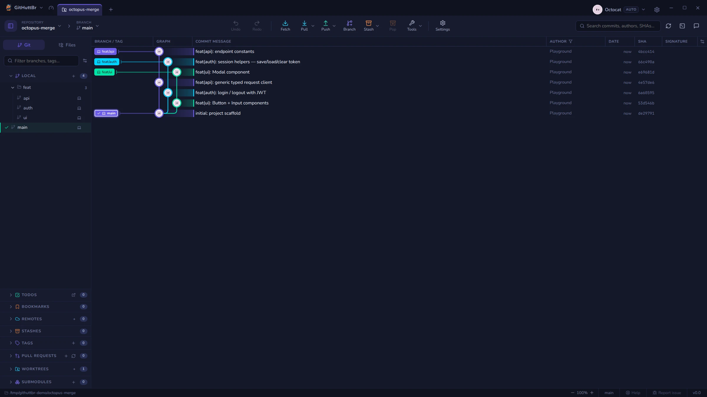
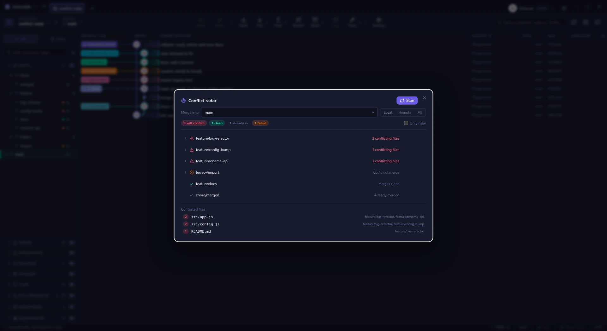
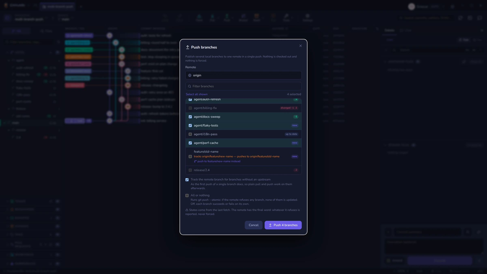
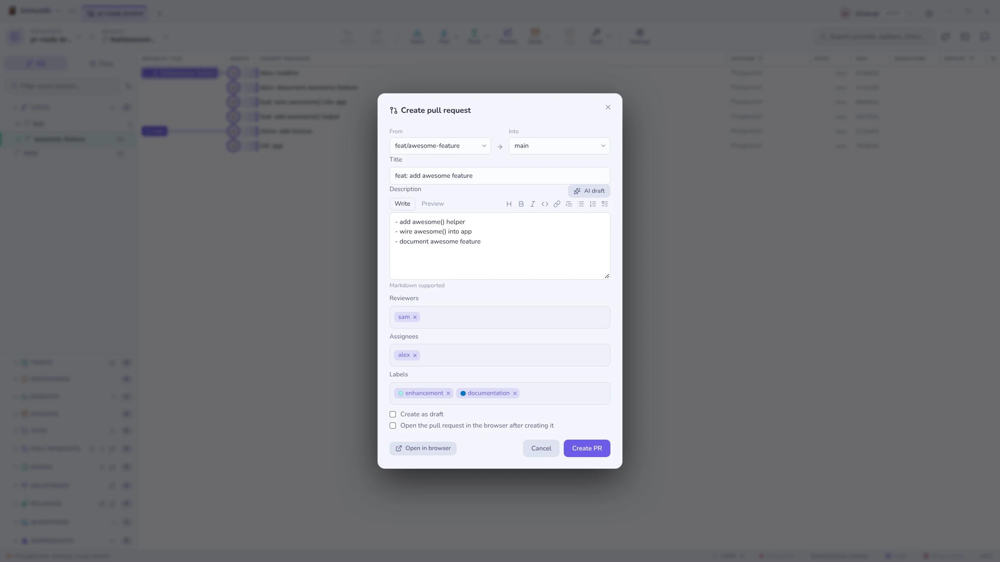

<div align="center">


# GitHuttBr

**A Git client for macOS, Windows and Linux.**

_The whole of git — graph, staging by line, rebase, worktrees, submodules, LFS — with a UI that shows you git instead of hiding it._

[](https://github.com/StarleyDev/githuttbr/releases)
[](LICENSE)




</div>

---

> [!WARNING]
> **Honest disclaimer.** GitHuttBr is young. **GitHub** is the battle-tested path,
> and the only one with Projects fields. The pull request page — review, comment,
> approve, merge — also works on **GitLab**, **Forgejo**, **Azure DevOps** and
> **Bitbucket Data Center**; on bitbucket.org you can list and create pull requests,
> but review still opens in the browser. Issues, milestones, releases and the
> notifications inbox are GitHub and Forgejo only. **GitHub Enterprise Server,
> self-managed GitLab and Bitbucket Data Center are beta**: tested against simulated
> servers, not yet against real ones. OpenAI and Anthropic each speak their own
> API; the remaining AI providers use an OpenAI-compatible call shape and are
> unverified. If it breaks: well, **it works on my machine**. PRs welcome. 💜

## Install

Grab the latest build from **[Releases](https://github.com/StarleyDev/githuttbr/releases)**.
The app then updates itself from those releases, on Linux, Windows and macOS.
Updating across 4.59, the release that gave GitHuttBr its own identity? See
**[Upgrading](docs/help/upgrading.md)**.

macOS needs **13 Ventura or later** (Electron no longer supports macOS 12). The macOS
build is signed with a Developer ID and notarized by Apple, so it opens like any other app.

Then, optionally, open repositories from your terminal:

```sh
githuttbr .                      # open this folder
githuttbr ~/code/api -n "API"    # …with a display name
githuttbr . -g "Work"            # …inside a group tab
```

Install the shim from the command palette: `⌘K` → **Install 'githuttbr' command in PATH**.

## What you get

A complete client, not a subset. Everything below is built, documented and in
the app today — the ordinary things done properly, which is most of what using
git actually is.

### Reading history

| | |
|---|---|
| **[Command palette](docs/help/search.md)** (`⌘K`) | Fuzzy-jump to any branch, commit, file or action. |
| **[Commit graph](docs/help/graph.md)** | Octopus merges drawn properly, windowed for huge histories, focus modes (linear, hide merged branches, solo), "new since last fetch" marks. |
| **[Code search](docs/help/search.md)** (`⌘⇧F`) | `git grep` across the tree, or a history pickaxe. |
| **[Blame & history](docs/help/blame.md)** | Per-file, with follow-the-line and "reblame before this commit". |
| **[Diffs & previews](docs/help/diffs.md)** | Split or unified, word-level highlights, code that only moved marked as moved, image diffs. |
| **[Semantic diff](docs/help/semantic-diff.md)** | What changed symbol by symbol — `startServer` → `bootServer` instead of a red/green wall, parsed with tree-sitter. |
| **[What changed since](docs/help/range-diff.md)** | Someone force-pushed the branch you reviewed: `git range-diff` pairs the old and new commits, the old ones read from the reflog. |
| **[Compare any two refs](docs/help/merging.md#compare-any-two-refs)** | Branch, tag or SHA against a base, in the centre pane: everything at once or one commit at a time, a file list beside the diff so a huge comparison still scrolls, and Create PR from there. |
| **[Commit notes](docs/help/notes.md)** | Annotate a commit that is already pushed, without rewriting it. |
| **[Signed commits](docs/help/signing.md)** | GPG, SSH or X.509 signing per repository, with a verification badge on every commit. |
| **[Time machine](docs/help/time-machine.md)** | Drag a slider and watch the repository itself change, commit by commit — HEAD never moves. |
| **[Timelapse](docs/help/timelapse.md)** | Replay the repository's whole life as an animation, and export it. |
| **[Teammate radar](docs/help/teammate-radar.md)** | Who moved what upstream since the last fetch — and whether it lands on files you are editing right now. |
| **[Insights](docs/help/insights.md)** | Commits/day, contributors, weekly churn, file hotspots. |

### Changing code

| | |
|---|---|
| **[Commit composer](docs/help/committing.md)** | Conventional, [Gitmoji](docs/help/committing.md#gitmoji) (all 75, searchable in your language), Gitmoji + Conventional with the emoji following the type, Ticket, Plain… even Caveman. Co-author picker, message recall, live linter. Amend and undo from the graph menu prefill it. Other tools' `:sparkles:` subjects read as ✨ across the history views. |
| **[Staging](docs/help/staging.md)** | Whole files, hunks, or **individual lines** — and the same precision to [unstage, discard, revert or apply](docs/help/staging.md#hunk-and-line-actions) one hunk or a few lines, each undoable. File-list headers split the count by modified / added / deleted. |
| **[Stashes](docs/help/stashes.md)** | Stash only the files you tick, apply just some of a stash's files or one hunk, or turn a stash into a branch. |
| **[Absorb](docs/help/absorb.md)** | Send each staged review fix to the unpushed commit that introduced the line — `fixup!` commits, folded in by an autosquash rebase if you want. |
| **[Conflict radar](docs/help/conflict-radar.md)** | Which branches will conflict with a base *before* you merge any of them — merged inside the object database, nothing checked out. |
| **[Conflict resolver](docs/help/conflicts.md)** | Three panes, per-line picking, a conflict-by-conflict navigator, editable output. |
| **[Xcode project merge](docs/help/conflicts.md)** | A `project.pbxproj` conflict merged by object identity instead of by line — and refused, by name, where a build setting genuinely diverged. |
| **[Lockfile conflicts](docs/help/conflicts.md)** | `Podfile.lock`, `Package.resolved`, `yarn.lock` and friends: take a side, and the command that regenerates it, instead of merging a graph nobody solved. |
| **[External diff & merge tools](docs/help/diff-tools.md)** | Hand a file to Kaleidoscope, Beyond Compare, Meld — read straight from git's own tool list. |
| **[Edit any commit](docs/help/commit-edit.md)** | Rewrite a past commit's files or message in place — cascade previewed before anything moves, merges replayed with their recorded resolutions. |
| **[Interactive rebase](docs/help/rebase.md)** | Drag to reorder, squash, fixup, reword, edit or drop. |
| **[Drop a branch on another](docs/help/merging.md#drag-one-ref-onto-another)** | Fast-forward, merge, rebase, interactive rebase, push to its remote branch, reset, open a pull request (pushing first if needed) or compare — in the sidebar, on the graph's badges, or from one to the other. Only what git would accept is offered. |
| **[Drop a commit on a branch](docs/help/merging.md#drag-a-commit-onto-a-branch)** | Drag a commit from the graph onto a branch: cherry-pick it there, or move the branch to it — confirmed first, and undoable. |
| **[Stacked branches](docs/help/stacks.md)** | Graphite-style chains, edited as a route: a start branch and one stop per level, added, swapped, reordered or removed from typeaheads — then one click pushes every level and opens/retargets the chained PRs, registering them as a **native GitHub stack** where that exists and carrying stack navigation in every body where it does not. |
| **[Branch cleanup](docs/help/branch-cleanup.md)** | Delete the local branches merged PRs left behind — upstream gone on the server, or already in `main` — ticked only when no commit would be lost, in one undoable step. |
| **[Git flow](docs/help/gitflow.md)** | Start and finish features, releases and hotfixes — merges, tag and cleanup in one step, undoable. |
| **[Changelog generator](docs/help/changelog.md)** | Conventional commits between two refs — latest tag → HEAD by default — grouped into a changelog, breaking changes first, ready to prepend to `CHANGELOG.md`. |
| **[Merge options](docs/help/merge-options.md)** | `-X ours`, whitespace-blind merges, squash, `-s subtree` — and the commits behind a conflict. |
| **[Recovery](docs/help/recovery.md)** | Reflog, WIP snapshots of the whole tree — untracked files included, taken automatically before every destructive action — guided bisect, or hand the search to `git bisect run`, and one-click removal of the stale `.lock` file a crashed git left behind. |
| **[Local CI](docs/help/local-ci.md)** | Run the repo's GitHub Actions on your machine with [act](https://nektosact.com) before pushing — including against a commit or range you're not on, via throwaway worktrees, with the run cost stated up front. |
| **[CI runs](docs/help/ci-runs.md)** | Follow GitHub Actions, GitLab pipelines, Azure Pipelines and Forgejo Actions without leaving the app — jobs, steps and the end of each log, with re-run, cancel and *run workflow* — plus CI badges on every host's commits in the graph. |
| **[Remove a file from history](docs/help/history-purge.md)** | A leaked key or a 400 MB blob out of every commit — measured first, backed up, undoable. |
| **[File attributes](docs/help/attributes.md)** | `.gitattributes` with a UI: line endings, `merge=union`, `export-ignore`, readable diffs for Word, Excel, JSON and the UTF-16 `.strings` git calls binary (converter included), and clean/smudge filters gated behind a dry run. |
| **[Replace & graft](docs/help/replace.md)** | Shorten a clone's history without rewriting a byte — reversible, and honest about what it hides. |
| **[Object explorer](docs/help/objects.md)** | Walk blobs, trees, commits and refs — the layer beneath the graph, read-only. |
| **[Repository maintenance](docs/help/maintenance.md)** | Where the disk went — packed, loose, unreachable — and what gc, repack, prune or fsck would do about it. |
| **[Remove untracked files](docs/help/clean.md)** | `git clean` as a dry run: every path sized, ignored files apart and unselected, Trash by default. |

<div align="center">

</div>

### Many repositories, and your hosts

| | |
|---|---|
| **[Repositories](docs/help/repositories.md)** | Every repository GitHuttBr has ever opened, plus folders you scan, in one searchable list — open, favourite, recent, and per workspace. [Scanned repositories](docs/help/repositories.md#scanned-repositories) in the Open window opens several from those folders at once. |
| **[Mission control](docs/help/mission-control.md)** | Every repository of the workspace on one screen, worst first — blocked, then to sync, then dirty — with a fetch for just the stale ones. |
| **[Clone many at once](docs/help/cloning.md#several-repositories-at-once)** | Tick several repositories in a host tab, or select all shown, and clone them into one folder — a few at a time, in a corner tray that keeps going after the dialog closes, each with its own cancel. |
| **[Go to repository](docs/help/workspaces.md#going-to-a-repository)** (`⌘J`) | Jump to any open repository by name, folder or branch — group members included, most recently used first. Switching is instant even next to a huge `node_modules`: the file watcher follows only what git tracks, and a bar under the toolbar shows while the repository you switched to catches up. |
| **[Groups & workspaces](docs/help/workspaces.md)** | Tabs with folders nested to any depth, colour-coded, fetch-all per subtree. Browser-like tab sizing, opt-in auto-grouping of [worktrees](docs/help/worktrees.md#grouping-worktrees-in-the-header). [Right-click a repository](docs/help/repo-menu.md) for alias, worktrees, GitHub, terminal and remove. |
| **[Tab images](docs/help/repo-settings.md#tab-image)** | Give a repository a small picture from its own files, and show tabs as image, name or both. |
| **[Pull or push any branch](docs/help/syncing.md)** | Catch a branch up or publish it from its right-click menu, without checking it out first. |
| **[Push several branches at once](docs/help/syncing.md#pushing-several-branches-at-once)** | Tick the branches you want and push them all to one remote in a single push. Each branch shows whether it is ahead, new or diverged, the secret guard checks every branch, and nothing is ever forced. |
| **[Untracked-branch repair](docs/help/syncing.md)** | A pull that stops on "no tracking information" offers the fix as a button — link the branch to its remote, or push it if the remote has never seen it. |
| **[Pull requests](docs/help/hosting.md)** | Create on GitHub, GitLab, Bitbucket, Azure DevOps and Forgejo, with [reviewers, assignees and labels](docs/help/hosting.md#reviewers-assignees-and-labels) picked from the host's own lists where the host has them; the new one is [listed in the app](docs/help/hosting.md#after-you-press-create), and the browser opens only if you ask. Review on GitHub, GitLab, Forgejo, Azure DevOps and Bitbucket Data Center in a [page of its own](docs/help/hosting.md#reviewing--github-and-gitlab), on the repository's tab or group chip: conversation, each file's diff, checks, an AI review of the host's diff, and a sidebar with reviewers and their decisions, labels, branches and size. A 👁 marks the ones [waiting for your review](docs/help/hosting.md#waiting-for-your-review). Each profile [links its own account](docs/help/hosting.md#tokens) — a token, or a login git's credential helper or the GitHub CLI already holds. |
| **[Preview a pull request](docs/help/pr-preview.md)** | Run someone else's pull request on your machine — forks included, on any host — without committing anything. |
| **[Pull requests page](docs/help/pull-requests.md)** | Every pull request of a repository on one page — open, drafts, merged, closed — filtered by author (*Me* first), reviewer (*review requested from me*), target branch and failing CI; inside a pull request, ‹ › and Alt+← / Alt+→ walk the filtered list it came from, and its branch names [check the branch out](docs/help/pull-requests.md#going-to-a-pull-requests-branch) — fetching it when only the server has it; a [Commits tab](docs/help/pull-requests.md#commits) opens each commit in the graph or fetches the branch it is on; an [Updates tab](docs/help/pull-requests.md#updates) lists each push — force pushes marked, what is new since your last visit badged — and shows what one push alone changed; its files read [as a tree](docs/help/pull-requests.md#reading-the-files), ticked off as viewed by file or by folder, with images shown before and after and each path one click from your clipboard or editor; the page keeps your place and unsent text until you close it; any line of its diff takes a [comment of its own](docs/help/pull-requests.md#commenting-on-a-line); your own comments can be [edited or deleted](docs/help/pull-requests.md#editing-and-deleting-your-comments) in place; comments are [drawn as Markdown](docs/help/pull-requests.md#how-comments-are-shown), with images from other sites held back until clicked; and pointing at a `#123` or `AB#123` shows [its title and state](docs/help/pull-requests.md#what-a-123-or-ab123-is-about). |
| **[Writing comments](docs/help/writing-comments.md)** | Every comment box — pull requests, issues, thread replies, line comments, new PR and issue descriptions — is a Markdown editor with Write / Preview, GitHub's toolbar and shortcuts, lists that continue on Enter, and @mention / #reference completion. |
| **[Issues, milestones & notifications](docs/help/hosting.md#issues-milestones-releases--github-and-forgejo)** | On GitHub and Forgejo: issues with a *create a branch for this issue*, milestones, releases, and the [notifications inbox](docs/help/hosting.md#notifications--github-and-forgejo) behind the toolbar bell. |
| **[Azure Pipelines checks and logs](docs/help/hosting.md#reviewing--github-and-gitlab)** | Build-validation policies appear alongside PR statuses. Read failed tasks or job logs from the Checks tab. |
| **[Errors that explain themselves](docs/help/syncing.md#when-the-host-refuses)** | A push refused for a missing `workflow` scope, a 100 MB file, a protected branch or a missing credential says why and what to do, in your language — git's raw text one click away. |
| **[A profile per repository](docs/help/profiles.md#per-repository-binding)** | Bind a repository to a profile, and every hosting action on it — fetch, push, the pull request pages, creating PRs, CI badges, issues — runs as that profile, whichever one is active. |
| **[GitHub Enterprise Server](docs/help/hosting.md#github-enterprise-server)** *(beta)* | Add your company's self-hosted GitHub: pull requests, issues, checks, releases and push sign-in work there, each server with its own token that is never sent anywhere else. |
| **[Self-managed GitLab](docs/help/hosting.md#self-managed-gitlab)** *(beta)* | Add your company's GitLab servers — as many as you work with — next to gitlab.com in one profile: merge requests, the clone browser and push sign-in work on each, and each server's token is only ever sent to that server. |
| **[Bitbucket Data Center](docs/help/hosting.md#bitbucket-data-center)** *(beta)* | Your company's self-hosted Bitbucket: pull requests with review, comments, approve and merge (merge checks respected), build status in the graph, and push sign-in — each server with its own HTTP access token that is never sent anywhere else. |
| **[Forgejo](docs/help/hosting.md#forgejo)** | Your own Forgejo or Gitea server, or Codeberg: push sign-in, open and create pull requests, clone and create repositories — the token only ever goes to that server. |
| **[Azure Boards work items](docs/help/branching.md#a-branch-from-an-azure-boards-work-item)** | Start a branch from a work item's number, named from its type and title — and `AB#1234` in commits and pull requests links to the item. |
| **[Plumbing, with a UI](docs/help/lfs-sparse.md)** | [Tags](docs/help/tags.md) (lightweight, annotated or signed), [worktrees](docs/help/worktrees.md#looking-after-worktrees) (with what each one holds, lock, move and repair), [submodules](docs/help/worktrees.md#submodules), LFS, sparse-checkout, patches, [hooks and `.gitignore`](docs/help/hooks.md). |
| **[Subtrees](docs/help/subtree.md)** | Vendor another repo into a directory — and remember where it came from, which git does not. |
| **[Bundles & archives](docs/help/export.md)** | The repository as one file git can clone from — or a tree as a zip, honouring `export-ignore`. |
| **[Credential helper](docs/help/credentials.md)** | Git's own password store — why https keeps asking, and the plaintext file nobody meant to have. Launched from an editor's terminal, git never borrows that editor's sign-in window. |
| **[Remote sign-in check](docs/help/credentials.md#which-account-a-push-uses)** | Right-click a remote: see the account and token scopes for each push destination, including separate push URLs. |
| **[Token in a remote URL](docs/help/credentials.md#a-password-saved-in-the-remote-url)** | An old clone with `user:token@` in its remote URL ignores your profile's token. GitHuttBr flags it, explains the failing push, and takes it out of `.git/config` once you confirm. |
| **[Environment check](docs/help/environment.md)** | Git version, LFS, the native terminal, git's credential helper, the GitHub CLI's `workflow` scope and the inotify limit — checked in one place, each fix a command to copy. |
| **[SSH keys](docs/help/ssh-keys.md)** | See which key the agent is holding, generate one, test the host — the auth path tokens never covered. |

<table>
<tr>
<td></td>
<td></td>
</tr>
<tr>
<td></td>
<td></td>
</tr>
</table>

### AI, optional and grounded

Commit messages, PR descriptions and branch names from the actual diff ·
[hover to explain](docs/help/ai.md) an identifier ·
[AI edit](docs/help/ai.md) of just the lines you select, applied to the editor
draft for review · [PR review](docs/help/ai.md)
whose findings must anchor to a real `path:line` or get rejected ·
a [repo wiki](docs/help/repo-wiki.md) where every claim cites its file ·
[**repository chat**](docs/help/repo-chat.md) that answers from files and commits
you pin as context, asks for more evidence instead of guessing, links every answer
back to the lines it read, and can propose Git actions — up to merge, rebase,
revert, cherry-pick, and opt-in push, pull request and
[stacked-PR submit](docs/help/stacks.md) — plus reviewed file CRUD, each drawn as
a widget you approve under always-ask, auto-safe, or auto-all rules and can undo
as one plan (or from an error toast's "fix with AI").
[**Several accounts at once**](docs/help/ai.md) — an OpenAI key for commit
messages, Claude for chat, a local Ollama for the rest — with model lists fetched
live from each provider. OpenAI, Anthropic, Google Gemini, OpenRouter, Groq,
Mistral, Ollama, any compatible endpoint, or a [signed-in CLI](docs/help/ai.md)
you already pay for. Connect your [ChatGPT or Claude subscription](docs/help/ai.md#using-a-subscription-instead-of-an-api-key) during onboarding or in Settings → AI.
A provider is [tested before it is saved](docs/help/ai.md#adding-and-editing-a-provider), and each one shows whether it is ready, missing a key or not responding.
The status bar names [the AI in use](docs/help/ai.md#the-ai-in-use-from-the-status-bar) for the profile — general or its own — and switches its provider in one click.

### Make it yours

<div align="center">

</div>

[Themes](docs/help/themes.md) in light and dark, plus **AI-generated** ones ·
[the interface in your language](docs/help/languages.md), picked by flag and its
own name, with a mirrored layout for Arabic and Hebrew ·
[screen-reader and keyboard accessibility](docs/help/accessibility.md) ·
[rebindable shortcuts](docs/help/keyboard.md) ·
[settings search](docs/help/themes.md#finding-a-setting) — type part of a setting's
name and land on it, in your language or in English ·
[a native macOS menu bar](docs/help/menu-bar.md) that shows the keys you actually
bound · [profiles](docs/help/profiles.md)
for separate identities and accounts, each linking its own ·
[author avatars](docs/help/avatars.md) — Gravatar, then the author's GitHub
picture, then a generated blob drawn offline, and a title-bar face that reacts to
conflicts, half-finished rebases, a detached HEAD and piles left to grow — or
[your own picture](docs/help/avatars.md#your-profiles-picture): your account's, an
icon, or an image ·
[integrated terminal](docs/help/terminal.md) in [your shell or one you pick](docs/help/terminal.md#which-shell-starts) with splits, and
[suggestions](docs/help/terminal.md#script-suggestions) for `npm run` scripts, `make` targets
and branch names ·
[**A real CLI**](docs/help/cli.md) — `githuttbr .` opens a repo, `githuttbr blame
src/api.ts -l 84` opens it *there*, `githuttbr doctor` answers in the terminal with
an exit code your CI can use, and `githuttbr editor install` makes GitHuttBr the
editor `git commit` and `git rebase -i` open ·
[**Repository rules**](docs/help/repo-config.md) — an optional `.githuttbr.json`
carries the house rules with the clone: protected branches, commit scopes,
tracker links, a push checklist, and a doctor that tells a newcomer why the
project does not run yet ·
[**Todos**](docs/help/todos.md) — a private checklist per repository, marked in
the sidebar and the status bar, and never written into the repo ·
[**Sidebar panes**](docs/help/branching.md) — open sections share leftover height
equally, each scrolling on its own; collapsed ones stay as headers, so they
never drift off screen ·
[**One sidebar filter**](docs/help/branching.md#one-filter-for-every-section) —
narrows every section at once, counting "2 of 10" per header and folding the
empty ones away ·
[**Bookmarks**](docs/help/bookmarks.md) — remembered places in the code that
re-locate themselves when the line moves, and say so when it is gone ·
[**Open in your editor**](docs/help/editor.md) — repo, file, or the exact line
you right-clicked, with [Xcode projects and other packages](docs/help/editor.md)
treated as one item rather than a folder to dig through ·
[**Problems**](docs/help/problems.md) — what your project's own analyzers
(`tsc`, `dart analyze`, ESLint, Clippy, `go vet`, Ruff) say, in a dock at the
bottom, with a toggle for "only the files I changed", and a
[Tests](docs/help/problems.md#tests) tab that runs the suite and opens a failure at its line ·
[**Code TODOs**](docs/help/code-todos.md) — every `TODO`, `FIXME` and `HACK` the
source carries, in the same dock, grouped by tag, by folder, or by the owner in
`TODO(cgm)` ·
[**Run & debug**](docs/help/launch.md) from your `.vscode/launch.json` —
inputs that read current values from JSON/YAML files, compounds as parallel
sessions, `stopAll`, `serverReadyAction`, a
[hot reload](docs/help/launch.md) button for the runtime you actually launched,
and a [run target](docs/help/launch.md) picker for the phone or simulator ·
[**Dev tools**](docs/help/devtools.md) embedded on the repository's own tab —
Flutter DevTools, `dart devtools`, Prisma Studio and friends, from the address
the session announces ·
[previews](docs/help/diffs.md) for Markdown, Word, Excel, PDF, video and images —
plus `Info.plist` and `.entitlements` as a key/value outline, and a
`project.pbxproj` as the targets, file tree and build settings it really is ·
[open-source licenses](docs/help/licenses.md) for every package the build ships,
readable in the app.

## Your secrets stay yours

GitHuttBr has no backend. Tokens and [vault](docs/help/vault.md) entries are
encrypted with your **OS keychain** — and before it ever touches that keychain it
tells you what for and lets you say no; the app keeps working either way. Nothing
is synced or phoned home. The only network calls are to your Git host and, if you
turn it on, your AI provider. Details in [Security & secrets](docs/help/security.md).

A few of the guards, each with its section in that page:

| | |
|---|---|
| **[Tokens git never sees in plain sight](docs/help/security.md#a-profiles-token-while-git-runs)** | A profile's token reaches git through a private, per-operation endpoint — not `.git/config`, not the command line, not the environment every hook inherits. |
| **[One token, one server](docs/help/hosting.md#github-enterprise-server)** | A github.com, Enterprise Server, GitLab or Data Center token is only ever sent to the server it was saved for. |
| **[A keychain prompt you dismiss wipes nothing](docs/help/security.md#when-the-saved-tokens-cannot-be-read)** | Unreadable saved tokens are left untouched — retry, or start a new store with the old one kept as a backup. |
| **[A damaged settings file is never overwritten](docs/help/security.md#the-settings-file)** | Settings are written atomically; a file that cannot be parsed stops the app with *Try again* or *move it aside*, instead of silently resetting to defaults. |
| **[Roll back a bad update](docs/help/rollback.md)** | *Beta.* A last resort while a fix is on its way: Settings → About offers the three previous versions — report the bug, then one click copies your settings, installs the older version and stops offering the one you left, and a newer version's settings survive the trip. |
| **[AppImage paths that outlive the app](docs/help/security.md#the-appimage-and-paths-that-outlive-it)** | The AppImage refuses to write its temporary mount path into the `githuttbr` shim or a diff converter, and flags stale ones it finds. |
| **[Export only what the other machine needs](docs/help/security.md#choosing-what-to-export)** | Pick the parts a settings file carries — a full backup, profiles for another computer, or preferences for the team — with credentials only when you opt in. |
| **[Import without losing what is only here](docs/help/security.md#choosing-what-to-import)** | Profiles merge with yours instead of replacing them, repository paths are translated between machines, and anything that would be deleted is named and confirmed first. |
| **[No keyring, no weak storage](docs/help/security.md#linux-without-a-keyring)** | On Linux without GNOME Keyring or KWallet, new tokens stay in memory instead of a store anyone could unscramble — and the app says so. |

Team sharing works the same way: [secure share](docs/help/secure-share.md) packs
secrets, commit notes, and whole workspace layouts into one encrypted file a
teammate imports — no server in between.

## The handbook

**Built into the app**, in every language it speaks — the **Help** button in the
status bar, or `⌘K` → *Help*. It is the same Markdown you can
[read right here in the repository](docs/help/getting-started.md), offline and
versioned with the code.

Contributions welcome — **[CONTRIBUTING.md](CONTRIBUTING.md)** has the working
agreement: commit format, the translation rule, the test fixtures, and when a
change has to update the handbook.

## What's next

**[ROADMAP.md](ROADMAP.md)** — what might come next, what it would cost, and what
is deliberately out of scope. Ideas welcome as
[issues](https://github.com/StarleyDev/githuttbr/issues).

## Sponsor

If GitHuttBr saves you an afternoon of `git reflog`, consider
[sponsoring its development](https://github.com/sponsors/StarleyDev). 💜

## License

Apache 2.0 — see [LICENSE](LICENSE) and [NOTICE](NOTICE).
---

<div align="center">

Made by **[Starley - Mestre Jedi](https://github.com/StarleyDev)** with 💜

</div>
