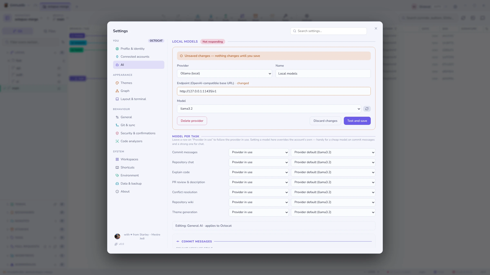

# ميزات الذكاء الاصطناعي

كل ميزة ذكاء اصطناعي **اختيارية** ومعطَّلة حتى تضبط مزوّدًا. ولا يُرسل شيء إلى
أي مكان حتى تطلب شيئًا محددًا.

## ذكاء اصطناعي واحد لكل الملفات الشخصية

يُضبط الذكاء الاصطناعي مرة واحدة، في **الإعدادات ← الذكاء الاصطناعي**، ويستخدمه كل
[ملف شخصي](profiles.md): الملف الذي تنشئه لاحقًا يملك الذكاء الاصطناعي من البداية،
بلا حساب تضيفه من جديد. تسرد الصفحة كل ملف شخصي وما إذا كان يتبع هذا **الذكاء
الاصطناعي العام**.

يمكن لملف شخصي أن يستخدم **ذكاءه الخاص** بدلًا من ذلك — ملف عمل لا بد أن يمر عبر
حساب الشركة، لأسباب التكلفة أو سياسة البيانات، أو يكتب التزاماته بطريقة أخرى. في
صفحة **الملف الشخصي** لذلك الملف، تحت *الذكاء الاصطناعي لهذا الملف الشخصي*، بدّل
**عام** إلى **خاص**: يبدأ نسخةً من الذكاء الاصطناعي العام كاملًا — الحسابات
والمفاتيح والتفضيلات — ومن ثم يصبح كل ذلك للملف وحده. والعودة إلى **عام** تحذفه،
بعد تأكيد، وتترك الذكاء الاصطناعي العام كما كان.

يستخدم الملف الشخصي ذكاءً اصطناعيًا واحدًا **بالكامل**: العام أو الخاص به، ولا
خليط أبدًا. الحسابات والنماذج، *وكذلك* طريقة كتابة الذكاء الاصطناعي وما يُسمح
للدردشة بفعله، تأتي كلها من المكان نفسه، لذا فإن تغيير نمط الالتزام في الذكاء
الاصطناعي العام يغيّره لكل ملف شخصي يتبعه.

كل ذكاء اصطناعي يُضبط في هذه الصفحة الواحدة. يختار شريط **يتم تعديل** في الأعلى
أيّها: الذكاء الاصطناعي العام، أو الذكاء الخاص بملف شخصي (*الذكاء الخاص بـ
العمل*). زر **إعداد الذكاء الخاص** في صفحة الملف الشخصي، أو **تعديل ذكائه
الخاص** في قائمة الملفات الشخصية، يفتح الصفحة عليه مباشرة. أما صفحة الملف الشخصي
نفسها فتعرض فقط أي ذكاء اصطناعي يستخدمه الملف وما الذي يجيب — ولا تستضيف المحرر
أبدًا، ولا تحمل أي خيار للذكاء الاصطناعي خاص بها.

تحت الحسابات، تضم الصفحة نفسها طريقة **كتابة** ذلك الذكاء الاصطناعي وما يُسمح له
بفعله، في أقسام:

| القسم | يضم |
|---|---|
| **رسائل الإيداع** | نمط الإيداع — Conventional وGitmoji والتذكرة كبطاقات مع سطر مثال، والبقية تحت «أنماط أخرى» — «توليد وصف الالتزام»، وسطر المؤلف المشارك، و**قواعد إضافية للإيداعات**، ومعاينة |
| **الشرح والتمرير** | نمط الشرح، *شرح الشيفرة عند التمرير* ومفتاح التعديل الخاص به |
| **التعارضات والفروع** | نمط حل التعارضات، نمط تسمية الفروع، ولكل منهما مثال على النتيجة |
| **دردشة المستودع** | هل الدردشة مفعّلة، وما الذي تقرؤه، والإجراءات التي يمكنها اقتراحها — انظر [دردشة المستودع](repo-chat.md#الإعدادات) |

يذكر سطر فوق الأقسام أيّ ذكاء اصطناعي تعدّله ومن يشمل: *الذكاء الاصطناعي العام ·
ينطبق على العمل والشخصي*، أو الخاص بملف شخصي واحد.

**قواعد إضافية للإيداعات** — «تعليمات مخصصة» حتى الإصدار 4.60 — تُضاف إلى توليد رسائل الإيداع فقط: الدردشة والشروح والمراجعات وأسماء الفروع لا تقرؤها. المعاينة مثال ثابت وليست استدعاءً للنموذج: تُظهر شكل النمط المختار، لا ما سيكتبه الذكاء الاصطناعي لتغييرك.

مفتاح النمط في المؤلِّف ومنتقيا النموذج والموافقة في الدردشة تكتب كلها في الذكاء
الاصطناعي نفسه الذي يقرؤه الملف الشخصي: العام، أو الخاص بالملف.

الترقية من إصدار كان فيه لكل ملف شخصي ذكاؤه الخاص لا تُفقد شيئًا: يصبح ذكاء الملف
المستخدم هو الذكاء الاصطناعي العام، وكل ملف آخر كان ذكاؤه مختلفًا يحتفظ به ذكاءً خاصًا.

**الترقية من 4.59 أو أقدم**، حين كانت تفضيلات الكتابة محفوظة في كل ملف شخصي: مرة
واحدة، تنتقل تفضيلات الملف المستخدم (أو، إن كان له ذكاء خاص، تفضيلات أول ملف على
الذكاء الاصطناعي العام) إلى الذكاء الاصطناعي العام. وتحتفظ الملفات ذات الذكاء
الخاص بتفضيلاتها. **الحد:** إذا كان ملفان على الذكاء الاصطناعي العام يكتبان بشكل
مختلف — ملف عمل بنمط `ticket` وملف شخصي بنمط `conventional` — فسيكتب كلاهما الآن
مثل الملف الذي نُقلت تفضيلاته. للإبقاء على الفرق، امنح أحدهما ذكاءً خاصًا واضبط
نمطه هناك من جديد.

## المزوّدون

**الحساب** طريقة واحدة للوصول إلى نموذج: مزوّد، وأين تبلغه، وكيف يستوثق. يمكنك
إعداد عدّة حسابات تتعايش معًا — مفتاح للعمل، وآخر شخصي، ونموذج محلي، وواجهة أوامر
سجّلت الدخول إليها من قبل.

تغطّي الإعدادات الجاهزة **OpenAI وAnthropic وGoogle Gemini وOpenRouter وGroq
وMistral** و**Ollama** (محلي بالكامل)، إضافة إلى أي نقطة نهاية متوافقة مع OpenAI.

**لا يغادر المفتاح هذا الجهاز دون تشفير أبدًا.** يصل الحساب الذي له مفتاح إلى
نقطة النهاية عبر `https://`، أو عبر `http://` العادي على هذا الحاسوب فقط
(`localhost` و`127.x` و`::1`). أي استدعاء كان سيرسل المفتاح عبر `http://` إلى
مضيف آخر يُرفض قبل أن يخرج شيء، ويقول ذلك. أما نقطة النهاية التي بلا مفتاح —
Ollama على جهاز آخر في شبكتك — فتظل تعمل عبر `http://`.

يستخدم Anthropic واجهته `/v1/messages` بدل نداء على شكل OpenAI، لذا تعمل نماذج
Claude فعليًا بدل أن تبدو عاملة فحسب. أما Gemini فيُبلَغ عبر نقطة نهاية Google
المتوافقة مع OpenAI.

### قائمة المزوّدين

كل مزوّد محفوظ بطاقة: حرف لمزوّده، واسمه، وتحته ما يستخدمه فعلًا — فيمكن التمييز
بين حسابين للمزوّد نفسه دون فتح أيٍّ منهما.

| نوع المزوّد | السطر الثاني |
| --- | --- |
| اشتراك أو CLI محلي | `CLI claude · sonnet` — الأمر ثم النموذج |
| Ollama أو خادم مخصّص | `http://localhost:11434 · qwen3:8b` — العنوان ثم النموذج |
| واجهة API مستضافة | `gpt-4o-mini · 41 نموذج` — النموذج، وعدد النماذج التي سردها المزوّد |

لا يظهر عدد النماذج إلا بعد أن يسرد المزوّد نماذجه؛ القائمة المضمّنة التي يرجع
إليها GitHuttBr تخمين وليست عدًّا. شارة الحالة على الطرف الآخر. البطاقة التي
تحرّرها لها حافة بلون التمييز؛ والتي لا تستجيب لها حافة حمراء وسببها تحت الاسم،
منتهيًا بـ **اختبر مجددًا**. انقر على بطاقة لفتحها في المحرّر أسفل القائمة.

### إضافة مزوّد وتعديله

كان المزوّد المحفوظ نصف مكتمل فخًّا صامتًا: قد ينتهي مفتاح فارغ قيد الاستخدام، ولا
يجيب شيء. لذلك لا يُحفظ شيء في هذه البطاقة أثناء الكتابة.

يفتح **إضافة مزوّد** بطاقة موسومة **مسودة · غير محفوظة** بحافة متقطعة. املأ
المزوّد والمفتاح ونقطة النهاية والنموذج ثم اختر **اختبار وحفظ**. يسرد
GitHuttBr أولًا نماذج المزوّد بهذا المفتاح — الطلب نفسه الذي يرسله
زر التحديث بجانب **النموذج** — ولا يحفظ إلا إذا أجاب. سترى **متصل · N نموذج**، وينضم
المزوّد إلى القائمة بحالة **جاهز**.

إذا فشل الاختبار تعرض البطاقة **تعذّر الاتصال** مع سبب المزوّد
(مفتاح مرفوض، `401`؛ خادم لا يعمل) و**لم يُحفظ أي شيء.** صحّح الحقل واختبر
مجددًا، أو اختر **احفظ على أي حال** لإبقائه كما هو — فيظهر عندها بحالة
**لا يستجيب** — أو **إلغاء** الذي لا يترك أثرًا.

تعديل مزوّد محفوظ يعمل بالطريقة نفسها. يظهر شريط يقول
**تغييرات غير محفوظة — لا يتغيّر شيء حتى تحفظ**، ويُوسم كل حقل غيّرته بـ**· تغيّر**.
يعيد **تجاهل التغييرات** القيم المحفوظة؛ ويختبر **اختبار وحفظ**
ويحفظ. اختيار مزوّد آخر أو إضافة واحد أو فتح **استخدام اشتراكي** مع وجود تغييرات
معلّقة يسأل **حفظ التغييرات على «…»؟** — **حفظ** أو **تجاهل التغييرات** أو
**متابعة التعديل**. إغلاق الإعدادات يُبقي المسودة في الذاكرة فتجدها عند
عودتك؛ ولا تُكتب على القرص أبدًا.

تُحفظ المفاتيح تمامًا كما من قبل، في سلسلة المفاتيح، وعند الحفظ فقط. ويظهر خطأ
المزوّد مع إخفاء المفتاح وكل ما يشبه رمزًا مميزًا.

| نوع المزوّد | ما يتحقق منه **اختبار وحفظ** |
| --- | --- |
| مفتاح API أو خادم محلي (Ollama، نقطة نهاية مخصصة) | يسرد النماذج؛ النجاح يعني أن نقطة النهاية أجابت بهذا المفتاح |
| اشتراك (Codex، Claude Code) | يرسل موجّه الاختبار القصير الموصوف أدناه، من حصة خطتك |
| CLI محلي | يبحث عن الأمر في `PATH`؛ والمسار المكتوب يُحفظ دون تحقق |

### شارات الحالة

لكل مزوّد في القائمة شارة واحدة، مستنتجة مما تعرفه الصفحة أصلًا — آخر اختبار، أو
قائمة النماذج التي جلبتها على أي حال. لا يُستطلع شيء في الخلفية.

| الشارة | المعنى |
| --- | --- |
| **جاهز** | نجح آخر اختبار أو آخر سرد للنماذج |
| **لا يستجيب** | فشلت آخر محاولة؛ السبب في السطر التالي مع **اختبر مجددًا** |
| **لا يوجد مفتاح** | يحتاج المزوّد إلى مفتاح API وليس لديه واحد |
| **لم يُفحص** | لم يسأله شيء بعد — اشتراك حتى يُختبر، أو قائمة لم تُجلب |

**الحدّ:** الشارة حديثة بقدر آخر فحص لها. المزوّد الذي توقّف عن الإجابة قبل
ساعة يبقى **جاهز** حتى يسأله شيء من جديد — اختر
**اختبار الاتصال** في بطاقته لتتأكد. ويبقى **CLI محلي** بمسار مكتوب
**لم يُفحص**، لأن إثبات أنه يعمل يكلّف موجّهًا.

### المزوّد قيد الاستخدام

يجيب مزوّد واحد عن كل مهمة ليس لها مزوّد خاص بها في **نموذج لكل مهمة**. تنتهي
بطاقته بعلامة **قيد الاستخدام** خضراء، حيث تحمل البطاقات الأخرى **استخدام**،
وتبقى في مكانها من القائمة. الأخضر يعني قيد الاستخدام فقط: المزوّد الذي يستجيب
لكنه ليس قيد الاستخدام يقول **جاهز** بلون رمادي مزرقّ هادئ. للذكاء الاصطناعي العام وللملف الشخصي الذي له ذكاؤه الخاص مزوّد قيد
الاستخدام لكل منهما؛ والقائمة تغيّر الذي تحرّره الآن.

لكل مزوّد محفوظ آخر زر **استخدام** في طرف صفّه، بجانب شارته. نقرة واحدة تجعله
قيد الاستخدام وتحفظ فورًا: اختيار المزوّد الذي يجيب قرار وليس تعديلًا، فلا ينتظر
**اختبار وحفظ**. لا تُفتح بطاقة ذلك المزوّد، والبطاقة التي فيها تغييرات غير
محفوظة تحتفظ بها.

**الحدّ:** **استخدام** لا يختبر شيئًا. يمكن جعل مزوّد معلَّم بـ **لا يوجد مفتاح**
أو **لا يستجيب** قيد الاستخدام — عن قصد، قبل إصلاح مفتاحه — وتظل شارته تقول ذلك؛
وتفشل مهمة الذكاء الاصطناعي التالية بسبب ذلك المزوّد. المسودة ليس لها **استخدام**:
لا تصبح مزوّدًا حتى تُحفظ.

### الذكاء الاصطناعي المستخدم، من شريط الحالة

الملف الشخصي الذي له ذكاء اصطناعي خاص يتجاهل المزوّد المستخدم في الذكاء الاصطناعي العام: استخدام مزوّد آخر في الذكاء الاصطناعي العام لا يغيّر شيئًا لهذا الملف، ولم يكن شيء خارج الإعدادات يقول ذلك. شريط الحالة أسفل المستودع يقوله الآن. زر **الذكاء الاصطناعي:** _المزوّد_ يسمّي المزوّد الذي يجيب للملف الشخصي المستخدم، مع نقطة لحالته — خضراء **جاهز**، حمراء **لا يستجيب**، كهرمانية **لا يوجد مفتاح**، رمادية **لم يُفحص**. وحين تكون حالة المزوّد **جاهز** يصبح الزر كله أخضر، كي لا يبدو ذكاء اصطناعي يعمل وكأنه متوقف.

النقر عليه يفتح لوحة صغيرة:

| الجزء | ما يعرضه |
| --- | --- |
| الترويسة | الملف الشخصي المستخدم، وهل **يتبع الذكاء الاصطناعي العام** أم **له ذكاء اصطناعي خاص** |
| صف لكل مزوّد | كل مزوّد محفوظ في ذلك الذكاء الاصطناعي مع نموذجه وحالته؛ والمزوّد الذي لا يستجيب يعرض السبب في سطر ثانٍ |
| **قيد الاستخدام** / **استخدام** | المزوّد الذي يجيب الآن، والتبديل بنقرة واحدة على كل مزوّد آخر |
| **ضبط الذكاء الاصطناعي** | يفتح **الإعدادات ← الذكاء الاصطناعي** |
| **الاستخدام والتكلفة** | يفتح تبويب *التحليلات* في إعدادات المستودع |

**استخدام** يكتب حيث يقرأ الملف الشخصي ذكاءه الاصطناعي. في ملف يتبع الذكاء الاصطناعي العام يغيّر الذكاء الاصطناعي العام — ومن ثم كل ملف يتبعه؛ وفي ملف له ذكاء اصطناعي خاص يغيّر ذكاءه هو فقط. المهام التي لها مزوّد خاص تحتفظ به. **Esc** يغلق اللوحة، ويُخفى الزر ما دام الذكاء الاصطناعي متوقفًا.

**الحدود:** تُستنتج النقطة من قائمة النماذج التي جلبها التطبيق على أي حال (تُحفظ حتى يوم واحد) ولا تختبر شيئًا، لذا قد يظل مزوّد توقف عن الاستجابة يظهر **جاهز** — واختبار الاتصال في الإعدادات هو طريق التأكد. إلى أن تُفتح الإعدادات لا تحمل النافذة المفاتيح نفسها، فقد يظهر مزوّد بلا مفتاح بحالة **لم يُفحص** أو **لا يستجيب** بدل **لا يوجد مفتاح**. وكما في **استخدام** داخل الإعدادات، لا يختبر التبديل المزوّد الذي يضعه قيد الاستخدام.

### استخدام اشتراك بدل مفتاح API

في **الإعدادات ← الذكاء الاصطناعي** اختر **استخدام اشتراكي**. عند [التشغيل
الأول](first-run.md) تعثر بطاقة **اشتراكي** في خطوة الذكاء الاصطناعي على Claude
Code أو Codex وتختبره في خطوة واحدة، وتعود إلى هذا الإعداد نفسه حين لا تجد أيًّا
منهما. اختر الخطة التي تستخدمها، ثم افتح **التوثيق** لتعليمات التثبيت من
المزوّد. بعد التثبيت اختر **ربط ChatGPT (Codex)** أو **ربط Claude (Claude
Code)**. تفتح CLI المزوّد صفحة تسجيل الدخول في متصفحك وتحفظ جلستها الخاصة. يُعاد
استخدام جلسة اشتراك موجودة. يوقف **إلغاء** اتصالًا معلّقًا. تسجيل الدخول الذي
يستغرق أكثر من ثلاث دقائق يتوقف ويمكن إعادة محاولته.

| الخطة | CLI المطلوبة | تسجيل الدخول من الطرفية |
| --- | --- | --- |
| ChatGPT مع وصول إلى Codex | Codex CLI | `codex login` ثم اختر ChatGPT |
| Claude مع وصول إلى Claude Code | Claude Code | `claude auth login` ثم اختر حساب اشتراكك |

الربط يختبر الجلسة أيضًا. إن سجّلت الدخول من الطرفية فاختر **اختبار الاتصال**.
يتحقق GitHuttBr من طريقة تسجيل دخول CLI ويرسل طلب اختبار قصيرًا من مجلد مؤقت
فارغ. يُحتسب الطلب من حصة المزوّد. بعد **متصل** اختر **إضافة مزوّد**. يُعيَّن
أول حساب للذكاء الاصطناعي العام **قيد الاستخدام**. لإعداد موجود، اختر
**استخدام** في سطره أو عيّن ميزات بعينها أدناه. لتخطي الإعداد في التشغيل الأول،
اختر **تخطَّ، دون ذكاء اصطناعي** وعد إلى الإعدادات حين تكون جاهزًا.

إن لم يعثر GitHuttBr على CLI فثبّتها أو أدخل المسار الكامل لملفها التنفيذي
واختبر من جديد. إن انتهت صلاحية تسجيل الدخول أو كانت CLI تستخدم مفتاح API، فسجّل
الدخول بحساب الاشتراك. وإن بلغت حدّ الاستخدام، فانتظر حتى تتجدد حصة المزوّد.

للإعداد اليدوي، اختر المزوّد **واجهة الأوامر المحلية** ليجيب بواسطة CLI وكيل
مثبّتة ومسجَّل الدخول فيها على هذا الجهاز — `claude` أو `gemini` أو `codex` أو
`devin`. يشغّل GitHuttBr البرنامج بطلبك ويقرأ رده؛ لا مفتاح API للصقه ولا يُحفظ
أي رمز.

لا يشغّل GitHuttBr إلا أمرًا أعددته أنت كحساب، ودائمًا بقائمة وسائط لا عبر صدفة،
فلا يمكن لشيء في فرق أو في اسم فرع أن يُفهم على أنه أمر.

يشغّل كل استدعاء CLI ومجلد عملها هو المستودع، كي تتمكن CLI الوكلاء مثل Devin من
فتح الملفات التي تسأل عنها بدل الإجابة دون رؤية. أما الميزات التي لا مستودع لها
(توليد السمات) فتشغّلها من مجلد التطبيق نفسه.

> **هذا ليس أكثر خصوصية من مفتاح API.** ما زالت مطالباتك تصل إلى المزوّد نفسه،
> تحت حسابك أنت، تمامًا كما لو استخدمت مفتاحًا. ما يتغيّر هو الفوترة والإعداد، لا
> وجهة النص.

إن لم يكن الأمر ضمن `PATH` لديك، فاكتب مساره الكامل في الحساب.

### نموذج لكل مهمة

تحت **نموذج لكل مهمة**، تستطيع كل ميزة — رسائل الالتزام، والدردشة، وشرح
الشيفرة، ومراجعة طلب الدمج، وحل التعارضات، والويكي، والسمات — أن تشير إلى حسابها
ونموذجها. اترك الصف على **المزوّد قيد الاستخدام** ليتبع المزوّد المعلَّم بـ
**قيد الاستخدام**. نموذج رخيص لرسائل الالتزام وآخر قوي للدردشة هو التوزيع المعتاد.

### إشعار الترقية

عند الترقية من إصدار سابق للحسابات يظهر هذا مرّة واحدة. يصير المزوّد والمفتاح اللذان لديك أول حساب؛ ولا شيء يُعاد ضبطه يدويًا.

## النماذج

تأتي قوائم النماذج من المزوّد نفسه وتُخزَّن مؤقتًا ليوم واحد؛ وزر التحديث بجانب **النموذج**
يحدّث واحدة فورًا. أسفل القائمة يقول GitHuttBr من أين جاءت — مباشرة، أم من التخزين
المؤقت (مع التاريخ)، أم من القائمة المدمجة الاحتياطية ولماذا.

تُرشَّح القائمة إلى النماذج القادرة على الإجابة عن طلب دردشة، فتبقى نماذج التضمين
والكلام والصور خارجها. كما يقبل كل حقل نموذج نصًّا حرًّا، فيظل نموذج معاينة أو نشر
خاص أو وسم Ollama جرى سحبه للتوّ قابلًا للاستعمال ولو لم يذكره المزوّد.

المزوّد الذي لم تعطه مفتاحًا بعد، أو الذي يتعذّر بلوغه، يرتدّ إلى قائمة مدمجة
صغيرة بدل قائمة منسدلة فارغة.

لا ينشر أي مزوّد قائمة مرتّبة أو منتقاة، فالتشكيل إذًا من GitHuttBr: تُطوى اللقطات المؤرَّخة داخل النموذج الذي هي لقطة له (فـ`gpt-4o` يغطّي `gpt-4o-2024-08-06`)، ويُرتَّب ما تبقّى من الأحدث إلى الأقدم بدل الترتيب الأبجدي. و**عرض كل النماذج** في أسفل القائمة يعيد كل ما أرسله المزوّد.

## ما يستطيع فعله

| الميزة | ما تحصل عليه |
|---|---|
| **رسالة الالتزام** | ملخص (ومتن اختياري) من فرقك المحضَّر، بالنمط الذي اخترته |
| **اشرح هذا الملف** | شرح بلغة بسيطة في لوحة جانبية — عادي، ومختصر، وكأنك في الخامسة… وحتى بلهجة القراصنة |
| **مرّر لتحصل على شرح** | اضغط <kbd>⇧</kbd> وأشِر إلى معرّف لتحصل على شرح من سطر واحد، مع الأسطر التي استند إليها |
| **تحرير التحديد بالذكاء الاصطناعي** | حدّد أسطرًا في ملف وصِف التغيير، فيعيد النموذج كتابة تلك الأسطر وحدها في مسودة المحرر |
| **حل التعارضات** | يقترح دمجًا في الناتج القابل للتحرير — ولا يطبّق تلقائيًا أبدًا |
| **مراجعة طلب السحب** | يلخّص فرقًا ويشير إلى المخاطر، وكل واحدة مثبَّتة على `path:line` حقيقي |
| **وصف طلب السحب** · **أسماء الفروع** | تُصاغ من التزامات الفرع وفرقه |
| **السمات** · **لوحات ألوان الرسم البياني** | تُولَّد من موجّه |
| **التحضير الذكي** | اقتراحات لما ينتمي إلى هذا الالتزام |
| **[دردشة المستودع](repo-chat.md)** | أسئلة مستندة إلى الكود وتغييرات ملفات تمت مراجعتها، تليها إجراءات Git مُتحقَّق منها |
| **معالج إعداد الذكاء الاصطناعي** | يولّد ملفات إعداد المساعد (التعليمات والوكلاء والخطافات) للمستودع — زر العصا السحرية في رأس لوحة الدردشة |

### حرّر الأسطر التي تحددها فقط

في عرض الملف اسحب فوق الأسطر التي تريد تغييرها واضغط **تحرير بالذكاء
الاصطناعي…** (أو انقر بزر الفأرة الأيمن على سطر واختره من القائمة). يعرض شريط في
الأسفل النطاق المحدد ويستقبل تعليمتك — «أعد تسمية هذا المتغير»، «أضف فحوص null»،
«ترجم هذه النصوص». يرى النموذج الأسطر المحددة مع قليل من السياق حولها ويعيد بديل
ذلك النطاق فقط، فيصل إلى **مسودة المحرر** لا إلى القرص. تراجعه هناك ثم تحفظه أو
تتجاهله عبر مسار التحرير المعتاد، فلا يُكتب شيء حتى تقرر. يعمل مع كل خلفية
مُعدّة، لا مع CLI الوكلاء فقط، لأن الإجابة نص لا استدعاء أداة. الحدود: يعيد
كتابة نطاق متصل واحد في كل مرة، ولا يستطيع إنشاء ملفات كاملة أو حذفها، ويُرفض
التحديد الذي يعبر أكثر من hunk في diff — حدّد في عرض الملف بدلًا من ذلك.

## مؤسَّس، لا مخمِّن

ترى المراجعة الفرق على شكل **قطع معنونة** ولا يجوز لها أن تستشهد إلا بتلك
العناوين؛ ثم يحلّ GitHuttBr كل عنوان إلى ملف وسطر حقيقيين. والنموذج الذي يخترع
موضعًا **يُرفَض ويُسأل من جديد**، فتشير النتائج دائمًا إلى شيفرة موجودة.

و«مرّر لتحصل على شرح» لا يقرأ إلا نافذة مرقَّمة حول الرمز — وفي الفرق، لا يقرأ
إلا القطع الظاهرة على الشاشة — فحين يكون تعريف ما في مكان آخر يقول ذلك بدل أن
يخترعه. والأجوبة مخزَّنة مؤقتًا لكل نسخة من الملف.

يعمل [دردشة المستودع](repo-chat.md) بالطريقة نفسها: لا يجوز له أن يستشهد إلا
بالمقتطفات التي سُلّمت إليه، ويختارها الطلب ذو المرحلتين من قائمة Git نفسها
للملفات المتتبَّعة لا من أي شيء يكتبه النموذج. وحين يقترح تغييرًا، يتحقق
GitHuttBr من إجراءات الملفات الدقيقة ويحسب فروقها محليًا، ثم يشغّل إجراءات Git
التالية وفق سياسة الموافقة المضبوطة.

**لا تُرسَل ملفات الأسرار المقنّعة أبدًا.** ولا الملفات التي تشملها قواعد إخفاء
الأسرار — بما فيها ملف تثبّته في الدردشة يدويًا، فيُرفض مع ذكر السبب بدل أن
يُقرأ.

## حين يبطئ النموذج، أو يتوقف عن الرد

قد يستغرق نموذج محلي على حاسوب محمول دقيقة لكتابة رسالة التزام، ويستغرق النموذج
الذي "يفكّر" قبل أن يجيب وقتًا أطول — لكن الخادم الذي أُغلق في منتصف الطلب لا
ينبغي أن يتركك تحدّق في مؤشر يدور.

| ما يحدث | ما تراه |
|---|---|
| لا رد بعد 30 ثانية | *"يستغرق {الحساب} وقتًا أطول من المتوقع للرد."*، مع **مواصلة الانتظار** و**استخدام {حساب آخر}** و**إلغاء**. مواصلة الانتظار تسأل مجددًا بعد دقيقة إن كان لا يزال يعمل |
| خادم محلي (Ollama، LM Studio، llama.cpp…) يُغلق أثناء عمله | خلال ثوانٍ قليلة: *"لا يستجيب {الحساب}. هل ما زال قيد التشغيل؟"*، مع زر لكل حساب آخر جاهز للاستخدام، و**إلغاء** |
| كان الخادم مغلقًا أصلًا حين طلبت | الشيء نفسه، فورًا |

**استخدام {حساب آخر}** يلغي الطلب ويرسل الطلب نفسه إلى ذلك الحساب، بنموذجه
الافتراضي — فتصل رسالة الالتزام أو المراجعة أو رد الدردشة كأنك طلبتها هناك. ولا
يغيّر إعداداتك: الطلب التالي يذهب مجددًا إلى الحساب الذي اخترته لتلك المهمة.

يشمل هذا كل ميزات الذكاء الاصطناعي — رسائل الالتزام، والدردشة، والمراجعة،
والشرح، والتعارضات، والسمات، والويكي — لأنها كلها تمر عبر الاستدعاء نفسه.

## الحدود

- **الخوادم المحلية وحدها تُراقَب لمعرفة إن أُغلقت.** المزوّد السحابي الذي يتعطل
  يفشل بخطئه الخاص؛ والاستدعاء السحابي البطيء فحسب يتلقى تنبيه *وقتًا أطول* مثل
  أي استدعاء آخر. والخادم المحلي المشغول، لا المغلق، يُعدّ حيًا: وحده الاتصال
  المرفوض أو المنقطع ينهي الاستدعاء مبكرًا.

- تتقادم القوائم الاحتياطية المدمجة بين الإصدارات. ولهذا وُجد الجلب المباشر؛
  فالاحتياطي لا يغطّي إلا حالة تعذّر الجلب.
- ترشيح قائمة المزوّد إلى نماذج الدردشة يجري بالاسم، فقد يسقط نموذج دردشة ذو اسم
  غير معتاد. اكتبه بنفسك حينئذ.
- لا يستطيع حساب واجهة الأوامر الإبلاغ عن استهلاك الرموز ما لم تفعل الواجهة ذلك،
  فتأتي أرقام الاستخدام والتكلفة في الإعدادات أقل من الحقيقة لتلك النداءات.
- ردود واجهة الأوامر أبطأ من نداء مباشر لواجهة البرمجة: يبدأ الملف التنفيذي جلسة
  كاملة مع كل طلب.
- تُحفظ المفاتيح لكل حساب في سلسلة مفاتيح نظامك. حذف حساب يحذف مفتاحه — يسأل
  أولًا، ولا يمكن التراجع.
- العودة إلى إصدار سابق للذكاء الاصطناعي العام تُفقد مفاتيح الذكاء الاصطناعي العام: ذلك
  الإصدار لا يعرف أين تُحفظ، فيتخلص منها عند الحفظ. تبقى الحسابات؛ اكتب المفاتيح من
  جديد. ولا يتأثر الذكاء الخاص بملف شخصي.

**انظر أيضًا:** [دردشة المستودع](repo-chat.md) · [ويكي المستودع](repo-wiki.md) · [الأمان والأسرار](security.md)
