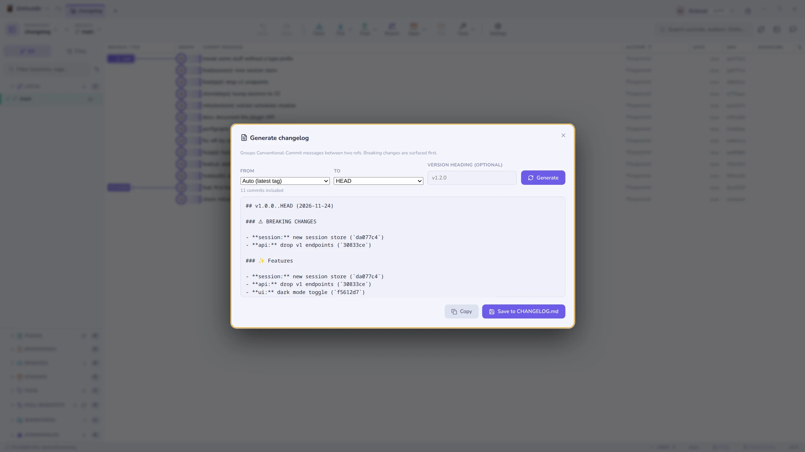

# توليد سجل التغييرات

أعطِه مرجعين — والافتراضي هو **أحدث وسم ← HEAD** — فيحوّل الالتزامات الواقعة
بينهما إلى سجل تغييرات، مجمَّع بحسب نوع الالتزام الاصطلاحي.

- **التغييرات الكاسرة** تظهر أولًا، أيًّا كان النوع الذي جاءت منه.
- ثم Features وFixes وPerformance وما إلى ذلك.
- أما الالتزامات التي لا تتبع أي اصطلاح فتهبط تحت **Other** بدل أن تُسقَط —
  فسجل تغييرات يفقد التزامات في صمت أسوأ من سجل فوضوي.

تُفتح النتيجة في محرر **كتابة / معاينة** نفسه الذي يُكتب فيه وصف طلب السحب،
بشريط أدواته: أعد صياغة مدخل، واحذف سطرًا لا يحتاجه أحد، وتحقّق من طريقة عرضها
قبل أن تذهب إلى أي مكان. التوليد من جديد يستبدل تعديلاتك.

انسخ النتيجة، أو **أضِفها مباشرةً إلى مقدمة `CHANGELOG.md`**.

> كتابة رسائلك [بالأسلوب الاصطلاحي](committing.md) هي ما يجعل هذا مفيدًا.
> المولّد ليس أفضل من العناوين التي يقرؤها.

**انظر أيضًا:** [الالتزام](committing.md) · [الاستضافة وطلبات السحب](hosting.md)
