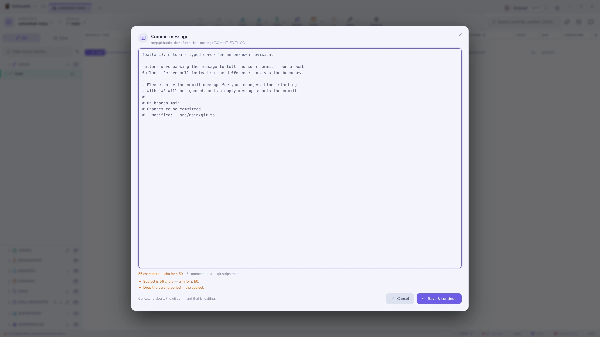

# سطر الأوامر

من الطرفية يُطرح نوعان من الأسئلة، و`githuttbr` يجيب عنهما معًا.

الأول هو *«أرِني هذا»* — أنت داخل نسخة من المستودع، وثمة ما يستحق النظر، والتطبيق
هو المكان المناسب للنظر فيه. هذه الاستدعاءات تفتح نافذة، أقرب ما يمكن إلى ما
سألت عنه.

والثاني هو *«قُل لي الآن»* — خطّاف، أو مهمة تكامل مستمر، أو أنت في منتصف أنبوب
أوامر، تريد إجابة ورمز خروج لا نافذة. هذه لا تُشغّل التطبيق إطلاقًا: تكتب إلى
المخرج القياسي ثم تنصرف.

```sh
githuttbr .                        # افتح هذا المجلد
githuttbr blame src/api.ts -l 84   # …عند لوم ذلك السطر
githuttbr doctor                   # بلا نافذة: يفحص المستودع ويخرج بالرمز 1 عند الفشل
```

## التثبيت

لوحة الأوامر (<kbd>⌘K</kbd>) ← **تثبيت الأمر 'githuttbr' في PATH**. على macOS يُنشئ
وصلة رمزية إلى وسيط صغير في `/usr/local/bin` أو `/opt/homebrew/bin`، ولا يطلب
صلاحيات المدير إلا إذا لم يكن أيٌّ منهما قابلًا للكتابة لديك. على لينكس يذهب إلى
`~/.local/bin` الذي لا يحتاج صلاحيات أصلًا. الأمر نفسه يزيله. ويندوز غير مدعوم
بعد.

ثم، اختياريًا:

```sh
githuttbr completions zsh >> ~/.zshrc     # أو bash أو fish
```

## فتح الأشياء

| الأمر | يفتح |
|-------|------|
| `githuttbr [مسار]` | المستودع (افتراضيًا: المجلد الحالي) |
| `githuttbr open <اسم>` | مستودعًا **باسم لسانه** — `githuttbr open api` |
| `githuttbr diff` | تغييرات نسخة العمل |
| `githuttbr graph` | مخطط الإيداعات |
| `githuttbr show <ref>` | إيداعًا واحدًا — `HEAD~2` أو وسمًا أو بصمة قصيرة |
| `githuttbr blame <ملف>` | لوم ملف؛ أضف `-l 84` للهبوط على سطر بعينه |
| `githuttbr search <استعلام>` | بحث الشيفرة والاستعلام مكتوب سلفًا |
| `githuttbr stack` و`stash` و`reflog` و`conflicts` و`todos` و`chat` و`settings` | تلك اللوحة |
| `githuttbr ci` و`clean` و`bisect` و`absorb` و`snapshots` و`insights` و`terminal` | …وهكذا |

الأمر `githuttbr help verbs` يطبع القائمة كاملة. وثلاثة خيارات تنطبق عليها جميعًا:
`-n <اسم>` يضبط الاسم المعروض للسان، و`-g <مجموعة>` يضعه في لسان مجموعة (تُنشأ عند
الحاجة)، و`-l <n>` يختار سطرًا.

GitHuttBr **نسخة واحدة**: تشغيل `githuttbr` والتطبيق مفتوح يسلّم الطلب إلى تلك
النافذة بدل إطلاق نسخة ثانية. المسار المفتوح سلفًا — لسانًا كان أو داخل مجموعة —
**يُبرَّز** ولا يُكرَّر. والمجلد الذي ليس مستودعًا بعد يُفتح أيضًا، عارضًا مسار
«تهيئة مستودع هنا».

## الإجابة في الطرفية

هذه تطبع ثم تنتهي. لا نافذة تُفتح، ولا حاجة حتى أن يكون التطبيق قيد التشغيل.

### `githuttbr status`

الفرع، والتتبّع، والتقدّم/التأخّر، وشجرة العمل، والمخبّآت — وإن كان المستودع يحمل
واحدة — [قائمة التحقق قبل الدفع من `.githuttbr.json`](repo-config.md). يخرج
بالرمز 1 حين تكون في شجرة العمل تعارضات، فيعمل
`githuttbr status || echo محجوب`.

### `githuttbr doctor [--fix]`

يُجري الفحوص نفسها التي تجريها لوحة [إعداد المستودع](repo-config.md): إصدار
Node، والوحدات الفرعية، وLFS، و`core.hooksPath`، والملفات المطلوبة. **يخرج بالرمز
1 إذا فشل أي فحص**، وهذا هو المقصد: القواعد التي يعلنها مستودع لا تساوي كثيرًا إن
لم يرها إلا من فتح الواجهة الرسومية:

```yaml
- run: githuttbr doctor          # في التكامل المستمر، قبل أي شيء مكلف
```

الخيار `--fix` يطبّق الإصلاحات التي يعرفها الطبيب (تهيئة الوحدات الفرعية،
و`lfs pull`، وضبط `core.hooksPath`، ونسخ ملف عن مثاله) ثم يعيد الفحص. ولا ينفّذ
أبدًا أمرًا جاء من ملف الإعداد؛ فمجموعة الإصلاحات مغلقة.

التحذيرات لا تُفشل التشغيل. التحذير يعني أن الطبيب لم يستطع تحديد شيء، لا أن شيئًا
معطوب؛ وإفشال البناء بسببها يجعل هذا الملف باهظ التبنّي.

### `githuttbr commit-check [ملف]`

يفحص رسالة إيداع. بلا وسيط يقرأ `.git/COMMIT_EDITMSG`، و`-m "…"` يفحص نصًا. وهو
يعرف ما أعلنه المستودع: النطاق المجهول **خطأ** حين يسرد `.githuttbr.json` نطاقات،
ومجرد نصيحة أسلوبية حين لا يسردها. اربطه بخطّاف:

```sh
# .husky/commit-msg
githuttbr commit-check "$1"
```

### `githuttbr config init | show | check`

الأمر `init` يقرأ المستودع ويقترح `.githuttbr.json` مما هو موجود فعلًا — `.nvmrc`،
و`.gitmodules`، و`.env.example` بلا `.env`، ونطاقات الإيداع التي يستعملها التاريخ.
و`--dry-run` يطبع بدل أن يكتب. و`show` يطبع الملف الحالي، و`check` يتحقق منه ويسرد
كل حقل سيُهمَل.

### `githuttbr repos [مرشّح]`

كل مستودع يعرفه GitHuttBr — الألسنة المفتوحة أولًا ثم الأخيرة — مع مجموعته. والخيار
`--paths` يطبع المسارات مجرّدة، واحدًا في كل سطر، للاستعمال في السكربتات:

```sh
cd "$(githuttbr repos --paths api | head -1)"
```

## GitHuttBr محرِّرًا لـ git

```sh
githuttbr editor install
```

يضبط `core.editor` و`sequence.editor` على `githuttbr --wait`. ومن ثَمّ يفتح
`git commit` (بلا `-m`) و`git commit --amend` و`git tag -a` و`git rebase -i`
ملفّاتها في GitHuttBr بدل vim، مع عدّاد للأحرف والتلميحات نفسها التي يعرضها مؤلّف
الرسائل.



المهم هنا كلمة **ينتظر**: فـ git متوقف عند ذلك الحوار. لذلك

- **حفظ ومتابعة** يعيد كتابة الملف ويمضي git في طريقه.
- **إلغاء** يكتب ملفًّا فارغًا، وهو ما يقرؤه git على أنه *إجهاض*.
- إغلاق الحوار بأي طريقة أخرى — Escape، أو الخلفية، أو إنهاء GitHuttBr — يُحسب
  إلغاءً. فطرفية تنتظر إلى الأبد نتيجة أسوأ بكثير من رسالة يُعاد كتابتها.

أضف `--local` لقصره على مستودع واحد، وتراجع عنه بـ `githuttbr editor uninstall`.

## ما لن يفعله

- **لا فعل طرفي يعدّل المستودع.** الاستثناء الوحيد `doctor --fix`، وإصلاحاته
  قائمة ثابتة لا يستطيع ملف إعداد توسيعها.
- **`repos` للقراءة فقط.** التطبيق العامل يملك ملف إعداداته؛ وسطر الأوامر يقرؤه
  ولا يكتبه أبدًا.
- **الفعل الذي لا يعرفه التطبيق المثبَّت يُتجاهل** ولا يُرفض — فالوسيط الأحدث مع
  تطبيق أقدم يفتح المستودع رغم ذلك.
- **لا وسيط لويندوز بعد.** كل الأفعال منفَّذة؛ الناقص هو مسار التثبيت وحده.

**انظر أيضًا:** [مساحات العمل والألسنة والمجموعات](workspaces.md) ·
[إعداد المستودع](repo-config.md) · [الإيداع](committing.md)
