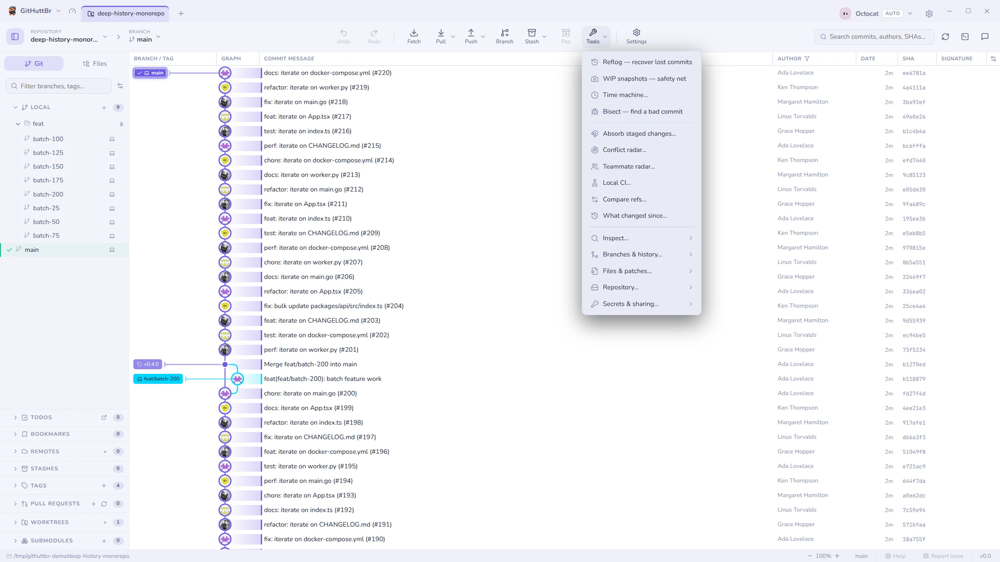

# البداية

يفتح GitHuttBr مجلدًا ويعرض لك سجله. ولا يُكتب أي شيء في مستودعك حتى تطلب ذلك
أنت.

## افتح مستودعًا

- **اسحب مجلدًا** إلى النافذة، أو استخدم **فتح مستودع** في شاشة الترحيب. يقبل
  منتقي المجلدات عدة مجلدات دفعة واحدة: حدّدها بنقرة ⌘ أو بنقرة Shift، فيُفتح كل
  منها في تبويبه الخاص (أو ينضم إلى المجموعة التي فتحت المنتقي منها). وفي تحديد من
  عدة مجلدات، يُتخطّى المستودع المفتوح أصلًا، أو المجلد الذي ليس مستودع Git، ويُذكر
  اسمه في رسالة، كي تُفتح البقية رغم ذلك. ولا يستطيع منتقي macOS أن يُبهت
  المستودعات المفتوحة مسبقًا: فـElectron لا يكشف خطّاف اللوحة الخاص بكل مجلد، لذا
  يجري الفحص بعد نقرك على فتح.
- **المستودعات الممسوحة**، تحت الأزرار الثلاثة، تسرد كل مستودع في المجلدات التي
  طلبت من GitHuttBr مسحها — حدّد عدة مستودعات وافتحها دفعة واحدة، أو انقر نقرًا
  مزدوجًا على أحدها. وهي أيضًا حيث تضيف تلك المجلدات أو تزيلها. انظر
  [المستودعات](repositories.md#المستودعات-الممسوحة).
- **نقرت على الزر الخطأ؟** نوافذ استنساخ وإنشاء وإنشاء مجموعة والمستودعات
  الممسوحة، حين تُفتح من فتح مستودع، فيها سهم **رجوع** بجوار عنوانها يعيدك إليه.
- **استنسخ** مستودعًا من عنوان أو مباشرةً من مستضيفك — انظر
  [الاستنساخ](cloning.md) للخيارات التي تجعل استنساخ مستودع ضخم سريعًا.
- من الطرفية، يفتح الأمر `githuttbr .` المجلد الحالي في التطبيق العامل — انظر
  [سطر الأوامر](cli.md).
- والمجلد المنفرد الذي ليس مستودع Git بعد يُفتح هو أيضًا، عارضًا عليك تهيئته.

## اللوحات الثلاث

| اللوحة | ما تحتويه |
|---|---|
| اليمين | الفروع والمستودعات البعيدة والوسوم والمخابئ وأشجار العمل — وتبويب **الملفات** لشجرة العمل |
| الوسط | الرسم البياني للالتزامات، وكل ما تختاره منه |
| اليسار | مؤلِّف الالتزام، أو تفاصيل الالتزام المحدد |

## كيف تجد كل شيء آخر

طريقان، وكلاهما يوصل إلى الأماكن نفسها:

- **`⌘K`** (`Ctrl+K`) — لوحة الأوامر. اكتب ما تريد؛ وهي تنتقل بك أيضًا إلى
  الفروع والالتزامات والملفات.
- **الأدوات** في شريط الأدوات — المجموعة نفسها المرتبطة بالمستودع، معروضةً
  كقائمة، مع طيّ الذيل الطويل في مجموعات كي تبقى مقروءة.

عندما تضيق النافذة يتوقف شريط الإجراءات عن التنافس على المساحة: تنطوي الأزرار التي لم تعد تتّسع داخل قائمة **المزيد** في نهايته، بترتيب الشريط نفسه ومع قوائمها الفرعية. وسّع النافذة فتعود إلى مكانها.

كل ما يمكن الوصول إليه بأحد الطريقين يمكن الوصول إليه بالآخر، فليس هناك شيء
لا يعثر عليه إلا المستخدمون المتمرسون.

## أول التزام لك

1. حرّر ملفًا. سيظهر تحت **غير محضَّر**.
2. حضّره — الملف كله، أو قطعة منه، أو [أسطرًا مفردة](staging.md).
3. اكتب رسالة واضغط **التزام**.

كل ما عدا ذلك في GitHuttBr اختياري.

