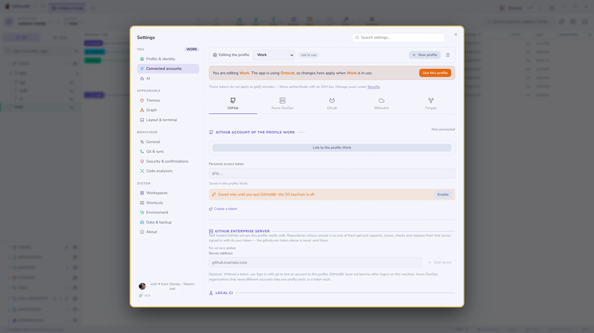

# ملفات التعريف

يجمع ملف التعريف **هوية Git** (الاسم والبريد) مع **رموز التكامل** الخاصة بها.
بدّل ملف التعريف فيتغيّر الاثنان معًا — تُنسَب الالتزامات نسبةً صحيحة، وتستخدم
نداءات الواجهة البرمجية الحساب المناسب.

مفيد حين يكون الجهاز نفسه موطنًا لمستودعات العمل والمستودعات الشخصية، أو حين
يكون لديك حسابان على GitHub.

## تحرير ملف شخصي، واستخدام ملف شخصي

صفحتان في الإعدادات تتغيران مع الملف الشخصي — **الملف الشخصي والهوية** و**الحسابات المتصلة**، في أعلى مجموعة **أنت** التي يذكر عنوانها الملف الشخصي الذي تحرّرانه. أما سائر الصفحات فتسري في أي ملف شخصي وتقول ذلك في أعلاها.

تبدأ **الملف الشخصي والهوية** ببطاقة الملف الشخصي: صورته واسمه (يُحرَّر في مكانه) و*قيد الاستخدام* حين يستخدمه التطبيق والمحدِّد و**ملف شخصي جديد**. وتبدأ **الحسابات المتصلة** بالمحدِّد نفسه في شريط *تحرير الملف الشخصي*. يختار المحدِّد الملف الذي **تحرّره**؛ ولا يغيّر الملف الذي **يستخدمه** التطبيق. وحين يختلفان يقول ذلك شريط كهرماني مع **استخدام هذا الملف الشخصي** للتبديل. تلك هي اللحظة التي يسهل فيها ربط حساب بالملف الخطأ، لذا تذكر الحسابات المتصلة الملف الشخصي على كل بطاقة وعلى الزر نفسه، ويكرره التأكيد. وحذف ملف شخصي في المكان نفسه، ويسأل أولًا.

تحت البطاقة تأتي هوية git وتوقيع الإيداعات. وحين يكون مستودع مفتوحًا يودِع باسم شخص آخر — إعداد git فيه يسمّي مؤلفًا آخر — يقول ذلك سطر مع **طبّق الهوية على المستودع الحالي**؛ وحين يتطابقان لا شيء يُطبَّق ولا يظهر السطر. ثم صورة الملف الشخصي، وملخص **حساباته المتصلة** — سطر لكل خادم مع *متصل* أو *الرمز منتهي الصلاحية أو خطأ* أو *تعذّر الوصول* أو *غير متصل*، و**اتصال** أو **تجديد** اللذين يفتحان الحسابات المتصلة على ذلك الخادم — والذكاء الاصطناعي الذي يستخدمه الملف.

يتحقق الملخص بهدوء، دون نافذة تسجيل دخول، في كل مرة تُفتح فيها الصفحة أو يتغير رمز؛ ولا يستطلع دوريًا أبدًا. وما يجده تستخدمه القائمة الجانبية أيضًا: تُظهر **الحسابات المتصلة** عدّاد تحذير صغيرًا حين يُرفض رمز أو يفشل التحقق، وذلك لعمليات التحقق التي أجرتها الإعدادات فعلًا فقط. والخادم الذي تعذّر الوصول إليه لا يُحسب — فقد يكون الرمز سليمًا.

## الذكاء الاصطناعي مشترك

لا يحتاج الملف الشخصي إلى ذكاء اصطناعي خاص به: [ذكاء اصطناعي
عام](ai.md#ذكاء-اصطناعي-واحد-لكل-الملفات-الشخصية) واحد يخدم كل الملفات الشخصية،
ولا ينتقل ملف إلى ذكاء خاص به إلا عند الضرورة. ويشمل هذا الاختيار كل شيء: الملف
الذي يتبع الذكاء الاصطناعي العام يكتب أيضًا بالطريقة المضبوطة في الذكاء
الاصطناعي العام — نمط الالتزامات، والقواعد الإضافية للإيداعات، ودردشة المستودع. والملف
الذي يحتاج نمطًا آخر يحصل على ذكاء خاص به، نسخة من العام يمكنه تغييرها بعد ذلك.
ويُحرَّر كل ذلك في صفحة **الذكاء الاصطناعي**؛ أما صفحة الملف الشخصي فتقول فقط أي
ذكاء اصطناعي يستخدمه الملف وتحيل إليها.

## لكل ملف شخصي حساباته

إلى جانب الرمز، يمكن للملف الشخصي أن **يربط** تسجيل دخول موجودًا أصلًا على
الجهاز — من credential helper الخاص بـgit أو من GitHub CLI — في الإعدادات ← الحسابات المتصلة. الربط ملك لملف شخصي واحد: يبدأ الملف الشخصي الجديد غير متصل، ويُرفض
الحساب الذي يملكه ملف شخصي آخر، لذا يمكن لملفين شخصيين أن يحملا حسابين على GitHub
(أو Azure DevOps) جنبًا إلى جنب. انظر [الاستضافة](hosting.md).

## الربط بمستودع بعينه

يمكن **ربط مستودع بملف تعريف**، فيصادِق أي جلب في الخلفية عليه دائمًا بالحساب
الصحيح — حتى وأنت تنظر إلى مستودع يخصّ الحساب الآخر.

تعيش الرموز في [سلسلة مفاتيح نظام التشغيل](security.md)، لا في ملف الإعدادات.

**انظر أيضًا:** [الأمان والأسرار](security.md) · [الاستضافة](hosting.md)
