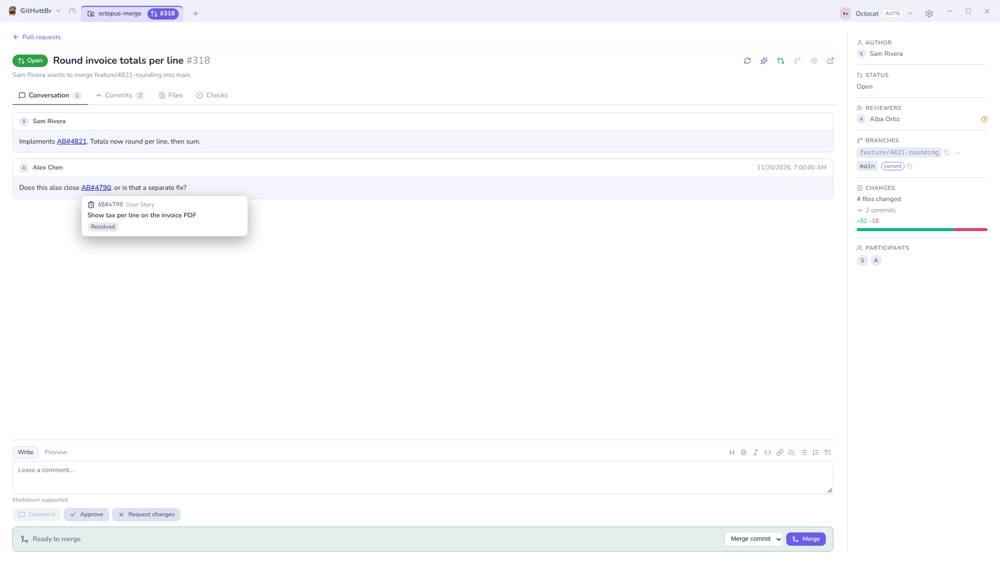

# صفحة طلبات السحب

في المستودع النشط عشرون طلب سحب مفتوحًا في الوقت نفسه. يسردها الشريط الجانبي،
لكن سطرًا واحدًا لكلٍّ منها لا يقول الكثير: لمن هذا، وأيّها ينتظرك، وأيّها صار
أحمر. كانت معرفة ذلك تعني فتح كل واحد وقراءته والرجوع وفتح التالي. **صفحة طلبات
السحب** تجيب عن هذه الأسئلة في شاشة واحدة، وما إن تفتح طلب سحب حتى ينقلك **‹ ›**
إلى التالي في القائمة نفسها دون رجوع.

## فتحها

- **أيقونة القائمة** في ترويسة **طلبات السحب** في الشريط الجانبي (*عرض كل طلبات
  السحب*).
- *طلبات السحب…* في لوحة الأوامر (⌘K)، أو **الأدوات ← طلبات السحب…**.

مثل الويكي و[تشغيلات CI](ci-runs.md)، تُفتح الصفحة على تبويب المستودع.

## التبويبات

| التبويب | ما يحويه |
|---|---|
| **مفتوحة** | كل طلبات السحب المفتوحة، ومنها المسودات |
| **مسودات** | المفتوحة الموسومة مسودةً فقط |
| **مدمجة** | طلبات السحب المدمجة، تُقرأ أول مرة تفتح فيها التبويب |
| **مغلقة** | المغلقة دون دمج (المرفوضة، المتروكة)، تُقرأ مع المدمجة |

الأعداد بجانب مفتوحة ومسودات تأتي من القائمة التي يملكها الشريط الجانبي أصلًا.
أما مدمجة ومغلقة فلا تُطلب إلا حين تفتح أحدهما، ومرة واحدة في كل جلسة؛ و**تحديث**
يطلبها من جديد.

## المرشحات

| المرشح | ما يُبقيه |
|---|---|
| **بحث** | طلبات السحب التي يحوي عنوانها أو وصفها أو فروعها أو رقمها كل كلمة مكتوبة. `#482` أو `482` يجد ذلك الرقم؛ وتُميَّز التطابقات في العنوان |
| **المؤلف** | مؤلفًا واحدًا — كلٌّ مدرج مع عدد طلباته في هذا التبويب. **أنا** في المقدمة |
| **المراجع** | مراجعًا مطلوبًا واحدًا، أو **طُلبت مراجعتي** |
| **الفرع الهدف** | طلبات السحب إلى ذلك الفرع |
| **طلباتي** | اختصار لـ *المؤلف: أنا* |
| **بانتظار مراجعتي** | اختصار لـ *المراجع: طُلبت مراجعتي* |
| **فشل CI** | طلبات السحب التي فشلت فحوص رأسها (head) |

يقول السطر تحت المرشحات كم طلبًا من طلبات التبويب معروض وأيّ المرشحات مفعّلة، مع
**مسح المرشحات** لإزالتها كلها.

تُحفظ المرشحات لكل مستودع **ما دام التطبيق يعمل** — غادر الصفحة وعد إليها، تجدها
كما تركتها. ولا تُحفظ عبر إعادة التشغيل عن قصد: مرشح «طلباتي، فشل CI» يعود بصمت
بعد أسبوع سيخفي طلبات سحب لم تطلب إخفاءها.

### من «أنا»

«أنا» هو الحساب الذي تسجّل به استدعاءات هذا المستودع الدخول إلى منصة الاستضافة —
ملف التعريف الذي [رُبط](profiles.md) به المستودع، وإلا فالنشط — ويُسأل عنه المضيف
نفسه. وحين لا يستطيع الرمز المميز أن يقول لمن هو (لا نطاق مستخدم)، أو لا يوجد رمز،
لا تُعرض **أنا** و**طلباتي** و**بانتظار مراجعتي**.

## القائمة

| العمود | ما يعرضه |
|---|---|
| **#** | الرقم، مع أيقونة لمفتوح أو مسودة أو مدمج أو مغلق |
| **العنوان** | العنوان، وشارة *مسودة*، ومن لا تزال مراجعته مطلوبة — بلون التمييز حين تكون أنت |
| **المؤلف** | صورة المضيف حيث يقدّمها، وإلا فالحرف الأول، و**أنت** على طلباتك |
| **الفروع** | المصدر ← الهدف |
| **الفحوص** | فحوص الرأس مجمّعة — `6/6`، `1 فاشل`، `2 قيد التشغيل`؛ مرّر المؤشر لترى الأعداد |
| **آخر تحديث** | منذ متى تغيّر آخر مرة؛ مرّر المؤشر لترى التاريخ |

تُرتَّب الصفوف بحسب أحدث نشاط. والنقر يفتح صفحة طلب السحب نفسه
([الاستضافة وطلبات السحب](hosting.md)). وعلى مضيف لا يملك تلك الصفحة، يفتح الصف
طلب السحب في المتصفح.

في [checkout لنسخة متفرعة](hosting.md#طلبات-السحب-الخاصة-بك-في-المستودع-الأصل-لنسخة-متفرعة) تُسرد أيضًا طلبات السحب الخاصة بك في
المستودع الأصل، موسومةً *على owner/repo*.

## التنقل في القائمة من طلب سحب

طلب السحب المفتوح من الصفحة يعرض شريطًا فوق عنوانه:

- **← طلبات السحب** يعود إلى القائمة، والمرشحات كما تركتها.
- **‹ k من n ›** ينتقل إلى طلب السحب السابق أو التالي في القائمة التي فتحته منها —
  القائمة المُرشَّحة، بترتيبها، كما كانت لحظة نقرت. وتسمّي التلميحات طلب السحب
  الذي يقود إليه كل سهم.
- **Alt+← / Alt+→** يفعلان الشيء نفسه من لوحة المفاتيح. ويمكن إعادة تعيينهما في
  **الإعدادات ← الاختصارات**. ويتنحّيان ما دام المؤشر في حقل نصي (حيث ينتقل
  Option+← كلمةً كلمة) وما دام التركيز في الطرفية.

التنقل يستبدل الصفحة في مكانها، فالمرور على عشرة طلبات سحب لا يترك عشر أيقونات
على التبويب؛ وفتح صف آخر من القائمة يستبدلها كذلك.

طلب السحب المفتوح **من أي مكان آخر** — الشريط الجانبي، إشعار — يتنقل بين طلبات
السحب المفتوحة في المستودع بالترتيب الافتراضي للصفحة (مفتوحة، بلا مرشحات). وما لم
يكن في تلك القائمة أيضًا، كطبقة مدمجة من كومة، لا يعرض إلا طريق العودة إلى القائمة.

## الانتقال إلى فرع طلب السحب

لتعمل على طلب سحب تحتاج إلى سحب فرعه (checkout) — وفي مستودع فيه آلاف الفروع،
العثور عليه بالاسم في قائمة الفروع هو الجزء البطيء. في صفحة طلب السحب، يتولى حقل
**الفروع** ذلك عنك:

- **اسم الفرع رابط.** النقر يسحب ذلك الفرع ويأخذك إلى الرسم البياني للمستودع، عند
  طرف الفرع. وتبقى صفحة طلب السحب مفتوحة على التبويب.
- **الفرع الموجود على الخادم فقط** يُجلب أولًا — ذلك الفرع وحده، لا المستودع البعيد
  كله — ثم يُسحب فرعًا محليًا يتتبّعه. والفرع الموجود عندك محليًا يُبدَّل إليه كما
  هو — لا يُحدَّث، فاسحب التغييرات (pull) حين تريد أحدث إيداعات طلب السحب.
- **الفرع الذي أنت عليه أصلًا** يُوسم بدلًا من ذلك *الحالي*. ولا يُسحب شيء.
- **زر النسخ** بجانب كل اسم يضعه في الحافظة.
- **تراجع** (⌘Z) يعيدك إلى الفرع الذي كنت عليه ويحذف الفرع المحلي الذي أنشأه
  السحب — إلا إذا أودعت عليه منذ ذلك الحين، فيُترك كما هو.

وفي الترويسة الخطوتان نفسهما زرَّين: **الانتقال إلى الفرع المصدر** و**الانتقال إلى
الفرع الهدف**. وهما يعملان على الفرع الذي أنت عليه أيضًا — يأخذانك إلى المستودع
فحسب. ومع تشغيل [ألوان الأيقونات](themes.md#ألوان-الأيقونات) يأخذ كل زر في الترويسة لونه: التحديث أزرق، ومراجعة الذكاء الاصطناعي بنفسجي، والمعاينة فيروزي، والفرع المصدر أخضر، والفرع الهدف برتقالي (ويبقى الفتح في المتصفح رماديًا).

لا يُبحث عن شيء قبل أن تنقر: فتح طلب سحب لا يقرأ أي فرع ولا يجلبه.

ما لا يفعله:

- **الفرع المصدر لنسخة متفرعة** يقيم في مستودع آخر، فلا رابط له (ويبقى زر النسخ).
  و**معاينة طلب السحب محليًا…**، المعروضة تحته مباشرة، هي طريقة تشغيله هنا. ويبقى
  الفرع الهدف رابطًا.
- **لا مستودع بعيد مطابق.** يُبحث عن الفرع في المستودع البعيد الذي عنوانه هو
  مستودع طلب السحب. وحين لا يشير إليه أي مستودع بعيد مُعدّ، لا يفعل الرابط شيئًا
  ويقول تلميحه السبب.
- **فرع محذوف.** كثيرًا ما يأخذ طلب السحب المدمج فرعه معه؛ عندئذ يقول الجلب إن الفرع
  لم يعد موجودًا على المستودع البعيد، وتبقى على طلب السحب.
- **تغييرات محلية.** السحب ليس هدّامًا، فلا تأكيد — ويرفض git السحب حين تُستبدل
  تغييراتك غير المودعة. يذكر الخطأ أيّ الملفات؛ أودِعها أو ضعها في stash وانقر
  مجددًا.
- **هذه النافذة.** يحدث السحب في شجرة عمل هذا المستودع. وحين يكون الفرع مسحوبًا
  أصلًا في [شجرة عمل](worktrees.md) أخرى، يُفتح تبويب تلك الشجرة بدلًا من ذلك.

## الالتزامات

كان الشريط الجانبي يقول كم التزامًا في طلب السحب، لا أيّها. ومراجعة التزام واحد في
كل مرة — وهي الطريقة التي يُفترض أن تُقرأ بها أغلب طلبات السحب — كانت ترسلك إلى
المتصفح. تبويب **الالتزامات**، بين المحادثة والملفات، يسردها:

- **الأقدم أولًا**، بالترتيب الذي تُطبَّق به، مجمَّعةً تحت اليوم الذي كُتبت فيه. والالتزام
  الذي دخل بإعادة تأسيس (rebase) خارج ترتيب التواريخ يبدأ يومًا خاصًا به بدل أن يُنقل.
- في كل صف صورة المؤلف (حيث يقدّمها المضيف)، والموضوع، والمؤلف، ومنذ متى، وSHA
  المختصر. وتَسِم شارة **دمج** الالتزامَ الذي له أبوان، حيث يقول المضيف ذلك.
- **▸** بجانب التزام فيه أكثر من موضوع يعرض بقية رسالته.
- **نسخ** يضع SHA الكامل في الحافظة؛ و**فتح في المتصفح** يفتح الالتزام على المضيف —
  داخل طلب السحب حيث يملك المضيف صفحة كهذه (GitHub، GitLab، Bitbucket Data Center)،
  وإلا ففي صفحة الالتزام في المستودع.

**انقر صفًا** — أو انتقل إليه بـTab واضغط Enter — لتفتح الالتزام في التطبيق، كما تفعل
نقرة في الرسم البياني: عرض المستودع، وذلك الالتزام محدَّد، وتفاصيله مفتوحة. يعمل هذا
حين **يملك** هذا النسخ المحلي الالتزام. وحين لا يملكه، يقول الصف ذلك بدل أن يفشل
بصمت، ويعرض:

- **جلب فرع طلب السحب لرؤيته** — الجلب نفسه لفرع واحد كما في
  [الانتقال إلى الفرع](#الانتقال-إلى-فرع-طلب-السحب)، دون السحب. فإن جاء الالتزام معه فُتح؛ وإن لم يأتِ
  (أعادت كتابته دفعة قسرية منذئذ)، قال الإشعار ذلك.
- **اجلب إيداعات طلب السحب**، لطلب سحب آتٍ من **نسخة متفرعة**. فرعه يقيم في مستودع آخر،
  لكن أغلب المضيفين يعكسون رأس طلب السحب في المستودع الهدف تحت مرجع خاص به —
  `refs/pull/N/head` (GitHub، GitHub Enterprise Server، Forgejo)،
  `refs/merge-requests/N/head` (GitLab)، `refs/pull-requests/N/from` (Bitbucket Data
  Center). يجلب التطبيق ذلك المرجع وحده، دون وسوم، إلى مرجع خاص به،
  `refs/githuttbr/pr/<remote>/N`، ويُفتح الإيداع كأي إيداع آخر: يرسم الرسم البياني ذلك
  الرأس مسارًا بلا تسمية. والجلب مجددًا ينقل المرجع إلى الرأس كما هو حينها. وإن ترك الدفع
  القسري منذئذ الإيداع خارجًا، قال الإشعار ذلك.
- **فتح في المتصفح**، حين لا يكون الجلب خيارًا.

تُقرأ القائمة أول مرة تفتح فيها التبويب، لا مع الصفحة، ومن جديد مع كل **تحديث**. وإلى
أن تصل، يكون العدد في التبويب هو ما أعطاه المضيف لطلب السحب. وطلبات السحب المدمجة
والمغلقة تسرد التزاماتها بالطريقة نفسها.

ما لا يفعله:

- **250 التزامًا على الأكثر.** GitHub نفسه لا يسرد أكثر من 250 لطلب سحب؛ والتطبيق يتوقف
  عند العدد نفسه على كل مضيف، ويقول *لدى المضيف المزيد* حين يكون كذلك، مع رابط إلى طلب
  السحب على المضيف. وأيّ 250 هي يتوقف على الترتيب الذي يسردها به المضيف — يُبقي
  التطبيق المسرودة أولًا، ويقول السطر فوق القائمة أيّها:

  | المضيف | ما يعرضه طلب سحب أطول |
  |---|---|
  | GitHub | **أول** 250 (حدّ GitHub نفسه) |
  | GitLab، Azure DevOps، Bitbucket Data Center، bitbucket.org | **أحدث 250** |
  | Forgejo | الطرف الذي يسرده الخادم أولًا؛ ترتيبه غير موثَّق |
- **رأس نسخة متفرعة حيث لا يعكسه المضيف.** لا ينشر Azure DevOps إلا نتيجة دمج، ولا ينشر
  أبدًا الرأس الخاص بطلب السحب، ولا ينشر bitbucket.org أيًّا منهما: هناك لا يعرض الصف إلا
  المتصفح. وعلى مضيف آخر يتبيّن أنه لا يعكسه، يقول الجلب ذلك. و**معاينة طلب السحب
  محليًا…** تجلب نتيجة دمج Azure، إن كانت هي ما تحتاجه.
- **الرؤوس المجلوبة تبقى.** `refs/githuttbr/pr/…` ليس فرعًا: لا شيء لتسحبه أو تدفعه،
  والجلب مع التقليم لا يمسّه، وgit يحتفظ بإيداعاته. ولا شيء يزيله أيضًا — لا إغلاق الصفحة
  ولا [تنظيف الفروع](branch-cleanup.md). للتخلص منها، احذف المراجع يدويًا:
  `git for-each-ref refs/githuttbr/pr` يسردها، و`git update-ref -d <ref>` يحذف واحدًا.
- **مستودع بعيد في اسمه `/`** لا يمكن أن يكون جزءًا واحدًا من اسم ذلك المرجع، فيُرفض الجلب
  هناك.
- **فرع محذوف.** كثيرًا ما يأخذ طلب السحب المدمج فرعه معه: والجلب يقول ذلك. ولا يسرد
  bitbucket.org أي التزام بعد زوال الفرع المصدر.
- **الدمج بالضغط (squash).** التزامات طلب سحب مدمج بالضغط لم تصل قط إلى الفرع الهدف،
  فبعد حذف فرعه لا تبقى إلا على المضيف.
- **المؤلفون** يُسمَّون كما تسمّيهم التزاماتهم. ولا يقدّم GitLab وAzure DevOps وBitbucket
  Data Center صورة دون تسجيل دخول لا يستطيع طلب الصورة إرساله، فتعرض تلك الصفوف الحرف
  الأول.
- **الرسائل الطويلة على Azure DevOps** قد تُقتطع: قائمة Azure تقصّ رسالة الالتزام،
  والتطبيق يعرض ما يرسله.
- طلبات السحب على **bitbucket.org** تُفتح في المتصفح — لا صفحة لها في التطبيق بعد —
  فلا يُبلغ هذا التبويب هناك، مع أن التطبيق يستطيع قراءة القائمة.

## قراءة الملفات

طلب سحب فيه مئتا ملف يصعب قراءته على أنه مئتا مسار كامل. قائمة تبويب **الملفات** فيها
مفتاح **المسار / الشجرة** نفسه الذي في لوحة الإيداع، والاختيار واحد في التطبيق كله. في
**الشجرة** تقع الملفات تحت مجلداتها (سلسلة مثل `src/main/ipc` صف واحد)، ويعرض كل مجلد
مجموع **+/−** فيه وكم من ملفاته شوهد (*3/5*). مربع اختيار المجلد يعلّم كل ملف داخله
كمُشاهَد، أو يزيل العلامات كلها؛ والعلامات تُحفظ على هذا الحاسوب وحده، ولا تُرسل إلى
المضيف أبدًا. العلامة تتذكر نسخة فروقات الملف: حين يغيّر دفعٌ ملفًا مُشاهَدًا، يعود غير
مُشاهَد، مع نقطة صفراء (*تغيّر منذ أن شاهدته*). والملف الذي لا فروقات له (ثنائي، كبير
جدًا) يُقارن بحالته وعدد أسطره فقط. والملف الذي فيه محادثات مراجعة يعرض بجانبه عددًا داخل فقاعة كلام (وتجمع المجلدات أعدادها)، فتبرز الملفات التي عليها تعليقات في قائمة طويلة؛ وتُحتسب المحادثات القديمة أيضًا. انقر مجلدًا، أو اضغط ←/→ عليه، لطيّه؛ و↑/↓ (أو
j/k) تمرّ على الملفات الظاهرة وتفتح فروقات كلٍّ منها. تُتذكَّر المجلدات المطوية لكل طلب
سحب حتى يُغلق التطبيق، والملف الذي يُفتح داخل أحدها يفتح الطريق إليه. والشجرة مرتبة
بالاسم، لا بالترتيب الذي يسرد به المضيف الملفات.

## التعليق على سطر

كان الرد على سلسلة مراجعة ممكنًا هنا، أما بدء واحدة فلا، فكانت المراجعة الحقيقية لا
تزال ترسلك إلى المتصفح. في تبويب **الملفات** لطلب السحب، يقبل أي سطر من الفروقات
تعليقًا خاصًا به:

- **مرّر المؤشر فوق سطر** واضغط **+** الذي يظهر فوق رقمه، أو **انقر السطر** نفسه
  (النقرة التي تُنهي تحديد نص، أو النقرة المزدوجة التي تحدد كلمة، لا تُحتسب — تلك
  قراءة). وفي قائمة النقر بالزر الأيمن — أو مفتاح قائمة السياق في لوحة المفاتيح —
  أيضًا *التعليق على السطر N*.
- يُفتح مربع **تحت ذلك السطر**. اكتب، ثم **تعليق** — أو ⌘/Ctrl+Enter. **إلغاء**
  يغلقه؛ و**Esc** كذلك، مع السؤال أولًا إن كُتب شيء. وفي الحالتين يعود التركيز إلى ذلك
  السطر.
- عند النجاح تظهر السلسلة الجديدة **تحت سطرها**، وفي سلاسل المراجعة في تبويب
  المحادثة، حيث سيراها الجميع.

الجانب الذي يقع عليه التعليق يتبع السطر:

| السطر | مرتبط بـ |
|---|---|
| **مُضاف** (أخضر) | النسخة الجديدة من الملف، عند رقمه الجديد |
| **محذوف** (أحمر) | النسخة القديمة، عند رقمه القديم |
| **دون تغيير** | النسخة الجديدة (يُرسَل إلى GitLab الرقمان كلاهما، كما يشترط) |

تُرسم السلاسل الموجودة أيضًا تحت أسطرها، مع مربع الرد حيث يسمح المضيف للتطبيق
بالرد داخل سلسلة (Forgejo لا يسمح). ولا تُرسم سلسلة على سطر إلا حين يقول المضيف إنها
لا تزال تنتمي إلى الفروقات المعروضة؛ وما عدا ذلك يبقى في تبويب المحادثة، بدل أن يوضع
على سطر مُخمَّن:

| المضيف | سلسلة كُتبت قبل آخر دفع |
|---|---|
| GitHub | قديمة حين يتغيّر سطرها: في المحادثة فقط |
| GitLab | كُتبت على head أقدم: في المحادثة فقط |
| Azure DevOps | يتتبّعها Azure إلى حيث صار سطرها الآن |
| Bitbucket Data Center | يتيمة حين يختفي سطرها: في المحادثة فقط |
| Forgejo | لا يقول Forgejo إن التعليق قديم، فيُرسم عند رقم السطر المسجَّل — وبعد دفعٍ قد يحوي ذلك السطر شيفرة أخرى |

التعليق على سطر خارج المقاطع (hunks) المعروضة يكون في تبويب المحادثة فقط، على كل
المضيفين.

التعليق المكتوب غير المُرسَل يُعدّ نصًا غير مُرسَل: **‹ ›** وAlt+الأسهم تسأل قبل
مغادرته، كما تفعل مع مربع التعليق الرئيسي. والنظر في ملف آخر يُبقيه؛ ولبدء تعليق على
سطر آخر، انشر الأول أو ألغِه.

ما لا يفعله:

- **سطر واحد، يُنشر فورًا.** لا نطاق أسطر، ولا مراجعة معلّقة تجمع فيها التعليقات
  لتقدّمها لاحقًا، ولا تغييرات مقترحة. يُنشر كل تعليق لحظة إرساله، سلسلةً مستقلة (وعلى
  Forgejo مراجعةً تحوي ذلك التعليق وحده، إذ لا استدعاء لديه لتعليق منفرد).
- **الفروقات التي تنظر إليها.** يتذكر تبويب الملفات عند أي إيداع (وعلى Azure DevOps عند
  أي تكرار) قُرئت فروقاته، ويُرسَل التعليق مقابله. وحين يكون طلب السحب قد تقدّم منذئذ —
  دفع، أو قاعدة دمج جديدة — لا يُنشر التعليق على السطر الذي يحمل ذلك الرقم الآن: بل
  يُرفض برسالة *تغيّر طلب الدمج منذ تحميل هذه الفروقات*، و**تحديث** يعرض الفروقات
  الجديدة. أما على GitHub فيُنشر التعليق مقابل الإيداع الذي قرأته، ويَسِمه GitHub بأنه
  قديم إن تغيّر ذلك السطر. والسطر الذي لا يزال المضيف يرفضه يُرفض لأنه خارج الفروقات.
- **مرفوض.** دون إذن بالتعليق (رمز للقراءة فقط، أو حساب لا يسمح له المستودع
  بالتعليق)، يرفضه المضيف وتقول الرسالة إن هذا هو السبب.
- طلبات السحب على **bitbucket.org** تُفتح في المتصفح — لا صفحة لها في التطبيق بعد —
  فالتعليق على سطر هناك لا يزال يتم على الموقع.
- **الملف الذي لا فروقات له** (ثنائي، أو أكبر من أن يُدرجه المضيف) لا أسطر فيه للتعليق
  عليها.

## كتابة التعليقات

كل مربع في الصفحة — التعليق في الأسفل، والرد داخل سلسلة، والتعليق على سطر — هو محرر
Markdown نفسه: تبويبا **كتابة / معاينة**، وشريط تنسيق باختصارات GitHub، وقوائم تستمر
عند Enter، وإكمال **@** / **#** من الأشخاص وطلبات السحب الظاهرين على الشاشة أصلًا.
ويُظهر مربع الرد أدواته ما إن تنقر داخله، ويُرسل بـ⌘/Ctrl+Enter، لأن Enter صار يبدأ
سطرًا جديدًا. وفي [كتابة التعليقات](writing-comments.md) التفاصيل والحدود.

## كيف تُعرض التعليقات

يكتب الناس التعليقات بـMarkdown، فالتعليق المعروض نصًّا عاديًا يمتلئ بـ`**` و`- [ ]`
وأسوار الشيفرة. والوصف والمحادثة وسلاسل المراجعة (في تبويبي المحادثة والملفات) تُرسم
بوصفها Markdown: العناوين، والقوائم وقوائم المهام، والجداول، والاقتباسات، وكتل الشيفرة
المُبرزة باللغة التي يسمّيها السور، والروابط والصور. وصفحة المشكلة ترسم نصها بالطريقة
نفسها. ولا تزال `#123` و`AB#123` و`!123` و`@user` في النص تصير روابط، مع
[البطاقة](#عمّ-يتحدث-123-أو-ab123) حيث كانت لها واحدة.

من أين يأتي الرسم:

| المضيف | يعرضه |
|---|---|
| GitHub، GitHub Enterprise Server | GitHub نفسه (`body_html`): الإشارات والمراجع مربوطة كما على الموقع، والصور تمر عبر وكيل الصور في GitHub، والمرفقات الخاصة تحمل عنوانها الموقّع |
| GitLab، Forgejo، Azure DevOps، Bitbucket Data Center | التطبيق، من Markdown التعليق. الرابط النسبي يشير إلى داخل المستودع؛ وعلى GitLab يشير `/uploads/…` إلى داخل المشروع، كما يفعل GitLab |

التعليق محتوى أشخاص آخرين، فما يجوز أن يحويه ضيّق، وأضيق مما في ملفاتك أنت: قائمة صريحة
بالوسوم، وروابط وصور عبر `https:` أو `http:` أو `mailto:` فقط، بلا نصوص برمجية ولا إطارات
ولا نماذج ولا SVG ولا أنماط مضمّنة، وروابط لا تُفتح أبدًا داخل التطبيق (تذهب إلى متصفحك).
ومربع الاختيار في قائمة المهام يظهر لكنه غير قابل للنقر: تحديده هنا لن يغيّر شيئًا على
المضيف.

**الصور من مواقع أخرى تنتظر نقرة.** تحميل صورة طلب يستطيع الموقع خلفها مراقبته، مع عنوان
IP الخاص بك واللحظة التي تقرأ فيها التعليق — وكل من يستطيع التعليق يستطيع وضع بكسل تتبع
هناك. لذا لا تُحمَّل تلقائيًا إلا صور المضيف نفسه: على github.com مرفقاته، و
`*.githubusercontent.com` (ويشمل وكيل الصور لديه) وأصوله؛ وعلى أي مضيف آخر عنوانه هو.
وكل صورة أخرى تعرض *صورة من example.net — انقر للتحميل*، والنقرة تحمّل تلك الصورة وحدها.
و**الإعدادات ← الأمان ← تحميل الصور من مواقع أخرى في التعليقات** يوقف ذلك؛ انظر
[الأمان](security.md#الصور-في-التعليقات).

**المعاينة تُظهر ما سيُنشر.** في هذه الصفحة وفي صفحة المشكلة، يرسم تبويب **معاينة** في كل
مربع تعليق النص بالطريقة نفسها: الملف نفسه، وفواصل الأسطر نفسها، والصور المحجوبة نفسها —
فالرابط الملصق إلى صورة خارجية لا يحمّلها وأنت تكتب. وتحتفظ نافذتا طلب السحب الجديد
والمشكلة الجديدة بمعاينة Markdown المعتادة في التطبيق.

**الطويل جدًا أو المعقّد جدًا يُعرض نصًّا.** يُعرض Markdown داخل نافذة التطبيق، وبعض
النصوص يكلّف عرضها أكثر بكثير مما يوحي به حجمها. فالتعليق الذي يتجاوز **32,000 حرف**، أو
المصوغ ليعطّل العارض (آلاف من `_` أو `*` غير المتزاوجة في فقرة واحدة، أو أكثر من 32 مستوى
من `>` أو علامات القوائم في سطر واحد)، يُعرض نصًّا عاديًا مع روابطه، تحت *تعليق طويل معروض
كنص عادي.* أو *التعليق معروض كنص عادي: معقّد جدًا لعرضه هنا.* والتعليق الذي يفشل عرضه رغم
ذلك يرجع من تلقاء نفسه بالطريقة نفسها: ولا يُمسّ باقي الصفحة.

ما لا يفعله:

- **التعديل يعرض النص كما كُتب.** **تعديل** لا يزال يفتح Markdown، والتعديل المحفوظ
  يرسمه التطبيق إلى أن تعيد الصفحة قراءة طلب السحب (وعلى GitHub يرسمه GitHub بعد ذلك).
- **مرفقات GitHub الخاصة تنتهي صلاحيتها.** يوقّع GitHub عنوان الصورة الخاصة لبضع دقائق؛
  والصورة التي لم تعد تُحمَّل بعد أن بقيت الصفحة مفتوحة مدة تعود بـ**تحديث**.
- **الصورة النسبية على GitHub** التي يرسمها التطبيق بنفسه (رد أُرسل من التطبيق قبل أن
  تعيد الصفحة قراءته) يُبحث عنها تحت عنوان المستودع على github.com، وقد لا يكون ذلك حيث
  كان GitHub سيضعها.
- **مقاطع الفيديو** في تعليق GitHub تظهر رابطًا إلى الملف، لا مشغّلًا.
- **الامتدادات الخاصة بـGitHub** غائبة حين يرسم التطبيق بنفسه (على المضيفين الآخرين): لا
  رموز مختصرة للرموز التعبيرية، ولا مخططات Mermaid، ولا تنسيق للتنبيهات، وتبقى الصيغ
  الرياضية نصًّا.
- **لا تُبرز الشيفرة إلا حين يسمّي السور لغتها.** تخمين اللغة يعني تمرير كل قواعد
  اللغات على كل كتلة في الصفحة.
- **رسائل الإيداعات** في تبويب الالتزامات تبقى نصًّا عاديًا: git لا يعرض Markdown، ولا
  المضيفون.

## تعديل تعليقاتك وحذفها

الخطأ المطبعي في تعليق أُرسل، أو الملاحظة التي لم تعد صالحة، كانا يعنيان رحلة إلى
المتصفح. صار لتعليقاتك الآن **تعديل** (القلم) و**حذف** (سلة المهملات) في آخر ترويستها:
تعليقات المحادثة، وتعليقات سلاسل المراجعة وردودها، في تبويبي المحادثة والملفات كليهما.
وصفحة المشكلة فيها ذلك أيضًا، لتعليقاتها على GitHub وForgejo.

ما هو «لك» تقرّره الصفحة نفسها، إذ تسأل المضيف في كل تحميل بأي حساب تسجّل استدعاءات
هذا المستودع الدخول (ملف التعريف المرتبط به، لا أي ملف تعريف نشط). أغلب المضيفين يسمّون
المؤلف باسم الدخول، ويُقارن دون اعتبار لحالة الأحرف. أما Azure DevOps فيسمّي المؤلفين بالاسم المعروض، وقد يشترك فيه شخصان، فلا يقارن الأسماء
هناك أبدًا: يكون التعليق لك حين يطابق معرّف مؤلفه معرّف الحساب، **أو** يطابق الاسم الفريد
لمؤلفه (اسم الحساب، وهو عادةً عنوان بريد إلكتروني) اسم الحساب دون اعتبار لحالة الأحرف.
وكلٌّ منهما خاص بشخص واحد؛ والثاني يغطي معرّف مؤلف ليس هو الذي يبلّغ عنه الاتصال. وحين
لا يمكن مقارنة أيٍّ منهما، لا يعرض أي تعليق الإجراءين. وحين لا يستطيع التطبيق معرفة من
أنت (رمز دون نطاق مستخدم، أو لم يُجب المضيف)، لا يعرضهما أي تعليق كذلك؛ و**تحديث**
يسأل من جديد. ويبقى القرار للمضيف: الحساب الذي لا يسمح له بتغيير تعليق يُرفض، وتقول
الرسالة ذلك.

- **تعديل** يفتح التعليق في مكانه، في محرر Markdown نفسه، بنصه كما كُتب. **حفظ** (أو
  ⌘/Ctrl+Enter) يرسله؛ و**إلغاء** أو **Esc** يغلقه، مع السؤال أولًا إن غيّرت شيئًا. لا
  يُحذف إلا الأسطر الفارغة حول النص: الشيفرة المزاحة وفاصل السطر بمسافتين في الآخر يبقيان
  كما كُتبا. يظهر النص الجديد فورًا وتعيد الصفحة قراءة طلب السحب. وفي صفحة طلب السحب
  يُعدّ التعديل غير المحفوظ نصًا غير مُرسَل: **‹ ›** تسألان قبل مغادرته. أما صفحة المشكلة
  فلا أسهم فيها كهذه، ولا شيء هناك يسأل قبل إغلاق تبويبها.
- **حذف** يسأل أولًا دائمًا، والسؤال يقول ما يحدث: يزيل الخادم التعليق للجميع، ولا يمكن
  التراجع عن ذلك. ولا يوجد قيد تراجع، إذ لا شيء يعيده.

حذف **أول تعليق في سلسلة** لها ردود (سلسلة مراجعة، أو تعليق محادثة ردّ عليه آخرون)
يختلف بحسب المضيف، ويسمّي التأكيد الحالة. اثنتان من هذه الحالات لم يوثّقهما المضيف،
ويقال ذلك:

| المضيف | أول تعليق في سلسلة لها ردود |
|---|---|
| GitHub | يُفترض أن تبقى الردود؛ وثائق GitHub لا تقول ذلك. وتحتفظ السلسلة بمربع ردّها: حين يزول تعليقها الأول، يُرسل الرد إلى السلسلة نفسها عبر واجهة GraphQL البرمجية لـGitHub، ويُعثر عليها من خلال رد لا يزال فيها. وإن فشل ذلك (Enterprise Server قديم، أو رمز ترفضه GraphQL، أو سلسلة يقول GitHub إن هذا الحساب لا يستطيع الرد فيها)، تعرض السلسلة **الرد على GitHub** بدلًا من ذلك. وإن كانت لديك مراجعة قيد التنفيذ على GitHub، فقد يضع GitHub الرد تحتها: يقول الإشعار ذلك حينئذ، ولا يرى أحد الرد حتى تقدّم تلك المراجعة هناك |
| GitLab | تذهب تلك الملاحظة وحدها؛ وتبقى السلسلة وردودها |
| Azure DevOps | يُفترض أن يوسم محذوفًا ويُخفى، مع إبقاء السلسلة وردودها؛ وثائق Azure لا تقول ذلك |
| Bitbucket Data Center | مرفوض: لا يحذف Data Center تعليقًا له ردود. احذف الردود أولًا، أو عدّله بدلًا من ذلك |

بعض المضيفين يَسِمون التعليق بأنه **معدّل**. Azure DevOps وحده يحفظ تاريخًا للنص وحده؛
وعلى GitHub وBitbucket Data Center وForgejo يقارن التطبيق وقت إنشاء التعليق بوقت آخر
تحديث له، فالوسم هناك تقريبي (قد يضعه أي شيء آخر يمسّ التعليق). وتاريخ GitLab يتغيّر
أيضًا حين تُحلّ سلسلة، فلا يُستخدم.

ما لا يفعله:

- **تعليقات المراجعة على Forgejo** (التعليقات على سطر) لا يمكن تعديلها عبر واجهته
  البرمجية، وبعض الإصدارات فقط يستطيع حذفها، فلا تعرض أيًّا من الإجراءين: غيّرها على
  الموقع. وتعليقات المحادثة تعمل كما في غيره.
- **غيّره أحدهم في الأثناء.** يتحقق Bitbucket Data Center من نسخة التعليق: تعديل أو حذف
  تعليق تغيّر منذ تحميل الصفحة يُرفض، و**تحديث** يعرض الحالي. أما بقية المضيفين فيأخذون
  آخر كتابة.
- **غير موجود**: حين لا يجد المضيف التعليق، تقول الرسالة إنه ربما حُذف، أو إن هذا الحساب
  لا يراه، وتعيد الصفحة قراءة طلب السحب. ويُترك التعديل المفتوح على تعليق زال.
- طلبات السحب على **bitbucket.org** تُفتح في المتصفح، فلا صفحة بعد لتعديل تعليقاتها، مع أن
  التطبيق يستطيع إجراء الاستدعاء.
- **وصف** طلب السحب وملخّصات مراجعاته ليست تعليقات، ولا تُعدَّل هنا.

## عمّ يتحدث `#123` أو `AB#123`

الالتزام الذي يقول *fixes AB#4821* أو التعليق الذي يقول *انظر #312* يعطيك رقمًا، لا
ما كان يدور حوله. ومعرفة ذلك كانت تعني فتحه. الآن، **الإشارة إلى مرجع** — أو الوصول
إليه بـTab — تفتح بطاقة صغيرة بما يقوله المضيف عنه:

- أيقونة لنوعه، والمرجع كما كُتب؛
- **عنوانه**؛
- **حالته** (مفتوح، مغلق، مدمج — وعلى Azure DevOps الحالة الخاصة بعنصر العمل، مثل
  *Active* أو *Resolved*)؛
- وعلى Azure DevOps **نوع عنصر العمل** (Bug، User Story، Task…).

البطاقات موجودة في صفحة طلب السحب (الوصف، والتعليقات، وسلاسل المراجعة، والرسالة
الكاملة لالتزام في تبويب **الالتزامات**)، وفي صفحة المشكلة، وفي الموضوع في لوحة تفاصيل
الالتزام. وفي تبويب **الالتزامات** على Azure DevOps، يعرض كل عنصر عمل في موضوع الالتزام
(`AB#123`، أو `#123`، وهو العنصر نفسه هناك) عنوانه أيضًا بجانبه، بالرمادي. وعلى Azure
DevOps يربط `!123` بطلب السحب ذاك، دون بطاقة.

| المرجع | المضيف | يُقرأ من |
|---|---|---|
| `AB#123`، و`#123` في مستودع Azure | Azure DevOps | عناصر العمل، حتى 200 في طلب واحد |
| `#123` | GitHub، GitHub Enterprise Server | المشكلات وطلبات السحب، حتى 50 في طلب GraphQL واحد؛ وطلب REST لكل واحدة حين تفشل GraphQL |
| `#123` / `!123` | GitLab | المشكلات / طلبات الدمج، طلب لكل نوع |
| `#123` | Forgejo | المشكلات (وطلبات السحب أيضًا)، طلب لكل واحدة، اثنتان في وقت واحد |

لا يُحتسب `#123` إلا كلمةً مستقلة: `org/repo#123` (مستودع آخر)، و`&#39;`، ولون مثل
`#123abc`، و`#issuecomment-…` في رابط، تُترك كما هي.

لا يُسأل عن شيء حتى تُفتح بطاقة. عندئذ يذهب المرجع الذي أنت عليه والمراجع الأقرب إليه
في الصفحة التي لم تُعرف بعد في استدعاء واحد، فتظهر البطاقة التالية عادةً فورًا. تُحفظ
الإجابات في الذاكرة ما دام التطبيق يعمل، لا على القرص أبدًا، لخمس دقائق؛ وبعدها تظل
معروضة وتُقرأ من جديد عند التمرير التالي. وتُحفظ لكل ملف تعريف: يُجرى الاستدعاء بملف
التعريف الذي [رُبط](profiles.md) به المستودع، وقد يرى ملف تعريف آخر عناصر أخرى.

ما يكلّفه:

- **GitHub** يقرأ حتى **50** في طلب واحد، عبر واجهة GraphQL البرمجية — التي أنت عليها
  وأقرب جاراتها. وحين تفشل GraphQL لسبب غير حدّ المعدّل (Enterprise Server قديم، أو رمز
  ترفضه)، يرجع التطبيق إلى واجهة REST البرمجية التي تقرأ مشكلة واحدة في كل طلب: فلا يُسأل
  حينها إلا عن أول **10**، واحدة تلو الأخرى كما يطلب GitHub من التطبيقات؛ وتبقى البقية
  مجهولة، ويسأل عنها تمرير لاحق.
- **Forgejo** لا يستطيع قراءة عدة مشكلات في طلب واحد، فكل بطاقة تكلّف طلبًا: التمرير
  الواحد يطلب **10** على الأكثر، اثنتين في كل مرة.
- على GitHub وForgejo، أول إجابة تقول *تمهّل* (429، أو 403، أو خطأ حدّ المعدّل الخاص بـ
  GraphQL، أو حدّ ثانوي، أو إجابة استهلكت آخر طلب في الحدّ) توقف البقية — ولا يرجع GitHub
  حينها إلى REST — ولا يُسأل عن تلك المراجع مجددًا لخمس دقائق.
- **Azure DevOps** يقرأ حتى 200 عنصر عمل في طلب واحد، وGitLab طلبًا لكل نوع، فهناك تذهب
  الصفحة كلها دفعة واحدة.

ما لا يفعله:

- **Bitbucket** لا بطاقة فيه: لا يقرأ التطبيق مشكلات هناك، ويفتح الرابط المتصفح كما
  من قبل.
- **غير موجود، أو لا وصول.** المشكلة المحذوفة، وعنصر العمل في مشروع لا يراه هذا الحساب،
  ورمز Azure دون نطاق *Work Items (Read)* تبدو كلها سواء: تقول البطاقة ذلك، ويظل الرابط
  يعمل. والمضيف الذي يحدّ الطلبات، أو يتعذّر الوصول إليه، أو لا حساب له في ملف التعريف
  هذا، ينال رسالته الخاصة.
- **`AB#123` خارج Azure DevOps** — في مستودع GitHub موصول بـAzure Boards — لا يصير
  رابطًا، فلا بطاقة له: لا يعرف التطبيق إلى أي منظمة ينتمي.
- **حالة الدمج على إصدارات GitHub Enterprise Server القديمة** التي لا ترسل متى دُمج طلب
  السحب: يظهر مغلقًا.
- صفوف الالتزامات **في الرسم البياني** لا تعرض بطاقات.

## الحدود

- **طلبات السحب المفتوحة هي قائمة الشريط الجانبي.** يقرأ GitHub وGitLab
  وbitbucket.org أول 30؛ والمستودع الذي فيه أكثر لا يعرض إلا هذه، ويُقرأ عدد مفتوحة
  **30+**. أما Azure DevOps وBitbucket Data Center وForgejo فتقرأها كلها.
- **المدمجة والمغلقة محدودة**، ويعرض التبويب **+** حين يكون لدى المضيف المزيد (موقعه
  يسردها كلها):

  | المضيف | ما يُقرأ |
  |---|---|
  | GitHub، bitbucket.org، Forgejo | آخر 100 جرى تحديثها، المدمجة والمغلقة **معًا** |
  | GitLab | آخر 100 جرى تحديثها من كلٍّ منهما |
  | Bitbucket Data Center | 100 من كلٍّ منهما بترتيب *newest* لدى الخادم — لا تقول واجهته البرمجية أهو الفتح أم التحديث |
  | Azure DevOps | 100 من كلٍّ منهما بين ما انتهى في **السنة الأخيرة**؛ لا تذكر واجهته البرمجية ترتيبًا، فما بعد المئة يختاره الخادم |

  لا تُقرأ فحوصها — فـCI طلب سحب منتهٍ لا يقرّر شيئًا، وسيكلّف طلبًا لكل صف — لذا
  لا ينطبق **فشل CI** على هذين التبويبين (ويُخفى زره هناك).
- **لا حساب**: دون رمز مميز يصل إلى المضيف، تقول مدمجة ومغلقة ذلك بدل عرض قائمة
  فارغة (ولا يزال GitHub قادرًا على قراءة مستودع عام).
- **الفحوص**: يحملها GitHub وBitbucket Data Center في القائمة. ويُسأل GitLab وAzure
  DevOps وForgejo مرة لكل رأس عند فتح الصفحة، عبر ذاكرة التخزين المؤقت نفسها التي
  تستخدمها شارات CI في الرسم البياني. وbitbucket.org لا يملك فحوصًا.
- **المراجعون**: يسمّي GitHub وGitLab وForgejo وBitbucket Data Center وAzure DevOps
  من لا يزال مطلوبًا (Azure: شخص لم يصوّت؛ ويُستبعد الفريق). وقائمة bitbucket.org
  لا تقول ذلك، فمرشح المراجع فارغ هناك.
- **البحث في الوصف** يعمل حيث تحمل قائمة المضيف الوصف؛ وقد يُغفله bitbucket.org،
  فلا يُبحث حينئذ إلا في العناوين والفروع والأرقام.
- **«أنا» على bitbucket.org وAzure DevOps** يُطابَق بالاسم المعروض، لأن قوائمهما
  تسمّي المؤلف هكذا.
- **آخر تحديث على Azure DevOps** هو وقت فتح طلب السحب (أو إغلاقه): لا وقت لآخر نشاط
  في قائمته.
- يُتذكَّر التنقل ما دام التطبيق يعمل؛ وبعد إعادة التشغيل، يتنقل طلب السحب المفتوح
  من القائمة بين طلبات السحب المفتوحة بدلًا من ذلك.
