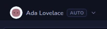

# Author avatars

A commit list is a wall of names, and names are slow to scan. A picture next to
each one turns "who wrote this" into something you answer by glance rather than
by reading. Gitcito puts one on every author it shows: in the graph's author
column, in commit details next to the author and each co-author, in the
co-author picker while you compose, in the profile switcher, and beside each
profile in Settings.

## Where the picture comes from

Three sources, tried in that order. The first that has a picture wins:

| Source | When it is used |
|---|---|
| **Gravatar** | The commit email has a Gravatar account. Fetched over HTTPS, keyed on a SHA-256 hash of the lowercased email. Skipped for GitHub noreply addresses, which nobody registers there. |
| **GitHub** | The email is a GitHub noreply address, or the repository lives on GitHub or a GitHub Enterprise Server your profile has a token for, and the email belongs to an account there. |
| **Generated avatar** | Everything else — no photo anywhere, no network, or the lookups turned off. Drawn locally from the email, never fetched. |

Gravatar goes first because it costs nothing but one image request, and an
address someone registered there carries a picture they chose for exactly this.
GitHub goes second because, for most addresses, it needs an API call.

### How GitHub finds the picture

A commit holds a name and an email, never an account, so the picture has to be
found from the email. There are two ways, depending on the address:

- **A noreply address** — `12345+login@users.noreply.github.com`, or the older
  `login@users.noreply.github.com` — names its account outright. Gitcito turns it
  straight into the picture's address (`avatars.githubusercontent.com/u/12345`, or
  `github.com/login.png` for the old form) and loads only the image. No token, no
  API call, and it works in any repository, wherever it is hosted.
- **Any other address** is looked up on the repository's own server, with your
  profile's token for that server: Gitcito asks for one commit by that author
  (`GET /repos/{owner}/{repo}/commits/{sha}`, or, when that commit has not been
  pushed, the newest commit by that email), and the server answers with the
  account it belongs to — the same thing it does to draw the commit on its own
  website. This only finds an account when the email is **added and verified on
  that account**. A personal address you commit with but never added to GitHub
  is not linked to you there, and no client can find it.

The graph asks in batches — one request per repository for all the authors on
screen, each author once — and at most four requests at a time. If the server
says the rate limit is spent, Gitcito stops asking that server until the time
it gives, and tries again after.

**GitHub pictures appear once your tokens are unlocked.** Tokens saved in the
keychain stay encrypted until you do something that needs one — open Settings,
push, list pull requests. Drawing a picture is not such a thing: it never brings
up the keychain prompt on its own, so right after launch authors get their
Gravatar or the generated face, and your title-bar avatar its generated one.
The moment the tokens unlock, the pictures that were waiting on them ask again —
in the graph and in the title bar alike.

Until then Gitcito cannot tell which servers have a saved token without
decrypting the store, and a saved token outranks a machine login (git's
credential helper or the GitHub CLI) — so while there is an encrypted store
that could hold one, it waits for the unlock rather than ask GitHub as what may
be a different account. **That includes a profile signed in only through a
machine login**, when the same computer has saved other secrets in the keychain
(an AI key, another profile's token): its GitHub pictures arrive after the
first unlock, not at launch. Noreply addresses need no token and show at once.

When there is no encrypted store to wait for — nothing saved in the keychain at
all, or the keychain declined (in the explainer or in **Settings → Security**) —
the machine login and any token you typed this session are all there is, and
they are used from the start. A keychain that is on but not available on this
system (a Linux desktop without a Secret Service) is only discovered by the
first real unlock attempt — drawing a picture never asks the keyring anything,
since on macOS that question is itself the prompt — so there the pictures wait
for that first push, pull request listing or visit to Settings, then use the
machine login. A token you typed while the keychain was unavailable lives only
in memory for the session, and is used straight away.

What came back is remembered: for the session in memory, and on disk in
`github-avatars.json` in Gitcito's data folder — a found picture for 7 days, "no
account" for a day. "No account" is only ever recorded when the server showed a
commit by that email whose author is no account. **No commit by that email in
this repository** — an author who only ever pushed elsewhere — proves nothing
about the account — and changes with the author's next push — so it only holds
the lookup back in this repository for ten minutes and is never recorded as "no
account"; the same author still gets their picture in the next repository. A
**404** says nothing about the author either — GitHub gives the same answer for
a private repository your token cannot see, or one whose SSO it is not
authorised for — so Gitcito records nothing and leaves that repository alone
for ten minutes, while the same authors in repositories you can see still get
their pictures. An **empty repository** (409) is left alone for ten minutes the
same way. The file is keyed on a SHA-256 hash of the server and the email, so
it holds no address in readable form; deleting it is always safe.

The generated avatar is a small creature, not a coloured square: the same email
always produces the same shape and the same colours, so an author stays
recognisable across repositories and across restarts. Two different emails
effectively never collide. It is drawn by
[blobatar](https://github.com/Alain00/blobatar) (MIT), and it needs no network
at all — a repository full of authors nobody has a Gravatar for still gets a
full set of distinguishable faces, offline, on first paint.

Because the seed is the **commit email**, an author who commits under two
addresses gets two avatars. That is deliberate — it is the same signal the
graph's author column gives you, and it is usually how you notice a machine
account or a misconfigured `user.email`. Fix it with
[author attributes](attributes.md) if the two addresses really are one person.

## The face in the title bar

The avatar next to your profile name is the one avatar in Gitcito that stands for
**you, in this repository, right now** — so it is the only one that reacts to the
repository's state. It pulls a face when something is up, and holds a neutral one
the rest of the time.

What it reacts to, worst first: files left conflicted; a merge, rebase,
cherry-pick or revert that git was never told how to finish; a detached HEAD —
alarmed when there is uncommitted work under it, merely uncertain when there is
not; commits piling up unpushed, or unpulled from the remote; changes piling up
uncommitted; a stash drawer nobody opens; and a repository where nothing has
landed in a month.

Worst wins: a repository with conflicts *and* forty unpushed commits wears the
conflicts. Hover the avatar and the tooltip says exactly what caused the face —
a picture that changes for an unstated reason is a puzzle, not a signal. The
tooltip is the part to read; the face is only what makes you look.

The thresholds are deliberately high. A face that turns worried at one unpushed
commit is worried permanently, and a permanent signal is one you learn to stop
reading. A branch with no upstream stays neutral rather than content: "in sync"
is not a claim that can be made about a branch nobody has pushed.

**This is decoration, not instrumentation.** The status bar carries the real
counts, and it is the thing to trust. The face only ever says *something is up*
at a glance.

### Motion

The title-bar avatar breathes and blinks on its own. Turn it off at
**Settings → Themes → Graph → Animate the profile avatar** — the expression
still follows the repository, it just stops moving. Motion is also skipped
automatically when your system asks for reduced motion.

Only this one avatar animates. An animated avatar has to be drawn as live SVG
rather than a cached image, which is fine for one and wasteful for the several
hundred a scrolling graph draws.

## Your profile's picture

The avatar in the title bar and the profile list is yours, so you can choose it.
**Settings → Profile → Avatar** offers four sources:

| Source | What it shows |
|---|---|
| **Automatic** | The default: your Gravatar for the profile's git email, else the picture of the GitHub account the profile is connected to (github.com first, then any Enterprise Server it holds a token for), else the generated face — the one that reacts to the repository. |
| **From integration** | The picture of the GitHub or GitLab account this profile is connected to in Integrations. Disabled until one is. |
| **Icon** | One of 24 glyphs on a colour you pick. |
| **Image** | A file you choose — PNG or JPEG. It is scaled to 256 px and kept on this computer, in Gitcito's data folder, not in the settings file. |

An image travels with **Settings → Data → Export settings** and comes back on import;
deleting the profile deletes it.

**A commit never carries a picture.** It holds a name and an email, and that is
all. GitHub and GitLab show your account picture on a commit when its email
belongs to your account. If you would rather not publish your real address, the
profile's git identity offers **Use my GitHub noreply email** once the account
is connected — an address the host keeps private that still links your commits
to you.

This is for your own profiles only. Every other author still gets the picture of
their commit email, as described above. A chosen picture, like a Gravatar photo,
has no expression: the face that reacts to the repository is the automatic one.

## Turning the lookups off

Two switches, both in **Settings → Themes → Graph**:

- **Show avatars** is the master switch. Off means no request to `gravatar.com`
  or to GitHub for a picture, ever — not deferred, not cached-and-retried — and
  avatars still appear, all of them generated locally.
- **Use GitHub profile pictures** (on by default) turns off only the GitHub
  source: noreply addresses go back to Gravatar, and the API is never asked
  about authors. Gravatar keeps working.

So these are privacy switches, not "hide the pictures" switches. There is no
setting that removes avatars entirely.

### What is sent where

| Sent | To | When |
|---|---|---|
| SHA-256 of the email | `gravatar.com` | Every author with an email, unless Show avatars is off. |
| The account id or login inside a noreply address | `avatars.githubusercontent.com` / `github.com` | A noreply author, unless either switch is off. No token. |
| The repository's owner/name, a commit sha, and the author's email | The repository's own GitHub server — `api.github.com` for a github.com repository, the Enterprise Server itself for one hosted there | An author with no Gravatar, in a repository on a GitHub your profile has a token for. With that server's token and no other. |
| Your profile's token | Its own server (`GET /user`) | Once per session and account, for your own picture in the title bar — again after you connect a different account. |

A token is only ever sent to the server it was saved for: a github.com token
never goes to an Enterprise Server, an Enterprise Server's token never goes to
github.com, and a repository on any other host sends nothing. Without a token
there is no API call at all — anonymous clients get 60 requests an hour, which a
single graph would spend in one scroll. Nothing goes to any other third party.

## The limits

- **A Gravatar lookup tells gravatar.com that this email was looked at.** The
  hash is not a secret: anyone holding a candidate email can hash it and compare.
  If a repository's author list is something you would rather not hand to a third
  party, turn the lookup off before you open it.
- **GitHub only, among hosts.** Pictures uploaded to GitLab, Bitbucket, Azure
  DevOps or Forgejo are not read for commit authors.
- **GitHub needs the email on the account.** The API finds an author only by an
  email added and verified on their GitHub account. A commit made with an
  address that is not — a work address, a typo, a machine's default — gets
  Gravatar or the generated face, and so does every author in a repository with
  no GitHub remote, unless their address is a noreply one.
- **Locked tokens hold GitHub pictures back.** While the keychain store is
  still encrypted, non-noreply authors and your title-bar picture wait for the
  first unlock — even with a machine login, if anything at all is saved in the
  keychain. See above for why.
- **A GitHub picture can be GitHub's default.** An account that never uploaded a
  photo has GitHub's generated pattern, and that is what you see.
- **Enterprise Server noreply addresses are not decoded.** GitHub documents no
  format for them, so they go through the API like any other address.
- **The API reads the repository's `origin`** (or its first remote). A fork
  whose `origin` is your copy finds the authors your copy has.
- **No overrides.** You cannot pin a chosen picture to an author, and you cannot
  swap the generated style. The avatar is a function of the email and nothing
  else.
- **A photo has no expression.** If your profile email has a Gravatar, or your
  profile is connected to a GitHub account, the title bar shows the photo and no
  face — a photograph cannot pull a face at you. Turn the lookups off if you
  would rather have the expressive blob.
- **The face follows the active repository only.** On a tab that is not a
  repository there is nothing to react to, so it stays neutral.
- **One reading at a time.** The face shows the single worst thing it found, so
  a repository can be untidy in several ways and still wear one expression. It is
  not a status list — that is the status bar's job, and the tooltip's.
- **Small is small.** In the graph's author column the avatar is 16px, which
  carries colour and silhouette but not detail. Commit details draws the author
  at 38px, which is where you actually see the face.

**See also:** [Themes & appearance](themes.md) · [The commit graph](graph.md) ·
[Author attributes](attributes.md) · [Profiles](profiles.md)
