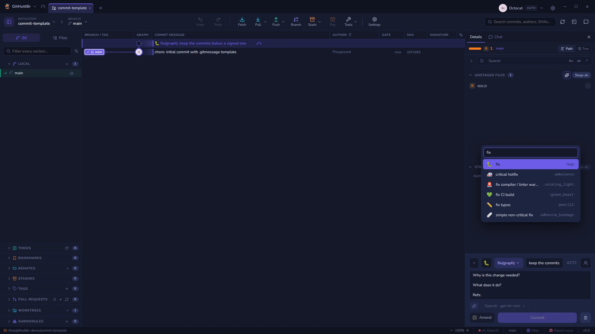

# Committing

## Message styles

Pick one in **Settings → AI → Commit messages**, or straight from the composer;
the composer adapts to it. The style belongs to the AI the profile uses — the
general one, or the profile's own.

| Style | Looks like |
|---|---|
| **Conventional** | `feat(api)!: add rate limiting` — with a type dropdown |
| **Gitmoji** | `✨ add rate limiting` — with an emoji picker |
| **Gitmoji + Conventional** | `✨ feat(api): add rate limiting` — emoji picker *and* type dropdown |
| **Ticket** | `ABC-123: add rate limiting` — seeded from the branch name |
| **Plain** · **Auto** | Whatever you type; Auto lets the AI decide the shape |
| **Caveman** · **Haiku** | Exactly what they sound like |

### Gitmoji

[Gitmoji](https://gitmoji.dev) puts an emoji in front of the subject so a
history reads at a glance — 🐛 fixes, ✨ features, 🔥 removals. With either
gitmoji style, the emoji button sits right beside the subject field: it opens
**all 75 official gitmoji**, searchable by emoji, by `:code:` (what gitmoji-cli
users type) or by meaning in your own language.

**Gitmoji + Conventional** keeps the type and the emoji in step. Pick a type
and its emoji follows; change the type and it changes too — unless you chose
the emoji yourself (🚑️ on a `fix`, say), which is never overwritten.

| Type | Emoji | Type | Emoji |
|---|---|---|---|
| `feat` | ✨ | `test` | ✅ |
| `fix` | 🐛 | `build` | 📦️ |
| `docs` | 📝 | `ci` | 👷 |
| `style` | 🎨 | `chore` | 🔧 |
| `refactor` | ♻️ | `revert` | ⏪️ |
| `perf` | ⚡️ | | |

The AI writes in the same shape, and if a model forgets the emoji or answers
with a `:shortcode:`, the subject is corrected before it reaches the field.

Commits written by other tools as `:sparkles: add login` are **shown** as
`✨ add login` in the graph, the commit details and the history views.

Limits:

- The picker always writes the **unicode** emoji, never a `:shortcode:`.
- Shortcodes are converted for display only. The commit itself is not
  rewritten, and searching the history matches the text as it was committed.
- Only gitmoji count: a subject that starts with any other emoji is left alone.
- A repository whose `commit-msg` hook runs commitlint with the stock
  Conventional preset rejects a leading emoji. That is the hook's rule, not
  GitHuttBr's — configure commitlint for gitmoji or use plain Conventional there.

## Writing the message with AI

With AI on, the **✦** button (*Generate with AI* on hover) sits under the
description. It reads the staged diff and writes the summary and the
description in the style above. Beside it, the row names who will answer — *account · model*, the pair chosen for
commit messages under **Settings → AI → Model per task** — so a slow local
model or a costly one is never a surprise.

- **▾** beside the name lists your saved accounts, each with a few of its
  models. A pick is used **for that one generation only**; Settings do not
  change.
- While it runs, the ✦ spins and the same row shows the seconds so far and
  **Cancel**, which stops the request itself, not just the spinner. The summary
  and description are read-only meanwhile, so nothing you type is overwritten
  by the answer. After 30 seconds the app-wide *taking longer than expected*
  prompt ([AI](ai.md)) offers to keep waiting or move the same generation to
  another ready account; **Generate again** then uses that account.
- The new text **replaces** what was there, and the old text is kept: **Undo**
  and **Generate again** appear on the same row (hover them for *Generated by
  account · model in 7 s*). Undo puts your summary and description back. Both
  go away as soon as you edit the text or commit.
- The description you type, or the one the AI wrote, stays when you switch to
  another tab and come back, like the summary — and so do **Undo** and
  **Generate again** after a generation.

[Edit commit](commit-edit.md) has the same button, working from that commit's
own diff.

Limits:

- Only the staged diff is sent, clipped when it is very large — never unstaged
  changes or other files.
- Undo holds one step: the text from before the first generation in a row.
  Once Undo is gone, so is that copy.
- Cancel cannot refund tokens a provider has already spent on the request.
- The ▾ list shows every saved account, including one with no key yet; picking
  it fails with that account's own error.

## Things the composer does for you

- <kbd>↑</kbd> <kbd>↓</kbd> recalls your **recent messages**.
- A **co-author picker** adds `Co-authored-by:` trailers from the repository's
  own contributors.
- `commit.template` / `.gitmessage` **prefills** the message, comment lines
  stripped.
- During a merge, cherry-pick or revert, the message is **pre-filled** the way
  git would.
- Drafts **persist** per repository, so switching tabs never loses a message.

## The linter

A live, non-blocking check: subject length (with a character counter), a
trailing period, a non-imperative or lowercase subject, over-wide body lines.
Hints, never a gate — it will not stop you committing.

## Amend

Amend rewrites the last commit with whatever is staged. GitHuttBr shows you the
existing message first so you are editing, not retyping.

**Amend Commit…** on a graph row does the same thing for HEAD: it loads the
full message, switches the composer into amend mode, and focuses it. A HEAD
that was already pushed can still be amended, but GitHuttBr warns that updating
the remote will take a force push.

**Undo Commit…** is the sibling for an unpushed HEAD: mixed reset to the
parent, working-tree changes kept, message restored to the composer. The
initial commit has a dedicated path that leaves an unborn branch instead of
destroying the files.

**See also:** [Staging](staging.md) · [Absorb](absorb.md) · [Changelog generator](changelog.md)
