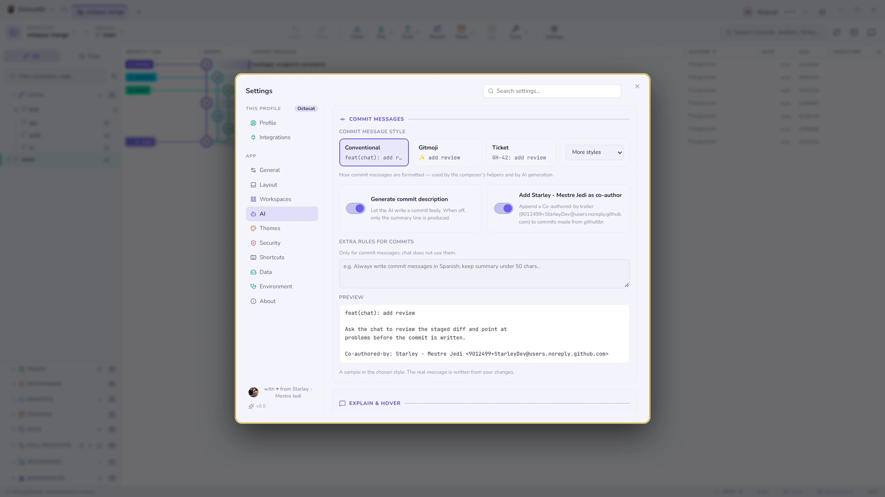

# KI-Funktionen

Jede KI-Funktion ist **optional** und aus, bis du einen Anbieter einrichtest.
Es wird nichts irgendwohin geschickt, bevor du nicht konkret etwas anforderst.

## Eine KI für alle Profile

Die KI wird einmal eingerichtet, unter **Einstellungen → KI**, und jedes
[Profil](profiles.md) nutzt sie: Ein Profil, das du später anlegst, hat die KI
schon, ohne dass ein Konto erneut hinzugefügt werden muss. Die Seite listet jedes
Profil und ob es dieser **allgemeinen KI** folgt.

Ein Profil kann stattdessen **seine eigene KI** verwenden — ein Arbeitsprofil,
das aus Kosten- oder Datenschutzgründen über das Konto der Firma laufen muss
oder seine Commits anders schreibt. Auf der Seite **Profil** dieses Profils,
unter *KI dieses Profils*, stellst du **Allgemein** auf **Eigene** um: Sie
beginnt als Kopie der gesamten allgemeinen KI — Konten, Schlüssel und
Einstellungen —, und all das gehört von da an nur diesem Profil. Zurück auf
**Allgemein** entfernt sie nach einer Bestätigung und lässt die allgemeine KI,
wie sie war.

Ein Profil nutzt eine KI **ganz**: die allgemeine oder seine eigene, nie eine
Mischung. Konten und Modelle *und* wie die KI schreibt und was der Chat darf,
kommen von derselben Stelle — wer den Commit-Stil der allgemeinen KI ändert,
ändert ihn für jedes Profil, das ihr folgt.

Jede KI wird auf dieser einen Seite eingerichtet. Die Leiste **Bearbeitet wird**
oben wählt, welche: die allgemeine KI oder die eigene eines Profils (*Eigene KI
von Arbeit*). **Eigene KI einrichten** auf der Profilseite oder **Eigene KI
bearbeiten** in der Profilliste öffnet die Seite auf genau dieser. Die
Profilseite selbst zeigt nur, welche KI das Profil verwendet und was antwortet —
den Editor enthält sie nie, und eigene KI-Optionen hat sie keine.

Unter den Konten enthält dieselbe Seite, wie diese KI **schreibt** und was sie
darf, in Abschnitten:

| Abschnitt | Enthält |
|---|---|
| **Commit-Nachrichten** | Der Commit-Stil — Conventional, Gitmoji und Ticket als Karten mit einer Beispielzeile, der Rest unter *Weitere Stile* — *Commit-Beschreibung erzeugen*, die Co-Autor-Zeile, **Zusätzliche Regeln für Commits** und eine Vorschau |
| **Erklären & Hover** | Stil der Erklärungen, *Code beim Überfahren erklären* und seine Zusatztaste |
| **Konflikte & Branches** | Stil der Konfliktlösung, Stil der Branch-Namen, jeweils mit einem Beispiel des Ergebnisses |
| **Repository-Chat** | Ob der Chat an ist, was er liest, welche Aktionen er vorschlagen darf — siehe [Repository-Chat](repo-chat.md#einstellungen) |

**Zusätzliche Regeln für Commits** — bis 4.60 *Eigene Anweisungen* — fließen nur in die Erzeugung von Commit-Nachrichten ein: Chat, Erklärungen, Reviews und Branch-Namen lesen sie nicht. Die Vorschau ist ein festes Beispiel, kein Modellaufruf: sie zeigt die Form des gewählten Stils, nicht das, was die KI für deine Änderung schreibt.

Der Stilschalter im Editor und die Modell- und Freigabeauswahl des Chats
schreiben in dieselbe KI, die das Profil liest: die allgemeine oder die eigene
des Profils.

Ein Upgrade von einer Version, in der jedes Profil seine eigene KI hatte, verliert
nichts: Die KI des verwendeten Profils wird zur allgemeinen KI, und jedes andere
Profil, dessen KI anders war, behält sie als eigene.

**Upgrade von 4.59 oder älter**, wo die Schreibeinstellungen an jedem Profil
hingen: Einmalig wandern die Einstellungen des verwendeten Profils (oder, falls
dieses eine eigene KI hat, die des ersten Profils auf der allgemeinen KI) in die
allgemeine KI. Profile mit eigener KI behalten ihre. **Die Grenze:** Wenn zwei
Profile auf der allgemeinen KI unterschiedlich schrieben — ein Arbeitsprofil mit
`ticket` und ein privates mit `conventional` —, schreiben jetzt beide wie das
übernommene. Um den Unterschied zu behalten, gib einem von ihnen eine eigene KI
und stelle seinen Stil dort erneut ein.

## Anbieter

Ein **Konto** ist ein Weg zu einem Modell: ein Anbieter, wo er erreichbar ist
und wie er sich authentifiziert. Du kannst mehrere einrichten, und sie bestehen
nebeneinander — ein Arbeitsschlüssel, ein privater, ein lokales Modell, eine
CLI, in der du bereits angemeldet bist.

Voreinstellungen gibt es für **OpenAI, Anthropic, Google Gemini, OpenRouter,
Groq, Mistral** und **Ollama** (vollständig lokal), dazu jeder
OpenAI-kompatible Endpunkt.

Anthropic nutzt seine eigene `/v1/messages`-API statt eines OpenAI-förmigen
Aufrufs, deshalb funktionieren Claude-Modelle jetzt wirklich, statt es nur zu
scheinen. Gemini wird über Googles OpenAI-kompatiblen Endpunkt angesprochen.

### Einen Anbieter hinzufügen und bearbeiten

Ein halb ausgefüllt gespeicherter Anbieter war eine stille Falle: Ein leerer
Schlüssel konnte in Verwendung landen, und nichts antwortete. Deshalb wird auf
dieser Karte nichts beim Tippen gespeichert.

**Anbieter hinzufügen** öffnet eine Karte mit der Markierung **Entwurf · nicht gespeichert**
und gestricheltem Rand. Trage Anbieter, Schlüssel, Endpunkt und Modell ein und
wähle **Testen und speichern**. GitHuttBr listet zuerst mit diesem Schlüssel
die Modelle des Anbieters — dieselbe Anfrage wie **Modelle abrufen** — und
speichert nur, wenn er antwortet. Du siehst **Verbunden · N Modelle**, und der
Anbieter erscheint in der Liste als **Bereit**.

Schlägt der Test fehl, zeigt die Karte **Verbindung fehlgeschlagen** mit dem
Grund des Anbieters (ein abgelehnter Schlüssel, `401`; ein Server, der nicht
läuft) und **Es wurde nichts gespeichert.** Korrigiere das Feld und teste erneut,
wähle **Trotzdem speichern**, um ihn so zu behalten — dann steht er auf
**Antwortet nicht** —, oder **Abbrechen**, das keine Spur hinterlässt.

Einen gespeicherten Anbieter zu bearbeiten funktioniert genauso. Ein Banner
zeigt **Ungespeicherte Änderungen – nichts ändert sich, bis du speicherst**, und jedes geänderte Feld ist mit
**· geändert** markiert. **Änderungen verwerfen** stellt die
gespeicherten Werte wieder her; **Testen und speichern** testet und speichert.
Wer mit offenen Änderungen einen anderen Anbieter wählt, einen hinzufügt oder
**Mein Abo verwenden** öffnet, wird gefragt: **Änderungen an „…“ speichern?** —
**Speichern**, **Änderungen verwerfen** oder **Weiter bearbeiten**. Beim
Schließen der Einstellungen bleibt der Entwurf im Speicher und ist beim
Zurückkommen noch da; auf die Festplatte wird er nie geschrieben.

Schlüssel werden genau wie bisher im Schlüsselbund gespeichert, und nur beim
Speichern. Die Fehlermeldung eines Anbieters erscheint mit maskiertem Schlüssel
und maskierten tokenartigen Zeichenfolgen.

| Anbietertyp | Was **Testen und speichern** prüft |
| --- | --- |
| API-Schlüssel oder lokaler Server (Ollama, eigener Endpunkt) | Listet die Modelle; Erfolg heißt, der Endpunkt hat mit diesem Schlüssel geantwortet |
| Abo (Codex, Claude Code) | Sendet den unten beschriebenen kurzen Testprompt, aus dem Kontingent deines Plans |
| Lokale CLI | Sucht den Befehl in deinem `PATH`; ein eingetippter Pfad wird ohne Prüfung gespeichert |

### Statusabzeichen

Jeder Anbieter in der Liste trägt ein Abzeichen, abgeleitet aus dem, was die
Seite schon weiß — dem letzten Test oder der ohnehin geladenen Modellliste. Im
Hintergrund wird nichts abgefragt.

| Abzeichen | Bedeutung |
| --- | --- |
| **Bereit** | Der letzte Test oder die letzte Modellliste war erfolgreich |
| **Antwortet nicht** | Der letzte Versuch ist fehlgeschlagen; der Grund steht in der Zeile darunter, mit **Erneut testen** |
| **Kein Schlüssel** | Der Anbieter braucht einen API-Schlüssel und hat keinen |
| **Nicht geprüft** | Noch nichts hat ihn gefragt — ein Abo, bis es getestet ist, oder eine nicht geladene Liste |

**Die Grenze:** Ein Abzeichen ist nur so frisch wie seine letzte Prüfung. Ein
Anbieter, der seit einer Stunde nicht mehr antwortet, steht weiter auf
**Bereit**, bis ihn etwas erneut fragt — wähle
**Verbindung testen** auf seiner Karte, um sicherzugehen. Eine **lokale CLI** mit
eingetipptem Pfad bleibt **Nicht geprüft**, weil der Nachweis einen
Prompt kosten würde.

### Der verwendete Anbieter

Ein Anbieter beantwortet jede Aufgabe, die unter **Modell je Aufgabe** keinen
eigenen Anbieter hat. Seine Zeile trägt **In Verwendung** — eine gefüllte Pille
und einen Akzentrand — und bleibt an ihrem Platz in der Liste. Die allgemeine KI
und ein Profil mit eigener KI haben jeweils ihren eigenen verwendeten Anbieter;
die Liste ändert den, den du gerade bearbeitest.

Jeder andere gespeicherte Anbieter hat rechts in seiner Zeile, neben seinem
Abzeichen, eine Schaltfläche **Verwenden**. Ein Klick setzt ihn in Verwendung und
speichert sofort: Welcher Anbieter antwortet, ist eine Wahl, keine Bearbeitung,
also wartet es nicht auf **Testen und speichern**. Die Karte dieses Anbieters
öffnet sich nicht, und eine Karte mit ungespeicherten Änderungen behält sie.

**Die Grenze:** **Verwenden** testet nichts. Ein Anbieter mit **Kein Schlüssel**
oder **Antwortet nicht** lässt sich verwenden — absichtlich, bevor du den
Schlüssel reparierst — und sein Abzeichen sagt es weiterhin; die nächste
KI-Aufgabe scheitert mit dem Grund dieses Anbieters. Ein Entwurf hat kein
**Verwenden**: Er ist erst nach dem Speichern ein Anbieter.

### Die verwendete KI, aus der Statusleiste

Ein Profil mit eigener KI ignoriert den Anbieter, den die allgemeine KI
verwendet: einen anderen Anbieter in der allgemeinen KI zu verwenden ändert für
dieses Profil nichts, und außerhalb der Einstellungen sagte das nichts. Die
Statusleiste am unteren Rand eines Repositorys sagt es jetzt. Ihr Knopf **KI:** _Anbieter_ nennt den Anbieter, der für das aktive Profil antwortet, mit einem
Punkt für seinen Status — grün **Bereit**, rot **Antwortet nicht**, bernstein
**Kein Schlüssel**, grau **Nicht geprüft**.

Ein Klick öffnet ein kleines Panel:

| Teil | Was er zeigt |
| --- | --- |
| Kopf | Das aktive Profil, und ob es **der allgemeinen KI folgt** oder **eine eigene KI hat** |
| Eine Zeile pro Anbieter | Jeder gespeicherte Anbieter dieser KI, mit Modell und Status; ein Anbieter, der nicht antwortet, nennt den Grund in einer zweiten Zeile |
| **In Verwendung** / **Verwenden** | Der Anbieter, der jetzt antwortet, und ein Wechsel mit einem Klick bei jedem anderen |
| **KI konfigurieren** | Öffnet **Einstellungen → KI** |
| **Nutzung und Kosten** | Öffnet den Tab *Auswertung* der Repository-Einstellungen |

**Verwenden** schreibt dorthin, wo das Profil seine KI liest. Bei einem Profil,
das der allgemeinen KI folgt, ändert es die allgemeine KI — und damit jedes
Profil, das ihr folgt; bei einem Profil mit eigener KI nur dessen eigene.
Aufgaben mit eigenem Anbieter behalten ihn. **Esc** schließt das Panel, und der
Knopf ist ausgeblendet, solange KI ausgeschaltet ist.

**Die Grenzen:** Der Punkt wird aus der Modellliste abgeleitet, die die App
ohnehin abgerufen hat (bis zu einem Tag aufbewahrt), und testet nie etwas — ein
Anbieter, der nicht mehr antwortet, kann also noch **Bereit** zeigen; sicher ist
nur ein Verbindungstest in den Einstellungen. Bis die Einstellungen geöffnet
wurden, hält das Fenster die Schlüssel selbst nicht, sodass ein Anbieter ohne
Schlüssel dort **Nicht geprüft** oder **Antwortet nicht** statt **Kein
Schlüssel** zeigen kann. Wie **Verwenden** in den Einstellungen testet der
Wechsel den Anbieter nicht, den er in Verwendung nimmt.

### Ein Abo statt eines API-Schlüssels nutzen

Wähle bei der Einrichtung oder unter Einstellungen → KI **Mein Abo verwenden**. Wähle ChatGPT oder Claude und melde dich mit dem passenden Befehl im Terminal an. Teste die Verbindung und füge das Konto nach erfolgreichem Test hinzu. Das erste Konto der allgemeinen KI ist danach **In Verwendung**.

Klicke nach der CLI-Installation auf Verbinden, um die Anmeldeseite des Anbieters zu öffnen. Eine laufende Verbindung kannst du abbrechen.

- ChatGPT (Codex) — `codex login`
- Claude (Claude Code) — `claude auth login`

Der Test sendet eine kurze Anfrage an den Anbieter und nutzt dein Kontingent. Kontingent erschöpft. Versuche es nach der Erneuerung erneut.

Wähle den Anbieter **Lokale CLI**, um mit einer Agent-CLI zu antworten, die auf
diesem Rechner bereits installiert und angemeldet ist — `claude`, `gemini` oder
`codex`. GitHuttBr startet das Programm mit deiner Eingabe und liest die Antwort;
es gibt keinen API-Schlüssel einzufügen und kein Token wird gespeichert.

GitHuttBr führt nur einen Befehl aus, den du als Konto eingerichtet hast, und
immer mit einer Argumentliste statt einer Shell — nichts aus einem Diff oder
einem Branch-Namen kann also als Befehl gelesen werden.

> **Das ist nicht privater als ein API-Schlüssel.** Deine Eingaben erreichen
> weiterhin denselben Anbieter, unter deinem eigenen Konto, genau wie mit einem
> Schlüssel. Es ändern sich Abrechnung und Einrichtung, nicht der Weg des Texts.

Liegt der Befehl nicht in deinem `PATH`, trage seinen vollständigen Pfad am
Konto ein.

### Modell je Aufgabe

Unter **Modell je Aufgabe** kann jede Funktion — Commit-Nachrichten,
Chat, Erklären, PR-Review, Konfliktlösung, Wiki, Themes — auf ein eigenes Konto
und Modell zeigen. Lass eine Zeile auf **Verwendeter Anbieter**, um dem Anbieter
mit **In Verwendung** zu folgen. Ein günstiges Modell für Commit-Nachrichten und
ein starkes für den Chat ist die übliche Aufteilung.

### Upgrade-Hinweis

Beim Upgrade von einer Version vor den Konten erscheint das einmal. Anbieter und Schlüssel, die du hattest, werden zum ersten Konto; von Hand ist nichts neu einzurichten.

## Modelle

Modelllisten kommen vom Anbieter selbst und werden einen Tag zwischengespeichert;
**Modelle abrufen** aktualisiert eine sofort. Unter der Liste sagt GitHuttBr, woher
sie stammt — live, aus dem Cache (mit Zeitpunkt) oder aus der eingebauten
Ersatzliste, und warum.

Die Liste ist auf Modelle gefiltert, die eine Chat-Anfrage beantworten können;
Embedding-, Sprach- und Bildmodelle bleiben also draußen. Jedes Modellfeld nimmt
außerdem freien Text an, sodass ein Vorschaumodell, ein privates Deployment oder
ein frisch geholter Ollama-Tag immer nutzbar ist, auch wenn der Anbieter ihn
nicht aufführt.

Ein Anbieter, dem du noch keinen Schlüssel gegeben hast, oder der nicht
erreichbar ist, fällt auf eine kleine eingebaute Liste zurück statt auf ein
leeres Auswahlfeld.

Kein Anbieter veröffentlicht eine sortierte oder kuratierte Liste, die Aufbereitung stammt also von GitHuttBr: datierte Snapshots klappen in das Modell zusammen, von dem sie ein Snapshot sind (`gpt-4o` deckt `gpt-4o-2024-08-06` ab), und der Rest steht nach Aktualität statt alphabetisch. **Alle Modelle zeigen** am Ende der Liste holt alles zurück, was der Anbieter geliefert hat.

## Was es kann

| Funktion | Was du bekommst |
|---|---|
| **Commit-Nachricht** | Zusammenfassung (und optional ein Body) aus deinem gestagten Diff, im gewählten Stil |
| **Diese Datei erklären** | Erklärung in Alltagssprache in einem Seitenpanel — Normal, Knapp, ELI5… sogar Pirat |
| **Hover zum Erklären** | Halte <kbd>⇧</kbd> und zeige auf einen Bezeichner für eine einzeilige Erklärung, plus die Zeilen, auf die sie sich stützt |
| **Konfliktlösung** | Schlägt einen Merge in der editierbaren Ausgabe vor — wendet nie automatisch an |
| **PR-Review** | Fasst einen Diff zusammen und markiert Risiken, jedes verankert an einer echten `path:line` |
| **PR-Beschreibung** · **Branch-Namen** | Entworfen aus den Commits und dem Diff des Branches |
| **Themes** · **Graph-Paletten** | Aus einem Prompt generiert |
| **Smartes Staging** | Vorschläge, was in diesen Commit gehört |
| **KI-Konfigurationsassistent** | Erzeugt Assistenten-Konfigurationsdateien (Anweisungen, Agenten, Hooks) für das Repository — der Zauberstab-Knopf in der Kopfzeile des Chat-Panels |

## Verankert, nicht geraten

Das Review sieht den Diff als **beschriftete Hunks** und darf nur diese
Beschriftungen zitieren; GitHuttBr löst dann jede Beschriftung zu einer echten
Datei und Zeile auf. Ein Modell, das eine Fundstelle erfindet, wird
**abgelehnt und erneut gefragt** — Befunde zeigen also immer auf Code, den es
wirklich gibt.

Hover zum Erklären liest nur ein nummeriertes Fenster rund um das Token — in
einem Diff nur die Hunks, die auf dem Bildschirm sichtbar sind. Liegt eine
Definition anderswo, sagt es das, statt sie zu erfinden. Antworten werden pro
Dateiversion gecacht.

**Maskierte Secret-Dateien werden nie gesendet.** Ebenso wenig Dateien, die
unter die Regeln zur Secret-Maskierung fallen.

## Wenn ein Modell langsam ist oder nicht mehr antwortet

Ein lokales Modell auf einem Laptop kann für eine Commit-Nachricht eine Minute
brauchen, und ein Modell, das vor der Antwort „nachdenkt“, noch länger — aber
ein Server, der mitten in einer Anfrage geschlossen wurde, sollte dich nicht vor
einem drehenden Kreis sitzen lassen.

| Was passiert | Was du siehst |
|---|---|
| Nach 30 Sekunden keine Antwort | *„{Konto} braucht länger als erwartet für die Antwort.“*, mit **Weiter warten**, **{anderes Konto} verwenden** und **Abbrechen**. Weiter warten fragt eine Minute später erneut, falls es noch läuft |
| Ein lokaler Server (Ollama, LM Studio, llama.cpp…) wird geschlossen, während er arbeitet | Innerhalb weniger Sekunden: *„{Konto} antwortet nicht. Läuft es noch?“*, mit einem Knopf für jedes andere einsatzbereite Konto und **Abbrechen** |
| Der Server war schon geschlossen, als du gefragt hast | Dasselbe, sofort |

**{anderes Konto} verwenden** bricht die Anfrage ab und schickt dieselbe an
dieses Konto, mit dessen Standardmodell — die Commit-Nachricht, das Review oder
die Chat-Antwort kommt an, als hättest du dort gefragt. An deinen Einstellungen
ändert das nichts: Die nächste Anfrage geht wieder an das Konto, das du für
diese Aufgabe gewählt hast.

Das gilt für jede KI-Funktion — Commit-Nachrichten, Chat, Review, Erklären,
Konflikte, Themes, das Wiki — denn sie laufen alle über denselben Aufruf.

## Grenzen

- **Nur lokale Server werden darauf überwacht, ob sie geschlossen wurden.** Ein
  Cloud-Anbieter, der ausfällt, scheitert mit seinem eigenen Fehler; ein
  Cloud-Aufruf, der bloß langsam ist, bekommt die *dauert länger*-Abfrage wie
  jeder andere. Ein lokaler Server, der beschäftigt statt geschlossen ist, gilt
  als lebendig: Nur eine abgelehnte oder abgebrochene Verbindung beendet den
  Aufruf vorzeitig.

- Die eingebauten Ersatzlisten veralten zwischen Releases. Genau dafür gibt es
  den Live-Abruf; der Ersatz deckt nur den Fall ab, dass ein Abruf nicht möglich
  ist.
- Die Filterung auf chatfähige Modelle geht über den Namen, ein ungewöhnlich
  benanntes Chat-Modell kann also herausfallen. Dann tippst du es einfach ein.
- Ein CLI-Konto kann den Tokenverbrauch nur melden, wenn die CLI das tut — die
  Nutzungs- und Kostenzahlen in den Einstellungen zählen solche Aufrufe also zu
  niedrig.
- CLI-Antworten sind langsamer als ein direkter API-Aufruf: das Programm startet
  pro Anfrage eine ganze Sitzung.
- Schlüssel werden pro Konto im Schlüsselbund deines Systems abgelegt. Ein Konto
  zu löschen löscht seinen Schlüssel.
- Der Wechsel zurück zu einer Version vor der allgemeinen KI verliert die
  Schlüssel der allgemeinen KI: Diese Version weiß nicht, wo sie liegen, und
  verwirft sie beim Speichern. Die Konten bleiben; gib die Schlüssel neu ein. Die
  eigene KI eines Profils ist nicht betroffen.

**Siehe auch:** [Repo-Wiki](repo-wiki.md) · [Sicherheit & Secrets](security.md)
