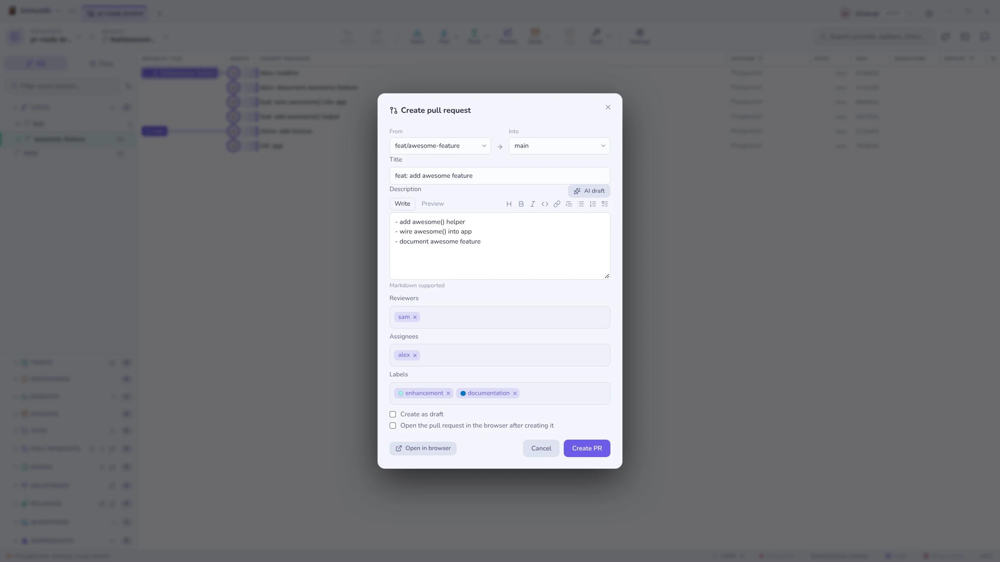
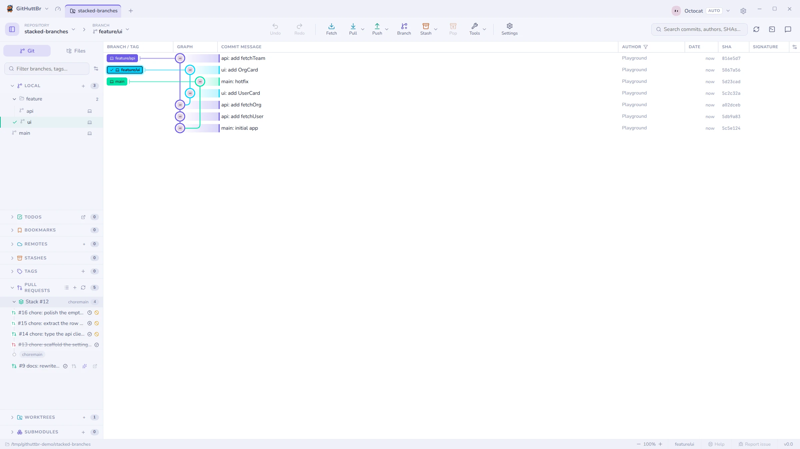
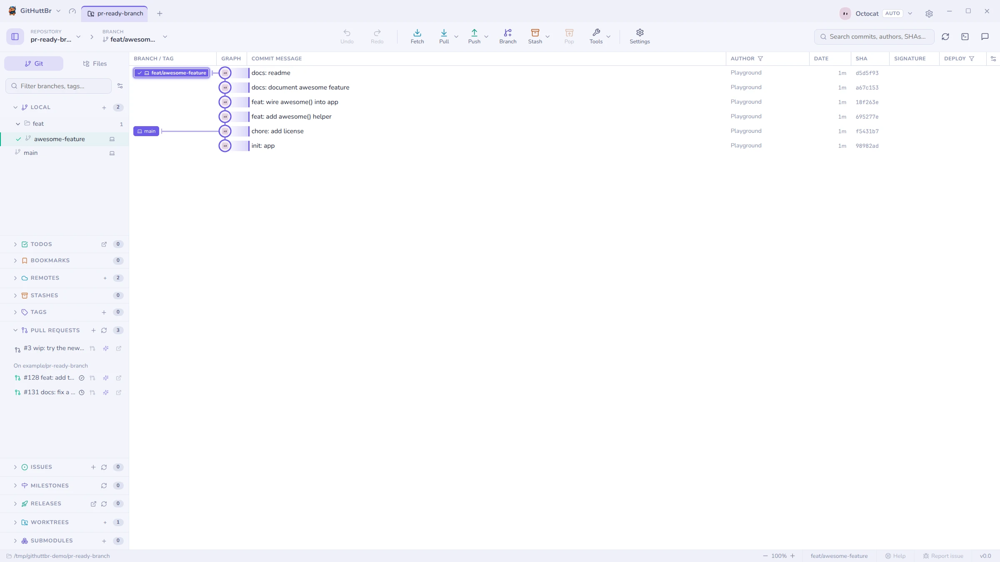
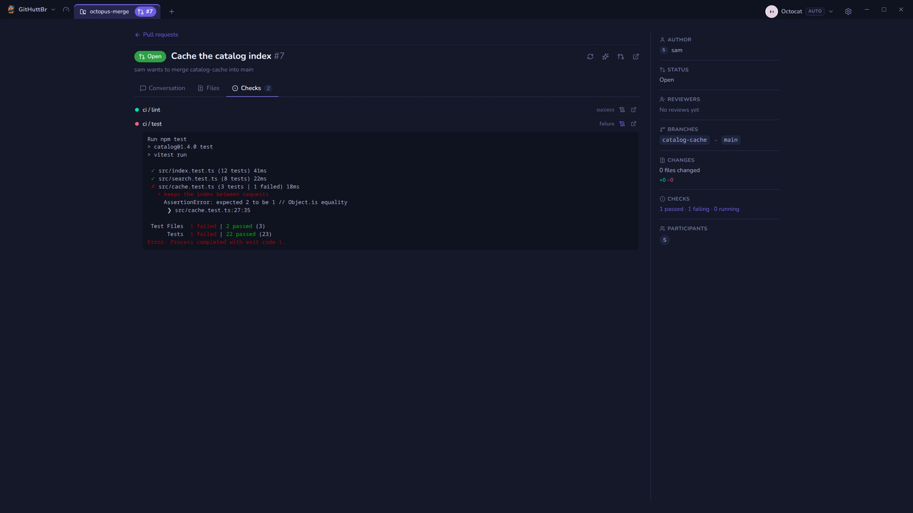
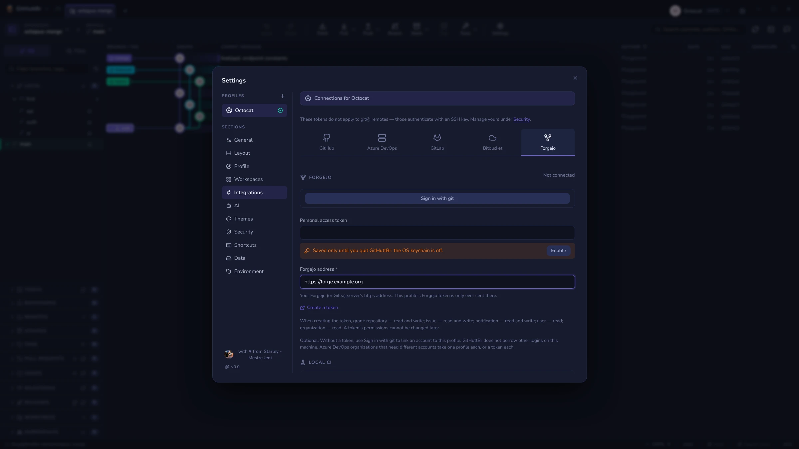
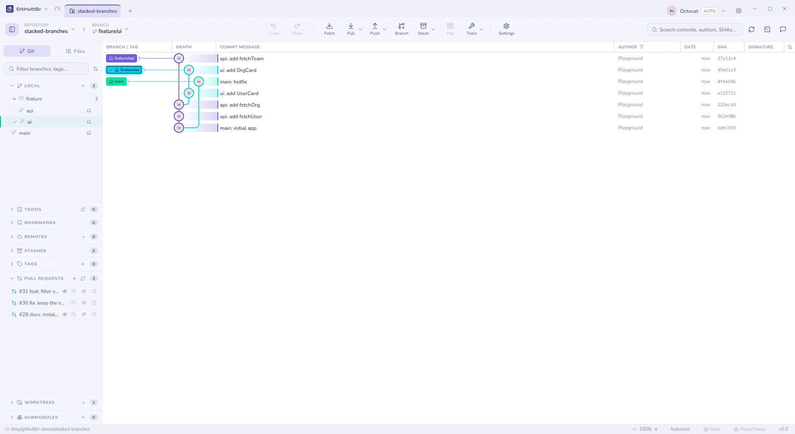

# Hosting & Pull Requests

## Erstellen

Erstelle einen Pull (oder Merge) Request, ohne die App zu verlassen:
Branch-Auswahllisten, Titel und Beschreibung vorausgefüllt aus den Commits des
Branches, ein Draft-Schalter und — auf GitHub — Reviewer, Labels und
Verantwortliche, die beim Anlegen gleich mitgesetzt werden.

Funktioniert mit **GitHub, GitLab, Bitbucket und Azure DevOps**. Offene PRs/MRs
für alle vier werden in der Seitenleiste aufgelistet.

Starte einen aus dem Branch-Vergleich, aus dem Graph, über das `+` im PR-Panel
oder aus einem Issue heraus (was `Closes #N` einträgt).

## Stapel in der Liste

Pull Requests, die aufeinander sitzen, klappen zu einer Zeile zusammen: mit
Stapelsymbol, dem Branch, auf dem die Kette landet, und wie viele es sind.
Aufklappen zeigt die Kette in Leserichtung — Blatt zuerst, hinunter zur Basis —
mit einem kleinen Pfeil unter jeder Zeile, der nennt, wohin sie gemergt wird. Die
Richtung steht damit auf dem Bildschirm, statt aus vier Basen erschlossen zu
werden.

Zwei Dinge bilden so eine Gruppe: GitHubs eigene Stapelnummer, wenn die Pull
Requests zu einem [nativen Stapel](stacks.md) gehören, und sonst die Refs selbst
— ein Pull Request, dessen Basis der Head eines anderen ist, sitzt auf ihm. Die
zweite Regel ist der Grund, warum das auch auf GitLab, Bitbucket und Azure
DevOps funktioniert, und für Ketten von früher.

Jede Zeile trägt den Zustand der **Checks** ihres Heads — für die Zahlen darüber
fahren — und auf GitHub auch die bereits geschlossenen oder gemergten Ebenen, die
eine Liste offener Pull Requests verstecken würde. Eine Ebene über einer
**geschlossenen** gilt als blockiert: ihre eigenen Checks mögen grün sein, aber
der Branch, auf den sie zielt, wird nie landen. Die Aktionen der Zeile erscheinen
beim Überfahren, damit der Titel die Breite behält.

Die Checks zu lesen kostet eine Anfrage pro Pull Request, und nur beim
Aktualisieren der Liste.

## Deine Pull Requests im Ursprungs-Repository eines Forks

In einem Fork zählen meist die Pull Requests, die du im Repository geöffnet hast,
von dem du geforkt hast — und die liegen dort, nicht in deinem Fork. Hat ein
Repository einen Remote `upstream`, der auf ein anderes GitHub-Repository als
`origin` zeigt, fragt die Liste deshalb auch `upstream` nach offenen Pull
Requests und behält **nur die, deren Branch aus deinem Fork kommt**. Sie
erscheinen unter denen deines Forks, unter einer Überschrift mit dem Namen des
Ursprungs, **Auf owner/repo**. Ein Klick öffnet dieselbe Detailansicht, mit
Checks und Review, im Ursprungs-Repository.

*Grenzen:* nur GitHub, und nur ein Remote namens `upstream`. Die übrigen Pull
Requests des Ursprungs bleiben absichtlich draußen: Das ist dessen Warteschlange,
nicht deine Arbeit. Stapel und Branch-Abfragen arbeiten weiter nur mit der Liste
von `origin`. Den Ursprung abzufragen kostet eine Anfrage mehr pro Aktualisierung.

## Reviewen — GitHub und GitLab

Ein Klick auf einen Pull Request öffnet ihn als **eigene Seite**. Sie hängt an
ihrem Repository wie das Wiki: ein Symbol mit der PR-Nummer am Tab des
Repositorys oder an seinem Chip in einer Gruppe. Ein erneuter Klick auf das
Symbol oder auf den Namen des Repositorys führt zurück. **In neuem Tab öffnen**
im Rechtsklickmenü des PRs gibt ihm stattdessen einen eigenen Tab. Ist das
Repository nirgends geöffnet, öffnet sich der PR in einem eigenen Tab.

Die Arbeit passiert in der Hauptspalte, und die Seitenleiste sagt, was der PR
*ist*, ohne dass du scrollen musst. Mit eingeschalteter KI reviewt der ✨-Knopf
in der Kopfzeile den Diff des PRs so, wie der Host ihn meldet — das klappt
auch für einen Branch, den du nie geholt hast (ein Fork, der eines anderen).

Die Hauptspalte hat drei Bereiche:

| Bereich | Was er enthält |
|---|---|
| **Unterhaltung** | Beschreibung, Kommentare und Inline-Review-Threads (`datei:zeile`, mit Antworten). Nur die Unterhaltung scrollt: Das Kommentarfeld mit kommentieren / freigeben / Änderungen anfordern und die Merge-Box (Merge, Squash oder Rebase) bleiben unten fest, sodass ein langer Pull Request sie nie außer Reichweite schiebt |
| **Dateien** | Jede geänderte Datei und der Diff der gewählten neben der Liste, mit Syntax-Hervorhebung und Änderungen auf Wortebene (geheim aussehende Dateien maskiert, wenn diese Einstellung an ist). Eine ✓-„Gesehen“-Liste merkt sich deinen Fortschritt. Eine Datei, für die der Host keinen Diff schickt (binär oder zu groß), verlinkt auf den Host |
| **Checks** | Wie die CI des Head-Commits gelaufen ist und warum sie fehlschlug — siehe [den Tab Checks](#der-tab-checks). Jeder Lauf des Repositorys — nicht nur die dieses Pull Requests — steht auf der Seite [CI-Läufe](ci-runs.md) |

Die Seitenleiste zeigt:

| Zeile | Zeigt |
|---|---|
| **Autor** | Wer ihn geöffnet hat, und wann |
| **Status** | Offen, Entwurf, gemergt (von wem, wann) oder geschlossen; Konflikte mit dem Ziel |
| **Reviewer** | Die letzte Entscheidung jedes Reviewers (freigegeben, Änderungen angefordert, kommentiert) und wer noch aussteht, Teams eingeschlossen |
| **Zuständige, Labels, Meilenstein** | Wie auf dem Host gesetzt, Labels in ihren eigenen Farben |
| **Branches** | Quelle → Ziel, und der Fork, aus dem er kommt |
| **Änderungen** | Geänderte Dateien, Commits, hinzugefügte und entfernte Zeilen, mit Balken |
| **Checks** | Bestanden / fehlgeschlagen / läuft, einen Klick vom Bereich Checks entfernt |
| **Beteiligte** | Alle, die mitgewirkt haben |
| **Aktivität** | Wann er geöffnet und zuletzt aktualisiert wurde |

GitLab meldet für einen Merge Request keine Zeilensummen; sie werden aus der
Dateiliste summiert, sobald sie geladen ist. Eine Zeile, die der Host nicht
meldet, fällt weg.

Wenn jemand mitten im Review force-pusht, zeigt dir [was sich seitdem geändert hat](range-diff.md)
genau, was sich bewegt hat.

### Der Tab Checks

Ein roter Check beantwortet eine Frage schlecht: *was* kaputtgegangen ist. Der
Tab Checks beantwortet sie ohne Umweg über die Website der CI. Die Beschriftung
des Tabs trägt eine rote Zahl der fehlgeschlagenen Checks, du weißt es also,
bevor du ihn öffnest.

- **Die Zusammenfassung** oben sagt, wie viele Checks fehlgeschlagen sind (oder
  dass alle bestanden haben, oder wie viele noch laufen), auf welchem Commit,
  wann der letzte fertig wurde und wie lange sie zusammen gebraucht haben.
  **Fehlgeschlagene erneut ausführen** startet die fehlgeschlagenen Jobs auf dem
  Host neu; **CI-Läufe öffnen** öffnet die Seite [CI-Läufe](ci-runs.md) des
  Repositorys.
- **Eine Karte pro Check**, mit Ergebnis und Dauer. Ein fehlgeschlagener Check
  öffnet sich von selbst; ein bestandener bleibt eine Zeile bis **Log ansehen**.
  **Log kopieren** kopiert das Log als reinen Text; **Auf dem Host ansehen →**
  öffnet den Check auf der Website des Hosts.
- **Der fehlgeschlagene Test.** Ist das Log ein Lauf von **vitest**, **jest**
  oder **pytest**, nennt die Karte die fehlgeschlagenen Tests, den Fehler und
  die Stelle: Der `pfad:zeile`-Chip und **Im Editor öffnen** öffnen die Datei an
  dieser Zeile in deinem [Editor](editor.md), und **Im PR-Diff ansehen** wechselt
  zum Tab Dateien auf diese Datei, wenn der Pull Request sie ändert.
- **Das vollständige Log** klappt unter der Karte auf, nummeriert, mit Farben,
  und die Zeilen, die einen Fehler markieren, sind hervorgehoben. Sehr lange
  Logs zeigen ihre letzten paar tausend Zeilen, nummeriert ab dem echten Anfang.

Wo jeder Host steht:

| Host | Log in der App | Zeiten und Commit | Fehlgeschlagene erneut ausführen |
|---|---|---|---|
| GitHub | Jobs von GitHub Actions | Ja | Ja — der Workflow-Lauf des Jobs |
| GitLab | Pipeline-Jobs | Ja | Ja — wiederholt die fehlgeschlagenen Jobs der Pipeline |
| Azure DevOps | Build-Validierung und Pipeline-Status | Nein | Build-Validierung — wiederholt die fehlgeschlagenen Jobs des Builds |
| Forgejo | Jobs von Forgejo Actions | Aus dem Status, die Zeit zählt also das Warten in der Warteschlange mit | Nein — Forgejo hat keine API dafür |
| Bitbucket Data Center | Nein | Nein | Nein |

Grenzen:

- Der fehlgeschlagene Test wird aus dem Text des Logs gelesen, nicht aus einem
  Testbericht. Ein anderer Runner, ein Fehler, bevor die Tests liefen (ein
  Build- oder Installationsfehler), oder ein Log, das vor dem Fehlerabschnitt
  abgeschnitten ist, zeigt wie bisher nur das Log. Höchstens zwanzig Fehler
  werden aufgelistet.
- Ein Pfad, den das Log als Pfad der CI-Maschine ausgibt
  (`/home/runner/work/…`), wird nach Möglichkeit in einen Pfad im Repository
  zurückverwandelt; einer, bei dem das nicht geht, wird angezeigt, aber nicht
  geöffnet.
- Ein Check einer anderen App (ein Coverage- oder Sicherheitsdienst) hat kein
  Log in der App: **Auf dem Host ansehen →** ist der einzige Weg hinein.

### Schließen, wieder öffnen und Entwürfe

Versehentlich geöffnet, oder die Arbeit wird nicht mehr gebraucht? Neben dem
Merge-Bereich schließt **PR schließen** den Pull Request, ohne zu mergen. Es
fragt vorher und sagt, was bleibt: der Branch, seine Commits und die
Unterhaltung. Ein geschlossener Pull Request zeigt in der Zeile Status der
Seitenleiste **PR wieder öffnen**, das das Schließen rückgängig macht.

**Zurück zum Entwurf** macht einen offenen Pull Request wieder zum Entwurf —
nicht bereit, niemand um ein Review gebeten —, und **Bereit für Review** holt
einen Entwurf wieder heraus. Jedes macht das andere rückgängig.

| Host | Schließen | Entwurf |
|---|---|---|
| GitHub, GitHub Enterprise | Geschlossen | Der Entwurfsstatus des Hosts |
| GitLab | Geschlossen | Der Titel beginnt mit *Draft:* — GitLabs eigener Weg |
| Azure DevOps | **Abandoned** (aufgegeben), sein Wort für geschlossen | Der Entwurfsstatus des Hosts |
| Bitbucket Data Center | **Declined** (abgelehnt), sein Wort für geschlossen | Der Entwurfsstatus des Hosts (8.18 oder neuer) |
| Forgejo | Geschlossen | Der Titel beginnt mit *WIP:* — Forgejos eigener Weg |

Grenzen: Wer das darf, entscheidet der Host — meist der Autor und die Maintainer
des Repositorys —, und seine Ablehnung wird so angezeigt, wie er sie formuliert.
Schließen löscht den Branch nicht; das erledigt [Branches
aufräumen](branch-cleanup.md).

GitLab-Unterschiede, offen gesagt: GitLab hat keinen einzelnen „Review
abschicken“-Aufruf, daher nutzt **Freigeben** den Freigabe-Endpunkt, und
**Änderungen anfordern** nimmt deine Freigabe zurück und postet deinen
Kommentar. **Rebase-Merge** wird nicht angeboten — GitLab entscheidet Merge-Commit
oder Fast-Forward nach den Projekteinstellungen, also zeigt das Merge-Menü nur
Merge und Squash. Inline-Threads zeigen Datei und Zeile, aber nicht den
umgebenden Diff-Abschnitt, den GitLabs API nicht liefert. Review und Merge
funktionieren auf gitlab.com und auf einem [selbst betriebenen GitLab](#selbst-betriebenes-gitlab).
Bitbucket öffnet sich fürs Review weiterhin im Browser.

Azure-DevOps-Unterschiede: Freigeben gibt deine Stimme ab (*Approved*);
**Änderungen anfordern** stimmt *Waiting for author*. Den PR abschließen geht
mit Merge, Squash oder Rebase. Azure listet die geänderten Dateien eines PRs,
schickt aber keinen Diff, also holt die App beide Versionen jeder Datei und
berechnet den Diff selbst — für die ersten 200 Dateien; eine Binärdatei oder
eine zu große Änderung verlinkt auf den Host. Personen erscheinen als
Initialen, weil Azures Profilbilder einen angemeldeten Browser brauchen.

Die Seitenleiste listet außerdem die **mit dem PR verknüpften Work Items** —
Nummer, Titel, Typ und Status —, jedes öffnet sich im Browser. Sie zu lesen
braucht ein Token, das Work Items lesen darf (*Work Items: Read*); ohne das
fällt die Zeile einfach weg.

Zu den **Checks** gehört die **Build-Validierung** des Branches — die Pipeline,
die seine Richtlinie verlangt und die Azure als Richtlinienergebnis statt als
Status verbucht — neben jedem Status, den eine Pipeline oder eine externe CI
meldet. Ein Check, der ein Azure-Pipelines-Build dieser Organisation ist, zeigt
sein Log unter der Zeile: die fehlgeschlagenen Tasks, jeder unter seinem Namen,
oder das ganze Log jedes Jobs, wenn nichts fehlschlug, beginnend am Ende. Das
Token geht nur an Builds in der eigenen Organisation des PRs. Das Panel liest
höchstens drei Logs, die sich ein Budget von 512 KB vom Ende teilen. Logs zu
lesen braucht *Build: Read*; ohne das bietet die Zeile stattdessen den Browser
an. Ein Token, dem ein Recht fehlt, wird schlicht abgewiesen — die App hält das
nie für eine widerrufene Anmeldung und verwirft nie die Zugangsdaten, die git
nutzt.

## Selbst betriebenes GitLab

Ein Firmen-GitLab hat seine eigene Adresse. Trage sie für ein Profil unter
**Einstellungen → Verbundene Konten → GitLab → GitLab-Adresse** ein, zum Beispiel
`git.example.org` oder `https://example.net/gitlab` für eines unter einem Pfad.
Ab dann sind Remotes auf diesem Host GitLab: Merge Requests werden gelistet,
geöffnet, reviewt und gemergt, der Klon-Browser und *Repository erstellen*
sprechen mit ihm, und Push und Fetch melden sich mit dem Token dieses Profils an.

**Ein GitLab-Token gehört zu genau einer Instanz.** Das Token eines Profils wird
nur an die Adresse geschickt, die dieses Profil nennt. Ist die Adresse leer,
bedeutet das gitlab.com. Ein gitlab.com-Token erreicht nie den Firmenserver, und
ein Firmen-Token nie gitlab.com. Liegen Arbeits- und Privatkonto auf
verschiedenen Instanzen, bekommt jedes sein eigenes Profil. Ein an ein Profil
gebundenes Repository nutzt dessen Instanz.

**Token erstellen** öffnet die Token-Seite deiner Instanz mit vorausgewähltem
`api` und `write_repository`. Ein reines Lese-Token verbindet sich problemlos und
scheitert dann am ersten Push.

Grenzen:

- **Nur https.** Eine `http://`-Adresse wird abgelehnt, weil das Token sonst im
  Klartext durchs Netz ginge.
- **Eine GitLab-Instanz pro Profil.** Für eine zweite Instanz ein zweites Profil
  anlegen.
- Über ssh wird der Host verglichen, nicht der Pfad; zwei Instanzen auf einem
  Host unter verschiedenen Pfaden lassen sich bei einem ssh-Remote nicht
  unterscheiden.
- Remote-Avatare werden nur für gitlab.com und github.com geladen. Ein selbst
  betriebener Remote bekommt das schlichte Icon, damit seine Gruppennamen nie an
  einen öffentlichen Host gehen.

## Forgejo

Lege die Adresse der Instanz fest, bevor du ihr Token einträgst. Eine Änderung der Adresse löscht die vorherige Anmeldung.

Forgejo — und Gitea, das dieselbe API teilt — läuft immer unter einer Adresse,
die sein Betreiber gewählt hat: dein eigener Server oder ein öffentlicher wie
codeberg.org. Trage diese Adresse für ein Profil unter **Einstellungen → Verbundene Konten → Forgejo** ein, zusammen mit einem Zugriffstoken. **Token
erstellen** öffnet die Token-Seite dieses Servers. Gib dem Token Lese- und Schreibrechte auf *repository*, *issue* und
*notification* sowie Leserechte auf *user* und *organization*. Die Rechte eines
Tokens lassen sich später nicht ändern: Eines ohne *issue* oder *notification*
listet keine Issues oder Benachrichtigungen, und die Lösung ist ein neues Token.

Ab dann sind Remotes auf diesem Server Forgejo:

| Funktioniert | Wie |
|--------------|-----|
| Push und Fetch | Angemeldet mit dem Token des Profils |
| Offene Pull Requests | In der Seitenleiste gelistet und in der [Pull-Request-Seite](#reviewen--github-und-gitlab) geöffnet: Unterhaltung, Diff jeder Datei, Checks (Commit-Status, auch Forgejo Actions), kommentieren, freigeben, Änderungen anfordern sowie Merge / Squash / Rebase |
| Pull Request erstellen | Aus der App; ein Entwurf bekommt das Präfix `WIP:`, das Forgejo verwendet |
| Klon-Browser, Repository erstellen | Auf diesem Server, unter deinem Konto oder einer Organisation |

Ein Check, der ein **Forgejo-Actions**-Job ist, zeigt sein Log unter der Zeile,
mit Farben, beginnend am Ende, wo ein Fehler steht. Forgejo hat keine API für
Job-Logs, also fragt die App dieselbe Seite ab, die Forgejos Web-Log-Ansicht
lädt, und schickt das Token nur, wenn der Link ein Job auf genau diesem Server
ist; ein Status einer externen CI bekommt es nie. Ein Server, der Logs nur einem
angemeldeten Browser gibt, antwortet mit seiner Anmeldeseite — die Zeile sagt
das und bietet den Browser an. Sehr lange Logs zeigen ihre letzten paar tausend
Zeilen; [der Tab Checks](#der-tab-checks) zeigt, was er mit ihnen macht.

Wie bei GitLab gilt: **Ein Forgejo-Token geht nur an den Server, der es
ausgestellt hat.** Ein Profil ohne Forgejo-Adresse hat überhaupt keine
Forgejo-Anmeldung. Es gibt keinen Standardserver als Rückfall.

Grenzen:

- Zeilenkommentar-Threads werden angezeigt, lassen sich aus der App aber nicht
  beantworten: Forgejo hat keine API für eine Antwort in einem bestehenden
  Thread. Antworte auf dem Server.
- Nur https, ein Forgejo-Server pro Profil.
- Listen enden nach zwanzig Anfragen: 1.000 Pull Requests oder Repositories bei der Standard-Seitengröße des Servers.

## Issues, Meilensteine, Releases — GitHub und Forgejo

Durchsuche Issues und öffne einen vollständigen Issue-Tab: Beschreibung,
Kommentare, Labels, Verantwortliche, Meilenstein, Projects-v2-Felder,
Schließen/Wiederöffnen und **einen Branch für dieses Issue anlegen** (mit
KI-Namensvorschlag). Meilensteine zeigen ihren Fortschritt und ihre Issues.
Releases lassen sich mit einer Changelog-Seite durchblättern.

**Verknüpfte Pull Requests** beantwortet „Behebt das schon jemand?“: die PRs,
die das Issue schließen werden oder geschlossen haben — über ein Schlüsselwort
im Stil von `Closes #N` oder eine manuelle Verknüpfung in GitHubs Feld
*Development* —, offene zuerst, dann gemergte, dann geschlossene. Ein PR, der
das Issue nur *erwähnt*, bleibt absichtlich draußen, ebenso alles nach den
ersten 50. Einer aus diesem Repository öffnet sich in einem PR-Tab, einer aus
einem anderen Repository im Browser. Ein Token, das die Pull Requests des
Repositorys nicht lesen darf (ein Fine-grained Token ohne *Pull requests:
read*), bekommt ein dezentes „konnte nicht geladen werden“ statt eines falschen
„keine“.

Auf einem [Forgejo](#forgejo)-Server funktionieren dieselben Listen und Seiten,
mit dem Forgejo-Token des Profils. Zwei Dinge gibt es nur bei GitHub: Felder aus
Projects v2 bleiben leer, und der Bereich mit verknüpften Pull Requests wird
nicht angezeigt. Releases listen die neuesten, nicht die ganze Geschichte.

## Wartet auf dein Review

In der Pull-Request-Liste der Seitenleiste markiert ein 👁 die PRs, bei denen
**du** als Reviewer angefragt bist und noch nicht geantwortet hast — auf GitHub,
GitLab und Forgejo gleichermaßen. Wer „du“ bist, wird beim Host mit der Anmeldung
des Profils erfragt und zehn Minuten gemerkt. Ein Token, das den eigenen Benutzer
nicht lesen darf (bei Forgejo etwa ohne `read:user`), markiert nichts.

Mit **Einstellungen → Allgemein → Desktop-Benachrichtigungen** löst ein Pull Request auf
GitLab oder Forgejo, der *beginnt*, auf dich zu warten, eine aus; ein Klick
öffnet die PR-Seite. Der erste Blick auf ein Repository merkt sich nur, was schon
wartet, also spielt der App-Start keinen Rückstau ab. GitHubs Review-Anfragen
bleiben seinem Benachrichtigungs-Posteingang weiter unten überlassen, der sie
schon meldet.

## Benachrichtigungen — GitHub und Forgejo

Dein gesamter Posteingang — Review-Anfragen, Erwähnungen, CI-Aktivität — über
alle Repositorys hinweg, mit Filtern für ungelesen/alle und Als-gelesen-Markieren.
Die Glocke in der Werkzeugleiste trägt ein Ungelesen-Abzeichen, und optionale
Desktop-Benachrichtigungen erscheinen, wenn ein Review angefragt wird oder CI
fertig ist.

Hat das aktive Profil einen Forgejo-Server, kommen dessen Benachrichtigungen in
dieselbe Liste, die neuesten zuerst, und werden auf jenem Server als gelesen
markiert. Forgejo sagt nicht, *warum* du benachrichtigt wurdest, daher haben
diese Zeilen keinen Grund und lösen nie eine Desktop-Benachrichtigung aus — die
hängt am Grund.

## Tokens

Tokens pro Profil für mehrere Accounts oder Organisationen, gespeichert im
Schlüsselbund deines Betriebssystems. GitHuttBr kann sich außerdem ausleihen, was
dein **git credential helper** ohnehin schon hält — eine Organisation, für die du
dich bereits authentifiziert hast, braucht deshalb oft gar keine Einrichtung.
Siehe [Sicherheit & Secrets](security.md).

Jedes Profil **verknüpft sein eigenes Konto**. Unter Einstellungen → Verbundene Konten sucht **Mit dem Profil verknüpfen** nach einer Anmeldung, die schon auf dem
Rechner liegt — im Credential Helper von git, dann im aktiven Konto der **GitHub
CLI**, dann im Anmeldefenster des Helpers — und verknüpft dieses Konto mit dem
Profil. Nichts wird stillschweigend geteilt: Ein neues Profil startet getrennt,
und ein Konto, das ein anderes Profil schon verknüpft hat, wird abgelehnt. Für
ein zweites GitHub-Konto fügst du es zu gh hinzu (`gh auth login`), machst es
aktiv (`gh auth switch`) und meldest dich im anderen Profil an — oder fügst das
Token dieses Kontos ein. Git fragt nie in einem Terminal nach Benutzername und
Passwort.

Die Seite zeigt, ob die Verbindung das Token des Profils, seine Verknüpfung mit
dem Helper von git oder mit der GitHub CLI ist, und **Trennen** hebt sie nur für
dieses Profil auf: Ein Token wird gelöscht (beim Anbieter bleibt es gültig, bis
du es dort widerrufst), eine Verknüpfung entfernt (die Anmeldung bleibt in gh
oder im Helper).

Die API des Anbieters — Pull Requests, Issues, CI — und Fetch, Pull und Push von
git selbst über https nutzen beide das Token oder das verknüpfte Konto des
Profils. Die Zugangsdaten erreichen git nur für diesen einen Befehl, beschränkt
auf den Host des Remotes, und werden nie in `.git/config` geschrieben. Ein
Profil ohne beides überlässt git seinem eigenen Credential Helper. Azure DevOps,
GitLab und Bitbucket verknüpfen über den Credential Helper von git — der Git
Credential Manager hält mehrere Konten pro Anbieter — oder nutzen ein Token pro
Profil. Eine Verknüpfung nennt ein Konto pro Anbieter; Organisationen, die
verschiedene Konten brauchen, bekommen je ein Profil.

**Siehe auch:** [Gestapelte Branches](stacks.md) · [KI-Funktionen](ai.md)
