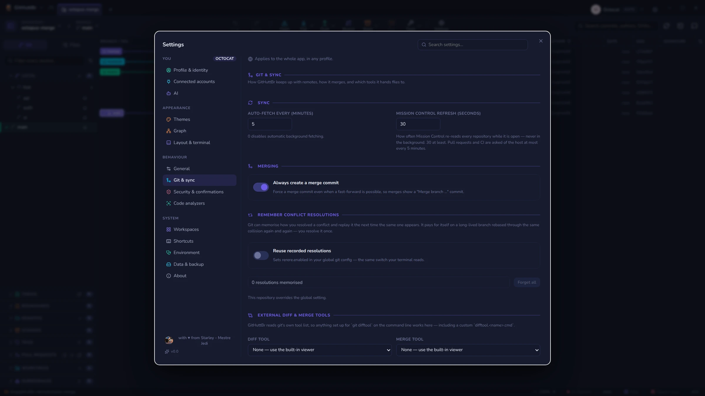

# Missionskontrolle

Zwanzig Repositorys, und die Frage ist immer dieselbe: Welches braucht mich?

Die Missionskontrolle beantwortet sie. Jedes Repository des **aktiven
Workspace** auf einem Bildschirm, sortiert danach, was dich tatsächlich braucht:

1. **Blockiert** — ein halb stehengebliebenes Rebase oder Merge, Konflikte, ein
   Repo, das sich überhaupt nicht lesen lässt.
2. **Zu synchronisieren** — Commits zum Pullen, dann Commits zum Pushen.
3. **In Arbeit** — nicht committete Arbeit, ungetrackte Dateien.
4. **Sauber** — die stillen, ganz unten, wo sie hingehören.

## Was dir eine Zeile sagt

Jede Zeile liest sich von links nach rechts, und die Spalten fluchten über die
ganze Liste, sodass sich die Zähler wie in einer Tabelle vergleichen lassen:

| Spalte | Was sie zeigt |
|---|---|
| **Repository** | Name, Gruppe, der Branch und sein Upstream — oder **kein Upstream** in Bernstein: so ein Branch wird nie aus Versehen gepusht, synchronisiert aber auch nie |
| **Letzter Commit** | Betreff und Autor: woran das Repository zuletzt war, ohne es zu öffnen |
| **Lokal** | Konflikte · ↓ zu pullen · ↑ zu pushen · gestaged · geändert · nicht verfolgt · Stashes. Mit der Maus sehen, was jeder zählt |
| **Hosting** | Die offenen Pull Requests — die, die auf **deine** Review warten, in Bernstein — und das CI von HEAD. Ein Klick auf die Zahl öffnet die Seite **Pull Requests** dieses Repositorys, ein Klick auf **CI** seine Läufe |
| **Release** | Der neueste Tag, den HEAD erreicht, und wie viele Commits danach kamen — **aktuell**, wenn keine. Die Zahl ist danach gefärbt, wie weit ein Release zurückliegt: grau bis 5 Commits, gelb bis 20, rot darüber, in vier Bereichen, die du ändern kannst — eigene Farben inklusive — unter [**Einstellungen → Themes → Farben des Release-Hinweises**](themes.md#farben-des-release-hinweises) |
| **Aktivität** | Eine 14-Tage-Sparkline der Commits, und wie viele es sind |
| **Zeit** | Wie lange der letzte Commit her ist, und der letzte **Fetch** |

Mit der Maus über dem Status-Symbol steht, warum die Zeile dort steht —
„2 zu pushen · 1 nicht committet“.

Das Fetch-Alter steht da, weil das Lesen dieser Seite nie fetcht: die Zahl „zu
pullen“ ist nur so frisch wie der letzte Fetch. Hat ein Branch mit Upstream seit
einem Tag oder länger nicht gefetcht, oder noch nie, wird das Alter bernsteinfarben
— vor dem Vertrauen auf eine 0 erst fetchen. Die Zeit liest git selbst, also zählt
auch ein `git fetch` im Terminal.

In einem schmalen Fenster bleiben alle Spalten, und die Tabelle scrollt seitlich
innerhalb ihres Rahmens.

**Öffnen** am Ende einer Zeile zeigt das Repository selbst — seinen Graphen —,
auch wenn sein Tab zuletzt die Pull-Request-Liste zeigte, die die PR-Zahl
geöffnet hat.

Klapp eine Zeile auf (das Chevron oder <kbd>Leertaste</kbd>), um genau zu
sehen, welche Commits auf ihren Push warten und welche Dateien schmutzig sind.

## Die Liste abarbeiten

- Die Status-Pillen oben sind **Filter** — klick auf „3 blockiert“, um nur diese
  zu sehen. **N offene PRs** und **N CI fehlgeschlagen** filtern genauso, und
  ebenso **N PRs warten auf deine Review** in der Zeile darunter.
- Sortieren nach **Dringlichkeit**, **Name** oder **Aktivität**.
- **Häkchen bei mehreren Repos** setzen, um sie zu fetchen — oder nur die zu
  pullen, die zurückhängen (der Knopf zählt sie für dich).
- **N veraltete fetchen** erscheint, wenn Branches mit Upstream seit einem Tag oder
  länger nicht gefetcht haben, und fetcht nur diese — die, deren „zu pullen“ falsch sein kann.
- Solange sie offen ist, aktualisiert sie sich alle 30 Sekunden selbst — änderbar
  unter **Einstellungen → Git & Synchronisierung → Mission-Control-Aktualisierung**,
  mindestens 30 Sekunden. Ist die Seite geschlossen, läuft nichts.

| Taste | Aktion |
|---|---|
| <kbd>↑</kbd> <kbd>↓</kbd> oder <kbd>j</kbd> <kbd>k</kbd> | Durch die Liste laufen |
| <kbd>Enter</kbd> | Dieses Repository öffnen |
| <kbd>f</kbd> / <kbd>p</kbd> | Fetch / Pull darauf |
| <kbd>Leertaste</kbd> | Aufklappen |
| <kbd>/</kbd> | Zum Filter springen |

## Es ist eine Ansicht, kein Tab

Die Anzeige neben dem Workspace-Namen schaltet sie um; ein Klick auf einen
beliebigen Tab bringt dich zurück an die Arbeit. Sie legt nie einen eigenen Tab
an, und sie gehört zu dem Workspace, in dem du gerade bist — wechsle den
Workspace, und du bekommst das Dashboard dieses Workspace.

Die git-Seite ist **lokal**: eine Handvoll git-Befehle pro Repository, kein
Fetch. Die Spalte **Hosting** ist der einzige Teil, der mit einem Host spricht.
Sie fragt den Host jedes Repositorys nach seinen offenen Pull Requests und dem
CI von HEAD, als das Profil dieses Repositorys, und zwar still: ein Host ohne
Token oder Verknüpfung für dieses Profil zeigt einfach nichts, und nie öffnet
sich ein Anmeldefenster. Ein Repository, das schon in einem Tab offen ist,
kostet keinen Aufruf, denn die Seitenleiste hat seine Pull Requests bereits.

Grenzen, damit die Zahlen richtig gelesen werden:

- Hosts werden **höchstens alle 5 Minuten** pro Repository gefragt (früher, wenn
  sich HEAD bewegt oder ein CI-Lauf noch läuft), unabhängig vom
  Aktualisierungsintervall — das API-Kontingent eines Hosts teilt sich die Seite
  mit dem Rest der App. **Aktualisieren** fragt sofort erneut.
- Eine Zahl zeigt **30+**, wenn die erste Seite des Hosts voll zurückkam; die
  Listenseite hat alle.
- Die Release-Spalte ist der neueste Tag, **den HEAD erreicht**, nicht der
  neueste Tag im Repository. Ein Tag auf einem Commit, den HEAD schon hat,
  erscheint innerhalb von zwei Minuten.

Ein Fetch ist immer etwas, worum du gebeten hast.

**Siehe auch:** [Workspaces & Tabs](workspaces.md) · [Workspaces, Tabs & Gruppen](workspaces.md)
