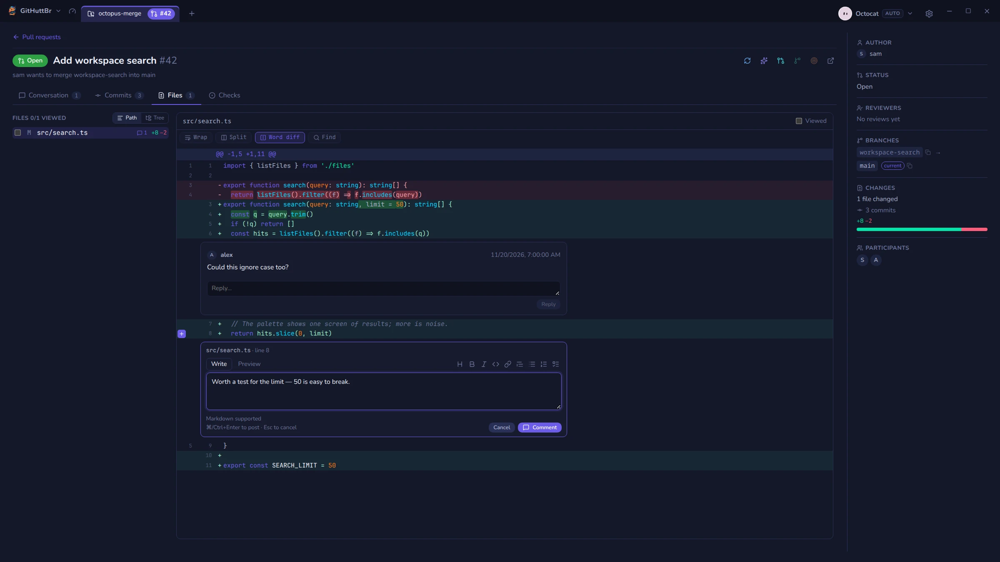

# Pull-Request-Seite

Ein belebtes Repository hat zwanzig Pull Requests gleichzeitig offen. Die
Seitenleiste listet sie, aber eine Zeile pro PR sagt wenig: wem gehört welcher,
welche warten auf dich, welche sind rot geworden. Um das herauszufinden, musstest
du jeden öffnen, lesen, zurückgehen, den nächsten öffnen. Die
**Pull-Request-Seite** beantwortet diese Fragen auf einem Bildschirm, und sobald
du einen Pull Request öffnest, bringen dich **‹ ›** zum nächsten derselben Liste,
ohne zurückzugehen.

## Öffnen

- Das **Listensymbol** im Kopf **PULL REQUESTS** der Seitenleiste (*Alle Pull
  Requests anzeigen*).
- *Pull Requests…* in der Befehlspalette (⌘K) oder **Werkzeuge → Pull Requests…**.

Wie das Wiki und die [CI-Läufe](ci-runs.md) hängt die Seite am Tab des
Repositorys.

## Tabs

| Tab | Was er enthält |
|---|---|
| **Offen** | Alle offenen Pull Requests, Entwürfe eingeschlossen |
| **Entwürfe** | Nur die offenen, die als Entwurf markiert sind |
| **Gemergt** | Gemergte Pull Requests, gelesen, wenn du den Tab zum ersten Mal öffnest |
| **Geschlossen** | Ohne Merge geschlossen (abgelehnt, aufgegeben), gelesen zusammen mit Gemergt |

Die Zahlen neben Offen und Entwürfe stammen aus der Liste, die die Seitenleiste
schon hat. Gemergt und Geschlossen werden erst abgefragt, wenn du einen davon
öffnest, und einmal pro Sitzung; **Aktualisieren** fragt erneut.

## Filter

| Filter | Behält |
|---|---|
| **Suchen** | Pull Requests, deren Titel, Beschreibung, Branches oder Nummer jedes eingegebene Wort enthalten. `#482` oder `482` findet diese Nummer; Treffer werden im Titel hervorgehoben |
| **Autor** | Einen Autor — jeder mit der Anzahl seiner PRs in diesem Tab. **Ich** steht oben |
| **Reviewer** | Einen angefragten Reviewer oder **Review von mir angefragt** |
| **Ziel-Branch** | Pull Requests in diesen Branch |
| **Meine** | Eine Abkürzung für *Autor: Ich* |
| **Wartet auf mein Review** | Eine Abkürzung für *Reviewer: Review von mir angefragt* |
| **CI schlägt fehl** | Pull Requests, deren Checks am Head fehlgeschlagen sind |

Die Zeile unter den Filtern sagt, wie viele Pull Requests des Tabs angezeigt
werden und welche Filter aktiv sind, mit **Filter zurücksetzen**, um alle zu
entfernen.

Filter bleiben pro Repository erhalten, **solange die App läuft** — verlasse die
Seite, komm zurück, sie sind, wie du sie verlassen hast. Über einen Neustart
hinweg werden sie absichtlich nicht gespeichert: ein Filter „Meine, CI schlägt
fehl“, der eine Woche später still wiederkommt, würde Pull Requests verstecken,
die du nicht verstecken wolltest.

### Wer „ich“ bin

„Ich“ ist das Konto, mit dem sich die Aufrufe dieses Repositorys beim Host
anmelden — das Profil, an das das Repository [gebunden](profiles.md) ist, sonst
das aktive — und zwar beim Host selbst erfragt. Wenn das Token nicht sagen kann,
wem es gehört (kein User-Scope), oder es kein Token gibt, werden **Ich**,
**Meine** und **Wartet auf mein Review** nicht angeboten.

## Die Liste

| Spalte | Was sie zeigt |
|---|---|
| **#** | Die Nummer, mit einem Symbol für offen, Entwurf, gemergt oder geschlossen |
| **Titel** | Der Titel, ein *Entwurf*-Badge und wer noch um ein Review gebeten ist — in der Akzentfarbe, wenn du es bist |
| **Autor** | Das Bild vom Host, wo er eins liefert, sonst die Initiale, und **du** bei deinen eigenen |
| **Branches** | Quelle → Ziel |
| **Checks** | Die Checks des Heads zusammengefasst — `6/6`, `1 fehlgeschlagen`, `2 laufen`; Hover zeigt die Zahlen |
| **Aktualisiert** | Wie lange die letzte Änderung her ist; Hover zeigt das Datum |

Die Zeilen sind nach der letzten Aktivität sortiert. Ein Klick öffnet die eigene
Seite des Pull Requests ([Hosting & Pull Requests](hosting.md)). Auf einem Host
ohne diese Seite öffnet die Zeile den Pull Request im Browser.

In einem [Fork-Checkout](hosting.md#deine-pull-requests-im-ursprungs-repository-eines-forks) werden auch deine Pull Requests im
Ursprungs-Repository gelistet, markiert mit *auf owner/repo*.

## Die Liste aus einem Pull Request heraus durchgehen

Ein von der Seite aus geöffneter Pull Request zeigt eine Leiste über seinem
Titel:

- **← Pull Requests** führt zurück zur Liste, mit den Filtern, wie du sie
  verlassen hast.
- **‹ k von n ›** wechselt zum vorherigen oder nächsten Pull Request der Liste,
  aus der du ihn geöffnet hast — der gefilterten Liste, in ihrer Reihenfolge, so
  wie sie beim Klick war. Die Tooltips nennen den Pull Request, zu dem jeder Pfeil
  führt.
- **Alt+← / Alt+→** tun dasselbe über die Tastatur. Sie lassen sich in
  **Einstellungen → Tastenkürzel** neu belegen. Sie halten sich zurück, solange
  der Cursor in einem Textfeld steht (wo Option+← wortweise springt) und solange
  das Terminal den Fokus hat.

Das Wechseln ersetzt die Seite an Ort und Stelle, sodass zehn durchgegangene Pull
Requests nicht zehn Symbole im Tab hinterlassen; eine andere Zeile aus der Liste
zu öffnen ersetzt sie ebenfalls.

Ein Pull Request, der **von woanders** geöffnet wurde — aus der Seitenleiste,
einer Benachrichtigung — geht die offenen Pull Requests des Repositorys in der
Standardreihenfolge der Seite durch (Offen, keine Filter). Einer, der auch auf
dieser Liste nicht steht, etwa eine gemergte Ebene eines Stacks, zeigt nur den
Weg zurück zur Liste.

## Zum Branch eines Pull Requests wechseln

Um an einem Pull Request zu arbeiten, brauchst du seinen Branch ausgecheckt —
und in einem Repository mit Tausenden von Branches ist es der langsame Teil, ihn
in der Branch-Liste nach Namen zu suchen. Auf der Seite eines Pull Requests
erledigt das Feld **Branches** das für dich:

- **Der Branch-Name ist ein Link.** Ein Klick checkt diesen Branch aus und bringt
  dich zum Graphen des Repositorys, an die Spitze des Branches. Die Seite des Pull
  Requests bleibt im Tab offen.
- **Ein Branch, den es nur auf dem Server gibt**, wird zuerst gefetcht — genau
  dieser Branch, nicht das ganze Remote — und als lokaler Branch ausgecheckt, der
  ihn trackt. Ein Branch, den du schon lokal hast, wird so gewechselt, wie er ist —
  er wird nicht aktualisiert, also pulle, wenn du die neuesten Commits des Pull
  Requests willst.
- **Der Branch, auf dem du schon bist**, ist stattdessen als *aktuell* markiert.
  Es wird nichts ausgecheckt.
- **Der Kopieren-Button** neben jedem Namen legt ihn in die Zwischenablage.
- **Rückgängig** (⌘Z) bringt dich zurück auf den Branch, auf dem du warst, und
  löscht den lokalen Branch, den der Checkout angelegt hat — es sei denn, du hast
  seitdem darauf committet; dann bleibt er unangetastet.

Der Kopf hat dieselben zwei Schritte als Buttons: **Zum Quell-Branch wechseln**
und **Zum Ziel-Branch wechseln**. Sie funktionieren auch auf dem Branch, auf dem
du schon bist — sie bringen dich dann einfach zum Repository. Mit eingeschalteten [Symbolfarben](themes.md#symbolfarben) hat jeder Button im Kopf seine eigene: Aktualisieren blau, KI-Review violett, Vorschau türkis, Quell-Branch grün, Ziel-Branch orange (Im Browser öffnen bleibt grau).

Nichts wird nachgeschlagen, bevor du klickst: einen Pull Request zu öffnen liest
oder fetcht keinen Branch.

Was es nicht tut:

- **Der Quell-Branch eines Forks** liegt in einem anderen Repository, also hat er
  keinen Link (der Kopieren-Button bleibt). **Pull Request lokal ansehen…**, direkt
  darunter angeboten, ist der Weg, ihn hier laufen zu lassen. Der Ziel-Branch ist
  weiterhin verlinkt.
- **Kein passendes Remote.** Der Branch wird auf dem Remote gesucht, dessen URL
  das Repository des Pull Requests ist. Wenn kein konfiguriertes Remote dorthin
  zeigt, tut der Link nichts, und sein Tooltip sagt, warum.
- **Ein gelöschter Branch.** Ein gemergter Pull Request hat seinen Branch oft
  mitgenommen; der Fetch meldet dann, dass der Branch auf dem Remote nicht mehr
  existiert, und du bleibst beim Pull Request.
- **Lokale Änderungen.** Auschecken ist nicht destruktiv, also gibt es keine
  Bestätigung — und git verweigert den Checkout, wenn deine nicht committeten
  Änderungen überschrieben würden. Der Fehler nennt die Dateien; committe oder
  stashe sie und klicke erneut.
- **Dieses Fenster.** Der Checkout passiert im Arbeitsverzeichnis dieses
  Repositorys. Wenn der Branch schon in einem anderen [Worktree](worktrees.md)
  ausgecheckt ist, öffnet sich stattdessen der Tab dieses Worktrees.

## Commits

Die Seitenleiste sagte, wie viele Commits ein Pull Request hat, nie welche. Einen
Commit nach dem anderen zu reviewen — so, wie die meisten Pull Requests gelesen
werden sollen — schickte dich in den Browser. Der Tab **Commits**, zwischen
Unterhaltung und Dateien, listet sie:

- **Älteste zuerst**, in der Reihenfolge, in der sie angewendet werden, gruppiert
  nach dem Tag, an dem sie geschrieben wurden. Ein Commit, der außer der
  Datumsreihenfolge hineingerebased wurde, beginnt einen eigenen Tag, statt
  verschoben zu werden.
- Jede Zeile hat das Bild des Autors (wo der Host eins liefert), den Betreff, den
  Autor, wie lange es her ist, und den kurzen SHA. Ein **Merge**-Badge markiert
  einen Commit mit zwei Eltern, wo der Host das sagt.
- **▸** neben einem Commit mit mehr als einem Betreff zeigt den Rest seiner
  Nachricht.
- **Kopieren** legt den vollständigen SHA in die Zwischenablage; **Im Browser
  öffnen** öffnet den Commit auf dem Host — innerhalb des Pull Requests, wo der
  Host eine solche Seite hat (GitHub, GitLab, Bitbucket Data Center), sonst auf der
  Commit-Seite des Repositorys.

**Klick auf eine Zeile** — oder springe mit Tab hin und drück Enter —, um den
Commit in der App zu öffnen, wie ein Klick im Graphen: die Ansicht des
Repositorys, dieser Commit ausgewählt, seine Details offen. Das klappt, wenn dieser
Klon den Commit **hat**. Hat er ihn nicht, sagt die Zeile das, statt still zu
scheitern, und bietet an:

- **PR-Branch abrufen, um ihn zu sehen** — derselbe Fetch eines einzelnen Branches
  wie beim [Wechsel zum Branch](#zum-branch-eines-pull-requests-wechseln), ohne den Checkout. Kam der Commit
  mit, öffnet er sich; kam er nicht (ein Force-Push hat ihn seitdem umgeschrieben),
  sagt der Toast das.
- **Commits des Pull Requests abrufen**, bei einem Pull Request aus einem **Fork**.
  Sein Branch liegt in einem anderen Repository, aber die meisten Hosts spiegeln
  den Head eines Pull Requests im Ziel-Repository unter einer eigenen Ref —
  `refs/pull/N/head` (GitHub, GitHub Enterprise Server, Forgejo),
  `refs/merge-requests/N/head` (GitLab), `refs/pull-requests/N/from` (Bitbucket
  Data Center). Die App fetcht genau diese eine Ref, ohne Tags, in eine eigene Ref,
  `refs/githuttbr/pr/<remote>/N`, und der Commit öffnet sich wie jeder andere: Der
  Graph zeichnet diesen Head als Spur ohne Beschriftung. Erneutes Fetchen setzt die
  Ref auf den Head, wie er dann ist. Hat der Force-Push seitdem den Commit
  ausgelassen, sagt der Toast das.
- **Im Browser öffnen**, für den Fall, dass Fetchen keine Option ist.

Die Liste wird gelesen, wenn du den Tab zum ersten Mal öffnest, nicht mit der
Seite, und erneut bei jedem **Aktualisieren**. Bis sie da ist, ist die Zahl im Tab
die, die der Host für den Pull Request angegeben hat. Gemergte und geschlossene
Pull Requests listen ihre Commits genauso.

Was es nicht tut:

- **Höchstens 250 Commits.** GitHub selbst listet für einen Pull Request nicht mehr
  als 250; die App hört auf jedem Host bei derselben Zahl auf und sagt *der Host
  hat mehr*, wenn das so ist, mit einem Link zum Pull Request auf dem Host. Welche
  250 es sind, hängt von der Reihenfolge ab, in der der Host sie listet — die App
  behält die zuerst gelisteten, und die Zeile über der Liste sagt, welche:

  | Host | Ein längerer Pull Request zeigt |
  |---|---|
  | GitHub | Die **ersten** 250 (GitHubs eigene Grenze) |
  | GitLab, Azure DevOps, Bitbucket Data Center, bitbucket.org | Die **250 neuesten** |
  | Forgejo | Das Ende, das der Server zuerst listet; seine Reihenfolge ist nicht dokumentiert |
- **Der Head eines Forks, wo der Host ihn nicht spiegelt.** Azure DevOps
  veröffentlicht nur ein Merge-Ergebnis, nie den eigenen Head eines Pull Requests,
  und bitbucket.org keins von beiden: Dort bietet die Zeile nur den Browser an. Auf
  einem anderen Host, der ihn doch nicht spiegelt, sagt der Fetch das. **Pull Request
  lokal ansehen…** holt das Merge-Ergebnis von Azure herein, falls du das brauchst.
- **Die gefetchten Heads bleiben.** `refs/githuttbr/pr/…` ist kein Branch: nichts
  zum Auschecken oder Pushen, ein Fetch mit Prune lässt sie in Ruhe, und git behält
  ihre Commits. Nichts entfernt sie auch — weder das Schließen der Seite noch
  [Branches aufräumen](branch-cleanup.md). Um sie loszuwerden, lösch die Refs von
  Hand: `git for-each-ref refs/githuttbr/pr` listet sie, und
  `git update-ref -d <ref>` löscht eine.
- **Ein Remote, dessen Name ein `/` enthält**, kann nicht ein Teil des Namens dieser
  Ref sein, also wird der Fetch dort abgelehnt.
- **Ein gelöschter Branch.** Ein gemergter Pull Request hat seinen Branch oft
  mitgenommen: der Fetch sagt das. bitbucket.org listet gar keine Commits mehr,
  sobald der Quell-Branch weg ist.
- **Squash-Merges.** Die Commits eines per Squash gemergten Pull Requests haben den
  Ziel-Branch nie erreicht, also gibt es sie nach dem Löschen seines Branches nur
  noch auf dem Host.
- **Autoren** werden so genannt, wie ihre Commits sie nennen. GitLab, Azure DevOps
  und Bitbucket Data Center liefern kein Bild ohne eine Anmeldung, die ein Bild
  nicht mitschicken kann, also zeigen diese Zeilen die Initiale.
- **Lange Nachrichten auf Azure DevOps** können gekürzt sein: Azures Liste schneidet
  die Nachricht eines Commits ab, und die App zeigt, was es sendet.
- **bitbucket.org**-Pull-Requests öffnen sich im Browser — die App hat noch keine
  Seite für sie —, also wird dieser Tab dort nicht erreicht, obwohl die App die
  Liste lesen kann.

## Die Dateien lesen

Ein Pull Request mit zweihundert Dateien ist als zweihundert vollständige Pfade
schwer zu lesen. Die Liste im Tab **Dateien** hat denselben Schalter **Pfad /
Baum** wie das Commit-Panel, und die Wahl gilt in der ganzen App. In **Baum** stehen
Dateien unter ihren Ordnern (eine Kette wie `src/main/ipc` ist eine Zeile), und
jeder Ordner zeigt sein summiertes **+/−** und wie viele seiner Dateien gesehen sind
(*3/5*). Das Kontrollkästchen eines Ordners markiert jede Datei darin als gesehen
oder entfernt alle Häkchen; die Häkchen bleiben nur auf diesem Computer und gehen
nie an den Host. Ein Häkchen merkt sich die Fassung des Diffs der Datei: ändert ein
Push eine gesehene Datei, gilt sie wieder als nicht gesehen, mit einem gelben Punkt
(*Geändert, seit du es gesehen hast*). Eine Datei ohne Diff (binär, zu groß) wird nur
nach Status und Zeilenzahlen verglichen. Eine Datei mit Review-Unterhaltungen zeigt daneben eine Zahl in einer Sprechblase (Ordner zählen ihre zusammen), sodass die kommentierten in einer langen Liste hervorstechen; veraltete Unterhaltungen zählen mit. Klick auf einen Ordner oder drück ←/→ darauf,
um ihn einzuklappen; ↑/↓ (oder j/k) gehen durch die Dateien auf dem Bildschirm und
öffnen jeden Diff. Eingeklappte Ordner werden pro Pull Request gemerkt, bis die App
beendet wird, und eine Datei, die darin geöffnet wird, klappt den Weg zu ihr auf. Der
Baum ist nach Namen sortiert, nicht in der Reihenfolge, in der der Host die Dateien
listet.

## Eine Zeile kommentieren

Auf einen Review-Thread antworten ging hier schon; einen beginnen nicht, also
schickte dich ein echtes Review weiterhin in den Browser. Im Tab **Dateien** eines
Pull Requests nimmt jede Zeile des Diffs einen eigenen Kommentar an:

- **Fahre über eine Zeile** und drück das **+**, das über ihrer Nummer erscheint,
  oder **klick auf die Zeile** selbst (ein Klick, der eine Textauswahl beendet, oder
  ein Doppelklick, der ein Wort markiert, zählt nicht — das ist Lesen). Das
  Kontextmenü — oder die Kontextmenütaste der Tastatur — hat ebenfalls *Zeile N
  kommentieren*.
- Ein Feld öffnet sich **unter dieser Zeile**. Schreib, dann **Kommentieren** —
  oder ⌘/Ctrl+Enter. **Abbrechen** schließt es; **Esc** auch, mit Rückfrage, wenn
  schon etwas getippt wurde. So oder so kehrt der Fokus zu dieser Zeile zurück.
- Bei Erfolg erscheint der neue Thread **unter seiner Zeile** und in den
  Review-Threads des Tabs Unterhaltung, wo alle anderen ihn sehen.

Auf welcher Seite der Kommentar landet, folgt der Zeile:

| Zeile | Verankert an |
|---|---|
| **Hinzugefügt** (grün) | Der neuen Fassung der Datei, unter ihrer neuen Nummer |
| **Gelöscht** (rot) | Der alten Fassung, unter ihrer alten Nummer |
| **Unverändert** | Der neuen Fassung (GitLab bekommt beide Nummern, wie es verlangt) |

Bestehende Threads werden ebenfalls unter ihren Zeilen gezeigt, mit ihrem
Antwortfeld, wo der Host der App erlaubt, in einem Thread zu antworten (Forgejo
nicht). Ein Thread erscheint nur dann an einer Zeile, wenn der Host sagt, dass er
noch zum gezeigten Diff gehört; alles andere bleibt im Tab Unterhaltung, statt an
einer geratenen Zeile zu landen:

| Host | Ein Thread von vor dem letzten Push |
|---|---|
| GitHub | Veraltet, wenn seine Zeile sich geändert hat: nur Unterhaltung |
| GitLab | Gegen einen älteren Head geschrieben: nur Unterhaltung |
| Azure DevOps | Von Azure dorthin verfolgt, wo seine Zeile jetzt ist |
| Bitbucket Data Center | Verwaist, wenn seine Zeile weg ist: nur Unterhaltung |
| Forgejo | Forgejo sagt nicht, dass ein Kommentar veraltet ist, also erscheint er an seiner gespeicherten Zeilennummer — nach einem Push kann dort jetzt anderer Code stehen |

Ein Kommentar zu einer Zeile außerhalb der gezeigten Hunks steht auf jedem Host nur
im Tab Unterhaltung.

Ein getippter, nicht gesendeter Kommentar zählt als ungesendeter Text: **‹ ›** und
Alt+Pfeile fragen nach, bevor sie ihn verlassen, wie beim Hauptkommentarfeld. Der
Blick in eine andere Datei behält ihn; um einen an einer anderen Zeile zu beginnen,
sende oder verwirf zuerst den ersten.

Was es nicht tut:

- **Eine Zeile, sofort gesendet.** Es gibt keinen Zeilenbereich, kein ausstehendes
  Review, in dem man Kommentare sammelt und später abschickt, und keine
  Änderungsvorschläge. Jeder Kommentar wird in dem Moment veröffentlicht, in dem du
  ihn sendest, als eigener Thread (auf Forgejo als Review mit genau diesem einen
  Kommentar, da Forgejo keinen Aufruf für einen Einzelkommentar hat).
- **Der Diff, den du ansiehst.** Der Tab Dateien merkt sich, an welchem Commit (auf
  Azure DevOps: an welcher Iteration) sein Diff gelesen wurde, und der Kommentar
  wird dagegen gesendet. Hat sich der Pull Request seitdem weiterbewegt — ein Push,
  eine neue Merge-Basis —, wird der Kommentar nicht an die Zeile gehängt, die jetzt
  diese Nummer hat: er wird abgelehnt mit *Der Pull Request hat sich seit dem Laden
  dieses Diffs geändert*, und **Aktualisieren** zeigt den neuen Diff. Auf GitHub
  wird der Kommentar stattdessen gegen den Commit gesendet, den du gelesen hast, und
  GitHub markiert ihn als veraltet, wenn sich die Zeile geändert hat. Eine Zeile,
  die der Host trotzdem nicht annimmt, wird als außerhalb des Diffs abgelehnt.
- **Abgelehnt.** Ohne Berechtigung zum Kommentieren (ein Token nur zum Lesen, ein
  Konto, das in dem Repository nicht kommentieren darf) lehnt der Host ab, und die
  Meldung nennt das als Grund.
- **bitbucket.org**-Pull-Requests öffnen sich im Browser — die App hat noch keine
  Seite für sie —, also wird ein Zeilenkommentar dort weiterhin auf der Website
  geschrieben.
- **Eine Datei ohne Diff** (binär oder zu groß, als dass der Host sie mitliefert)
  hat keine Zeilen zum Kommentieren.

## Kommentare schreiben

Jedes Feld auf der Seite — der Kommentar unten, eine Antwort in einem Thread, ein
Kommentar zu einer Zeile — ist derselbe Markdown-Editor: Tabs **Schreiben /
Vorschau**, eine Formatierungsleiste mit GitHubs Tastenkürzeln, Listen, die bei
Enter weitergehen, und Vervollständigung mit **@** / **#** aus den Personen und
Pull Requests, die schon auf dem Bildschirm sind. Ein Antwortfeld zeigt seine
Werkzeuge, sobald du hineinklickst, und sendet mit ⌘/Ctrl+Enter, da Enter jetzt
eine neue Zeile beginnt. [Kommentare schreiben](writing-comments.md) hat die
Details und die Grenzen.

## Wie Kommentare angezeigt werden

Kommentare werden in Markdown geschrieben, also ist ein als reiner Text gezeigter
Kommentar voller `**`, `- [ ]` und Code-Zäune. Die Beschreibung, die Unterhaltung und
die Review-Threads (in den Tabs Unterhaltung und Dateien) werden als Markdown
gezeichnet: Überschriften, Listen und Aufgabenlisten, Tabellen, Zitate, Codeblöcke mit
Hervorhebung in der Sprache, die der Zaun nennt, Links und Bilder. Die Issue-Seite
zeichnet ihren Text genauso. `#123`, `AB#123`, `!123` und `@user` im Text werden
weiterhin zu Links, mit der [Karte](#worum-es-bei-einem-123-oder-ab123-geht), wo sie eine hatten.

Woher die Darstellung kommt:

| Host | Gerendert von |
|---|---|
| GitHub, GitHub Enterprise Server | GitHub selbst (`body_html`): Erwähnungen und Verweise sind verlinkt wie auf der Website, Bilder gehen über GitHubs Bild-Proxy, und private Anhänge tragen ihre signierte Adresse |
| GitLab, Forgejo, Azure DevOps, Bitbucket Data Center | Die App, aus dem Markdown des Kommentars. Ein relativer Link zeigt ins Repository; auf GitLab zeigt `/uploads/…` ins Projekt, wie GitLab es tut |

Ein Kommentar ist Inhalt anderer Leute, also ist eng gefasst, was er enthalten darf,
und enger als bei deinen eigenen Dateien: eine ausdrückliche Liste von Tags, Links und
Bilder nur über `https:`, `http:` oder `mailto:`, keine Skripte, Frames, Formulare,
SVG oder Inline-Styles, und Links, die sich nie in der App öffnen (sie gehen an deinen
Browser). Ein Kontrollkästchen in einer Aufgabenliste wird gezeigt, ist aber nicht
anklickbar: Es hier anzuhaken würde auf dem Host nichts ändern.

**Bilder von anderen Websites warten auf einen Klick.** Ein Bild zu laden ist eine
Anfrage, die die Website dahinter beobachten kann, mit deiner IP-Adresse und dem
Moment, in dem du den Kommentar liest — jeder, der kommentieren darf, kann dort ein
Tracking-Pixel platzieren. Darum laden nur Bilder vom Host selbst von allein: auf
github.com seine Anhänge, `*.githubusercontent.com` (das seinen Bild-Proxy einschließt)
und seine Assets; auf jedem anderen Host seine eigene Adresse. Jedes andere Bild zeigt
*Bild von example.net – zum Laden klicken*, und der Klick lädt genau dieses Bild.
**Einstellungen → Sicherheit → Bilder von anderen Websites in Kommentaren laden**
schaltet das ab; siehe [Sicherheit](security.md#bilder-in-kommentaren).

**Die Vorschau zeigt, was gesendet wird.** Auf dieser Seite und der Issue-Seite
zeichnet der Tab **Vorschau** jedes Kommentarfelds den Text genauso: dasselbe Profil,
dieselben Zeilenumbrüche, dieselben zurückgehaltenen Bilder — ein eingefügter Link auf
ein fremdes Bild lädt es nicht, während du schreibst. Die Dialoge für einen neuen Pull
Request und ein neues Issue behalten die gewöhnliche Markdown-Vorschau der App.

**Zu lang oder zu verschachtelt wird als Text gezeigt.** Markdown wird im Fenster der
App gerendert, und mancher Text kostet beim Rendern weit mehr, als seine Größe
vermuten lässt. Ein Kommentar über **32.000 Zeichen** oder einer, der so gebaut ist,
dass er den Renderer lahmlegt (Tausende ungepaarte `_` oder `*` in einem Absatz, oder
mehr als 32 Ebenen von `>` oder Listenmarken in einer Zeile), wird als reiner Text mit
Links gezeigt, unter *Langer Kommentar als reiner Text angezeigt.* oder *Kommentar als
reiner Text angezeigt: zu verschachtelt, um ihn hier darzustellen.* Ein Kommentar, der
trotzdem nicht gerendert werden kann, fällt von selbst genauso zurück: Der Rest der
Seite bleibt unberührt.

Was es nicht tut:

- **Beim Bearbeiten steht der Text, wie er geschrieben wurde.** **Bearbeiten** öffnet
  weiterhin das Markdown, und eine gespeicherte Bearbeitung wird von der App
  gezeichnet, bis die Seite den Pull Request neu liest (auf GitHub danach von GitHub).
- **Private GitHub-Anhänge laufen ab.** GitHub signiert die Adresse eines privaten
  Bildes für ein paar Minuten; eines, das nicht mehr lädt, nachdem die Seite eine
  Weile offen war, kommt mit **Aktualisieren** zurück.
- **Ein relatives Bild auf GitHub**, das die App selbst zeichnet (eine aus der App
  gesendete Antwort, bevor die Seite sie neu liest), wird unter der Adresse des
  Repositorys auf github.com gesucht, was nicht unbedingt dort ist, wo GitHub es
  ablegen würde.
- **Videos** in einem GitHub-Kommentar erscheinen als Link auf die Datei, nicht als
  Player.
- **Nur auf GitHub vorhandene Erweiterungen**, die die App selbst zeichnet (auf
  anderen Hosts), fehlen: keine Emoji-Kürzel, keine Mermaid-Diagramme, kein Stil für
  Hinweisblöcke, und Formeln bleiben Text.
- **Code wird nur hervorgehoben, wenn der Zaun seine Sprache nennt.** Die Sprache zu
  erraten hieße, jede Grammatik über jeden Block der Seite laufen zu lassen.
- **Commit-Nachrichten** im Tab Commits bleiben reiner Text: git rendert kein
  Markdown, und die Hosts auch nicht.

## Eigene Kommentare bearbeiten und löschen

Ein Tippfehler in einem schon gesendeten Kommentar oder eine Bemerkung, die nicht
mehr gilt, bedeutete früher einen Ausflug in den Browser. Deine eigenen Kommentare
haben jetzt **Bearbeiten** (der Stift) und **Löschen** (der Papierkorb) am Ende ihres
Kopfes: Kommentare der Unterhaltung, Kommentare in Review-Threads und Antworten, in
den Tabs Unterhaltung und Dateien. Die Issue-Seite hat sie auch, für ihre Kommentare
auf GitHub und Forgejo.

Was „deins“ ist, entscheidet die Seite selbst: Sie fragt den Host bei jedem Laden,
als wer sich die Aufrufe dieses Repositorys anmelden (sein gebundenes Profil, nicht
das gerade aktive). Die meisten Hosts nennen einen Autor per Login, verglichen ohne
Rücksicht auf Groß- und Kleinschreibung. Azure DevOps nennt Autoren per Anzeigename, den zwei Personen teilen können, also
vergleicht es dort nie Namen: Ein Kommentar ist deiner, wenn seine Autoren-ID zur ID
des Kontos passt **oder** der eindeutige Name seines Autors (der Kontoname, meist
eine E-Mail-Adresse) zu dem des Kontos passt, ohne Rücksicht auf Groß- und
Kleinschreibung. Beides gehört eindeutig zu einer Person; das Zweite deckt eine
Autoren-ID ab, die nicht die ist, die die Verbindung meldet. Lässt sich keines von
beiden vergleichen, zeigt kein Kommentar die Aktionen. Kann
die App nicht sagen, wer du bist (ein Token ohne User-Scope, oder der Host hat nicht
geantwortet), zeigt sie auch kein Kommentar; **Aktualisieren** fragt erneut. Der
Host entscheidet trotzdem: Ein Konto, dem er das Ändern eines Kommentars nicht
erlaubt, wird abgewiesen, und die Meldung sagt das.

- **Bearbeiten** öffnet den Kommentar an Ort und Stelle, im selben Markdown-Editor,
  mit seinem Text, wie er geschrieben wurde. **Speichern** (oder ⌘/Ctrl+Enter) sendet
  ihn; **Abbrechen** oder **Esc** schließt ihn, mit Rückfrage, wenn du etwas geändert
  hast. Nur die Leerzeilen um den Text fallen weg: eingerückter Code und ein
  Zeilenumbruch aus zwei Leerzeichen am Ende bleiben, wie getippt. Der neue Text
  erscheint sofort, und die Seite liest den Pull Request neu. Auf der
  Pull-Request-Seite zählt eine nicht gespeicherte Bearbeitung als ungesendeter
  Text: **‹ ›** fragen, bevor sie sie verlassen. Die Issue-Seite hat keine solchen
  Pfeile, und dort fragt nichts, bevor ihr Tab geschlossen wird.
- **Löschen** fragt immer zuerst, und die Frage sagt, was passiert: Der Server
  entfernt den Kommentar für alle, und das lässt sich nicht rückgängig machen. Es
  gibt keinen Undo-Eintrag, da nichts ihn zurückbringen kann.

Den **ersten Kommentar eines Threads** mit Antworten zu löschen (ein Review-Thread
oder ein Kommentar der Unterhaltung, auf den andere geantwortet haben), verhält sich
je nach Host anders, und die Bestätigung sagt, wie. Zwei davon sind vom Host nicht
dokumentiert, und das wird auch gesagt:

| Host | Erster Kommentar eines Threads mit Antworten |
|---|---|
| GitHub | Die Antworten sollten bleiben; GitHubs Dokumentation sagt es nicht. Der Thread behält sein Antwortfeld: Ist sein erster Kommentar weg, geht die Antwort über GitHubs GraphQL-API an den Thread selbst, gefunden über eine Antwort, die noch darin steht. Schlägt das fehl (ein alter Enterprise Server, ein Token, das GraphQL ablehnt, ein Thread, in dem dieses Konto laut GitHub nicht antworten darf), bietet der Thread stattdessen **Auf GitHub antworten** an. Hast du auf GitHub ein Review in Arbeit, kann GitHub die Antwort darunter ablegen: Der Toast sagt das dann, und niemand sieht die Antwort, bis du dieses Review dort abschickst |
| GitLab | Nur diese Notiz verschwindet; der Thread und seine Antworten bleiben |
| Azure DevOps | Sollte als gelöscht markiert und ausgeblendet werden, Thread und Antworten bleiben; Azures Dokumentation sagt es nicht |
| Bitbucket Data Center | Abgelehnt: Data Center löscht keinen Kommentar, der Antworten hat. Lösche zuerst die Antworten oder bearbeite ihn stattdessen |

Manche Hosts markieren einen Kommentar als **bearbeitet**. Nur Azure DevOps führt
ein Datum allein für den Text; auf GitHub, Bitbucket Data Center und Forgejo
vergleicht die App, wann der Kommentar erstellt und zuletzt aktualisiert wurde, also
ist die Markierung dort eine Näherung (alles andere, was den Kommentar berührt, kann
sie setzen). Das Datum bei GitLab ändert sich auch, wenn ein Thread aufgelöst wird,
also wird es nicht verwendet.

Was es nicht tut:

- **Review-Kommentare auf Forgejo** (Kommentare zu einer Zeile) lassen sich über
  seine API nicht bearbeiten, und nur manche Versionen können einen löschen, also
  zeigen sie keine der beiden Aktionen: Ändere sie auf der Website. Kommentare der
  Unterhaltung funktionieren wie anderswo.
- **Jemand hat ihn inzwischen geändert.** Bitbucket Data Center prüft die Version
  des Kommentars: Eine Bearbeitung oder Löschung eines Kommentars, der sich seit dem
  Laden der Seite geändert hat, wird abgelehnt, und **Aktualisieren** zeigt den
  aktuellen. Die anderen Hosts übernehmen den letzten Schreibvorgang.
- **Nicht gefunden**: Findet der Host den Kommentar nicht, sagt die Meldung, dass er
  gelöscht worden sein könnte oder dieses Konto ihn nicht sehen kann, und die Seite
  liest den Pull Request neu. Eine offene Bearbeitung eines Kommentars, den es nicht
  mehr gibt, wird verworfen.
- **bitbucket.org**-Pull-Requests öffnen sich im Browser, also gibt es noch keine
  Seite, auf der man ihre Kommentare bearbeiten könnte, obwohl die App den Aufruf
  machen kann.
- **Die Beschreibung** des Pull Requests und die Zusammenfassungen seiner Reviews
  sind keine Kommentare und werden hier nicht bearbeitet.

## Worum es bei einem `#123` oder `AB#123` geht

Ein Commit, der *fixes AB#4821* sagt, oder ein Kommentar mit *siehe #312* nennt
dir eine Nummer, nicht, worum es ging. Um das herauszufinden, musstest du es
öffnen. Jetzt öffnet das **Zeigen auf einen Verweis** — oder das Hinspringen mit
Tab — eine kleine Karte mit dem, was der Host darüber sagt:

- ein Symbol für seine Art und der Verweis, wie er geschrieben steht;
- sein **Titel**;
- sein **Status** (offen, geschlossen, gemergt — auf Azure DevOps der eigene Status
  des Work Items, etwa *Active* oder *Resolved*);
- auf Azure DevOps der **Work-Item-Typ** (Bug, User Story, Task…).

Die Karten gibt es auf der Pull-Request-Seite (Beschreibung, Kommentare,
Review-Threads und die vollständige Nachricht eines Commits im Tab **Commits**), auf
der Issue-Seite und im Betreff im Commit-Detailbereich. Im Tab **Commits** auf Azure
DevOps zeigt jedes Work Item im Betreff eines Commits (`AB#123`, oder `#123`, dort
dasselbe Item) außerdem seinen Titel daneben, in Grau. Auf Azure DevOps verlinkt
`!123` auf diesen Pull Request, ohne Karte.

| Verweis | Host | Gelesen aus |
|---|---|---|
| `AB#123`, und `#123` in einem Azure-Repository | Azure DevOps | Work Items, bis zu 200 in einer Anfrage |
| `#123` | GitHub, GitHub Enterprise Server | Issues und Pull Requests, bis zu 50 in einer GraphQL-Anfrage; eine REST-Anfrage pro Stück, wenn GraphQL fehlschlägt |
| `#123` / `!123` | GitLab | Issues / Merge Requests, eine Anfrage pro Art |
| `#123` | Forgejo | Issues (auch Pull Requests), eine Anfrage pro Stück, zwei gleichzeitig |

Ein `#123` zählt nur als eigenes Wort: `org/repo#123` (ein anderes Repository),
`&#39;`, eine Farbe wie `#123abc` und das `#issuecomment-…` eines Links bleiben
unberührt.

Nichts wird abgefragt, bevor sich eine Karte öffnet. Dann gehen der Verweis, auf dem
du bist, und die noch unbekannten ihm nächstgelegenen auf der Seite in einem Aufruf
raus, sodass die nächste Karte meist sofort da ist. Antworten werden im Speicher
gehalten, solange die App läuft, nie auf der Festplatte, fünf Minuten lang; danach
werden sie weiter angezeigt und beim nächsten Hover neu gelesen. Sie werden pro
Profil gehalten: Der Aufruf geschieht als das Profil, an das das Repository
[gebunden](profiles.md) ist, und ein anderes Profil sieht womöglich andere Items.

Was es kostet:

- **GitHub** liest bis zu **50** in einer Anfrage, über seine GraphQL-API — die, auf
  der du bist, und ihre nächsten Nachbarn. Schlägt GraphQL aus einem anderen Grund
  als einem Rate-Limit fehl (ein alter Enterprise Server, ein Token, das es
  ablehnt), weicht die App auf die REST-API aus, die ein Issue pro Anfrage liest:
  Dann werden nur die ersten **10** abgefragt, nacheinander, wie GitHub es von Apps
  verlangt; die anderen bleiben unbekannt, und ein späterer Hover fragt nach ihnen.
- **Forgejo** kann nicht mehrere Issues in einer Anfrage lesen, also kostet jede
  Karte eine: Ein Hover fragt höchstens **10** an, zwei gleichzeitig.
- Auf GitHub und Forgejo stoppt die erste Antwort, die *langsamer* sagt (ein 429,
  ein 403, der eigene Rate-Limit-Fehler von GraphQL, ein sekundäres Limit oder eine
  Antwort, die die letzte Anfrage des Limits verbraucht hat), den Rest — GitHub weicht
  dann nicht auf REST aus —, und diese Verweise werden fünf Minuten lang nicht erneut
  abgefragt.
- **Azure DevOps** liest bis zu 200 Work Items in einer Anfrage und GitLab eine
  Anfrage pro Art, also geht dort die ganze Seite auf einmal.

Was es nicht tut:

- **Bitbucket** hat keine Karte: Die App liest dort keine Issues, und der Link öffnet
  wie bisher den Browser.
- **Nicht gefunden oder kein Zugriff.** Ein gelöschtes Issue, ein Work Item in einem
  Projekt, das dieses Konto nicht sehen kann, oder ein Azure-Token ohne den Scope
  *Work Items (Read)* sehen gleich aus: Die Karte sagt es, und der Link funktioniert
  trotzdem. Ein Host, der drosselt, nicht erreichbar ist oder in diesem Profil kein
  Konto hat, bekommt eine eigene Meldung.
- **`AB#123` außerhalb von Azure DevOps** — in einem GitHub-Repository, das mit Azure
  Boards verbunden ist — wird nicht verlinkt und hat daher keine Karte: Die App weiß
  nicht, zu welcher Organisation es gehört.
- **Gemergter Status auf älteren GitHub Enterprise Servern**, die nicht mitschicken,
  wann ein Pull Request gemergt wurde: Er erscheint als geschlossen.
- Die Commit-Zeilen **des Graphen** zeigen keine Karten.

## Grenzen

- **Offene Pull Requests sind die Liste der Seitenleiste.** GitHub, GitLab und
  bitbucket.org lesen die ersten 30; ein Repository mit mehr zeigt nur diese, und
  die Zahl bei Offen lautet **30+**. Azure DevOps, Bitbucket Data Center und
  Forgejo lesen alle.
- **Gemergt und Geschlossen sind begrenzt**, und der Tab zeigt **+**, wenn der
  Host mehr hat (seine Website listet alle):

  | Host | Was gelesen wird |
  |---|---|
  | GitHub, bitbucket.org, Forgejo | Die 100 zuletzt aktualisierten, gemergt und geschlossen **zusammen** |
  | GitLab | Die 100 zuletzt aktualisierten von jedem |
  | Bitbucket Data Center | 100 von jedem in der Reihenfolge *newest* des Servers — seine API sagt nicht, ob das eröffnet oder aktualisiert meint |
  | Azure DevOps | 100 von jedem unter denen, die im **letzten Jahr** endeten; seine API nennt keine Reihenfolge, also entscheidet jenseits von hundert der Server, welche |

  Ihre Checks werden nicht gelesen — die CI eines abgeschlossenen Pull Requests
  entscheidet nichts, und sie kostete eine Anfrage pro Zeile — also gilt **CI
  schlägt fehl** auf diesen Tabs nicht (der Chip ist dort ausgeblendet).
- **Kein Konto**: ohne ein Token, das den Host erreicht, sagen Gemergt und
  Geschlossen das, statt eine leere Liste zu zeigen (GitHub kann ein öffentliches
  Repository trotzdem lesen).
- **Checks**: GitHub und Bitbucket Data Center liefern sie in der Liste mit.
  GitLab, Azure DevOps und Forgejo werden beim Öffnen der Seite einmal pro Head
  gefragt, über denselben Cache wie die CI-Badges im Graphen. bitbucket.org hat
  keine.
- **Reviewer**: GitHub, GitLab, Forgejo, Bitbucket Data Center und Azure DevOps
  nennen, wer noch gefragt ist (Azure: eine Person, die noch nicht abgestimmt hat;
  ein Team bleibt außen vor). Die Liste von bitbucket.org sagt es nicht, also ist
  der Reviewer-Filter dort leer.
- **Suche in der Beschreibung** funktioniert, wo die Liste des Hosts die
  Beschreibung mitliefert; bitbucket.org lässt sie manchmal weg, und dann werden
  nur Titel, Branches und Nummern durchsucht.
- **„Ich“ auf bitbucket.org und Azure DevOps** wird über den Anzeigenamen
  abgeglichen, da ihre Listen einen Autor so benennen.
- **Aktualisiert auf Azure DevOps** ist der Zeitpunkt, zu dem der Pull Request
  eröffnet (oder geschlossen) wurde: seine Liste hat keine Zeit der letzten
  Aktivität.
- Das Durchgehen wird gemerkt, solange die App läuft; nach einem Neustart geht ein
  aus der Liste geöffneter Pull Request stattdessen die offenen Pull Requests
  durch.
