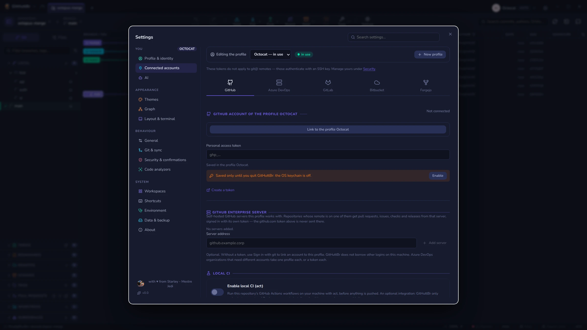
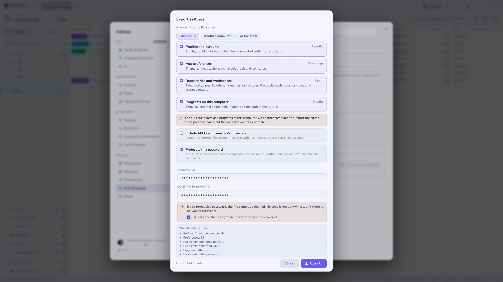

# Sicherheit & Geheimnisse

Gitcito hat **kein Backend**. Die einzigen Netzwerkaufrufe gehen an deinen
Git-Host und, falls du es einschaltest, an deinen KI-Anbieter.

## Geheimnisse maskieren

Werte in `.env*`, `*.pem`, `*.key`, `id_rsa`, `credentials.*` und Verwandten
werden in Diff-, Datei- und Blame-Ansicht als `KEY=••••••` dargestellt, damit
ein geteilter Bildschirm oder ein Screenshot sie nicht ausplaudern kann.
Apple-Signaturmaterial zählt dazu: `*.mobileprovision`,
`*.provisionprofile`, `*.p12` und die `*.p8`-Schlüssel für App Store Connect.
Ein `*.cer` nicht — ein Zertifikat ist von Haus aus öffentlich.

Das ist **reine Anzeige**: Die Datei wird nie verändert, und was du stagest,
auch nicht. Ein Augen-Schalter deckt sie pro Ansicht auf. `.env.example`,
`.sample` und `.template` gelten als Vorlagen, nicht als Geheimnisse.

## Wächter, bevor du Schaden anrichtest

| Wächter | Wann |
|---|---|
| **Geheimnisdatei** | Du committest etwas, das nach einem Zugangsdatum aussieht — mit *Ignorieren & nicht mehr verfolgen* auf einen Klick |
| **Große Datei** | Du committest einen übergroßen Blob (Schwellwert unter Einstellungen → Sicherheit) |
| **Build-Müll** | `xcuserdata/`, `DerivedData/` oder eine `.DS_Store` committen — mit demselben *Ignorieren & nicht mehr verfolgen* mit einem Klick |
| **Geschützter Branch** | Du committest direkt auf `main`/`master` oder erzwingst dort einen Push |
| **Getrackte Geheimnisse** | Du pushst ein Repository, das eine Geheimnisdatei *trackt* — einmal pro Sitzung gewarnt |

## Bilder in Kommentaren

Kommentare zu Pull Requests und Issues schreiben andere Leute, und ein Bild darin ist
eine Anfrage, die dein Rechner an die Website stellt, die der Autor gewählt hat. Diese
Website erfährt deine IP-Adresse und wann du den Kommentar liest — ein Tracking-Pixel
braucht nicht mehr als das Recht zu kommentieren.

Darum lädt die App von sich aus nur Bilder vom Host selbst: auf github.com seine
Anhänge, `*.githubusercontent.com` (das den Proxy einschließt, den GitHub in seiner
eigenen Darstellung vor jedes fremde Bild setzt) und seine Assets; auf jedem anderen
Host seine eigene Web-Adresse, über https. Jedes andere Bild zeigt einen Platzhalter
mit seiner Domain und wird erst angefragt, wenn du darauf klickst — genau dieses Bild,
einmal. Die Anfrage sendet nie einen `Referer`.

| Einstellung | Was sie tut |
|---|---|
| **Bilder von anderen Websites in Kommentaren laden** (standardmäßig aus) | Bilder von jeder Website laden ohne Klick, wie auf der Website des Hosts |

Die Grenzen:

- **Der Host sieht dich trotzdem.** Ein Bild vom Host selbst — und auf GitHub jedes
  Bild über seinen Proxy — ist eine Anfrage an den Host, der ohnehin weiß, dass dieses
  Konto den Pull Request liest.
- **`raw.githubusercontent.com` und `gist.githubusercontent.com` laden ohne Klick.**
  Jeder kann dort eine Datei ablegen, das Bild gehört also ihm — aber GitHub liefert
  es aus, und sein Autor sieht weder deine IP-Adresse noch, wann du liest.
- **Private GitHub-Anhänge laufen ab.** Ihre signierte Adresse hält ein paar Minuten;
  **Aktualisieren** auf der Seite holt eines zurück, das nicht mehr lädt.
- **Die Vorschau eines Kommentarfelds** auf diesen Seiten folgt derselben Regel: Ein
  eingefügter Link auf ein fremdes Bild wird nicht geladen, während du schreibst.
- **Nur die Pull-Request- und die Issue-Seite.** Bilder in einer Markdown-Datei des
  Repositorys, in Release Notes oder im Wiki sind Inhalt deines eigenen Repositorys und
  laden wie bisher.
- **Ein Link ist kein Bild.** Ein Klick auf einen Link in einem Kommentar öffnet ihn
  in deinem Browser, wie jeden Link in der App.

Ein Kommentar kann das Fenster auch nicht blockieren oder abstürzen lassen: Einer mit
über 32.000 Zeichen, oder einer, der so gebaut ist, dass der Markdown-Renderer
sekundenlang arbeitet, wird als reiner Text gezeigt. Wie der Rest eines Kommentars
eingeschränkt ist, steht unter [Pull Requests](pull-requests.md#wie-kommentare-angezeigt-werden).

## Das AppImage und Pfade, die es überdauern

Ein AppImage läuft aus einem Ordner unter `/tmp` (`/tmp/.mount_…`), der nur
existiert, solange die App offen ist, bei jedem Start anders heißt und in einem
Verzeichnis liegt, in das jeder lokale Benutzer schreiben kann. Bis 4.37.1
konnte das AppImage einen Pfad in diesem Ordner an zwei Stellen schreiben, die
es überdauern: den `gitcito`-Link im `PATH` ([CLI](cli.md)) und die Einstellung
`diff.<name>.textconv` eines Repositories ([Attribute](attributes.md)). Sobald
die App beendet war, konnte ein anderer Benutzer auf demselben Rechner den
Ordner mit einem eigenen Programm neu anlegen, das dein nächstes `gitcito` oder
`git diff` ausführen würde.

Gitcito verweigert beides jetzt unter einem AppImage, warnt beim Start vor einem
veralteten `gitcito`-Link (mit einem Palettenbefehl, um ihn zu entfernen) und
markiert einen veralteten Konverter im Attribute-Dialog mit einer Schaltfläche
**Entfernen**. Es sieht nur das Repository, das du geöffnet hast; um veraltete
Konverter anderswo zu finden, führe
`git config --get-regexp 'diff\..*\.textconv'` in jedem Repository (und mit
`--global`) aus und entferne jeden Eintrag unter `/tmp/.mount_`. Ein Rechner mit
nur einem Benutzer ist nicht gefährdet, aber die veralteten Einträge sind
trotzdem toter Ballast.

## Der Schlüsselbund des Betriebssystems

Tokens und [Tresor](vault.md)-Einträge werden mit dem Schlüsselbund deines
Betriebssystems verschlüsselt (Electron `safeStorage`), niemals mit einem
Schlüssel in der Einstellungsdatei.

**Nichts rührt den Schlüsselbund an, bevor du es sagst.** Noch bevor der
Berechtigungsdialog des Systems auftauchen kann, erklärt Gitcito, was gespeichert
wird, was es nicht kann (eine App liest immer nur den Eintrag zurück, den sie
selbst angelegt hat — deine anderen Passwörter sind unerreichbar) und dass Nein
sagen völlig in Ordnung ist: Tokens leben dann nur für die Sitzung im
Arbeitsspeicher, der Tresor bleibt zu, und du kannst es später unter
**Einstellungen → Sicherheit → Schlüsselbund des Betriebssystems** einschalten.

Eine frische Installation macht **null** Aufrufe an den Schlüsselbund, bis
tatsächlich etwas gespeichert werden muss.

Solange er aus ist, sagt das Token-Feld unter Integrationen es an — *Nur gespeichert, bis du Gitcito beendest: der System-Schlüsselbund ist aus.* — mit einer Schaltfläche **Aktivieren** daneben. Ihn dort oder hier einzuschalten speichert auch die Tokens, die du in dieser Sitzung schon eingegeben hast; nichts muss neu eingefügt werden.

Ein Token, das du bei ausgeschaltetem Schlüsselbund **entfernst**, ist sofort
weg — es wird mit nichts mehr gesendet —, aber nur **für diese Sitzung**: Der
verschlüsselte Speicher kann bei ausgeschaltetem Schlüsselbund nicht
geschrieben werden, und das Löschen wird im Arbeitsspeicher gehalten, nie in
einer Datei. Schalte den Schlüsselbund vor dem Beenden wieder ein, dann wird die
gespeicherte Kopie gelöscht; beendest du vorher, ist das alte Token beim
nächsten Start wieder da. Bis dahin bleibt der Hinweis aus diesem Grund
sichtbar. Um ein gespeichertes Token in einem Schritt endgültig zu löschen,
leere es bei eingeschaltetem Schlüsselbund.

Ein leeres Feld löscht nur, was Gitcito dir gezeigt hat. Ist der Schlüsselbund
von Anfang an aus, werden die gespeicherten Tokens nie entschlüsselt und nie
angezeigt — die Felder sind leer —, also wird nur ein Token entfernt, das du dort
eintippst und wieder leerst; das gespeicherte darunter ist noch da, sobald der
Schlüsselbund eingeschaltet ist.

Lädt das Fenster neu oder stürzt es ab, während die Schlüsselbund-Erklärung auf
dem Bildschirm steht, gilt die Frage als unbeantwortet — nicht als Nein — und
wird erneut gestellt, wenn das nächste Mal ein Token gespeichert werden muss.
Nichts wartet auf eine Frage, die niemand mehr beantworten kann: Die
Einstellungen laden wieder normal.

### Linux ohne Schlüsselbund

Unter Linux ist der Schlüsselbund ein Secret Service — GNOME Keyring oder
KWallet. Läuft keiner, „verschlüsselt“ das System trotzdem, aber mit einem
festen Passwort, das auf jedem Rechner gleich ist: Tokens und Schlüssel sind
nur verschleiert, nicht geschützt. Einstellungen → Sicherheit sagt das unter dem
Status des Schlüsselbunds — *Es läuft kein Schlüsselbund…* —, damit das Wort
*Schlüsselbund* nie für einen Schutz steht, den es nicht gibt.

Damit nichts Neues in einem Speicher landet, den jeder entschlüsseln könnte, wird
ein Token, das du eingibst, während kein Schlüsselbund läuft, **nur bis zum
Beenden** behalten. Das Token-Feld sagt es — *Nur bis zum Beenden von Gitcito
gespeichert: Es läuft kein Schlüsselbund…* — ohne Schaltfläche zum erneuten
Versuchen, weil ein neuer Versuch nichts bringt; nur ein Schlüsselbund hilft.
Der Import einer Einstellungsdatei mit Zugangsdaten sagt dasselbe, bevor er sie
importiert.
Vorher gespeicherte Tokens bleiben lesbar — du wirst nie von ihnen
ausgesperrt —, und ein Token zu leeren oder zu ersetzen entfernt den alten Wert
weiterhin von der Festplatte. Zwei Grenzen: Der Schlüssel der allgemeinen KI
wird nicht in seinen gemeinsamen Platz verschoben (jedes Profil liest weiter
seinen eigenen), und der Tresor speichert weiterhin im einfachen Speicher, weil
er keinen Modus nur für die Sitzung hat. Installiere oder entsperre einen Schlüsselbund
und starte Gitcito neu, um neue Tokens wieder dauerhaft zu speichern.

Gitcito verlässt sich nicht auf das Wort des Systems, welchen Speicher es bekommen
hat. Es zählt den Speicher als einfach, wenn das System ihn so nennt, wenn es ihn gar
nicht benennen kann, und wenn das, was es verschlüsselt, mit dem festen Passwort
markiert zurückkommt — egal, was das System gesagt hat. So hält auch ein
Schlüsselbund, der still zurückfällt, neue Tokens von der Festplatte fern.

Auf einen Schlüsselbund, der nicht mehr antwortet, wird nicht ewig gewartet. Unter
Linux gilt, sobald der Schlüsselbund in dieser Sitzung einmal geantwortet hat, eine
Frage, die er 10 Sekunden unbeantwortet lässt, als *kein Schlüsselbund*: Ein Token,
das du speicherst, bleibt bis zum Beenden, und der Tresor bleibt zu. Die erste Frage
einer Sitzung — die, die die eigene Passwortabfrage des Schlüsselbunds aufrufen
kann — und die direkt nach Gitcitos Erklärung bekommen zwei Minuten, damit das Lesen
eines Dialogs nie abgeschnitten wird. Eine halbe Minute nach so einer
Zeitüberschreitung bleibt die Antwort *kein Schlüsselbund*, ohne erneut zu fragen;
danach fragt Gitcito neu. macOS und Windows antworten lokal und werden nie mit einer
Frist belegt.

Die Grenze gilt für diese eine Frage — *ist ein Schlüsselbund da?* Ein Schlüsselbund,
der sie beantwortet und dann beim Verschlüsseln oder Entschlüsseln hängt, wird
weiterhin abgewartet: Das Speichern der Einstellungen und der Tresor bleiben
beschäftigt, bis er antwortet oder Gitcito neu startet.

### Wenn die gespeicherten Tokens nicht gelesen werden können

Wenn du die Schlüsselbund-Abfrage des Systems schließt, der Schlüsselbund
gesperrt ist oder der Token-Speicher von einer anderen Kopie von Gitcito
geschrieben wurde (einem Entwicklungsbuild, einem neu signierten), **kann
Gitcito deine gespeicherten Tokens nicht lesen — und lässt sie unangetastet**.
Einstellungen → Sicherheit sagt *Gitcito konnte deine gespeicherten Tokens
nicht lesen*, und ein Token, das du in der Zwischenzeit eintippst, wird nur für
die Sitzung behalten (das Feld sagt es auch). Es wird nie über den Speicher
geschrieben, der nicht gelesen werden konnte: Das würde jedes gespeicherte Token
durch das gerade eingetippte ersetzen.

| Schaltfläche | Was sie tut |
|--------|--------------|
| **Erneut versuchen** | Liest den Speicher erneut — das System fragt jetzt vielleicht nach dem Schlüsselbund. Sobald er lesbar ist, kommen die zwischenzeitlich eingetippten Tokens hinzu. |
| **Neuen Token-Speicher anlegen** | Fragt zuerst. Gitcito wartet nicht länger auf den alten Speicher und beginnt einen neuen nur mit den Tokens dieser Sitzung. Die alte Datei bleibt 30 Tage lang als Sicherung daneben liegen und wird dann gelöscht. Für einen endgültig verlorenen Speicher, nicht für eine weggeklickte Abfrage. |

## Einstellungen importieren

**Einstellungen → Import / Export** bringt Einstellungen, Profile und Themes
von einem Rechner auf den anderen. Der Standardexport enthält **keine Tokens
und keine API-Schlüssel**, und der Import einer solchen Datei rührt deine
gespeicherten nie an — ein leeres Token in der Datei heißt „nicht in dieser
Datei“, nicht „lösch meins“.

### Auswählen, was exportiert wird

Eine Sicherung und eine Datei für einen Kollegen sind nicht dieselbe Datei. Eine
Sicherung will alles; eine Datei für einen anderen Computer sollte keine Ordner
enthalten, die es dort nicht gibt; eine Datei fürs Team sollte weder deine
Konten noch deine Pfade enthalten. Deshalb öffnet **Einstellungen exportieren**
einen Dialog mit denselben vier Teilen, die der Import anbietet (die Tabelle
unten), jeweils mit seiner Größe auf diesem Computer, und schreibt nur die
angehakten. Ein ausgelassener Teil ist überhaupt nicht in der Datei — ein
späterer Import lässt diesen Teil des anderen Rechners genau so, wie er ist.

Drei Schnellwahlen über den Teilen haken die üblichen Kombinationen an. Ändert
man ein Kästchen von Hand, leuchtet die passende Schnellwahl auf, oder keine:

| Schnellwahl | Teile | Für |
|----------|-------|-----|
| **Vollständige Sicherung** | Alle vier | Diesen Computer wiederherstellen, oder eine Kopie davon — dieselbe Datei, die Exportieren schrieb, bevor es Teile gab |
| **Anderer Computer** | Profile und Konten, App-Einstellungen | Deine Identität und deine Vorlieben auf einem neuen Rechner, ohne die Ordner und Programme dieses Rechners |
| **Fürs Team** | App-Einstellungen | Ein gemeinsames Theme, Tastenkürzel und Graph-Setup — nichts Persönliches, keine Pfade |

Unter den Teilen sagt ein Hinweis, ob die Datei Ordner oder Programme dieses
Computers nennt: bernsteinfarben mit angehakten **Repositorys** oder
**Programme** (der Import auf einem anderen Rechner übersetzt diese Pfade oder
lässt die aus, die er nicht findet), grün ohne sie. **Profile und Konten** ohne
**Programme** lässt auch den Pfad der KI-CLIs weg, die bei den Profilen
gespeichert sind, aber Programme dieses Rechners nennen.

**Zugangsdaten nur mit Profilen, und nur auf Wunsch.** Tokens und API-Schlüssel
gehören zu Profilen, daher ist **API-Schlüssel, Tokens & Tresor-Geheimnisse
einschließen** nur mit angehaktem **Profile und Konten** verfügbar; hakst du den
Teil ab, wird die Option mit ihm gelöscht. Mit angehakten Zugangsdaten empfiehlt
der Dialog **Mit Passwort schützen** (unten), und sie unverschlüsselt zu
exportieren fragt noch einmal nach.

Ein Kasten unten listet, was die Datei enthalten wird, bevor du
**Exportieren…** drückst: wie viele Profile (mit oder ohne Zugangsdaten),
Profilbilder, Einstellungen, Repository- und Programmpfade, ob die
Repository-Notizen und -Wikis und der Tresor dabei sind, welche Teile
ausgelassen werden und ob die Datei verschlüsselt ist. Was mit welchem Teil
reist:

| Extra | Gehört zu | Bedingung |
|-------|-----------|-----------|
| Profilbilder | Profile und Konten | Als Bild gewählte Profilbilder |
| Tresor-Geheimnisse | Profile und Konten | Nur mit der Zugangsdaten-Option |
| Repository-Notizen und -Wikis | Repositorys und Workspaces | Immer mit dem Teil |

Grenzen: Die Teile sind die ganze Einheit — einzelne Profile, einzelne
Repositories oder einzelne Einstellungen lassen sich nicht auswählen.
**Programme** ohne **Profile** enthält Terminal, Editor und Standard-Apps, aber
nicht die Pfade der KI-CLIs (die stecken in den Profilen). Das Manifest zählt
Einträge; die Pfade selbst zeigt es nicht. Und eine Datei ohne einen Teil kann
ihn nicht zurückgeben: Eine **Fürs Team**-Datei wiederherzustellen stellt nur
die Einstellungen wieder her.

### Auswählen, was importiert wird

Eine Einstellungsdatei enthält zweierlei: was *dir* folgt (Profile, Theme,
Tastenkürzel) und was nur auf dem Rechner Sinn ergibt, der sie geschrieben hat
(die Ordner, in denen deine Repositories liegen, der Pfad deines Terminals).
Alles auf einem neuen Computer anzuwenden füllt die Seitenleiste mit Tabs, die
ins Leere zeigen. Deshalb fragt nach der Wahl der Datei (und der Eingabe ihres
Passworts, falls sie eines hat) ein Dialog, welche Teile übernommen werden.
Nichts wird angewendet, bevor du **Importieren** drückst; **Abbrechen** lässt
alles, wie es war.

| Teil | Was er enthält |
|------|-----------------|
| **Profile und Konten** | Profile, Git-Identität, Integrationsverknüpfungen, die allgemeinen KI-Einstellungen und Profilbilder — und die Zugangsdaten und den [Tresor](vault.md), wenn die Datei sie enthält |
| **App-Einstellungen** | Theme, Sprache, Tastenkürzel, Layout, die Farben von Graph und Symbolen |
| **Repositorys und Workspaces** | Tabs, Workspaces, Favoriten, Spitznamen, Tab-Bilder, welches Profil jedes Repository nutzt, gescannte Ordner sowie die Notizen und Wikis pro Repository |
| **Programme auf diesem Computer** | Terminal, externer Editor, Standard-Apps und der Pfad der KI-CLIs |

Jeder Teil zeigt, wie viele Einträge die Datei dafür hat. Ein Teil, den du
nicht anhakst, bleibt auf diesem Rechner genau, wie er ist.

**Profile werden mit deinen zusammengeführt.** Eine Datei von einem anderen
Computer hat selten jedes Profil, das dieser hat — ein Konto, das auf dem
Linux-Laptop hinzukam, ein Kundenprofil, das es nur auf dem Mac gibt. Deshalb
fügt **Profile und Konten** die Profile der Datei zu deinen hinzu, statt die
Liste zu ersetzen. Vor dem Import listet der Teil jedes Profil auf und was mit
ihm geschieht:

| Markierung | Bedeutung |
|-----|---------|
| **Aktualisiert** | Das Profil gibt es auf beiden Seiten: Identität, KI und Bild aus der Datei ersetzen deine, und ihre Server kommen zu deinen hinzu |
| **Neu** | Nur die Datei hat es: wird nach deinen angefügt |
| **Bleibt** | Nur dieser Computer hat es: bleibt genau, wie es ist |

Zwei Profile sind „dasselbe“, wenn sie eine ID teilen — das erste Profil jeder
Installation tut das. Passt keine ID, zählt der Name (ohne Rücksicht auf
Groß-/Kleinschreibung und umgebende Leerzeichen), und das Profil behält **die
ID dieses Computers**: Die daran gebundenen Repositories, das aktive Profil,
seine gespeicherten Zugangsdaten und sein Bild bleiben verknüpft. Welches
Profil aktiv ist, ändert sich nicht, und ebenso wenig die **allgemeine KI**: Engine
und Modell, mit denen dieser Computer antwortet, bleiben seine eigenen.

**Alle ersetzen** gibt es weiterhin, für ein Backup, das du genau so
zurückhaben willst, wie es war: Nur die Profile der Datei bleiben, und die, die
nur dieser Computer hat, werden durchgestrichen als **Entfernt** aufgeführt.
Ein Druck auf **Importieren** fragt dann noch einmal nach und nennt sie — sie
gehen mit ihren gespeicherten Zugangsdaten und ihrem Bild, und das lässt sich
nicht rückgängig machen. Mit **Alle ersetzen** wird das aktive Profil der Datei
zum aktiven Profil, und die allgemeine KI der Datei ersetzt die dieses Computers.

Grenzen: Abgeglichen wird nur über ID oder exakten Namen — ein auf einer Seite
umbenanntes Profil zählt als neu, und du hast am Ende beide. Ein zugeordnetes
Profil übernimmt die Felder der Datei, mit drei Ausnahmen, damit nichts verloren
geht, was nur dieser Computer hat: Seine GitHub-Enterprise-, GitLab- und
Bitbucket-Server werden zu deinen **hinzugefügt** (bei einem Server, den beide
haben, gewinnt der Eintrag aus der Datei); ein Token, das die Datei leer
mitbringt, behält deins — aber nur für dieselbe Instanz, sodass ein Token nie
an ein anderes Forgejo, einen anderen GitLab-Aussteller oder eine andere
Azure-Organisation geht; und die Anmeldungen, die vom Credential Helper dieses
Rechners stammen, bleiben die dieses Rechners.

**Die Voreinstellungen sind eine Vermutung anhand deiner Festplatte.** Bevor
der Dialog erscheint, prüft Gitcito, ob die Repository-Ordner aus der Datei
hier existieren. Existiert keiner, stammt die Datei von einem anderen Computer:
**Repositorys** und **Programme** sind anfangs nicht angehakt, jeweils mit
Begründung — die Pfade der Programme werden aufgelistet, damit du siehst, dass
sie woandershin gehören. Existieren sie, ist es derselbe Computer (etwa ein
zurückgespieltes Backup), alles ist anfangs angehakt und ein grüner Hinweis
sagt das. Eine Datei ganz ohne Repositories wird stattdessen nach ihren
Programmpfaden beurteilt: **Programme** ist anfangs nur angehakt, wenn jeder
davon hier existiert.

Schlägt die Prüfung selbst fehl, wird nichts geraten: **Repositorys** und
**Programme** sind anfangs ohne Urteil nicht angehakt, eine Schaltfläche
**Erneut prüfen** fragt die Festplatte noch einmal, und **Repositorys** lässt
sich erst importieren, wenn eine Prüfung gelingt. Die anderen Teile schon.

**Pfade übersetzen.** Hake **Repositorys** bei einer Datei an, deren Ordner
fehlen, und ein Feld **Pfade übersetzen** öffnet sich. Links der Ordner, den die
Repositories der Datei gemeinsam haben (`/home/you/code`); rechts, wo dieser
Ordner auf diesem Computer liegt, vorausgefüllt aus deinem Home-Ordner
(`/Users/you/code`). Beide sind editierbar — die Vermutung kann falsch sein, und
findet Gitcito keinen gemeinsamen Ordner, lässt es beide leer, damit du sie
eintippst. Ein Balken zählt beim Tippen, wie viele Repositories jetzt hier einen
Ordner haben, und listet einige davon — grün gefunden, rot noch fehlend. Der
Tausch nimmt Spitzname, Tab-Bild und Profil des Repositorys mit, dazu seine
Notizen, Wikis und Tresor-Einträge, sodass nichts von Hand neu eingestellt
werden muss.

Die Fußzeile fasst es zusammen — *3 von 4 Teilen importieren · 31 Ordner*
(Scan-Wurzeln und der letzte Klon-Ordner zählen mit, deshalb heißt es Ordner
und nicht Repositories) —, und **Importieren** bleibt aus, bis mindestens ein
Teil angehakt ist.

**Importieren bleibt auch aus, wenn eine Übersetzung nichts findet.** Mit
angehaktem **Repositorys** und keinem einzigen Ordner unter dem neuen Präfix
würde der Import deine Repositories leer zurücklassen; korrigiere die Pfade oder
wähle den Teil ab.

Grenzen der Übersetzung:

- Es ist **ein Präfix gegen ein anderes getauscht**. Repositories, die in der
  Datei unter einem anderen Ordner liegen oder hier anders angeordnet sind,
  werden nicht gefunden; eine Zuordnung pro Repository gibt es nicht.
- Mit aktiver Übersetzung werden **nur die Repositories importiert, die danach
  einen Ordner haben**. Der Rest bleibt außen vor — nicht als kaputte Tabs
  hinzugefügt —, und der Dialog sagt dir, wie viele.
- Programme werden nie übersetzt: `/usr/bin/code` hat auf einem anderen System
  kein verlässliches Gegenstück. Lass diesen Teil abgewählt und stelle sie in den
  Einstellungen ein.
- Wenn du eines der beiden Präfixe leerst, werden die Pfade so importiert, wie
  sie in der Datei stehen.

**Während des Imports** lässt sich der Dialog nicht schließen. Scheitert ein
späterer Schritt — die Repository-Notizen, der Tresor, die Profilbilder —,
bleibt der Dialog offen, nennt den Schritt, und **Import fortsetzen** macht dort
weiter, ohne die früheren Schritte erneut zu schreiben.

### Zugangsdaten in der Datei

Eine mit der Option exportierte Datei enthält Zugangsdaten. Das Zusammenführen
von Profilen **fügt** sie immer **hinzu**: Die der Datei werden unter dem
passenden Profil abgelegt und ersetzen die für dasselbe Konto, und alle anderen
gespeicherten Zugangsdaten bleiben — sie zu löschen widerspräche dem Behalten
deiner Profile. Stehen die Profile auf **Alle ersetzen**, zeigt eine solche
Datei außerdem die Wahl, direkt unter **Profile und Konten**:

| Auswahl | Deine gespeicherten Zugangsdaten |
|--------|------------------------|
| **Hinzufügen** | Die der Datei kommen hinzu und ersetzen die für dasselbe Konto; alle anderen bleiben |
| **Alle ersetzen** | Werden genau die der Datei — jedes gespeicherte Token und jeder API-Schlüssel, den die Datei nicht hat, wird gelöscht |

Die Wahl gilt zusammen mit den Profilen: Ist **Profile und Konten** nicht
angehakt, werden keine Zugangsdaten importiert oder entfernt. Eine ohne die
Option exportierte Datei hat keine anzubieten, egal was du anhakst. **Alle
ersetzen** fragt beim Druck auf **Importieren** noch einmal nach und sagt, dass
jedes gespeicherte Token und jeder API-Schlüssel, den die Datei nicht hat,
gelöscht wird; **Abbrechen** dort lässt den Dialog, wie er war.

**Alle ersetzen braucht den Schlüsselbund.** Ist der Schlüsselbund aus oder
nicht verfügbar, blieben die alten Tokens im verschlüsselten Speicher und kämen
beim nächsten Start zurück — deshalb verweigert Gitcito es: Es sagt das, und
nichts wird importiert. Dasselbe gilt, solange die gespeicherten Tokens nicht
gelesen werden können (siehe oben): Sie kämen zurück, sobald sie es könnten. **Hinzufügen**
funktioniert weiterhin und behält die Tokens der Datei für die Sitzung.

**Die Grenze:** Zugangsdaten gehören zu einem Profil. Ein Profil, das der Import
entfernt, nimmt seine gespeicherten Tokens mit, egal was du wählst.

### Einen Export mit einem Passwort schützen

Ein Export mit angehakten Zugangsdaten ist für jeden, der die Datei findet, so
viel wert wie die Tokens selbst — ein synchronisierter Ordner, ein vergessener
USB-Stick, ein Anhang. **Mit Passwort schützen** im Exportdialog verschlüsselt
die Datei mit derselben Chiffre wie [Sicheres Teilen](secure-share.md) (ein per
scrypt abgeleiteter Schlüssel und AES-256-GCM), sodass nichts darin — nicht
einmal, ob sie Zugangsdaten enthält — ohne das Passwort gelesen werden kann.

Es ist optional, mit oder ohne das Zugangsdaten-Häkchen, und das Passwort hat
keine Mindestlänge. Du tippst es zweimal und hakst an, dass du verstehst, dass
es sich nicht wiederherstellen lässt; der Import der Datei fragt danach — in
einem Dialog in den Einstellungen, beim ersten Start im Willkommensschritt — und
ein falsches wird erneut abgefragt.

| | Ohne Passwort | Mit Passwort |
|---|---|---|
| **Wer sie lesen kann** | Jeder, der die Datei hat | Nur wer das Passwort hat |
| **Ein geändertes Byte** | Wird gelesen, wie es ist | Abgelehnt, wie ein falsches Passwort |
| **Öffnet sich in** | Jeder Version | Versionen, die das verschlüsselte Format kennen |

**Es gibt keine Wiederherstellung.** Das Passwort wird nirgends aufbewahrt —
nicht in der Datei, nicht auf diesem Rechner — und es gibt keinen Server, den
man fragen könnte. Vergisst du es, ist die Datei verloren; exportiere erneut von
einem Rechner, der die Einstellungen noch hat.

Grenzen: Eine ältere Version kann einen verschlüsselten Export nicht öffnen, und
sie weiß das auch nicht — sie meldet die Einstellungen als importiert und ändert
nichts. Importiere eine geschützte Datei mit einer Version, die nach ihrem
Passwort fragt. Ein kurzes Passwort bleibt schwach gegen jemanden, der die Datei
und Zeit zum Raten hat; der scrypt-Schlüssel macht jeden Versuch langsam, nicht
unmöglich. Das Passwort schützt die Datei, nicht die laufende App: Die
Zugangsdaten werden im Arbeitsspeicher entschlüsselt, während sie für den Export
gesammelt werden, wie schon immer.

## Die Einstellungsdatei

Die Einstellungsdatei und der verschlüsselte Token-Speicher werden am Stück
geschrieben: in eine neue, nur für den Besitzer lesbare Datei daneben, die dann
ausgetauscht wird, sodass ein Absturz oder zwei gleichzeitige Speichervorgänge
nie eine halbe Datei hinterlassen. Ist die Einstellungsdatei ein symbolischer
Link an einen anderen Ort (ein Dotfiles-Repository), geht das Schreiben an das
Ziel des Links und der Link bleibt. Gitcito ersetzt den Link nie. Einer, der auf
eine noch nicht vorhandene Datei zeigt, wird durchgeschrieben und legt diese
Datei an — sofern ihr Ordner existiert. Fehlt auch der Ordner, schlägt das
Speichern stattdessen fehl, mit einer einzigen Meldung dazu: Der Link und sein
Ziel bleiben unangetastet, und Änderungen in der Zwischenzeit halten nur, bis
Gitcito schließt. Stelle den Ordner wieder her oder lass den Link auf etwas
Vorhandenes zeigen, dann klappt das nächste Speichern.

Klartext-Tokens, die eine ältere Version in der Einstellungsdatei hinterlassen
hat, gehen beim Speichern nie verloren: Sie bleiben in der Datei, bis Gitcito
sie in den verschlüsselten Speicher lädt (das Öffnen der Einstellungen tut das),
es sei denn, du löschst selbst eines.

Nur zwei Dinge schreiben sie: ein Speichern deiner Einstellungen, und Gitcito,
wenn es sie lädt (beim Start oder beim Öffnen der Einstellungen) — dann wird ein
altes Klartext-Token in den verschlüsselten Speicher verschoben oder eine
Serveradresse mit einem Passwort darin bereinigt. Ein Nachschlagen, um das
niemand gebeten hat — ein Fetch, der sein Token auflöst, ein KI-Aufruf, der
seinen Schlüssel sucht, ein Profilbild — liest nur und kann daher nie über einem
Speichern landen. Ein Speichern wird außerdem verweigert, bis die Einstellungen
mindestens einmal geladen wurden: Vorher hält die App nur Standardwerte.

**Die Kosten bei einer alten Installation**, die noch Klartext-Tokens in ihrer
Einstellungsdatei hat: Bis die Einstellungen einmal geöffnet werden (oder die
App neu startet und sie lädt), entschlüsselt jedes Nachschlagen, das ein Token
braucht, den Speicher erneut, und Profilbilder, die ein gespeichertes Token
brauchen, warten. Ein Nachschlagen verschiebt nichts, daher bleibt ein Token,
das du in der Zwischenzeit löschst, gelöscht.

Eine Datei, die existiert, aber nicht geparst werden kann (eine missglückte
Handbearbeitung, ein beschädigter Datenträger), wird **nie** durch die
Standardwerte ersetzt: Gitcito sagt, dass die Datei beschädigt ist, und startet
nicht weiter — kein Tastenkürzel und kein Menübefehl kann von diesem Bildschirm
aus darüber speichern.

Du kannst `gitcito-settings.json` in ihrem Datenordner reparieren und
**Erneut versuchen** drücken, oder **Beschädigte Datei beiseitelegen und neu
beginnen** drücken: Die Datei wird in `gitcito-settings.json.corrupt-<date>`
umbenannt (nie gelöscht, du kannst also noch etwas daraus retten), eine Kopie
des verschlüsselten Token-Speichers wird daneben aufbewahrt, und Gitcito
startet wie beim ersten Mal, mit einem Hinweis, wohin die Datei gegangen ist.
Bei einer per Symlink verknüpften Einstellungsdatei wird das Ziel des Links
umbenannt, sodass die beschädigte Kopie in deinen Dotfiles bleibt, neben der
frischen Einstellungsdatei, die das erste Speichern dann durch den Link
schreibt. Die Kopie wird zuerst angelegt: Kann sie nicht geschrieben werden,
wird nichts verschoben, und der Bildschirm sagt das und zeigt den zu prüfenden
Datenordner, denn ein Neubeginn ohne die Kopie würde das erste Token, das du
speicherst, die Tokens der alten Profile löschen lassen. Behebe, was das
Schreiben in den Ordner verhindert (Berechtigungen, eine volle Festplatte), und
drücke **Erneut versuchen**.

Geht die Datei kaputt, während Gitcito läuft (darunter von Hand bearbeitet),
stoppt das Speichern und Gitcito sagt es einmal: Die Einstellungen können bis
zum Neustart nicht gespeichert werden, und Änderungen in der Zwischenzeit gehen
verloren.

Eine Datei, die da ist, aber kurz nicht *gelesen* werden kann — ein anderes
Programm wie ein Virenscanner hält sie fest —, wird etwa zwei Sekunden lang
erneut versucht. Schlägt es weiter fehl oder scheitert das Laden aus einem
anderen Grund, sagt Gitcito, dass es nicht starten konnte, dass die Datei nicht
verändert wurde, und bietet **Erneut versuchen** an; es nennt die Datei nicht
beschädigt.

### Bekannte Grenzen

Sie brauchen ungewöhnliche Bedingungen und stehen hier, damit niemand von ihnen
überrascht wird:

- **Eine sehr alte Installation mit Tokens noch in der Einstellungsdatei.** Wird
  der Schlüsselbund ausgeschaltet, nachdem die gespeicherten Tokens entsperrt
  wurden, oder abgelehnt, während ein KI-Schlüssel noch im alten Klartextformat
  gespeichert ist, kann diese Klartextkopie beim nächsten Speichern verloren
  gehen, und das Token ist nach einem Neustart weg. Öffne nach dem Upgrade von
  einem solchen Build einmal die Einstellungen mit eingeschaltetem
  Schlüsselbund, dann wandern die Tokens endgültig in den verschlüsselten
  Speicher.
- **Ein Speichern und ein fehlgeschlagenes Neuladen, die sich im selben Fenster
  kreuzen.** Ein Token, das in einem Speichern eingetippt wurde, das ein danach
  scheiterndes Neuladen überholt, kann in diesem Fenster nicht gelöscht werden,
  bis die Einstellungen wieder laden; öffne die Einstellungen erneut und lösche
  es.
- **Eine per Symlink verknüpfte Einstellungsdatei, deren Ordner fehlt.** Der
  Token-Speicher wird geschrieben, bevor die Einstellungsdatei scheitert, sodass
  die beiden aus dem Takt sind, bis der Ordner zurück ist. Stelle ihn wieder her
  (Laufwerk einhängen, Dotfiles klonen) und speichere erneut.

## Das Token eines Profils, während Git läuft

Wenn ein [Profil](profiles.md) ein Clone, Fetch, Pull oder Push mit seinem
Token anmeldet, landet das Token an keiner Stelle, an der ein anderes Programm
es lesen könnte: nicht in `.git/config`, nicht auf der Kommandozeile (jeder
lokale Benutzer kann die Prozessliste lesen) und nicht in der **Umgebung** des
git-Befehls — die jeder Hook, Filter und LFS-Prozess erbt, den git startet,
zusammen mit jedem npm-Paket, das ein husky- oder lefthook-Skript ausführt.

Stattdessen öffnet Gitcito für jede Operation einen eigenen privaten Endpunkt —
einen Socket in einem Ordner, den nur dein Benutzer betreten kann (unter Windows
eine Named Pipe mit zufälligem Namen) — und registriert einen
Credential-Helper für genau diesen einen Server. Wenn git nach einer Anmeldung
fragt, verbindet sich der Helper, beweist mit einem nur dafür erzeugten
Zufallscode, dass er zu dieser Operation gehört, sagt, nach welchem Host und
Repository git fragt, und erhält die Anmeldung. Der Endpunkt beantwortet jede
Anfrage der Operation — git kann mehr als einmal fragen, für LFS, nach einer
Weiterleitung, für jeden Prozess, den es startet — und wird geschlossen und
gelöscht, wenn git endet. Ein Hook, der seine Umgebung ausgibt, findet den Code,
nicht das Token.

Was es weiterhin nicht kann:

- **Ein Hook kann weiterhin fragen, solange die Operation läuft.** Dieser Code
  steht in der Umgebung von git, weil der Helper ein Programm ist, das git
  startet, und git jedem Programm, das es startet, dieselbe Umgebung gibt. Ein
  Hook, der das Protokoll des Helpers spricht, kann mit dem Code die Anmeldung
  erfragen, bis git endet — genau so bekommt der `pre-push`-Hook von git-lfs
  eine. Das ist eine weit kleinere Öffnung als ein Token in einer Variablen —
  nichts liest es versehentlich, ein Dump oder Absturzbericht zeigt nur einen
  Code, der nach dem Ende von git nutzlos ist —, aber es ist eine Öffnung.
- **Er antwortet nur für den Server, für den er geöffnet wurde.** Der Endpunkt
  lehnt jeden anderen Host ab, eine unverschlüsselte `http`-Anfrage, einen Pfad
  außerhalb der Basis des Servers und einen darunter verschachtelten Server
  (ein Data Center unter `/bitbucket` neben einem GitLab im Wurzelpfad) — auch
  mit dem richtigen Code. Ein Push an mehrere URLs bekommt einen Endpunkt pro
  Server, jeder nur mit der Anmeldung dieses Servers. Unter einem Server mit
  einem darin verschachtelten wird auch ein Pfad abgelehnt, den der Proxy des
  verschachtelten Servers zu sich selbst leiten könnte: jedes `;` darin (Tomcat
  verwirft `;params`), ein Segment, das auf einen Punkt endet, und der Name der
  verschachtelten Basis in anderer Schreibweise oder als Präfix (`/Bitbucket/`,
  `/bitbucketx/`) — sodass auch eine Gruppe auf dem äußeren Server, deren Name
  mit dem Pfad des verschachtelten Servers beginnt, dessen Token nicht bekommt.
- **Eine Ausnahme übersteht keine Weiterleitung auf Seiten des Servers.** Geprüft
  wird der Pfad, nach dem git fragt. Leitet der äußere Server selbst eine Anfrage
  in den Pfad des verschachtelten Servers um, oder schreibt ein Proxy sie dorthin
  um, nachdem git seine Anmeldung gesendet hat, kann das kein Client sehen.
- **Eine über `git -c` geerbte Anmeldung wird beiseitegelegt.** Ein
  Credential-Helper (oder ein `include`, das einen hinzufügen könnte), der in
  `GIT_CONFIG_PARAMETERS` weitergegeben wird — die App aus einem git-Alias oder
  von einem anderen git gestartet —, wird für die Operation entfernt, sodass ihm
  nie das Token des Profils zum Speichern angeboten und er nie im Namen von
  niemandem gefragt wird. Jede andere geerbte `-c`-Einstellung bleibt.
- **Eine Serveradresse muss so geschrieben sein, wie git sie liest.** Gitcito
  benennt den Server nach den Standard-URL-Regeln, git nach seinen eigenen: ein
  internationalisierter Name (`bücher.example`), eine numerische Kurzform
  (`127.1`, `0x7f.0.0.1`), eine komprimierte oder gemappte IPv6-Adresse oder ein
  kodiertes Zeichen im Host sind für beide ein anderer Server. Ist ein Profil im
  Spiel, wird eine solche Adresse mit einer Meldung abgelehnt, statt sie der
  eigenen Anmeldung des Rechners zu überlassen. Groß-/Kleinschreibung und ein
  ausdrücklicher Standardport (`:443`) sind in Ordnung.
- **Git älter als 2.26** ordnete einen Zugangsdateneintrag nur der exakten
  Adresse zu, nicht allem unter der Basis eines Servers. Wenn die App im Namen
  von niemandem fragt, schaltet sie dann die Helper für den ganzen Host für
  diesen einen Befehl ab; die Anmeldung mit einem Token braucht ohnehin git 2.31.
- **Führe keine Hooks aus, denen du nicht vertraust**, auch nicht mit einem
  angemeldeten Profil. Ein gerade geklontes Repository kann Hooks über Werkzeuge
  wie husky mitbringen, die sie bei `npm install` installieren; git führt aus,
  was in `.git/hooks` liegt, aus Gitcito wie aus einem Terminal, und ein Hook
  kann weit Schlimmeres tun, als ein Token zu lesen.
- **Schränke das Token ein.** Ein Token, das nur in die Repositories schreiben
  kann, an denen du arbeitest, ist für jeden, der es in die Hände bekommt, viel
  weniger wert.
- **SSH-Remotes sind nicht betroffen** — es ist kein Token beteiligt; stattdessen
  antwortet der [SSH-Agent](ssh-keys.md).

## Sicher teilen

[Sicheres Teilen](secure-share.md) exportiert Einstellungen, Tresor-Einträge
oder ganze Workspaces als **verschlüsseltes Paket** — Geheimnisse kommen
ausschließlich dann hinein, wenn du das Häkchen setzt.

## Ein Problem melden

**Problem melden** bei einem Fehler öffnet ein vorausgefülltes GitHub-Issue —
und schon das Öffnen sendet den Text an GitHub, bevor du dich entscheidest, es
zu posten. Deshalb wird die Meldung vorher bereinigt: Eine in eine URL
geschriebene Anmeldung, Tokens, dein Home-Ordner (und damit dein Benutzername),
private Server und Repository-Pfade, der Name des Profils, an das ein Repository
gebunden ist, E-Mail- und IP-Adressen werden ersetzt. Öffentliche Hosts wie
`github.com` bleiben, ebenso Dateinamen und die eigene Meldung von git.

**Die Grenze:** Ein Servername, der allein in einem Satz steht, wird an seiner
Form erkannt — mit Punkten, kleingeschrieben. Ein Host aus einem Wort
(`gitserver`) wird nur in den Meldungen erkannt, die Gitcito selbst schreibt,
und ein Server unter einer Top-Level-Domain, die wie eine Dateiendung aussieht
(`.sh`, `.md`), bleibt als Dateiname stehen. Lies das Issue trotzdem, bevor du
es postest: Die Bereinigung erkennt bekannte Formen, nicht alles Private.

## Was auf der Festplatte bleibt

Die Einstellungsdatei, das Operationsprotokoll, der Avatar-Cache und der
verschlüsselte Token-Speicher sind nur für dein Konto lesbar (unter macOS und
Linux). Einer Serveradresse, die mit einem `user:password@` oder einem
`?token=` darin gespeichert wurde — aus einem Import oder einer älteren Version
—, wird dieser Teil beim Lesen, Importieren oder Speichern entfernt. Der
Avatar-Cache für Commits speichert keine E-Mail-Adressen, nur pro Installation
gesalzene Hashes.

Jede dieser Dateien wird am Stück geschrieben: in eine neue Datei daneben, die
dann ausgetauscht wird, sodass ein Absturz oder zwei gleichzeitige
Speichervorgänge nie eine halbe Datei hinterlassen — die Gitcito sonst als
unlesbar behandeln müsste. Eine Sicherung des Token-Speichers wird nur dann
früher gelöscht, wenn jedes Token darin auch im aktuellen Speicher ist; jede
andere Sicherung wird 30 Tage lang aufbewahrt.

## Linux-Pakete: die Sandbox und AppArmor

Die Sandbox von Chromium braucht unprivilegierte User-Namespaces. Ubuntu 24.04
und neuer verweigern diese jedem Programm ohne ein AppArmor-Profil, das sie
erlaubt, und die beiden Linux-Pakete gehen damit unterschiedlich um:

| Paket | Was passiert |
|---------|--------------|
| `.deb` | Installiert `/etc/apparmor.d/gitcito`, ein Profil für `/opt/GitHuttBr/gitcito`, das User-Namespaces erlaubt. Die App läuft in der Sandbox. |
| AppImage | Hat kein Profil. Sein Starter versucht `unshare -Ur true`, und wenn das scheitert, startet er die App mit `--no-sandbox` — unter Ubuntu 24.04+ ist das jeder Start. Gitcito gibt dann eine Warnung auf seiner Konsolenausgabe aus. |

Um das AppImage in der Sandbox laufen zu lassen, installiere stattdessen das
`.deb`, oder gib dem AppImage ein eigenes AppArmor-Profil, das `userns` erlaubt
(oder rechnerweit `sysctl kernel.apparmor_restrict_unprivileged_userns=0`, was
die Einschränkung für alles abschaltet).

**Die Grenze des `.deb`-Profils.** Es ist `flags=(unconfined)` mit erlaubtem
`userns` und hängt am Pfad der ausführbaren Datei. Dieselbe ausführbare Datei
läuft auch als reines Node, wenn sie mit `ELECTRON_RUN_AS_NODE=1` gestartet
wird — so funktionieren der `gitcito`-Befehl, der mitgelieferte Diff-Konverter
und der Credential-Helper von Gitcito, daher lässt sich der Schalter nicht
abschalten, ohne sie kaputtzumachen. Zusammen bedeutet das: Jedes lokale
Programm kann die ausführbare Datei von Gitcito als Node-Interpreter nutzen, der
User-Namespaces anlegen darf — dieselbe Art Lücke wie die bekannten Umgehungen
der Ubuntu-Einschränkung über andere Programme mit Profil. Niemand erhält
dadurch mehr als die Rechte seines eigenen Kontos; es schwächt eine
Kernel-Härtungsschicht, die Ubuntu obendrauf legt. AppArmor kann die beiden Modi
einer ausführbaren Datei nicht unterscheiden, daher ist ein engeres Profil nicht
möglich, solange die CLI sie teilt; ein separates Hilfsprogramm für die CLI
steht auf der Roadmap. Administratoren, die das nicht wollen, können eine
Deny-Regel in `/etc/apparmor.d/local/gitcito` hinzufügen, auf Kosten der
Sandbox.

**Siehe auch:** [Tresor](vault.md) · [Sicheres Teilen](secure-share.md)
