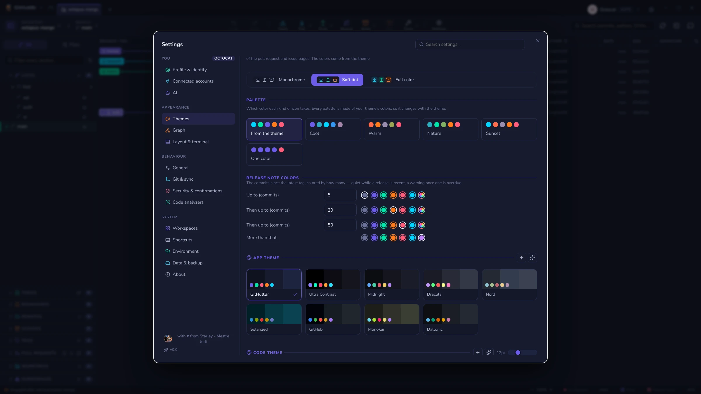

# Themes & Erscheinungsbild

Eingebaute Themes — GitHuttBr, Nord, Dracula, Solarized, GitHub, Monokai,
Midnight, Contrast und Daltonic — jedes mit einer hellen und einer dunklen
Variante.

- **Hell, dunkel oder dem Betriebssystem folgen**, live umgeschaltet.
- **Eigene Themes** und **KI-generierte** aus einem Prompt.
- Anpassbare **Code-Schriftgröße**.
- **Symbolfarben** für die Werkzeugleiste und die Abschnitte der Seitenleiste —
  siehe unten.
- Das **Aussehen des Graphen** — Spurpalette, Ecken, Zeilendichte und Linienstärke, mit Live-Vorschau — hat eine eigene Seite, **Einstellungen → Graph**: siehe [den Commit-Graphen](graph.md).

## Symbolfarben

Eine Reihe grauer Symbole lässt Abrufen, Push und Stash gleich aussehen, bis man
ihre Beschriftung liest. **Symbolfarben**, unter Erscheinungsbild im Reiter
Theme, färbt jedes Symbol nach dem, was es tut, damit das Auge die Aktion vor dem
Wort findet:

| Rolle | Symbole | Theme-Farbe, die es annimmt |
|---|---|---|
| Empfangen | Abrufen, Pull, Remotes, Worktrees | der Cyan-Platz des Themes |
| Senden, abschließen | Push, Aufgaben, Issues, Releases | Grün |
| Refs | Branch, Lokal, Tags, Pull Requests, Meilensteine, Submodule | die Akzentfarbe |
| Beiseitelegen | Stash, Pop, Stashes, Lesezeichen, Angeheftet | der Orange-Platz des Themes |

Rückgängig, Wiederholen, Werkzeuge und Einstellungen bleiben grau: Sie sind
Hilfsmittel, und dass sie schlicht bleiben, lässt die farbigen hervortreten.

Listen, die viele Einträge gruppieren, färben eine ganze Gruppe auf einmal, damit
sich eine Gruppe als eine Familie liest:

- **Werkzeuge-Menü** — die Zeitreise (Reflog, WIP-Schnappschüsse, Zeitmaschine,
  Bisect) in Orange; die Branch-Werkzeuge (Absorb, die Radare, lokale CI,
  Vergleiche) in der Akzentfarbe; und eine Farbe je Gruppe: Untersuchen Cyan,
  Branches & Historie die Akzentfarbe, Dateien & Patches Grün, Repository
  Orange, Geheimnisse & Teilen Rot.
- **Einstellungsseiten** — Layout & Terminal, Arbeitsbereiche und KI in der Akzentfarbe; Profil & Identität, Code-Analysen und Umgebung grün; Verbundene Konten, Git & Synchronisierung und Daten & Sicherung cyan; Themes und Graph orange; Sicherheit & Bestätigungen rot. Allgemein, Tastenkürzel und Über bleiben grau.

Eine Reihe von Symbolknöpfen ohne Beschriftung macht es umgekehrt — jeder Knopf
bekommt seine eigene Farbe, damit man sie auseinanderhalten kann. Auf der
[Pull-Request-Seite](pull-requests.md) sind die Knöpfe im Kopf so gefärbt:
Aktualisieren blau, KI-Review in der Akzentfarbe, lokale Vorschau türkis, zum
Quell-Branch grün und zum Ziel-Branch orange (Im Browser öffnen bleibt grau), und
bei deinen eigenen Kommentaren nimmt **Bearbeiten** die Akzentfarbe an und
**Löschen** Rot — dort und auf der Issue-Seite. Blau und Türkis sind Mischungen aus
den Farben des Themes, folgen ihm also ebenfalls.

| Option | Was du siehst |
|---|---|
| **Einfarbig** | Jedes Symbol grau, wie vor dieser Option |
| **Sanfter Ton** (Standard) | Die Farbe ins Grau gemischt; beim Darüberfahren die volle Farbe |
| **Volle Farbe** | Die Farbe selbst, auf einem kleinen Chip im selben Farbton |

Die Farben kommen aus dem Theme — ein Theme, das sein Grün oder seinen Akzent
umfärbt, färbt die Symbole mit, eigene und KI-generierte Themes eingeschlossen.

Grenzen: Gefärbt werden nur die Hauptknöpfe der Werkzeugleiste, die
Abschnittsköpfe der Seitenleiste, das Werkzeuge-Menü, die Rechtsklick-Menüs von Commits, Branches und Repositorys, die Einstellungsseiten und
die Knöpfe der Pull-Request- und der Issue-Seite sowie die Symbole der
Statusleiste (der Ordner, Hilfe, Ein Problem melden) — die Versionsnummer bleibt
grau; andere Menüs, die Zeilen
innerhalb eines Abschnitts und der Commit-Graph nicht. Eine Menüzeile unter dem
Mauszeiger behält ihr gewohntes Aussehen, Symbol eingeschlossen. Farbe ist nie der
einzige Hinweis — jedes Symbol behält seine Beschriftung.

## Farben des Release-Hinweises

Die [Missionskontrolle](mission-control.md) zeigt, wie viele Commits jedes
Repository seit seinem neuesten Tag gemacht hat. **Farben des Release-Hinweises**
legt fest, wie diese Zahl aussieht, damit ein überfälliges Release auffällt und ein
frisches ruhig bleibt.

Es gibt vier Bereiche. Die ersten drei enden bei einer Commit-Zahl, die du wählst;
der letzte nimmt alles darüber. Jeder Bereich nimmt eine der Farben des Themes oder
eine **Eigene Farbe…** aus dem Farbfeld am Ende seiner Zeile.

| Bereich | Ab Werk |
|---|---|
| Bis 5 Commits | Grau, wie der Rest der Zeile |
| Danach bis 20 | Gelb |
| Danach bis 50 | Rot |
| Mehr als das | Rot |

Eine Theme-Farbe folgt dem Theme, hell wie dunkel. Eine eigene Farbe bleibt in
jedem Theme genau so, wie sie gewählt wurde — wähle also eine, die auf beiden
Hintergründen lesbar ist.

## Wie die Einstellungen aufgebaut sind

Das Seitenmenü gruppiert die Seiten nach ihrem Thema:

| Gruppe | Seiten |
|---|---|
| **Du** | Profil & Identität · Verbundene Konten · KI — die ersten beiden bearbeiten das Profil, das in der Überschrift steht ([Profile](profiles.md)) |
| **Erscheinungsbild** | Themes · Graph · Layout & Terminal |
| **Verhalten** | Allgemein · Git & Synchronisierung · Sicherheit & Bestätigungen · Code-Analysen |
| **System** | Arbeitsbereiche · Tastenkürzel · Umgebung · Daten & Sicherung · Über |

Allgemein behält nur, was die App als Ganzes betrifft — Sprache, Repository-Tabs zeigen, Desktop-Benachrichtigungen, Changelog nach Updates öffnen, Beim Schließen warnen. Alles andere ist auf die Seite gezogen, zu der es gehört, und der Hinweis auf der Seite führt dorthin:

| Option | Jetzt in |
|---|---|
| Anfangs geladene Commits, Commits pro „mehr laden“, Beim Scrollen automatisch nachladen, Relative Datumsangaben, Avatare anzeigen, GitHub-Profilbilder verwenden | **Graph** — mit Spurenpalette, Linienecken, Zeilendichte, Knotenstil, Graph-Fokus, Stash-Anordnung, Linienstärke, dem früheren Graph-Tab von Themes |
| Automatisch abrufen alle (Minuten), Immer einen Merge-Commit erzeugen, Konfliktlösungen merken, Externe Diff- & Merge-Werkzeuge, Externer Editor, Standard-App für „Öffnen mit“ | **Git & Synchronisierung** |
| Vor Force-Push bestätigen | **Sicherheit & Bestätigungen** |
| Code-Analyzer, launch.json | **Code-Analysen** |
| Dateianzeige, Profil-Avatar animieren, Erledigte Aufgaben ausblenden, Refs nach Präfix gruppieren | **Layout & Terminal** |

Integrationen heißt jetzt **Verbundene Konten**, Daten heißt **Daten & Sicherung**. An dem, was eine Option tut, hat sich nichts geändert, und gespeicherte Einstellungen bleiben, wie sie sind. Ein Link, der eine Seite unter ihrem alten Namen öffnet, landet weiterhin auf der richtigen.

## Eine Einstellung finden

Die Einstellungen verteilen sich auf viele Seiten, und die gesuchte Option liegt selten dort,
wo man sie vermutet: Man weiß, dass es sie gibt, nicht auf welcher Seite. Das
Suchfeld in der Kopfzeile der Einstellungen, neben der Schließen-Schaltfläche,
durchsucht alle Seiten auf einmal.

Während du tippst, listet die rechte Seite die passenden Einstellungen nach
Seiten gruppiert — jede mit ihrem Namen, ihrer einzeiligen Beschreibung und der
Seite, auf der sie steht. Die Seitenleiste blendet Seiten ohne Treffer ab und
zeigt bei den anderen die Anzahl.

- Sie vergleicht den Namen einer Einstellung, ihre Beschreibung und den Namen der Seite — auch der Seite, auf der sie vor der Neugruppierung lag: „general fetch“ findet weiterhin das automatische Fetch unter Git & Synchronisierung, und „integrations“ findet Verbundene Konten. Groß- und Kleinschreibung und Akzente zählen nicht, und jedes getippte Wort muss vorkommen: „terminal font“ grenzt auf die Schrift-Einstellungen des Terminals ein.
- Gesucht wird in der Sprache der Oberfläche und gleichzeitig auf Englisch: Mit
  der App auf Deutsch findet „token“ oder „font“ die Einstellung trotzdem.
- Klicke auf ein Ergebnis oder drücke **Enter** für das erste, um seine Seite zu öffnen, zur Einstellung zu scrollen und sie kurz hervorzuheben.
- **Esc** leert die Suche; ein zweites **Esc** schließt die Einstellungen.

Durchsucht werden Namen und Beschreibungen, nicht die Werte, die du eingestellt
hast. Die Serverlisten pro Host unter Integrationen (GitHub Enterprise Server,
selbst betriebenes GitLab, Bitbucket Data Center) öffnen die Seite
Integrationen; den Tab des Hosts wählst du selbst. Einzelne Tastenkürzel sind
nicht indexiert — die Suche findet die Seite Tastenkürzel, deren Editor sie
auflistet.

## Layout

Seitenleiste links oder rechts, überall größenveränderbare Panels, eine
einklappbare Seitenleiste für die Momente, in denen der Graph das ganze Fenster
verdient, und eine Terminal-Platzierung pro Repository.

Dieselbe Seite, **Einstellungen → Layout & Terminal**, enthält auch die Extras der Titelleiste und der Seitenleiste — **Profil-Avatar animieren**, **Erledigte Aufgaben ausblenden**, **Refs nach Präfix gruppieren** — sowie die Änderungsleiste und die Minimap der Dateianzeige.

**Siehe auch:** [Der Commit-Graph](graph.md) · [Profile](profiles.md)
