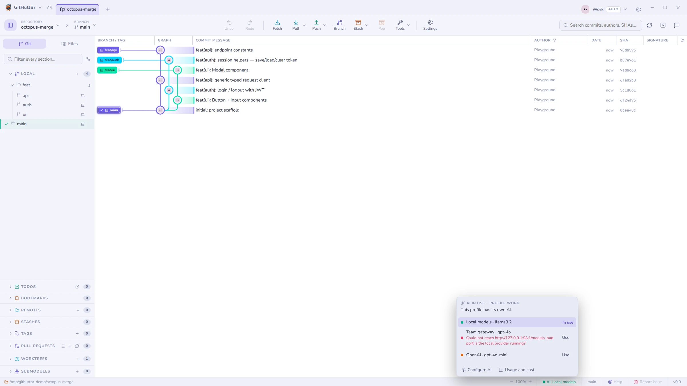

# Funciones de IA

Todas las funciones de IA son **opcionales** y están apagadas hasta que
configuras un proveedor. No se envía nada a ningún sitio hasta que pides algo
concreto.

## Una IA para todos los perfiles

La IA se configura una vez, en **Ajustes → IA**, y todos los [perfiles](profiles.md)
la usan: un perfil que crees después ya tiene la IA, sin volver a añadir ninguna
cuenta. La página lista cada perfil y si sigue esta **IA general**.

Un perfil puede usar **su propia IA** en su lugar — un perfil de trabajo que
debe pasar por la cuenta de la empresa, por coste o por política de datos, o que
escribe sus commits de otra forma. En la página **Perfil** de ese perfil, en *IA
de este perfil*, cambia **General** a **Propia**: empieza como una copia de toda
la IA general — cuentas, claves y preferencias — y desde entonces todo eso es
solo suyo. Volver a **General** la elimina, tras una confirmación, y deja la IA
general como estaba.

Un perfil usa una IA **entera**: la general o la suya, nunca una mezcla. Las
cuentas y los modelos *y* cómo escribe la IA y lo que puede hacer el chat vienen
del mismo sitio, así que cambiar el estilo de commit en la IA general lo cambia
para todos los perfiles que la siguen.

Todas las IA se configuran en esta misma página. La barra **Editando** de arriba
elige cuál: la IA general, o la propia de un perfil (*IA propia de Trabajo*).
**Configurar la IA propia** en la página Perfil, o **Editar su IA propia** en la
lista de perfiles, abre la página en esa. La página Perfil solo muestra qué IA
usa el perfil y qué responde — nunca aloja el editor, ni ninguna opción de IA
propia.

Debajo de las cuentas, la misma página guarda cómo **escribe** esa IA y lo que
puede hacer, en secciones:

| Sección | Contiene |
|---|---|
| **Mensajes de commit** | El estilo de commit — Conventional, Gitmoji y Ticket como tarjetas con una línea de ejemplo, el resto en *Más estilos* — *Generar descripción del commit*, la línea de coautor, **Reglas extra para commits** y una vista previa |
| **Explicar y al pasar el ratón** | Estilo de las explicaciones, *Explicar código al pasar el cursor* y su tecla modificadora |
| **Conflictos y ramas** | Estilo de resolución de conflictos, estilo de nombres de rama, cada uno con un ejemplo del resultado |
| **Chat del repositorio** | Si el chat está activado, qué lee, las acciones que puede proponer — consulta [Chat del repositorio](repo-chat.md#ajustes) |

Una línea sobre las secciones dice de quién es la IA que editas y a quién llega:
*IA general · se aplica a Trabajo y Personal*, o la propia de un perfil.

**Reglas extra para commits** — *Instrucciones personalizadas* hasta la 4.60 — solo se añaden a la generación de mensajes de commit: el chat, las explicaciones, las revisiones y los nombres de rama no las leen. La vista previa es un ejemplo fijo, no una llamada al modelo: muestra la forma del estilo elegido, no lo que la IA escribirá para tu cambio.

El selector de estilo del compositor y los selectores de modelo y de aprobación
del chat escriben en la misma IA que lee el perfil: la general o la propia del
perfil.

Actualizar desde una versión en la que cada perfil tenía su propia IA no pierde
nada: la IA del perfil en uso pasa a ser la IA general, y cualquier otro perfil
cuya IA fuera distinta la conserva como propia.

**Actualizar desde la 4.59 o anterior**, cuando las preferencias de escritura
estaban en cada perfil: una sola vez, las preferencias del perfil en uso (o, si
ese tiene IA propia, las del primer perfil en la IA general) pasan a la IA
general. Los perfiles con IA propia conservan las suyas. **El límite:** si dos
perfiles en la IA general escribían distinto — uno de trabajo con `ticket` y uno
personal con `conventional` —, ahora los dos escriben como el que se trasladó.
Para mantener la diferencia, dale a uno de ellos su propia IA y vuelve a elegir
allí su estilo.

## Proveedores

Una **cuenta** es una forma de llegar a un modelo: un proveedor, dónde
alcanzarlo y cómo se autentica. Puedes configurar varias y conviven — una clave
del trabajo, otra personal, un modelo local, una CLI en la que ya iniciaste
sesión.

Los preajustes cubren **OpenAI, Anthropic, Google Gemini, OpenRouter, Groq,
Mistral** y **Ollama** (enteramente local), además de cualquier endpoint
compatible con OpenAI.

**Una clave nunca sale de este equipo sin cifrar.** Una cuenta con clave llega a
su endpoint por `https://`, o por `http://` simple solo en este equipo
(`localhost`, `127.x`, `::1`). Una llamada que enviaría la clave por `http://` a
otro host se rechaza antes de que salga nada, y lo dice. Un endpoint sin clave —
Ollama en otra máquina de tu red — sigue funcionando por `http://`.

Anthropic usa su propia API `/v1/messages` en vez de una llamada con forma de
OpenAI, así que los modelos Claude funcionan de verdad en lugar de solo
aparentarlo. A Gemini se llega por el endpoint compatible con OpenAI de Google.

### La lista de proveedores

Cada proveedor guardado es una tarjeta: una letra de su proveedor, su nombre y,
debajo, lo que realmente usa — así se distinguen dos cuentas del mismo proveedor
sin abrir ninguna.

| Tipo de proveedor | Segunda línea |
| --- | --- |
| Suscripción o CLI local | `CLI claude · sonnet` — el comando y luego el modelo |
| Ollama o servidor propio | `http://localhost:11434 · qwen3:8b` — la dirección y luego el modelo |
| API alojada | `gpt-4o-mini · 41 modelos` — el modelo y cuántos listó el proveedor |

El número de modelos solo aparece cuando el proveedor ha listado sus modelos; la
lista incluida que GitHuttBr usa de reserva es una suposición, no un recuento.
La insignia de estado va a la derecha. La tarjeta que estás editando tiene un
borde de acento; una que no responde tiene un borde rojo y su motivo bajo el
nombre, terminado en **Probar de nuevo**. Haz clic en una tarjeta para abrirla
en el editor bajo la lista.

### Añadir y editar un proveedor

Un proveedor guardado a medias era una trampa silenciosa: una clave vacía podía
acabar en uso y nada respondía. Por eso nada de esta tarjeta
se guarda mientras escribes.

**Añadir proveedor** abre una tarjeta marcada **Borrador · sin guardar**, con borde
discontinuo. Rellena proveedor, clave, endpoint y modelo y elige
**Probar y guardar**. GitHuttBr primero lista los modelos del proveedor
con esa clave —la misma petición que el botón de actualizar junto a **Modelo**— y solo guarda cuando
responde. Verás **Conectado · N modelos** y el proveedor entra en la lista como
**Listo**.

Si la prueba falla, la tarjeta dice **No se pudo conectar** con el
motivo del proveedor (una clave rechazada, `401`; un servidor que no está en
marcha) y **No se guardó nada.** Corrige el campo y vuelve a probar, elige
**Guardar de todos modos** para conservarlo tal cual —entonces aparece como
**No responde**— o **Cancelar**, que no deja rastro.

Editar un proveedor guardado funciona igual. Un aviso dice
**Cambios sin guardar: nada cambia hasta que guardes** y cada campo que tocaste queda marcado
**· modificado**. **Descartar cambios** recupera los valores
guardados; **Probar y guardar** prueba y guarda. Elegir otro proveedor,
añadir uno o abrir **Usar mi suscripción** con cambios pendientes pregunta
**¿Guardar los cambios en «…»?**: **Guardar**, **Descartar cambios** o
**Seguir editando**. Cerrar Ajustes conserva el borrador en memoria, así
que sigue ahí cuando vuelves; nunca se escribe en disco.

Las claves se guardan exactamente como antes, en tu llavero, y solo al guardar.
El error de un proveedor se muestra con la clave y todo lo que parezca un token
enmascarados.

| Tipo de proveedor | Qué comprueba **Probar y guardar** |
| --- | --- |
| Clave de API o servidor local (Ollama, endpoint propio) | Lista los modelos; si funciona, el endpoint respondió con esa clave |
| Suscripción (Codex, Claude Code) | Envía el breve prompt de prueba descrito abajo, con cargo a tu plan |
| CLI local | Busca el comando en tu `PATH`; una ruta escrita se guarda sin comprobar |

### Insignias de estado

Cada proveedor de la lista lleva una insignia, deducida de lo que la página ya
sabe: la última prueba o la lista de modelos que obtuvo de todos modos. No se
consulta nada en segundo plano.

| Insignia | Significado |
| --- | --- |
| **Listo** | La última prueba o lista de modelos funcionó |
| **No responde** | El último intento falló; el motivo está en la línea de abajo, con **Probar de nuevo** |
| **Sin clave** | El proveedor necesita una clave de API y no la tiene |
| **Sin comprobar** | Nada le ha preguntado todavía: una suscripción hasta probarla, o una lista sin obtener |

**El límite:** una insignia es tan reciente como su última comprobación. Un
proveedor que dejó de responder hace una hora sigue en **Listo**
hasta que algo vuelva a preguntarle; elige **Probar conexión** en su tarjeta para
asegurarte. Una **CLI local** con ruta escrita queda en
**Sin comprobar**, porque demostrar que funciona costaría un prompt.

### El proveedor en uso

Un proveedor responde a toda tarea que no tenga un proveedor propio en
**Modelo por tarea**. Su tarjeta termina con un **En uso** verde, donde las demás tarjetas tienen
**Usar**, y se queda donde está en la lista. El verde solo significa en uso: un
proveedor que responde pero no está en uso dice **Listo** en un gris azulado
discreto. La IA general y un perfil
con IA propia tienen cada uno su proveedor en uso; la lista cambia el que estás
editando.

Cada otro proveedor guardado tiene un botón **Usar** a la derecha de su fila,
junto a su insignia. Un clic lo pone en uso y lo guarda al momento: qué proveedor
responde es una elección, no una edición, así que no espera a **Probar y
guardar**. No abre la tarjeta de ese proveedor, y una tarjeta con cambios sin
guardar los conserva.

**El límite:** **Usar** no prueba nada. Un proveedor marcado **Sin clave** o
**No responde** puede ponerse en uso — a propósito, antes de arreglar la clave —
y su insignia lo sigue diciendo; la siguiente tarea de IA falla con el motivo de
ese proveedor. Un borrador no tiene **Usar**: no es un proveedor hasta guardarlo.

### La IA en uso, desde la barra de estado

Un perfil con IA propia ignora el proveedor en uso de la IA general: poner otro
proveedor en uso en la IA general no cambia nada para ese perfil, y fuera de
Ajustes nada lo decía. La barra de estado, al pie de un repositorio, ahora lo
dice. Su botón **IA:** _proveedor_ nombra el proveedor que responde por el
perfil en uso, con un punto para su estado — verde **Listo**, rojo **No
responde**, ámbar **Sin clave**, gris **Sin comprobar**. Cuando el proveedor está
**Listo**, todo el botón se pone verde, para que una IA que funciona no parezca
apagada.

Al pulsarlo se abre un pequeño panel:

| Parte | Qué muestra |
| --- | --- |
| Cabecera | El perfil en uso, y si **sigue la IA general** o **tiene su propia IA** |
| Una fila por proveedor | Cada proveedor guardado de esa IA, con su modelo y su estado; uno que no responde muestra el motivo en una segunda línea |
| **En uso** / **Usar** | El proveedor que responde ahora, y el cambio con un clic en cada uno de los demás |
| **Configurar IA** | Abre **Ajustes → IA** |
| **Uso y coste** | Abre la pestaña *Analíticas* de los ajustes del repositorio |

**Usar** escribe donde el perfil lee su IA. En un perfil que sigue la IA
general cambia la IA general — y con ella todos los perfiles que la siguen; en
un perfil con IA propia cambia solo la suya. Las tareas que tienen un proveedor
propio lo conservan. **Esc** cierra el panel, y el botón se oculta mientras la
IA está desactivada.

**Los límites:** el punto se calcula con la lista de modelos que la app ya pidió
(guardada hasta un día) y nunca prueba nada, así que un proveedor que dejó de
responder puede seguir en **Listo** — probar la conexión en Ajustes es la forma
de estar seguro. Hasta que se abren los Ajustes, la ventana no tiene las claves
en sí, de modo que un proveedor sin clave puede verse como **Sin comprobar** o
**No responde** en lugar de **Sin clave**. Como **Usar** en Ajustes, el cambio
no prueba el proveedor que pone en uso.

### Usar una suscripción en vez de una clave de API

En **Ajustes → IA**, elige **Usar mi suscripción**. En el [primer
arranque](first-run.md), la tarjeta **Mi suscripción** del paso de IA encuentra
Claude Code o Codex y lo prueba en un solo paso, y vuelve a esta misma
configuración cuando no encuentra ninguno. Selecciona el plan que usas y abre
**Documentación** para ver las instrucciones de instalación del proveedor. Una
vez instalado, elige **Conectar ChatGPT (Codex)** o **Conectar Claude (Claude
Code)**. El CLI del proveedor abre su página de inicio de sesión en el navegador
y guarda su propia sesión. Una sesión de suscripción existente se reutiliza.
**Cancelar** detiene una conexión pendiente. Un inicio de sesión que tarda más
de tres minutos se detiene y puede reintentarse.

| Plan | CLI necesario | Iniciar sesión desde un terminal |
| --- | --- | --- |
| ChatGPT con acceso a Codex | Codex CLI | `codex login` y elige ChatGPT |
| Claude con acceso a Claude Code | Claude Code | `claude auth login` y elige tu cuenta de suscripción |

Conectar también prueba la sesión. Si iniciaste sesión desde un terminal, elige
**Probar conexión**. GitHuttBr comprueba el método de inicio de sesión del CLI y
envía un prompt de prueba corto desde un directorio temporal vacío. La solicitud
cuenta para la cuota de tu proveedor. Tras **Conectada**, elige **Añadir
proveedor**. La primera cuenta de la IA general queda **En uso**. Para una
configuración existente, elige **Usar** en su fila o asigna funciones concretas
más abajo. Para omitir la configuración en el primer arranque, elige **Omitir,
sin IA** y vuelve a Ajustes cuando quieras.

Si GitHuttBr no encuentra el CLI, instálalo o escribe la ruta completa del
ejecutable y prueba de nuevo. Si la sesión ha caducado o el CLI usa una clave de
API, inicia sesión con la cuenta de suscripción. Si llegas a un límite de uso,
espera a que se renueve la cuota del proveedor.

Para la configuración manual, elige el proveedor **CLI local** para responder
con un CLI de agente ya instalado y con sesión iniciada en esta máquina —
`claude`, `gemini`, `codex` o `devin`. GitHuttBr ejecuta el binario con tu
prompt y lee su respuesta; no hay clave de API que pegar ni se guarda ningún
token.

GitHuttBr solo ejecuta un comando que tú configuraste como cuenta, y siempre con
una lista de argumentos en vez de un shell, así que nada de un diff o del nombre
de una rama puede interpretarse como un comando.

Cada llamada inicia el CLI con el repositorio como directorio de trabajo, para
que los CLI de agente como Devin puedan abrir los archivos por los que preguntas
en vez de responder a ciegas. Las funciones sin repositorio (generar temas) lo
ejecutan desde el directorio propio de la app.

> **Esto no es más privado que una clave de API.** Tus indicaciones siguen
> llegando al mismo proveedor, bajo tu propia cuenta, igual que con una clave.
> Lo que cambia es la facturación y la configuración, no adónde va el texto.

Si el comando no está en tu `PATH`, escribe su ruta completa en la cuenta.

### Modelo por tarea

En **Modelo por tarea**, cada función — mensajes de commit, chat,
explicar, revisión de PR, resolución de conflictos, wiki, temas — puede apuntar
a su propia cuenta y modelo. Deja una fila en **Proveedor en uso** para seguir al
proveedor marcado **En uso**. Modelo barato para los mensajes de commit y uno
potente para el chat es el reparto habitual.

### Aviso de actualización

Al actualizar desde una versión anterior a las cuentas, esto se muestra una vez. El proveedor y la clave que tenías pasan a ser la primera cuenta; no hay que reconfigurar nada a mano.

## Modelos

Las listas de modelos vienen del propio proveedor y se guardan en caché un día;
el botón de actualizar junto a **Modelo** actualiza una al instante. Bajo la lista, GitHuttBr dice de
dónde salió: en directo, de caché (con la fecha), o la lista integrada de
reserva y por qué.

La lista se filtra a los modelos que pueden responder a una petición de chat,
así que los de embeddings, voz e imagen se quedan fuera. Toda casilla de modelo
acepta además texto libre, de modo que un modelo en vista previa, un despliegue
privado o una etiqueta de Ollama recién descargada siempre se puede usar aunque
el proveedor no la liste.

Un proveedor al que aún no le has dado clave, o que está inalcanzable, recurre a
una pequeña lista integrada en vez de a un desplegable vacío.

Ningún proveedor publica una lista ordenada ni curada, así que el criterio es de GitHuttBr: las instantáneas con fecha se pliegan sobre el modelo del que son instantánea (`gpt-4o` cubre `gpt-4o-2024-08-06`), y lo que queda va ordenado de más nuevo a más viejo en vez de alfabéticamente. **Mostrar todos los modelos**, al final de la lista, devuelve todo lo que envió el proveedor.

## Qué puede hacer

| Función | Qué obtienes |
|---|---|
| **Mensaje de commit** | Resumen (y cuerpo opcional) a partir de tu diff preparado, en el estilo que elijas |
| **Explicar este archivo** | Explicación en lenguaje llano en un panel lateral — Normal, Conciso, ELI5… incluso Pirata |
| **Explicar al pasar el ratón** | Mantén <kbd>⇧</kbd> y apunta a un identificador para una explicación de una línea, más las líneas de las que la sacó |
| **Edición con IA de la selección** | Selecciona líneas de un archivo, describe el cambio, y el modelo reescribe solo esas líneas en el borrador del editor |
| **Resolución de conflictos** | Propone una fusión en la salida editable — nunca la aplica sola |
| **Revisión de PR** | Resume un diff y señala riesgos, cada uno anclado a un `path:line` real |
| **Descripción de PR** · **nombres de rama** | Redactados a partir de los commits y el diff de la rama |
| **Temas** · **paletas del grafo** | Generados desde un prompt |
| **Preparación inteligente** | Sugerencias de qué pertenece a este commit |
| **[Chat del repositorio](repo-chat.md)** | Preguntas fundamentadas más cambios de archivos revisados, seguidos de acciones de Git validadas |
| **Asistente de configuración de IA** | Genera archivos de configuración del asistente (instrucciones, agentes, hooks) para el repositorio — el botón de la varita en la cabecera del panel de chat |

### Editar solo las líneas que seleccionas

En la vista de archivo, arrastra sobre las líneas que quieres cambiar y pulsa
**Edición con IA…** (o haz clic derecho en una línea y elígelo en el menú). Una
barra abajo muestra el rango seleccionado y recoge tu instrucción — «renombra
esta variable», «añade comprobaciones de null», «traduce estas cadenas». El
modelo ve las líneas seleccionadas más un poco de contexto alrededor y devuelve
solo el reemplazo de ese rango, que va al **borrador del editor** en lugar de al
disco. Lo revisas allí y guardas o descartas con el flujo de edición normal, así
que nada se escribe hasta que lo digas. Funciona con cualquier backend
configurado, no solo con CLI de agente, porque la respuesta es texto, no una
llamada a herramienta. Los límites: reescribe un rango contiguo cada vez, no
puede crear ni borrar archivos enteros, y una selección que cruza hunks de un
diff se rechaza — selecciona en la vista de archivo en su lugar.

## Anclada, no adivinando

La revisión ve el diff como **hunks etiquetados** y solo puede citar esas
etiquetas; después GitHuttBr resuelve cada etiqueta a un archivo y una línea
reales. Un modelo que se invente una ubicación es **rechazado y se le vuelve a
preguntar**, así que los hallazgos siempre apuntan a código que existe.

Explicar al pasar el ratón lee solo una ventana numerada alrededor del token —
en un diff, solo los hunks visibles en pantalla — así que cuando una definición
vive en otra parte lo dice en lugar de inventársela. Las respuestas se cachean
por versión de archivo.

[Chat del repositorio](repo-chat.md) funciona igual: solo puede citar los
fragmentos que recibió, y la solicitud en dos pasos los elige de la propia lista
de archivos rastreados de Git, no de algo que escriba el modelo. Cuando propone
un cambio, GitHuttBr valida acciones exactas sobre archivos, calcula sus diffs
localmente y luego ejecuta las acciones de Git siguientes según la política de
aprobación configurada.

**Los archivos secretos enmascarados nunca se envían.** Tampoco los archivos que
cubren las reglas de enmascaramiento de secretos — incluido un archivo que fijes
al chat a mano, que se rechaza con un motivo en vez de leerse.

## Cuando un modelo va lento, o deja de responder

Un modelo local en un portátil puede tardar un minuto en un mensaje de commit, y
un modelo que "piensa" antes de responder tarda todavía más — pero un servidor
que se cerró a mitad de una petición no debería dejarte mirando un indicador que
gira.

| Qué ocurre | Qué ves |
|---|---|
| Sin respuesta tras 30 segundos | *"{cuenta} está tardando más de lo esperado en responder."*, con **Seguir esperando**, **Usar {otra cuenta}** y **Cancelar**. Seguir esperando vuelve a preguntar un minuto después si sigue en marcha |
| Un servidor local (Ollama, LM Studio, llama.cpp…) se cierra mientras trabaja | En pocos segundos: *"{cuenta} no responde. ¿Sigue en ejecución?"*, con un botón por cada otra cuenta lista para usar, y **Cancelar** |
| El servidor ya estaba cerrado cuando lo pediste | Lo mismo, de inmediato |

**Usar {otra cuenta}** cancela la petición y envía la misma a esa cuenta, con su
modelo predeterminado — el mensaje de commit, la revisión o la respuesta del
chat llega como si la hubieras pedido allí. No cambia tu configuración: la
siguiente petición vuelve a ir a la cuenta que elegiste para esa tarea.

Esto cubre todas las funciones de IA — mensajes de commit, chat, revisión,
explicar, conflictos, temas, la wiki — porque todas pasan por la misma llamada.

## Límites

- **Solo se vigila si se cierran los servidores locales.** Un proveedor en la
  nube que se cae falla con su propio error; una llamada a la nube que
  simplemente va lenta recibe el aviso de *está tardando* como cualquier otra.
  Un servidor local ocupado, pero no cerrado, cuenta como vivo: solo una
  conexión rechazada o cortada termina la llamada antes de tiempo.

- Las listas de modelos de reserva se quedan obsoletas entre versiones. Para eso
  está la consulta en vivo; la reserva solo cubre el caso en que consultar no es
  posible.
- Filtrar la lista de un proveedor a modelos aptos para chat se hace por nombre,
  así que un modelo de chat con un nombre inusual puede quedar fuera. Escríbelo
  a mano.
- Una cuenta de CLI no puede informar del uso de tokens salvo que la CLI lo
  haga, así que las cifras de uso y coste en Ajustes contarán de menos esas
  llamadas.
- Las respuestas por CLI son más lentas que una llamada directa a la API: el
  binario arranca una sesión entera por petición.
- Las claves se guardan por cuenta en el llavero del sistema. Borrar una cuenta
  borra su clave — pregunta antes, y no se puede deshacer.
- Volver a una versión anterior a la IA general pierde las claves de la IA
  general: esa versión no sabe dónde se guardan y las descarta al guardar. Las
  cuentas se mantienen; vuelve a escribir las claves. La IA propia de un perfil
  no se ve afectada.

**Ver también:** [Chat del repositorio](repo-chat.md) · [Wiki del repositorio](repo-wiki.md) · [Seguridad y secretos](security.md)
