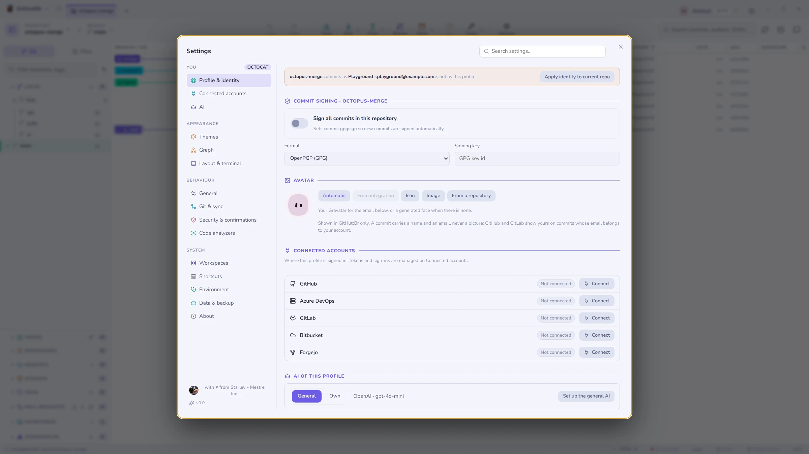

# Funciones de IA

Todas las funciones de IA son **opcionales** y están apagadas hasta que
configuras un proveedor. No se envía nada a ningún sitio hasta que pides algo
concreto.

## Una IA para todos los perfiles

La IA se configura una vez, en **Ajustes → IA**, y todos los [perfiles](profiles.md)
la usan: un perfil que crees después ya tiene la IA, sin volver a añadir ninguna
cuenta. La página lista cada perfil y si sigue esta **IA general**.

Un perfil puede usar **su propia IA** en su lugar — un perfil de trabajo que debe
pasar por la cuenta de la empresa, por coste o por política de datos. En la
página **Perfil** de ese perfil, en *IA de este perfil*, cambia **General** a
**Propia**: empieza como una copia de la IA general, y sus proveedores y claves
pasan a ser solo suyos. Volver a **General** los elimina, tras una confirmación,
y deja la IA general como estaba.

Todas las IA se configuran en esta misma página. La barra **Editando** de arriba
elige cuál: la IA general, o la propia de un perfil (*IA propia de Trabajo*).
**Configurar la IA propia** en la página Perfil, o **Editar su IA propia** en la
lista de perfiles, abre la página en esa. La página Perfil solo muestra qué IA usa
el perfil y qué responde — nunca aloja el editor.

Cómo **escribe** la IA sigue siendo de cada perfil en ambos casos: el estilo del
mensaje de commit, el estilo de las explicaciones, los estilos de resolución de
conflictos y de nombres de rama, las instrucciones personalizadas, la línea de
coautor y el chat del repositorio. Están en la página **Perfil**, en
*Preferencias de escritura de la IA*, así que un perfil de trabajo puede escribir
commits `ticket` mientras uno personal escribe `conventional`, los dos con la
misma IA.

Actualizar desde una versión en la que cada perfil tenía su propia IA no pierde
nada: la IA del perfil en uso pasa a ser la IA general, y cualquier otro perfil
cuya IA fuera distinta la conserva como propia.

## Proveedores

Una **cuenta** es una forma de llegar a un modelo: un proveedor, dónde
alcanzarlo y cómo se autentica. Puedes configurar varias y conviven — una clave
del trabajo, otra personal, un modelo local, una CLI en la que ya iniciaste
sesión.

Los preajustes cubren **OpenAI, Anthropic, Google Gemini, OpenRouter, Groq,
Mistral** y **Ollama** (enteramente local), además de cualquier endpoint
compatible con OpenAI.

Anthropic usa su propia API `/v1/messages` en vez de una llamada con forma de
OpenAI, así que los modelos Claude funcionan de verdad en lugar de solo
aparentarlo. A Gemini se llega por el endpoint compatible con OpenAI de Google.

### Usar una suscripción en vez de una clave de API

Durante la configuración inicial o en Ajustes → IA, elige **Usar mi suscripción**. Selecciona ChatGPT o Claude e inicia sesión desde la terminal con el comando correspondiente. Pulsa **Probar conexión** y, cuando aparezca «Conectado», añade la cuenta. La primera cuenta de la IA general pasa a ser la predeterminada.

Una vez instalada la CLI, pulsa Conectar para abrir la página de inicio de sesión del proveedor. Puedes cancelar la conexión pendiente.

- ChatGPT (Codex) — `codex login`
- Claude (Claude Code) — `claude auth login`

La prueba envía un mensaje breve al proveedor y consume cuota de tu plan. Has alcanzado el límite del plan. Reinténtalo cuando se renueve la cuota.

Elige el proveedor **CLI local** para responder con una CLI de agente ya
instalada y con sesión iniciada en esta máquina — `claude`, `gemini` o `codex`.
GitHuttBr ejecuta el binario con tu indicación y lee su respuesta; no hay clave de
API que pegar ni token que guardar.

GitHuttBr solo ejecuta un comando que tú configuraste como cuenta, y siempre con
una lista de argumentos en vez de un shell, así que nada de un diff o del nombre
de una rama puede interpretarse como un comando.

> **Esto no es más privado que una clave de API.** Tus indicaciones siguen
> llegando al mismo proveedor, bajo tu propia cuenta, igual que con una clave.
> Lo que cambia es la facturación y la configuración, no adónde va el texto.

Si el comando no está en tu `PATH`, escribe su ruta completa en la cuenta.

### Modelo por tarea

En **Modelo por tarea**, cada función — mensajes de commit, chat,
explicar, revisión de PR, resolución de conflictos, wiki, temas — puede apuntar
a su propia cuenta y modelo. Deja una fila en la predeterminada para seguir a la
cuenta predeterminada. Modelo barato para los mensajes de commit y uno potente
para el chat es el reparto habitual.

### Aviso de actualización

Al actualizar desde una versión anterior a las cuentas, esto se muestra una vez. El proveedor y la clave que tenías pasan a ser la primera cuenta; no hay que reconfigurar nada a mano.

## Modelos

Las listas de modelos vienen del propio proveedor y se guardan en caché un día;
**Obtener modelos** actualiza una al instante. Bajo la lista, GitHuttBr dice de
dónde salió: en directo, de caché (con la fecha), o la lista integrada de
reserva y por qué.

La lista se filtra a los modelos que pueden responder a una petición de chat,
así que los de embeddings, voz e imagen se quedan fuera. Toda casilla de modelo
acepta además texto libre, de modo que un modelo en vista previa, un despliegue
privado o una etiqueta de Ollama recién descargada siempre se puede usar aunque
el proveedor no la liste.

Un proveedor al que aún no le has dado clave, o que está inalcanzable, recurre a
una pequeña lista integrada en vez de a un desplegable vacío.

Ningún proveedor publica una lista ordenada ni curada, así que el criterio es de GitHuttBr: las instantáneas con fecha se pliegan sobre el modelo del que son instantánea (`gpt-4o` cubre `gpt-4o-2024-08-06`), y lo que queda va ordenado de más nuevo a más viejo en vez de alfabéticamente. **Mostrar todos los modelos**, al final de la lista, devuelve todo lo que envió el proveedor.

## Qué puede hacer

| Función | Qué obtienes |
|---|---|
| **Mensaje de commit** | Resumen (y cuerpo opcional) a partir de tu diff preparado, en el estilo que elijas |
| **Explicar este archivo** | Explicación en lenguaje llano en un panel lateral — Normal, Conciso, ELI5… incluso Pirata |
| **Explicar al pasar el ratón** | Mantén <kbd>⇧</kbd> y apunta a un identificador para una explicación de una línea, más las líneas de las que la sacó |
| **Resolución de conflictos** | Propone una fusión en la salida editable — nunca la aplica sola |
| **Revisión de PR** | Resume un diff y señala riesgos, cada uno anclado a un `path:line` real |
| **Descripción de PR** · **nombres de rama** | Redactados a partir de los commits y el diff de la rama |
| **Temas** · **paletas del grafo** | Generados desde un prompt |
| **Preparación inteligente** | Sugerencias de qué pertenece a este commit |
| **Asistente de configuración de IA** | Genera archivos de configuración del asistente (instrucciones, agentes, hooks) para el repositorio — el botón de la varita en la cabecera del panel de chat |

## Anclada, no adivinando

La revisión ve el diff como **hunks etiquetados** y solo puede citar esas
etiquetas; después GitHuttBr resuelve cada etiqueta a un archivo y una línea
reales. Un modelo que se invente una ubicación es **rechazado y se le vuelve a
preguntar**, así que los hallazgos siempre apuntan a código que existe.

Explicar al pasar el ratón lee solo una ventana numerada alrededor del token —
en un diff, solo los hunks visibles en pantalla — así que cuando una definición
vive en otra parte lo dice en lugar de inventársela. Las respuestas se cachean
por versión de archivo.

**Los archivos de secretos enmascarados no se envían nunca.** Tampoco los
archivos que cubren las reglas de enmascarado de secretos.

## Límites

- Las listas de modelos de reserva se quedan obsoletas entre versiones. Para eso
  está la consulta en vivo; la reserva solo cubre el caso en que consultar no es
  posible.
- Filtrar la lista de un proveedor a modelos aptos para chat se hace por nombre,
  así que un modelo de chat con un nombre inusual puede quedar fuera. Escríbelo
  a mano.
- Una cuenta de CLI no puede informar del uso de tokens salvo que la CLI lo
  haga, así que las cifras de uso y coste en Ajustes contarán de menos esas
  llamadas.
- Las respuestas por CLI son más lentas que una llamada directa a la API: el
  binario arranca una sesión entera por petición.
- Las claves se guardan por cuenta en el llavero de tu sistema. Borrar una
  cuenta borra su clave.
- Volver a una versión anterior a la IA general pierde las claves de la IA
  general: esa versión no sabe dónde se guardan y las descarta al guardar. Las
  cuentas se mantienen; vuelve a escribir las claves. La IA propia de un perfil
  no se ve afectada.

**Ver también:** [Wiki del repositorio](repo-wiki.md) · [Seguridad y secretos](security.md)
