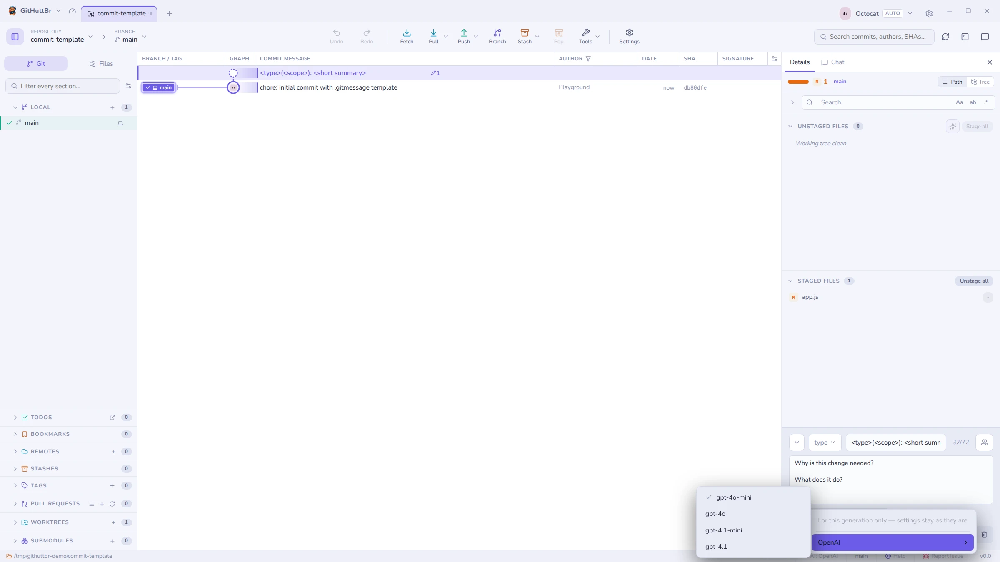

# Hacer commits

## Estilos de mensaje

Elige uno en **Ajustes → IA → Mensajes de commit**, o directamente en el
compositor; el compositor se adapta a él. El estilo pertenece a la IA que usa el
perfil — la general o la propia del perfil.

| Estilo | Tiene esta pinta |
|---|---|
| **Convencional** | `feat(api)!: add rate limiting` — con un desplegable de tipos |
| **Gitmoji** | `✨ add rate limiting` — con un selector de emoji |
| **Gitmoji + Convencional** | `✨ feat(api): add rate limiting` — selector de emoji *y* desplegable de tipo |
| **Ticket** | `ABC-123: add rate limiting` — sacado del nombre de la rama |
| **Simple** · **Auto** | Lo que escribas; con Auto es la IA quien decide la forma |
| **Cavernícola** · **Haiku** | Exactamente lo que parecen |

### Gitmoji

[Gitmoji](https://gitmoji.dev) pone un emoji delante del asunto para que el
historial se lea de un vistazo: 🐛 correcciones, ✨ funcionalidades, 🔥
eliminaciones. Con cualquiera de los dos estilos gitmoji, el botón de emoji está
junto al campo del asunto. Abre **los 75 gitmoji oficiales**, con búsqueda por
emoji, por `:código:` (lo que escriben quienes usan gitmoji-cli) o por
significado en tu idioma.

**Gitmoji + Convencional** mantiene el tipo y el emoji sincronizados. Elige un
tipo y su emoji lo sigue; cambia el tipo y cambia también, salvo que hayas
elegido el emoji a mano (🚑️ en un `fix`, por ejemplo). Ese nunca se sobrescribe.

| Tipo | Emoji | Tipo | Emoji |
|---|---|---|---|
| `feat` | ✨ | `test` | ✅ |
| `fix` | 🐛 | `build` | 📦️ |
| `docs` | 📝 | `ci` | 👷 |
| `style` | 🎨 | `chore` | 🔧 |
| `refactor` | ♻️ | `revert` | ⏪️ |
| `perf` | ⚡️ | | |

La IA escribe con la misma forma. Si un modelo olvida el emoji o responde con un
`:shortcode:`, el asunto se corrige antes de llegar al campo.

Los commits que otras herramientas escribieron como `:sparkles: add login` se
**muestran** como `✨ add login` en el grafo, en los detalles del commit y en las
vistas de historial.

Límites:

- El selector siempre escribe el emoji **unicode**, nunca un `:shortcode:`.
- Los shortcodes se convierten solo al mostrarlos. El commit no se reescribe, y
  la búsqueda en el historial coincide con el texto tal como se hizo commit.
- Solo cuentan los gitmoji: un asunto que empieza con otro emoji se deja igual.
- Un repositorio cuyo hook `commit-msg` ejecuta commitlint con el preset
  Conventional estándar rechaza un emoji al inicio. Es la regla del hook, no de
  GitHuttBr: configura commitlint para gitmoji o usa Conventional puro allí.

## Escribir el mensaje con IA

Con la IA activada, **Generar con IA** aparece bajo la descripción. Lee el diff
preparado (staged) y escribe el resumen y la descripción en el estilo de
arriba. El botón dice quién responderá — *cuenta · modelo*, la pareja elegida
para los mensajes de commit en **Ajustes → IA → Modelo por tarea** — para que
un modelo local lento o uno caro nunca sea una sorpresa.

- **▾** junto al nombre lista tus cuentas guardadas, cada una con algunos de
  sus modelos. La elección vale **solo para esa generación**; los Ajustes no
  cambian.
- Mientras se ejecuta, el cuadro muestra *Generando con cuenta · modelo… 12s*
  y **Cancelar**, que detiene la propia solicitud, no solo el indicador. A los
  30 segundos también ofrece **Usar** otra cuenta lista, que ejecuta la misma
  generación allí. El aviso global *está tardando más de lo esperado*
  ([IA](ai.md)) sigue apareciendo también.
- El texto nuevo **reemplaza** al que había, y el anterior se guarda: un aviso
  dice *Generado por cuenta · modelo en 7 s* y ofrece **Deshacer**, que
  devuelve tu resumen y tu descripción, y **Generar de nuevo**. Desaparece en
  cuanto editas el texto o haces el commit.

[Editar commit](commit-edit.md) tiene el mismo botón, a partir del diff de ese
commit.

Límites:

- Solo se envía el diff preparado, recortado cuando es muy grande — nunca
  cambios sin preparar ni otros archivos.
- Deshacer guarda un paso: el texto de antes de la primera generación seguida.
  Cuando el aviso desaparece, esa copia también.
- Cancelar no devuelve los tokens que el proveedor ya gastó en la solicitud.
- La lista de ▾ muestra todas las cuentas guardadas, incluida una sin clave
  todavía; elegirla falla con el error de esa cuenta.

## Cosas que el compositor hace por ti

- <kbd>↑</kbd> <kbd>↓</kbd> recuperan tus **mensajes recientes**.
- Un **selector de coautores** añade trailers `Co-authored-by:` a partir de
  quienes ya han contribuido al repositorio.
- `commit.template` / `.gitmessage` **rellena** el mensaje, sin las líneas de
  comentario.
- Durante un merge, un cherry-pick o un revert, el mensaje viene **prerrellenado**
  como lo haría git.
- Los borradores **persisten** por repositorio, así que cambiar de pestaña nunca
  pierde un mensaje.

## El linter

Una comprobación en vivo y sin bloqueo: longitud del asunto (con contador de
caracteres), punto final, asunto en minúscula o no imperativo, líneas del cuerpo
demasiado anchas. Son pistas, nunca una barrera — no te impedirá hacer el commit.

## Amend

Amend reescribe el último commit con lo que tengas preparado. GitHuttBr te enseña
antes el mensaje existente, para que estés editando y no reescribiendo.

**Enmendar commit…** en una fila del grafo hace lo mismo para HEAD: carga el
mensaje completo, pone el compositor en modo amend y le da el foco. Un HEAD ya
enviado también se puede enmendar, pero GitHuttBr avisa de que actualizar el
remoto exigirá un force push.

**Deshacer commit…** es su hermano para un HEAD sin enviar: reset mixed al
padre, los cambios del árbol de trabajo se conservan, y el mensaje vuelve al
compositor. El commit inicial tiene un camino propio que deja una rama sin
nacer en lugar de destruir los archivos.

**Ver también:** [Preparación](staging.md) · [Absorb](absorb.md) · [Generador de changelog](changelog.md)
