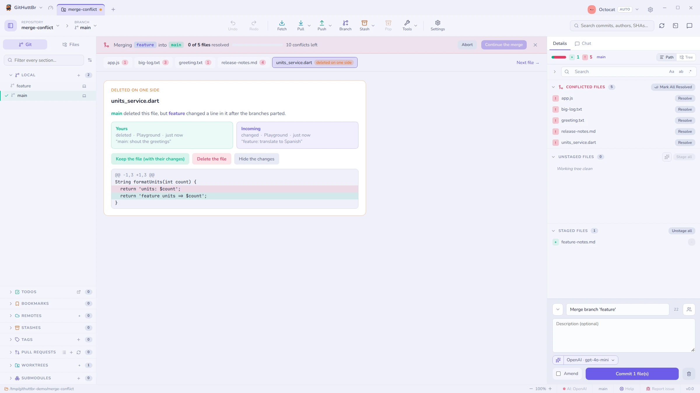

# Resolver conflictos

Cuando un merge, un rebase, un cherry-pick o un revert se detiene, el resolutor
convierte todo el paso en una sola pantalla. La barra de arriba dice **qué** se
ha parado y **entre qué** — "Fusionando `feature` en `main`", no un simple
"conflicto" — y cuánto llevas: *2 de 5 archivos* resueltos, con los conflictos
que aún quedan sumando todos los archivos.

## La tira de archivos

Bajo la barra, un chip por cada archivo en el que se detuvo este paso:

| Chip | Significa |
|---|---|
| Verde con ✓ | Resuelto — preparado, no queda nada por decidir |
| Con contorno | El archivo en el que estás |
| Un número rojo | Cuántos bloques en conflicto le quedan al archivo |
| Una etiqueta | Un conflicto sin texto que fusionar: *borrado en un lado*, *renombrado en los dos lados*, *añadido en un lado* |

Los chips resueltos van primero y los abiertos después, cada grupo por nombre,
así que la tira se lee como hecho a la izquierda y lo que queda a la derecha.

**Siguiente archivo →** salta al siguiente que sigue abierto, y marcar un
archivo como resuelto te lleva allí solo. **Continuar** en la barra sigue
desactivado hasta que todos los chips estén en verde; **Abortar** pregunta antes
y dice qué pierdes.

git olvida un archivo en el momento en que se prepara, así que "resuelto" es lo
que GitHuttBr vio durante este paso, más los archivos que git listó en su mensaje
de fusión. Un archivo que preparaste en una terminal antes de abrir el resolutor
sigue contando; tras un reinicio a mitad de un rebase, la mitad resuelta de ese
paso puede que no.

## Por qué hay conflicto

**Por qué hay conflicto**, en la cabecera del archivo, enumera por cada lado los
commits que tocaron este archivo desde que las ramas se separaron —
`git log --merge`, que git lleva incluyendo desde siempre y que nadie encuentra.

Los marcadores dicen qué choca. Esto dice quién lo cambió y por qué, que suele
ser lo que de verdad decide la resolución. Si ahí no hay nada, ninguno de los dos
lados hizo un commit sobre esta ruta exacta — el choque viene de un renombrado o
de un movimiento.

La cabecera también dice en qué conflicto estás y qué tipo de conflicto tiene el
archivo, leído del propio estado de git: *los dos lados cambiaron las mismas
líneas*, *añadido en los dos lados*.

## Los tres paneles

| Panel | Es |
|---|---|
| **Tu lado** | El lado en el que estabas, encabezado por el commit más reciente de ese lado que tocó el archivo: sha, asunto, autor, hace cuánto |
| **Base** | La versión de la que partieron los dos lados — el ancestro común o, en un pick o un paso de rebase, el padre del commit que se aplica. Las líneas que cada conflicto reemplazó aparecen sombreadas |
| **Entrante** | El lado que entra, encabezado igual que Tu lado |

**Mostrar la base**, en la cabecera del resultado, oculta o muestra el panel
Base y recuerda tu elección. Aparece en gris cuando no hay base — los dos lados
añadieron el archivo.

Todos los paneles se redimensionan, y la cabecera del resultado lleva dos
interruptores de vista:

| Interruptor | Qué hace |
|---|---|
| **Ajustar** | Pliega las líneas largas dentro de los paneles laterales en vez de desplazarlas. La vista de texto del resultado mantiene una fila por línea — sus marcadores laterales dependen de eso — así que siempre se desplaza |
| **Vincular desplazamiento** | Desplaza los paneles y el resultado a la vez, en vertical y en horizontal. Sus recuentos de líneas difieren, así que la posición vertical se iguala por proporción |

Ajustar empieza desactivado, Vincular desplazamiento empieza activado, y ambos
recuerdan su estado.

## El resultado

El resultado es el archivo tal como se va a escribir. Cada conflicto queda en
su sitio como una tarjeta con cuatro respuestas:

| Respuesta | Qué llega al archivo |
|---|---|
| **Usar el tuyo** | Tus líneas, y solo las tuyas |
| **Usar el suyo** | Sus líneas, y solo las suyas |
| **Ambos** | Tus líneas, y luego las suyas |
| **Editar** | Ambos, abiertos en el editor de texto con el conflicto seleccionado, para cuando la respuesta es "ambos, pero ajustados" |

Una tarjeta sin responder muestra una vista previa de los dos lados, cada línea
marcada *← tuyo* o *← suyo* y numerada con la línea en la que acabaría si la
eliges, así que decides sin levantar la vista. En un archivo con líneas muy
largas, las respuestas siguen a la vista mientras el código se desplaza en
horizontal por debajo. **Archivo entero: el tuyo | el suyo**, en la cabecera del
archivo, responde todos los conflictos de una vez.

**Editar como texto** cambia el resultado a un editor simple para escribir
libremente, con el número de líneas del archivo en la cabecera. En cuanto has
escrito, las tarjetas ya no describen lo que hay, así que el texto se queda
hasta que **Restablecer elecciones** lo devuelve todo a su sitio.

El pie cuenta lo que queda en este archivo; **Marcar *archivo* como resuelto**
escribe el resultado y lo prepara, y está desactivado hasta que cada conflicto
tiene respuesta.

## Moverse

Al abrir un archivo aterrizas en su **primer conflicto**, no al principio del
archivo. Las flechas ⌃ / ⌄ de la cabecera del resultado — o <kbd>Alt+↑</kbd> /
<kbd>Alt+↓</kbd> — recorren el resto, desplazando cada panel hasta cada uno.

## Elegir por línea

Los paneles laterales siguen eligiendo por **línea** y por **bloque**, y la
casilla de su cabecera se queda con el **lado entero** — para la respuesta que
ninguna tarjeta ofrece, como dos líneas tuyas y una suya. Lo que eliges línea a
línea aparece en las tarjetas al momento.

## Archivos sin nada que fusionar

Algunos conflictos no tienen líneas que comparar: un lado **borró** un archivo
que el otro cambió, o los dos lados lo **renombraron** con nombres distintos.
Tres paneles con uno de ellos vacío no explicarían nada, así que estos casos
reciben una tarjeta — quién hizo qué, con el commit, el autor y la antigüedad de
cada lado.

| Caso | Opciones |
|---|---|
| Borrado en un lado | **Conservar el archivo** (con los cambios que hizo el otro lado), **Borrar el archivo** (pregunta antes) y **Ver lo que cambiaste** — el diff desde la base, para que sepas qué tira el borrado |
| Renombrado en los dos lados | **Conservar** un nombre, el otro, o **los dos nombres** |

git no guarda ningún vínculo entre un original renombrado y sus dos nombres
nuevos, así que la tarjeta los empareja por contenido. Cuando no puede saberlo —
varios renombrados a la vez, y además los archivos cambiaron — lo dice, y los
nombres nuevos aparecen como chips propios.

## Terminar

Cuando el último archivo queda resuelto, el espacio de trabajo no te manda a
buscar **Continuar**: una tarjeta resume cómo se respondieron los conflictos, te
deja editar el mensaje de fusión (prerrellenado con el de git) y termina desde
ahí.

- El resumen cuenta lo que te vio elegir: el tuyo, el suyo, ambos, editado a
  mano. Un archivo resuelto fuera del resolutor cuenta como archivo, no como
  respuesta.
- Un paso de **rebase** conserva el mensaje propio del commit que se reaplica,
  así que no tiene caja de mensaje.
- **Recordar estas resoluciones (rerere) para la próxima vez** es el
  `rerere.enabled` de git, el mismo interruptor que en Ajustes. git solo recuerda
  conflictos que vio ocurrir, así que activarlo aquí surte efecto a partir del
  siguiente.
- **Revisar de nuevo** cierra el resolutor sobre el resultado preparado.

## Deshacer

Cada resolución — un archivo marcado como resuelto, un lado elegido, un archivo
conservado o borrado, un renombrado decidido — tiene su entrada para deshacer.
Deshacer devuelve el conflicto exactamente como lo dejó git: los marcadores, los
dos lados y la base en el índice, el archivo en disco. **Abortar** es lo único
que no se puede deshacer, y por eso pregunta.

## Ayuda de IA

Con la IA activada, **Resolver con IA** propone una fusión en el resultado, como
texto. Nunca aplica nada por su cuenta: la lees, la editas y la preparas. Mira
[Funciones de IA](ai.md).

## Archivos de proyecto de Xcode

`project.pbxproj` entra en conflicto más que cualquier otro archivo de un
repositorio de iOS, y casi nunca porque alguien discrepara. Es un único
diccionario plano de objetos con claves de 24 dígitos hexadecimales, así que
añadir un archivo escribe cuatro entradas: un `PBXBuildFile`, un
`PBXFileReference`, una línea en los `children` del grupo que lo contiene y otra
en la fase de compilación del target. Dos personas que añaden un archivo cada
una escriben ocho entradas que caen sobre las mismas pocas líneas. Git ve una
colisión; no hay nada que resolver.

Cuando el archivo en conflicto es un `project.pbxproj`, el resolutor lee las
tres versiones como proyectos en vez de como texto y ofrece **fusionar por
estructura**: emparejar objetos por identificador, tomar todas las adiciones de
ambos lados, unir los arrays `children` y `files`, y detenerse en lo que
realmente divergió. La franja sobre los paneles dice qué añadió cada lado y qué
queda —si queda algo— para ti.

Igual que la propuesta de la IA, aterriza en el resultado y no prepara
nada. Lo lees antes de guardar.

### Lo que se niega a hacer

**Nunca adivina un ajuste que ambos movisteis.** Si tú pones
`MARKETING_VERSION` en `1.1` y ellos en `2.0`, eso es una decisión, y aparece
nombrada en la franja —el ajuste, tu valor, el suyo— en lugar de resolverse a tus
espaldas. Un objeto que no pudo zanjar conserva *tu* versión exacta, así que
nunca llega al disco una fusión a medio aplicar.

**Rechaza el archivo entero si alguna de las tres versiones no se puede
analizar.** Un `project.pbxproj` que Xcode no pueda abrir cuesta más que una
fusión manual, así que todo lo que no pueda leer con certeza sigue siendo un
conflicto de texto normal, y lo dice.

**No detecta dos identificadores acuñados para objetos distintos.** Es raro,
porque Xcode los elige al azar, pero cuando pasa, tomar cualquiera de los dos
lados descartaría en silencio el archivo de alguien, así que se informa en vez
de fusionarse.

### No uses `merge=union`

El remedio que circula para esto es `*.pbxproj merge=union` en
[`.gitattributes`](attributes.md). Evítalo. La unión funciona mientras los
únicos cambios sean adiciones independientes, y en cuanto dos personas editan el
mismo ajuste de compilación emite ambas líneas y produce un archivo que Xcode se
niega a abrir — justo en el momento en el que menos probable es que estés leyendo
el diff con atención. La fusión estructural da la misma comodidad sin ese fallo.

## Lockfiles

`Podfile.lock`, `Package.resolved`, `yarn.lock` y sus primos registran un grafo
de dependencias que el resolutor de alguien ya resolvió. La mitad de una
solución cosida a la mitad de otra es un grafo que no resolvió nadie: puede que
no instale, y si instala, instala algo que ninguna de las dos ramas probó.

Así que cuando el archivo en conflicto es un lockfile, la franja nombra la
herramienta que lo gobierna, ofrece **Quedarme con lo mío** y **Quedarme con lo
suyo** ahí mismo, y te da el comando que lo vuelve a generar después. Elegir un
lado no es un apaño aquí — es el método entero, y regenerarlo es lo que lo hace
correcto.

Los tres paneles siguen disponibles, porque de vez en cuando sí quieres leer qué
cambió: una suma de comprobación que reconoces, una versión que esperabas.
Editarlos a mano es justo de lo que esto intenta disuadirte.

## Evitarlos de entrada

El [radar de conflictos](conflict-radar.md) te dice qué ramas van a dar conflicto
antes de que fusiones ninguna.

## Dejar que git lo recuerde (rerere)

Haz rebase de una rama de larga vida y te encontrarás el mismo conflicto una y
otra vez. `rerere` — *reuse recorded resolution* — es la respuesta de git:
memoriza cómo resolviste un conflicto y repite esa respuesta la próxima vez que
aparezca el idéntico.

**Ajustes → Git y sincronización → Recordar resoluciones de conflictos.** Escribe
`rerere.enabled` en tu configuración global de git, así que la línea de comandos
se comporta igual.

Cuando git ha respondido por ti, el resolutor lo dice en lugar de mostrar una
pantalla vacía de "sin marcadores de conflicto", y ofrece **Olvidar esta
resolución** — que borra el recuerdo *y* devuelve el conflicto, para que puedas
resolverlo de otra manera.

Dos cosas que conviene saber:

- **Una resolución repetida no se prepara** salvo que actives *Preparar
  automáticamente una resolución repetida*. Déjalo desactivado: el sentido de la
  pausa es que una respuesta memorizada puede ser incorrecta para esta fusión en
  concreto, y preparar sin mirar es como acaba llegando a un commit.

  Por eso un archivo repetido **sigue en Archivos en conflicto**: git escribió el
  contenido pero el índice lo mantiene como no fusionado, y solo prepararlo
  cierra el asunto. **Preparar tal cual** en el resolutor, o **Marcar todo como
  resuelto** en la lista, es lo que lo mueve.
- **rerere no entiende todos los conflictos.** Los conflictos de tipo add/add y
  delete/modify no tienen preimagen, así que vuelven siempre en crudo. El
  contador de Ajustes es cuántos guarda de verdad, y **Olvidar todo** lo vacía.

**Ver también:** [Radar de conflictos](conflict-radar.md) · [Fusionar y rebasar](merging.md)
