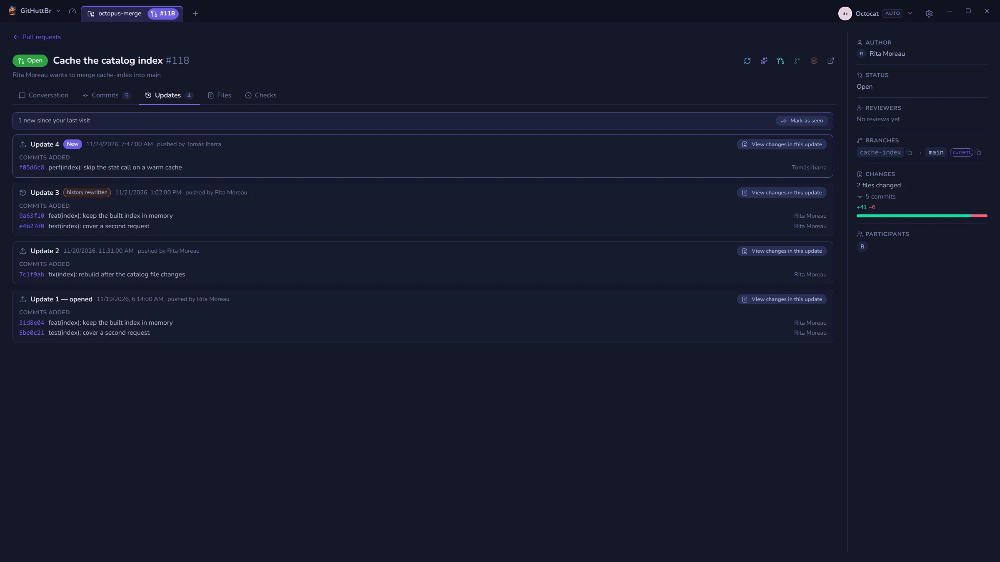

# Página de pull requests

Un repositorio con mucho movimiento tiene veinte pull requests abiertas a la
vez. La barra lateral las lista, pero una línea por PR dice poco: de quién es
cada una, cuáles esperan por ti, cuáles se pusieron en rojo. Averiguarlo
significaba abrir cada una, leerla, volver, abrir la siguiente. La **página de
pull requests** responde esas preguntas en una sola pantalla y, una vez que abres
una pull request, **‹ ›** te llevan a la siguiente de la misma lista sin volver
atrás.

## Abrirla

- El **icono de lista** en la cabecera **PULL REQUESTS** de la barra lateral
  (*Ver todas las pull requests*).
- *Pull requests…* en la paleta de comandos (⌘K), o **Herramientas → Pull
  requests…**.

Como la wiki y las [ejecuciones de CI](ci-runs.md), la página va en la pestaña
del repositorio.

## Pestañas

| Pestaña | Qué contiene |
|---|---|
| **Abiertas** | Todas las pull requests abiertas, borradores incluidos |
| **Borradores** | Solo las abiertas marcadas como borrador |
| **Fusionadas** | Pull requests fusionadas, leídas cuando abres la pestaña por primera vez |
| **Cerradas** | Cerradas sin fusionar (rechazadas, abandonadas), leídas junto con Fusionadas |

Los contadores junto a Abiertas y Borradores salen de la lista que la barra
lateral ya tiene. Fusionadas y Cerradas se piden solo cuando abres una de ellas,
y una vez por sesión; **Actualizar** las pide de nuevo.

## Filtros

| Filtro | Conserva |
|---|---|
| **Buscar** | Pull requests cuyo título, descripción, ramas o número contienen todas las palabras escritas. `#482` o `482` encuentra ese número; las coincidencias se resaltan en el título |
| **Autor** | Un autor — cada uno con cuántas tiene en esta pestaña. **Yo** va primero |
| **Revisor** | Un revisor solicitado, o **Piden mi revisión** |
| **Rama de destino** | Pull requests hacia esa rama |
| **Mías** | Un atajo para *Autor: Yo* |
| **Esperando mi revisión** | Un atajo para *Revisor: piden mi revisión* |
| **CI fallando** | Pull requests cuyos checks del head fallaron |

La línea bajo los filtros dice cuántas pull requests de la pestaña se muestran y
qué filtros están activos, con **quitar filtros** para quitarlos todos.

Los filtros se mantienen por repositorio **mientras la app está abierta** — sal
de la página, vuelve, y siguen como los dejaste. No se guardan entre reinicios a
propósito: un filtro «mías, CI fallando» que volviera en silencio una semana
después ocultaría pull requests que no pediste ocultar.

### Quién soy «yo»

«Yo» es la cuenta con la que las llamadas de este repositorio se identifican en
el host — el perfil al que el repositorio está [vinculado](profiles.md), o si no
el activo — preguntado al propio host. Cuando el token no puede decir de quién es
(sin scope de usuario), o no hay token, **Yo**, **Mías** y **Esperando mi
revisión** no se ofrecen.

## La lista

| Columna | Qué muestra |
|---|---|
| **#** | El número, con un icono de abierta, borrador, fusionada o cerrada |
| **Título** | El título, una insignia de *borrador* y a quién se le sigue pidiendo revisión — en el color de acento cuando eres tú |
| **Autor** | La foto del host cuando la da, si no la inicial, y **tú** en las tuyas |
| **Ramas** | Origen → destino |
| **Checks** | Los checks del head resumidos — `6/6`, `1 con fallos`, `2 en curso`; pasa el ratón para ver los números |
| **Actualizada** | Hace cuánto cambió por última vez; pasa el ratón para ver la fecha |

Las filas se ordenan por la actividad más reciente. Un clic abre la página propia
de la pull request ([Hosting y pull requests](hosting.md)). En un host sin esa
página, la fila abre la pull request en el navegador.

En un [checkout de un fork](hosting.md#tus-pull-requests-en-el-repositorio-original-de-un-fork), también se listan tus pull
requests en el repositorio original, marcadas *en owner/repo*.

## Recorrer la lista desde una pull request

Una pull request abierta desde la página muestra una franja sobre su título:

- **← Pull requests** vuelve a la lista, con los filtros como los dejaste.
- **‹ k de n ›** pasa a la pull request anterior o siguiente de la lista desde la
  que la abriste — la lista filtrada, en su orden, tal como estaba cuando hiciste
  clic. Los tooltips nombran la pull request a la que lleva cada flecha.
- **Alt+← / Alt+→** hacen lo mismo desde el teclado. Se pueden reasignar en
  **Ajustes → Atajos**. Se hacen a un lado mientras el cursor está en un campo de
  texto (donde Option+← avanza por palabras) y mientras el terminal tiene el
  foco.

Moverse reemplaza la página en su sitio, así que recorrer diez pull requests no
deja diez iconos en la pestaña; abrir otra fila desde la lista también la
reemplaza.

Una pull request abierta **desde cualquier otro sitio** — la barra lateral, una
notificación — recorre las pull requests abiertas del repositorio en el orden
predeterminado de la página (Abiertas, sin filtros). Una que tampoco está en esa
lista, como un nivel fusionado de un stack, muestra solo el camino de vuelta a la
lista.

## Ir a la rama de una pull request

Para trabajar en una pull request necesitas su rama en checkout — y en un
repositorio con miles de ramas, encontrarla por nombre en la lista de ramas es la
parte lenta. En la página de una pull request, el campo **Ramas** lo hace por ti:

- **El nombre de la rama es un enlace.** Un clic hace checkout de esa rama y te
  lleva al grafo del repositorio, a la punta de la rama. La página de la pull
  request sigue abierta en la pestaña.
- **Una rama que solo existe en el servidor** se trae primero — esa rama, no el
  remoto entero — y se hace checkout como rama local que la sigue. Una rama que ya
  tienes en local se cambia tal como está — no se actualiza, así que haz pull
  cuando quieras los últimos commits de la pull request.
- **La rama en la que ya estás** aparece marcada como *actual*. No se hace
  checkout de nada.
- **El botón de copiar** junto a cada nombre lo pone en el portapapeles.
- **Deshacer** (⌘Z) vuelve a la rama en la que estabas y borra la rama local que
  creó el checkout — salvo que hayas hecho commit en ella desde entonces, en cuyo
  caso se deja tal cual.

La cabecera tiene los mismos dos pasos como botones: **Ir a la rama de origen** e
**Ir a la rama de destino**. Funcionan también con la rama en la que ya estás —
simplemente te llevan al repositorio. Con los [colores de los iconos](themes.md#colores-de-los-iconos) activados, cada botón de la cabecera tiene el suyo: actualizar azul, revisión con IA violeta, vista previa turquesa, rama de origen verde, rama de destino naranja (abrir en el navegador sigue gris).

No se consulta nada hasta que haces clic: abrir una pull request no lee ni trae
ninguna rama.

Lo que no hace:

- **La rama de origen de un fork** vive en otro repositorio, así que no tiene
  enlace (el botón de copiar se queda). **Previsualizar pull request en local…**,
  ofrecido justo debajo, es la forma de ejecutarla aquí. La rama de destino sigue
  enlazada.
- **Sin remoto que coincida.** La rama se busca en el remoto cuya URL es el
  repositorio de la pull request. Cuando ningún remoto configurado apunta ahí, el
  enlace no hace nada y su tooltip dice por qué.
- **Una rama borrada.** Una pull request fusionada a menudo se llevó su rama
  consigo; el fetch dice entonces que la rama ya no existe en el remoto, y te
  quedas en la pull request.
- **Cambios locales.** Hacer checkout no es destructivo, así que no hay
  confirmación — y git rechaza el checkout cuando tus cambios sin commit se
  sobrescribirían. El error dice qué archivos; haz commit o stash de ellos y
  vuelve a hacer clic.
- **Esta ventana.** El checkout ocurre en el árbol de trabajo de este
  repositorio. Cuando la rama ya está en checkout en otro
  [worktree](worktrees.md), se abre en su lugar la pestaña de ese worktree.

## Commits

La barra lateral decía cuántos commits tiene una pull request, nunca cuáles.
Revisar un commit cada vez — como se supone que se leen la mayoría de las pull
requests — te mandaba al navegador. La pestaña **Commits**, entre Conversación y Actualizaciones, los lista:

- **Los más antiguos primero**, en el orden en que se aplican, agrupados bajo el
  día en que se escribieron. Un commit rebasado fuera del orden de fechas empieza
  un día propio en lugar de moverse.
- Cada fila tiene la foto del autor (cuando el host la da), el asunto, el autor,
  hace cuánto y el SHA corto. Una insignia **merge** marca un commit con dos
  padres, cuando el host lo indica.
- **▸** junto a un commit con algo más que el asunto muestra el resto de su
  mensaje.
- **Copiar** pone el SHA completo en el portapapeles; **Abrir en el navegador**
  abre el commit en el host — dentro de la pull request cuando el host tiene esa
  página (GitHub, GitLab, Bitbucket Data Center), si no en la página de commits
  del repositorio.

**Haz clic en una fila** — o llega a ella con Tab y pulsa Enter — para abrir el
commit en la app, como lo haría un clic en el grafo: la vista del repositorio,
ese commit seleccionado, sus detalles abiertos. Eso funciona cuando este clon
**tiene** el commit. Cuando no, la fila lo dice en lugar de fallar en silencio, y
ofrece:

- **Traer la rama del PR para verlo** — el mismo fetch de una sola rama que
  [ir a la rama](#ir-a-la-rama-de-una-pull-request), sin el checkout. Si el commit llegó con ella, se
  abre; si no (un force push lo reescribió desde entonces), el aviso lo dice.
- **Obtener los commits del pull request**, en una pull request de un **fork**. Su
  rama vive en otro repositorio, pero la mayoría de los hosts reflejan el head de una
  pull request en el repositorio de destino bajo una referencia propia —
  `refs/pull/N/head` (GitHub, GitHub Enterprise Server, Forgejo),
  `refs/merge-requests/N/head` (GitLab), `refs/pull-requests/N/from` (Bitbucket Data
  Center). La app trae esa única referencia, sin etiquetas, a una referencia propia,
  `refs/githuttbr/pr/<remote>/N`, y el commit se abre como cualquier otro: el grafo
  dibuja ese head como un carril sin etiqueta. Volver a traerlo mueve la referencia
  al head tal como esté entonces. Si el force push dejó fuera el commit desde
  entonces, el aviso lo dice.
- **Abrir en el navegador**, para cuando traer la rama no es una opción.

La lista se lee la primera vez que abres la pestaña, no con la página, y de nuevo
con cada **Actualizar**. Hasta que llega, el número de la pestaña es el que el
host dio para la pull request. Las pull requests fusionadas y cerradas listan sus
commits igual.

Lo que no hace:

- **Como mucho 250 commits.** El propio GitHub no lista más de 250 para una pull
  request; la app se detiene en el mismo número en todos los hosts, y dice *el
  host tiene más* cuando es así, con un enlace a la pull request en el host. Qué
  250 son depende del orden en que el host los lista — la app se queda con los
  primeros listados, y la línea sobre la lista dice cuáles:

  | Host | Una pull request más larga muestra |
  |---|---|
  | GitHub | Los **primeros** 250 (el límite del propio GitHub) |
  | GitLab, Azure DevOps, Bitbucket Data Center, bitbucket.org | Los **250 más recientes** |
  | Forgejo | El extremo que el servidor liste primero; su orden no está documentado |
- **El head de un fork donde el host no lo refleja.** Azure DevOps solo publica un
  resultado de fusión, nunca el head propio de una pull request, y bitbucket.org no
  publica ninguno de los dos: ahí la fila ofrece solo el navegador. En otro host que
  resulte no reflejarlo, el fetch lo dice. **Previsualizar pull request en local…**
  trae el resultado de fusión de Azure, si es lo que necesitas.
- **Los heads traídos se quedan.** `refs/githuttbr/pr/…` no es una rama: nada que
  sacar ni que subir, un fetch con prune no la toca, y git conserva sus commits.
  Tampoco nada la quita — ni cerrar la página ni la
  [limpieza de ramas](branch-cleanup.md). Para deshacerte de ellas, borra las
  referencias a mano: `git for-each-ref refs/githuttbr/pr` las lista, y
  `git update-ref -d <ref>` borra una.
- **Un remoto cuyo nombre tiene una `/`** no puede ser una parte del nombre de esa
  referencia, así que ahí el fetch se rechaza.
- **Una rama borrada.** Una pull request fusionada a menudo se llevó su rama: el
  fetch lo dice. bitbucket.org no lista ningún commit en cuanto la rama de origen
  desaparece.
- **Fusiones squash.** Los commits de una pull request fusionada con squash nunca
  llegaron a la rama de destino, así que tras borrar su rama solo están en el host.
- **Los autores** se nombran como los nombran sus commits. GitLab, Azure DevOps y
  Bitbucket Data Center no dan foto sin un inicio de sesión que una imagen no puede
  enviar, así que esas filas muestran la inicial.
- **Los mensajes largos en Azure DevOps** pueden salir recortados: la lista de Azure
  trunca el mensaje de un commit, y la app muestra lo que envía.
- Las pull requests de **bitbucket.org** se abren en el navegador — la app aún no
  tiene página para ellas —, así que ahí no se llega a esta pestaña, aunque la app
  puede leer la lista.

## Actualizaciones

Una pull request que revisaste el lunes se ha movido para el jueves. La pestaña
Commits muestra dónde está ahora, no qué pasó desde entonces: qué commits llegaron
en qué push, si alguien hizo force push y reescribió lo que ya habías leído, y cómo
queda el código *comparado con la versión que viste*. La pestaña
**Actualizaciones**, entre Commits y Archivos, responde a eso — como la propia
pestaña Updates de Azure DevOps.

Lista cada push a la pull request, **los más recientes primero**:

- **Actualización 1 — abierta** es el push con el que se abrió la pull request;
  cada push posterior lleva el número siguiente.
- Cada una muestra **cuándo**, **quién hizo el push** (cuando el host lo dice) y
  los **commits que añadió** — SHA corto, asunto, autor. Cuando el host informa de
  commits que un push quitó de la rama, aparecen bajo **Commits eliminados**,
  tachados.
- Un force push o un rebase se marca como **historial reescrito**: los commits que
  habías leído pueden haber desaparecido, y los listados pueden ser copias nuevas
  de trabajo antiguo. En Azure DevOps, un push que movió la pull request a otra rama
  de destino se marca como **destino cambiado**.

### Qué cambió en una actualización

**Ver los cambios de esta actualización** abre la pestaña Archivos solo con ese
push: el diff desde el head de la actualización anterior hasta este — o, para la
Actualización 1, desde la rama de destino contra la que se abrió, cuando el host
nombra ese punto (Azure DevOps, GitLab). El mismo árbol de archivos y el mismo
visor, con un aviso — *Mostrando los cambios de Actualización 3 (frente a
Actualización 2)* — y **Mostrar todos los cambios** para volver a la pull request
entera.

El diff se hace siempre **en este clon** cuando se puede: `git diff` entre los dos
heads, exacto y sin preguntar al host. Cuando falta alguno de los heads, la app
primero trae los dos **por su id de commit** desde el remoto de la pull request — no
se escribe ninguna rama, etiqueta ni referencia; un head que un force push
sustituyó ya no está en ninguna rama, pero la mayoría de los hosts aún lo sirven
por su id — y compara aquí. Solo cuando ese fetch falla se pregunta al host:

| Host | La comparación del host |
|---|---|
| Azure DevOps | Los cambios de la iteración con `$compareTo` — entre los dos pushes |
| GitLab | La comparación del repositorio, directamente de un head al otro |
| Bitbucket Data Center | La comparación del repositorio — **desde la base común** de los dos heads |
| GitHub | La API de comparación (`base...head`) — **desde la base común** de los dos heads |
| Forgejo / Gitea | Ninguna: su API no tiene un diff entre dos commits |

Desde la base común, el diff de una reescritura no es lo que hizo el push: lo que
quitó no se muestra, y los cambios que recibió la rama de destino desde entonces
pueden parecer de la pull request. El aviso lo dice — *Comparado desde la base
común: no se muestra lo que este push eliminó.* — cuando una actualización con
historial reescrito se comparó así. Cuando nada funciona, el aviso lo dice y ofrece
traer la rama (o, desde un fork, el head de la pull request) y comparar aquí.

Los comentarios de línea pertenecen al diff de la pull request entera, así que no
hay **+** en una línea mientras se muestra una sola actualización; el aviso lo dice.
Marcar un archivo como visto funciona como siempre — marca el archivo en la pull
request.

### Nuevo desde tu última visita

Las actualizaciones subidas desde la última vez que abriste la pestaña llevan una
insignia **Nueva**, y la propia pestaña dice cuántas: *Actualizaciones 5 · 2
nuevas*. Abrir la pestaña las marca como vistas (las insignias siguen mientras estás
en ella, para que veas cuáles eran nuevas); cuando **Actualizar** trae más con la
pestaña abierta, **Marcar como vistas** las quita. Abrir solo la página de la pull
request no marca nada. La primera vez que abres la pestaña Actualizaciones de una
pull request, nada es nuevo — no hay una visita anterior con la que comparar.

Las actualizaciones se leen con la página, para ese número, y de nuevo con
**Actualizar** — no después de cada comentario o revisión que publicas.

Lo que ya se vio se guarda solo en este equipo, por repositorio y pull request, y
nunca se envía al host.

### Según el host

| Host | De dónde salen las actualizaciones | Quién hizo el push | Commits eliminados | Reescritura detectada |
|---|---|---|---|---|
| Azure DevOps | Las **iteraciones** de la pull request — el registro propio de Azure de cada push | Sí | No (no se informa) | Sí: `forcePush` / `rebase` |
| GitLab | Las **versiones del diff** de la merge request; los commits de cada versión se deducen de su head | No (las versiones no nombran a nadie) | Sí | Sí: un head anterior que ya no se alcanza |
| Bitbucket Data Center | La actividad de la pull request: **OPENED** y cada **RESCOPED** que movió la rama de origen | Sí | Sí, con los totales del host | Sí: un rescope que quitó commits |
| GitHub | **Deducidas** de los commits y force pushes de la línea de tiempo — ver abajo | Solo los force pushes | No | Sí: un evento de force push |
| Forgejo / Gitea | Las entradas de **push** de la línea de tiempo, la primera escrita con la propia pull request | Sí | No | Sí: una entrada de force push |
| bitbucket.org | No disponible | — | — | — |

**GitHub no guarda registro de un push normal** — solo de los force pushes —, así
que las actualizaciones se **deducen de las horas de los commits**. Una
actualización es una serie de commits que se construyen unos sobre otros, entre
force pushes; un commit que no se construye sobre el anterior, o que llega más de
diez minutos después de él, empieza la siguiente. Un commit hecho después de abrirse
la pull request no puede haber estado en la apertura. Así, un push de commits
hechos con una hora de diferencia aparece **partido** en dos, y dos pushes con unos
minutos de diferencia aparecen como **uno**; la pestaña dice que la agrupación es
aproximada. Los commits nuevos de un rebase, que la línea de tiempo puede listar
justo antes de su force push, cuentan como de ese force push. Los heads de antes y
después de un force push son exactos, así que su **Ver los cambios** también lo es.

### Límites

- **Topes.** Se listan las 100 actualizaciones más recientes. La línea de tiempo de
  GitHub se lee desde su extremo más reciente, hasta 500 elementos; la actividad de
  Bitbucket Data Center (también de más reciente a más antigua) hasta 1.000; las
  versiones y commits de GitLab hasta 300 cada uno; la línea de tiempo de Forgejo
  hasta 500 entradas, las más recientes cuando es más larga. Cuando un tope corta la
  **apertura**, los números ya no son los del host: la pestaña lo dice y cuenta hacia
  atrás desde la última (*Última actualización*, *Actualización, 2 antes de la
  última*).
- **Azure DevOps** no informa de commits eliminados; en su lugar se marca un force
  push o un rebase. Una iteración cuya lista de commits Azure recorta se lee por
  separado (hasta 500 commits), y la actualización dice cuándo sigue incompleta.
- **GitLab** no nombra a quién hizo el push. Una versión cuyo head se reescribió se
  lee por separado para encontrar sus commits — para las diez más recientes de esas
  versiones —, una vez por sesión: las versiones nunca cambian.
- **Forgejo y Gitea** no listan commits de un force push — solo sus dos heads, que
  es lo que compara **Ver los cambios** —, y tras un force push nada dice qué
  contenía la apertura, así que queda vacía salvo que el servidor registrara el push
  de la propia apertura. Su API no tiene un diff entre dos commits, así que esa
  comparación necesita los dos commits en este clon. Un servidor sin la API de línea
  de tiempo muestra todos los commits en una sola actualización.
- **Traer por id** necesita un host que sirva un commit por su id. GitHub lo hace
  con cualquier commit que todavía tenga; otro host, o un servidor git simple, puede
  rechazar uno al que no apunte ninguna rama — entonces se usa la comparación del
  host. Los commits traídos quedan en este clon sin referencia, y git los recoge con
  el tiempo.
- **La comparación de Bitbucket Data Center** lee el diff estructurado del servidor
  y lo dibuja como uno unificado; los archivos muy grandes pueden llegar recortados.
- Un head reescrito puede haber **desaparecido del host** para siempre (Azure y
  GitLab lo conservan; otros pueden recogerlo). Entonces ninguno de los dos lados
  puede comparar, y el aviso lo dice.
- Las pull requests de **bitbucket.org** se abren en el navegador y no tienen
  pestaña Actualizaciones.

## Leer los archivos

Una pull request de doscientos archivos es difícil de leer como doscientas rutas
completas. La lista de la pestaña **Archivos** tiene el mismo selector **Ruta /
Árbol** que el panel de commit, y la elección es la misma en toda la app. En
**Árbol**, los archivos quedan bajo sus carpetas (una cadena como `src/main/ipc` es
una sola fila), y cada carpeta muestra su **+/−** sumado y cuántos de sus archivos
están vistos (*3/5*). La casilla de una carpeta marca como vistos todos los archivos
de dentro, o los desmarca todos; las marcas se guardan solo en este equipo, nunca se
envían al host. Una marca recuerda la versión del diff del archivo: cuando un push
cambia un archivo visto, vuelve a aparecer como no visto, con un punto amarillo
(*Cambió desde que lo viste*). Un archivo sin diff (binario, demasiado grande) se
compara solo por su estado y sus recuentos de líneas. Un archivo con conversaciones de revisión muestra a su lado un número en un bocadillo (las carpetas suman los suyos), para que los que tienen comentarios destaquen en una lista larga; las conversaciones obsoletas también cuentan. Haz clic en una carpeta, o
pulsa ←/→ sobre ella, para plegarla; ↑/↓ (o j/k) recorren los archivos en pantalla y
abren cada diff. Las carpetas plegadas se recuerdan por pull request hasta que se
cierra la app, y un archivo abierto dentro de una despliega el camino hasta él. El
árbol se ordena por nombre, no en el orden en que el host lista los archivos.

## Comentar una línea

Aquí ya se podía responder a un hilo de revisión, pero no empezar uno, así que una
revisión de verdad seguía mandándote al navegador. En la pestaña **Archivos** de una
pull request, cualquier línea del diff admite un comentario propio:

- **Pasa el ratón por una línea** y pulsa el **+** que aparece sobre su número, o
  **haz clic en la propia línea** (un clic que termina una selección de texto, o un
  doble clic que selecciona una palabra, no cuenta: eso es leer). El menú del botón
  derecho — o la tecla de menú contextual del teclado — también tiene *Comentar en
  la línea N*.
- Se abre un cuadro **bajo esa línea**. Escribe y luego **Comentar** — o
  ⌘/Ctrl+Enter. **Cancelar** lo cierra; **Esc** también, preguntando antes si ya
  escribiste algo. En ambos casos el foco vuelve a esa línea.
- Si sale bien, el hilo nuevo aparece **bajo su línea**, y en los hilos de revisión
  de la pestaña Conversación, donde lo verán los demás.

El lado en que queda el comentario depende de la línea:

| Línea | Anclado a |
|---|---|
| **Añadida** (verde) | La versión nueva del archivo, en su número nuevo |
| **Borrada** (roja) | La versión antigua, en su número antiguo |
| **Sin cambios** | La versión nueva (a GitLab se le envían ambos números, como exige) |

Los hilos existentes también se dibujan bajo sus líneas, con su cuadro de respuesta
donde el host deja a la app responder dentro de un hilo (Forgejo no). Un hilo solo
se dibuja en una línea cuando el host dice que aún pertenece al diff mostrado; lo
demás se queda en la pestaña Conversación, en vez de en una línea adivinada:

| Host | Un hilo escrito antes del último push |
|---|---|
| GitHub | Obsoleto cuando su línea cambió: solo Conversación |
| GitLab | Escrito sobre un head anterior: solo Conversación |
| Azure DevOps | Azure lo sigue hasta donde está ahora su línea |
| Bitbucket Data Center | Huérfano cuando su línea ya no está: solo Conversación |
| Forgejo | Forgejo no indica que un comentario esté obsoleto, así que se dibuja en el número de línea guardado — tras un push esa línea puede contener ahora otro código |

Un comentario en una línea fuera de los hunks mostrados está solo en la pestaña
Conversación, en todos los hosts.

Un comentario escrito y no enviado cuenta como texto sin enviar: **‹ ›** y Alt+flechas
preguntan antes de dejarlo, como con el cuadro de comentario principal. Mirar otro
archivo lo conserva; para empezar uno en otra línea, publica o cancela el primero.

Lo que no hace:

- **Una línea, publicada al momento.** No hay rangos de líneas, ni revisión
  pendiente en la que juntar comentarios para enviarlos después, ni cambios
  sugeridos. Cada comentario se publica en cuanto lo envías, como hilo propio (en
  Forgejo, como una revisión que contiene ese único comentario, ya que Forgejo no
  tiene una llamada para un comentario suelto).
- **El diff que estás mirando.** La pestaña Archivos recuerda en qué commit (en Azure
  DevOps, en qué iteración) se leyó su diff, y el comentario se envía contra ese.
  Cuando la pull request ha avanzado desde entonces — un push, una nueva base de
  merge —, el comentario no se publica en la línea que ahora tenga ese número: se
  rechaza con *la pull request cambió desde que se cargó este diff*, y
  **Actualizar** muestra el diff nuevo. En GitHub, en cambio, el comentario se
  publica contra el commit que leíste, y GitHub lo marca como obsoleto si esa línea
  cambió. Una línea que el host siga sin aceptar se rechaza por estar fuera del diff.
- **Rechazado.** Sin permiso para comentar (un token de solo lectura, una cuenta a
  la que el repositorio no deja comentar), el host lo rechaza y el mensaje dice que
  ese es el motivo.
- Las pull requests de **bitbucket.org** se abren en el navegador — la app aún no
  tiene página para ellas —, así que ahí un comentario de línea se sigue haciendo en
  la web.
- **Un archivo sin diff** (binario, o demasiado grande para que el host lo incluya)
  no tiene líneas que comentar.

## Escribir comentarios

Cada cuadro de la página — el comentario de abajo, una respuesta dentro de un
hilo, un comentario en una línea — es el mismo editor de Markdown: pestañas
**Escribir / Vista previa**, una barra de formato con los atajos de GitHub, listas
que continúan con Enter y autocompletado con **@** / **#** a partir de las
personas y pull requests que ya están en pantalla. Un cuadro de respuesta muestra
sus herramientas en cuanto haces clic en él, y envía con ⌘/Ctrl+Enter, ya que
Enter ahora empieza una línea nueva. [Escribir comentarios](writing-comments.md)
tiene los detalles y los límites.

## Cómo se muestran los comentarios

La gente escribe los comentarios en Markdown, así que un comentario mostrado como
texto plano está lleno de `**`, `- [ ]` y vallas de código. La descripción, la
conversación y los hilos de revisión (en las pestañas Conversación y Archivos) se
dibujan como Markdown: encabezados, listas y listas de tareas, tablas, citas, bloques
de código resaltados en el lenguaje que nombra la valla, enlaces e imágenes. La página
de la issue dibuja su texto igual. `#123`, `AB#123`, `!123` y `@user` en el texto
siguen convirtiéndose en enlaces, con la [tarjeta](#de-qué-trata-un-123-o-ab123) donde la tenían.

De dónde sale el dibujo:

| Host | Renderizado por |
|---|---|
| GitHub, GitHub Enterprise Server | El propio GitHub (`body_html`): las menciones y referencias se enlazan como en la web, las imágenes pasan por el proxy de imágenes de GitHub y los adjuntos privados llevan su dirección firmada |
| GitLab, Forgejo, Azure DevOps, Bitbucket Data Center | La app, a partir del Markdown del comentario. Un enlace relativo apunta dentro del repositorio; en GitLab, `/uploads/…` apunta dentro del proyecto, como hace GitLab |

Un comentario es contenido de otras personas, así que lo que puede contener es
limitado, y más limitado que para tus propios archivos: una lista explícita de
etiquetas, enlaces e imágenes solo en `https:`, `http:` o `mailto:`, sin scripts,
frames, formularios, SVG ni estilos en línea, y enlaces que nunca se abren dentro de
la app (van a tu navegador). Una casilla de una lista de tareas se muestra, pero no se
puede marcar: marcarla aquí no cambiaría nada en el host.

**Las imágenes de otros sitios esperan un clic.** Cargar una imagen es una petición
que el sitio detrás de ella puede observar, con tu dirección IP y el momento en que
lees el comentario — cualquiera que pueda comentar puede poner ahí un píxel de
seguimiento. Por eso solo las imágenes del propio host se cargan solas: en github.com
sus adjuntos, `*.githubusercontent.com` (que incluye su proxy de imágenes) y sus
recursos; en cualquier otro host, su propia dirección. Cualquier otra imagen muestra
*Imagen de example.net: haz clic para cargarla*, y el clic carga esa imagen.
**Ajustes → Seguridad → Cargar imágenes de otros sitios en los comentarios** lo
desactiva; ver [Seguridad](security.md#imágenes-en-los-comentarios).

**La vista previa muestra lo que se publicará.** En esta página y en la de la issue,
la pestaña **Vista previa** de cada cuadro de comentario dibuja el texto igual: el
mismo perfil, los mismos saltos de línea, las mismas imágenes retenidas — un enlace
pegado a una imagen de fuera no la carga mientras escribes. Los diálogos de pull
request nueva e issue nueva conservan la vista previa de Markdown habitual de la app.

**Lo demasiado largo o enrevesado se muestra como texto.** El Markdown se renderiza
en la ventana de la app, y algunos textos cuestan mucho más de renderizar de lo que su
tamaño sugiere. Un comentario de más de **32.000 caracteres**, o uno construido para
atascar el renderizador (miles de `_` o `*` sin pareja en un párrafo, o más de 32
niveles de `>` o marcadores de lista en una línea), se muestra como texto plano con
enlaces, bajo *Comentario largo mostrado como texto sin formato.* o *Comentario
mostrado como texto sin formato: demasiado complejo para renderizarlo aquí.* Un
comentario que aun así no se puede renderizar recurre a lo mismo por sí solo: el resto
de la página no se ve afectado.

Lo que no hace:

- **Al editar se ve el texto tal como se escribió.** **Editar** sigue abriendo el
  Markdown, y una edición guardada la dibuja la app hasta que la página vuelve a leer
  la pull request (en GitHub, después la dibuja GitHub).
- **Los adjuntos privados de GitHub caducan.** GitHub firma la dirección de una imagen
  privada durante unos minutos; una que deja de cargarse tras tener la página abierta
  un rato vuelve con **Actualizar**.
- **Una imagen relativa en GitHub** que dibuja la propia app (una respuesta enviada
  desde la app, antes de que la página la vuelva a leer) se busca bajo la dirección del
  repositorio en github.com, que quizá no es donde GitHub la pondría.
- **Los vídeos** de un comentario de GitHub se muestran como un enlace al archivo, no
  como un reproductor.
- **Las extensiones propias de GitHub** que dibuja la app (en otros hosts) no están:
  sin atajos de emoji, sin diagramas Mermaid, sin estilo de avisos, y las fórmulas
  quedan como texto.
- **El código solo se resalta cuando la valla nombra su lenguaje.** Adivinar el
  lenguaje obligaría a pasar todas las gramáticas por todos los bloques de la página.
- **Los mensajes de commit** de la pestaña Commits siguen siendo texto plano: git no
  renderiza Markdown, y los hosts tampoco.

## Editar y eliminar tus comentarios

Una errata en un comentario ya enviado, o una observación que ya no aplica, antes
obligaba a ir al navegador. Tus propios comentarios tienen ahora **Editar** (el
lápiz) y **Eliminar** (la papelera) al final de su cabecera: comentarios de la
conversación, comentarios de hilos de revisión y respuestas, en las pestañas
Conversación y Archivos. La página de la issue también los tiene, para sus
comentarios en GitHub y Forgejo.

Qué es «tuyo» lo decide la propia página, que pregunta al host, cada vez que carga,
con qué cuenta se identifican las llamadas de este repositorio (su perfil vinculado,
no el que esté activo). La mayoría de los hosts nombran a un autor por su login,
comparado sin distinguir mayúsculas. Azure DevOps nombra a los autores por nombre visible, que dos personas pueden
compartir, así que ahí nunca compara nombres: un comentario es tuyo cuando el id de
su autor coincide con el id de la cuenta, **o** el nombre único de su autor (el nombre
de la cuenta, normalmente una dirección de correo) coincide con el de la cuenta, sin
distinguir mayúsculas. Cualquiera de los dos es único de una persona; el segundo cubre
un id de autor que no es el que informa la conexión. Cuando no se puede comparar
ninguno, ningún comentario muestra las acciones. Cuando la app no puede saber quién eres (un token
sin scope de usuario, o el host no respondió), tampoco las muestra ningún
comentario; **Actualizar** vuelve a preguntar. El host sigue decidiendo: a una cuenta
a la que no deja cambiar un comentario se le rechaza, y el mensaje lo dice.

- **Editar** abre el comentario en su sitio, en el mismo editor de Markdown, con su
  texto tal como se escribió. **Guardar** (o ⌘/Ctrl+Enter) lo envía; **Cancelar** o
  **Esc** lo cierra, preguntando antes si cambiaste algo. Solo se quitan las líneas
  en blanco alrededor del texto: el código sangrado y un salto de línea final de dos
  espacios se quedan como se escribieron. El texto nuevo aparece al instante y la
  página vuelve a leer la pull request. En la página de la pull request, una edición
  sin guardar cuenta como texto sin enviar: **‹ ›** preguntan antes de dejarla. La
  página de la issue no tiene esas flechas, y allí nada pregunta antes de que se
  cierre su pestaña.
- **Eliminar** siempre pregunta antes, y la pregunta dice qué pasa: el servidor
  elimina el comentario para todos, y no se puede deshacer. No hay entrada de
  deshacer, ya que nada puede recuperarlo.

Eliminar el **primer comentario de un hilo** que tiene respuestas (un hilo de
revisión, o un comentario de la conversación que otros respondieron) varía según el
host, y la confirmación dice cómo. Dos de estos casos no están documentados por el
host, y se dice:

| Host | Primer comentario de un hilo con respuestas |
|---|---|
| GitHub | Las respuestas deberían quedarse; la documentación de GitHub no lo dice. El hilo conserva su cuadro de respuesta: sin su primer comentario, la respuesta se envía al hilo mismo a través de la API GraphQL de GitHub, localizado mediante una respuesta que sigue en él. Si eso falla (un Enterprise Server antiguo, un token que GraphQL rechaza, un hilo en el que GitHub dice que esta cuenta no puede responder), el hilo ofrece **Responder en GitHub** en su lugar. Si tienes una revisión en curso en GitHub, GitHub puede archivar la respuesta dentro de ella: el aviso lo dice entonces, y nadie ve la respuesta hasta que envías esa revisión allí |
| GitLab | Solo se va esa nota; el hilo y sus respuestas se quedan |
| Azure DevOps | Debería marcarse como eliminado y ocultarse, conservando el hilo y sus respuestas; la documentación de Azure no lo dice |
| Bitbucket Data Center | Rechazado: Data Center no elimina un comentario que tiene respuestas. Elimina primero las respuestas, o edítalo en su lugar |

Algunos hosts marcan un comentario como **editado**. Solo Azure DevOps guarda una
fecha para el texto en sí; en GitHub, Bitbucket Data Center y Forgejo la app compara
cuándo se creó el comentario y cuándo se actualizó por última vez, así que ahí la
marca es una aproximación (cualquier otra cosa que toque el comentario puede
ponerla). La fecha de GitLab también cambia cuando se resuelve un hilo, así que no se
usa.

Lo que no hace:

- **Los comentarios de revisión de Forgejo** (comentarios en una línea) no se pueden
  editar a través de su API, y solo algunas versiones pueden eliminarlos, así que no
  muestran ninguna de las dos acciones: cámbialos en la web. Los comentarios de la
  conversación funcionan como en los demás hosts.
- **Alguien lo cambió mientras tanto.** Bitbucket Data Center comprueba la versión
  del comentario: una edición o eliminación de un comentario que cambió desde que se
  cargó la página se rechaza, y **Actualizar** muestra el actual. Los demás hosts se
  quedan con la última escritura.
- **No encontrado**: cuando el host no encuentra el comentario, el mensaje dice que
  puede haberse eliminado, o que esta cuenta no puede verlo, y la página vuelve a
  leer la pull request. Una edición abierta sobre un comentario que ya no existe se
  descarta.
- Las pull requests de **bitbucket.org** se abren en el navegador, así que aún no hay
  página donde editar sus comentarios, aunque la app pueda hacer la llamada.
- **La descripción** de la pull request y los resúmenes de sus revisiones no son
  comentarios, y no se editan aquí.

## De qué trata un `#123` o `AB#123`

Un commit que dice *fixes AB#4821* o un comentario que dice *ver #312* te da un
número, no de qué se trataba. Averiguarlo significaba abrirlo. Ahora, **señalar una
referencia** — o llegar a ella con Tab — abre una pequeña tarjeta con lo que el host
dice de ella:

- un icono de su tipo, y la referencia tal como está escrita;
- su **título**;
- su **estado** (abierta, cerrada, fusionada — en Azure DevOps, el estado propio del
  work item, como *Active* o *Resolved*);
- en Azure DevOps, el **tipo de work item** (Bug, User Story, Task…).

Las tarjetas están en la página de la pull request (descripción, comentarios, hilos
de revisión y el mensaje completo de un commit en la pestaña **Commits**), en la
página de la issue y en el asunto del panel de detalles del commit. En la pestaña
**Commits** en Azure DevOps, cada work item del asunto de un commit (`AB#123`, o
`#123`, el mismo elemento allí) muestra además su título al lado, en gris. En Azure
DevOps, `!123` enlaza a esa pull request, sin tarjeta.

| Referencia | Host | Se lee de |
|---|---|---|
| `AB#123`, y `#123` en un repositorio de Azure | Azure DevOps | Work items, hasta 200 en una petición |
| `#123` | GitHub, GitHub Enterprise Server | Issues y pull requests, hasta 50 en una petición GraphQL; una petición REST por cada una cuando GraphQL falla |
| `#123` / `!123` | GitLab | Issues / merge requests, una petición por tipo |
| `#123` | Forgejo | Issues (también pull requests), una petición por cada una, de dos en dos |

Un `#123` solo cuenta como palabra propia: `org/repo#123` (otro repositorio),
`&#39;`, un color como `#123abc` y el `#issuecomment-…` de un enlace se dejan como
están.

No se pregunta nada hasta que se abre una tarjeta. Entonces la referencia en la que
estás y las más cercanas de la página que aún no se conocen van en una sola llamada,
así que la siguiente tarjeta suele ser instantánea. Las respuestas se guardan en
memoria mientras la app está abierta, nunca en disco, durante cinco minutos; después
se siguen mostrando y se vuelven a leer al pasar el ratón de nuevo. Se guardan por
perfil: la llamada se hace como el perfil al que el repositorio está
[vinculado](profiles.md), y otro perfil puede ver otros elementos.

Lo que cuesta:

- **GitHub** lee hasta **50** en una petición, a través de su API GraphQL — la que
  señalas y sus vecinas más cercanas. Cuando GraphQL falla por otro motivo que un
  límite de peticiones (un Enterprise Server antiguo, un token que rechaza), la app
  recurre a la API REST, que lee una issue por petición: entonces solo se piden las
  **10** primeras, una tras otra como GitHub pide a las apps; las demás quedan sin
  conocer, y un paso de ratón posterior las pide.
- **Forgejo** no puede leer varias issues en una petición, así que cada tarjeta cuesta
  una: pasar el ratón pide como mucho **10**, de dos en dos.
- En GitHub y Forgejo, la primera respuesta que dice *más despacio* (un 429, un 403,
  el propio error de límite de GraphQL, un límite secundario o una respuesta que gastó
  la última petición del límite) detiene el resto — GitHub no recurre entonces a REST
  — y esas referencias no se vuelven a pedir durante cinco minutos.
- **Azure DevOps** lee hasta 200 work items en una petición, y GitLab una petición
  por tipo, así que ahí va toda la página de una vez.

Lo que no hace:

- **Bitbucket** no tiene tarjeta: la app no lee issues allí, y el enlace abre el
  navegador como antes.
- **No encontrada, o sin acceso.** Una issue borrada, un work item de un proyecto que
  esta cuenta no puede ver, o un token de Azure sin el scope *Work Items (Read)* se
  ven igual: la tarjeta lo dice, y el enlace sigue funcionando. Un host que limita
  peticiones, no responde o no tiene cuenta en este perfil tiene su propio mensaje.
- **`AB#123` fuera de Azure DevOps** — en un repositorio de GitHub conectado a Azure
  Boards — no se enlaza, así que no tiene tarjeta: la app no sabe a qué organización
  pertenece.
- **El estado fusionada en GitHub Enterprise Servers antiguos** que no envían cuándo
  se fusionó una pull request: se ve como cerrada.
- Las filas de commits **del grafo** no muestran tarjetas.

## Límites

- **Las pull requests abiertas son la lista de la barra lateral.** GitHub, GitLab
  y bitbucket.org leen las primeras 30; un repositorio con más muestra solo esas,
  y el contador de Abiertas dice **30+**. Azure DevOps, Bitbucket Data Center y
  Forgejo las leen todas.
- **Fusionadas y cerradas tienen tope**, y la pestaña muestra **+** cuando el host
  tiene más (su web las lista todas):

  | Host | Qué se lee |
  |---|---|
  | GitHub, bitbucket.org, Forgejo | Las 100 actualizadas más recientemente, fusionadas y cerradas **juntas** |
  | GitLab | Las 100 actualizadas más recientemente de cada una |
  | Bitbucket Data Center | 100 de cada una en el orden *newest* del servidor — su API no dice si eso significa abiertas o actualizadas |
  | Azure DevOps | 100 de cada una entre las que terminaron en el **último año**; su API no indica orden, así que pasado el centenar cuáles entran lo decide el servidor |

  Sus checks no se leen — la CI de una pull request terminada no decide nada, y
  costaría una petición por fila — así que **CI fallando** no se aplica en esas
  pestañas (su chip se oculta ahí).
- **Sin cuenta**: sin un token que llegue al host, Fusionadas y Cerradas lo dicen
  en lugar de mostrar una lista vacía (GitHub aún puede leer un repositorio
  público).
- **Checks**: GitHub y Bitbucket Data Center los traen en la lista. A GitLab,
  Azure DevOps y Forgejo se les pregunta una vez por head al abrir la página, a
  través de la misma caché que las insignias de CI del grafo. bitbucket.org no
  tiene.
- **Revisores**: GitHub, GitLab, Forgejo, Bitbucket Data Center y Azure DevOps
  nombran a quién se le sigue pidiendo (Azure: una persona que no ha votado; un
  equipo queda fuera). La lista de bitbucket.org no lo dice, así que ahí el filtro
  de Revisor está vacío.
- **La búsqueda en la descripción** funciona donde la lista del host trae la
  descripción; bitbucket.org puede omitirla, y entonces solo se buscan títulos,
  ramas y números.
- **«Yo» en bitbucket.org y Azure DevOps** se compara por nombre visible, ya que
  así es como sus listas nombran a un autor.
- **Actualizada en Azure DevOps** es cuando se abrió (o cerró) la pull request:
  su lista no tiene hora de última actividad.
- El recorrido se recuerda mientras la app está abierta; tras un reinicio, una
  pull request abierta desde la lista recorre en su lugar las pull requests
  abiertas.
