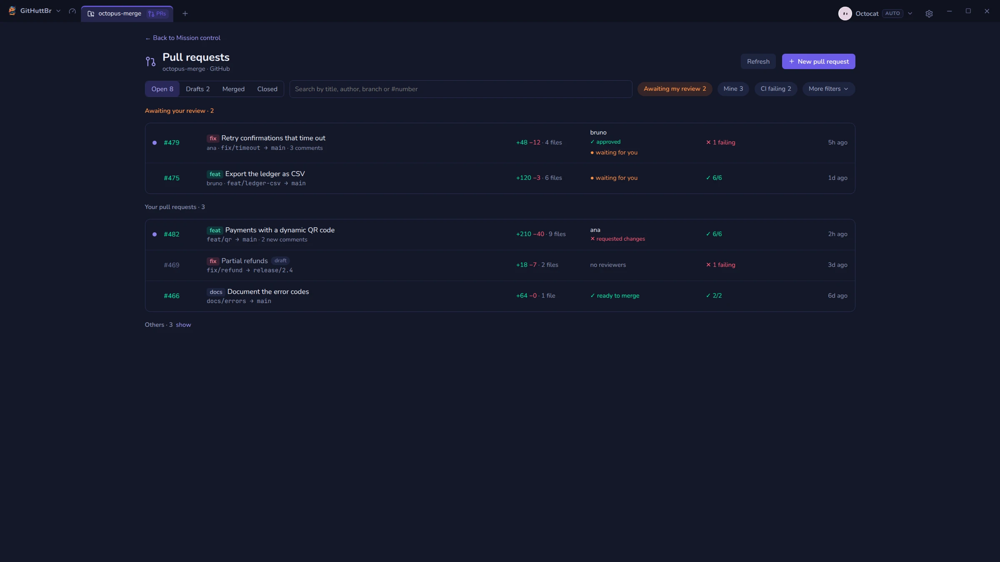

# Página de pull requests

Un repositorio con mucho movimiento tiene veinte pull requests abiertas a la
vez. La barra lateral las lista, pero una línea por PR dice poco: de quién es
cada una, cuáles esperan por ti, cuáles se pusieron en rojo. Averiguarlo
significaba abrir cada una, leerla, volver, abrir la siguiente. La **página de
pull requests** responde esas preguntas en una sola pantalla y, una vez que abres
una pull request, **‹ ›** te llevan a la siguiente de la misma lista sin volver
atrás.

## Abrirla

- El **icono de lista** en la cabecera **PULL REQUESTS** de la barra lateral
  (*Ver todas las pull requests*).
- *Pull requests…* en la paleta de comandos (⌘K), o **Herramientas → Pull
  requests…**.

Como la wiki y las [ejecuciones de CI](ci-runs.md), la página va en la pestaña
del repositorio.

## Pestañas

| Pestaña | Qué contiene |
|---|---|
| **Abiertas** | Todas las pull requests abiertas, borradores incluidos |
| **Borradores** | Solo las abiertas marcadas como borrador |
| **Fusionadas** | Pull requests fusionadas, leídas cuando abres la pestaña por primera vez |
| **Cerradas** | Cerradas sin fusionar (rechazadas, abandonadas), leídas junto con Fusionadas |

Los contadores junto a Abiertas y Borradores salen de la lista que la barra
lateral ya tiene. Fusionadas y Cerradas se piden solo cuando abres una de ellas,
y una vez por sesión; **Actualizar** las pide de nuevo.

## Filtros

| Filtro | Conserva |
|---|---|
| **Buscar** | Pull requests cuyo título, descripción, ramas o número contienen todas las palabras escritas. `#482` o `482` encuentra ese número; las coincidencias se resaltan en el título |
| **Autor** | Un autor — cada uno con cuántas tiene en esta pestaña. **Yo** va primero |
| **Revisor** | Un revisor solicitado, o **Piden mi revisión** |
| **Rama de destino** | Pull requests hacia esa rama |
| **Mías** | Un atajo para *Autor: Yo* |
| **Esperando mi revisión** | Un atajo para *Revisor: piden mi revisión* |
| **CI fallando** | Pull requests cuyos checks del head fallaron |

La línea bajo los filtros dice cuántas pull requests de la pestaña se muestran y
qué filtros están activos, con **quitar filtros** para quitarlos todos.

Los filtros se mantienen por repositorio **mientras la app está abierta** — sal
de la página, vuelve, y siguen como los dejaste. No se guardan entre reinicios a
propósito: un filtro «mías, CI fallando» que volviera en silencio una semana
después ocultaría pull requests que no pediste ocultar.

### Quién soy «yo»

«Yo» es la cuenta con la que las llamadas de este repositorio se identifican en
el host — el perfil al que el repositorio está [vinculado](profiles.md), o si no
el activo — preguntado al propio host. Cuando el token no puede decir de quién es
(sin scope de usuario), o no hay token, **Yo**, **Mías** y **Esperando mi
revisión** no se ofrecen.

## La lista

| Columna | Qué muestra |
|---|---|
| **#** | El número, con un icono de abierta, borrador, fusionada o cerrada |
| **Título** | El título, una insignia de *borrador* y a quién se le sigue pidiendo revisión — en el color de acento cuando eres tú |
| **Autor** | La foto del host cuando la da, si no la inicial, y **tú** en las tuyas |
| **Ramas** | Origen → destino |
| **Checks** | Los checks del head resumidos — `6/6`, `1 con fallos`, `2 en curso`; pasa el ratón para ver los números |
| **Actualizada** | Hace cuánto cambió por última vez; pasa el ratón para ver la fecha |

Las filas se ordenan por la actividad más reciente. Un clic abre la página propia
de la pull request ([Hosting y pull requests](hosting.md)). En un host sin esa
página, la fila abre la pull request en el navegador.

En un [checkout de un fork](hosting.md#tus-pull-requests-en-el-repositorio-original-de-un-fork), también se listan tus pull
requests en el repositorio original, marcadas *en owner/repo*.

## Recorrer la lista desde una pull request

Una pull request abierta desde la página muestra una franja sobre su título:

- **← Pull requests** vuelve a la lista, con los filtros como los dejaste.
- **‹ k de n ›** pasa a la pull request anterior o siguiente de la lista desde la
  que la abriste — la lista filtrada, en su orden, tal como estaba cuando hiciste
  clic. Los tooltips nombran la pull request a la que lleva cada flecha.
- **Alt+← / Alt+→** hacen lo mismo desde el teclado. Se pueden reasignar en
  **Ajustes → Atajos**. Se hacen a un lado mientras el cursor está en un campo de
  texto (donde Option+← avanza por palabras) y mientras el terminal tiene el
  foco.

Moverse reemplaza la página en su sitio, así que recorrer diez pull requests no
deja diez iconos en la pestaña; abrir otra fila desde la lista también la
reemplaza.

Una pull request abierta **desde cualquier otro sitio** — la barra lateral, una
notificación — recorre las pull requests abiertas del repositorio en el orden
predeterminado de la página (Abiertas, sin filtros). Una que tampoco está en esa
lista, como un nivel fusionado de un stack, muestra solo el camino de vuelta a la
lista.

## Ir a la rama de una pull request

Para trabajar en una pull request necesitas su rama en checkout — y en un
repositorio con miles de ramas, encontrarla por nombre en la lista de ramas es la
parte lenta. En la página de una pull request, el campo **Ramas** lo hace por ti:

- **El nombre de la rama es un enlace.** Un clic hace checkout de esa rama y te
  lleva al grafo del repositorio, a la punta de la rama. La página de la pull
  request sigue abierta en la pestaña.
- **Una rama que solo existe en el servidor** se trae primero — esa rama, no el
  remoto entero — y se hace checkout como rama local que la sigue. Una rama que ya
  tienes en local se cambia tal como está — no se actualiza, así que haz pull
  cuando quieras los últimos commits de la pull request.
- **La rama en la que ya estás** aparece marcada como *actual*. No se hace
  checkout de nada.
- **El botón de copiar** junto a cada nombre lo pone en el portapapeles.
- **Deshacer** (⌘Z) vuelve a la rama en la que estabas y borra la rama local que
  creó el checkout — salvo que hayas hecho commit en ella desde entonces, en cuyo
  caso se deja tal cual.

La cabecera tiene los mismos dos pasos como botones: **Ir a la rama de origen** e
**Ir a la rama de destino**. Funcionan también con la rama en la que ya estás —
simplemente te llevan al repositorio.

No se consulta nada hasta que haces clic: abrir una pull request no lee ni trae
ninguna rama.

Lo que no hace:

- **La rama de origen de un fork** vive en otro repositorio, así que no tiene
  enlace (el botón de copiar se queda). **Previsualizar pull request en local…**,
  ofrecido justo debajo, es la forma de ejecutarla aquí. La rama de destino sigue
  enlazada.
- **Sin remoto que coincida.** La rama se busca en el remoto cuya URL es el
  repositorio de la pull request. Cuando ningún remoto configurado apunta ahí, el
  enlace no hace nada y su tooltip dice por qué.
- **Una rama borrada.** Una pull request fusionada a menudo se llevó su rama
  consigo; el fetch dice entonces que la rama ya no existe en el remoto, y te
  quedas en la pull request.
- **Cambios locales.** Hacer checkout no es destructivo, así que no hay
  confirmación — y git rechaza el checkout cuando tus cambios sin commit se
  sobrescribirían. El error dice qué archivos; haz commit o stash de ellos y
  vuelve a hacer clic.
- **Esta ventana.** El checkout ocurre en el árbol de trabajo de este
  repositorio. Cuando la rama ya está en checkout en otro
  [worktree](worktrees.md), se abre en su lugar la pestaña de ese worktree.

## Límites

- **Las pull requests abiertas son la lista de la barra lateral.** GitHub, GitLab
  y bitbucket.org leen las primeras 30; un repositorio con más muestra solo esas,
  y el contador de Abiertas dice **30+**. Azure DevOps, Bitbucket Data Center y
  Forgejo las leen todas.
- **Fusionadas y cerradas tienen tope**, y la pestaña muestra **+** cuando el host
  tiene más (su web las lista todas):

  | Host | Qué se lee |
  |---|---|
  | GitHub, bitbucket.org, Forgejo | Las 100 actualizadas más recientemente, fusionadas y cerradas **juntas** |
  | GitLab | Las 100 actualizadas más recientemente de cada una |
  | Bitbucket Data Center | 100 de cada una en el orden *newest* del servidor — su API no dice si eso significa abiertas o actualizadas |
  | Azure DevOps | 100 de cada una entre las que terminaron en el **último año**; su API no indica orden, así que pasado el centenar cuáles entran lo decide el servidor |

  Sus checks no se leen — la CI de una pull request terminada no decide nada, y
  costaría una petición por fila — así que **CI fallando** no se aplica en esas
  pestañas (su chip se oculta ahí).
- **Sin cuenta**: sin un token que llegue al host, Fusionadas y Cerradas lo dicen
  en lugar de mostrar una lista vacía (GitHub aún puede leer un repositorio
  público).
- **Checks**: GitHub y Bitbucket Data Center los traen en la lista. A GitLab,
  Azure DevOps y Forgejo se les pregunta una vez por head al abrir la página, a
  través de la misma caché que las insignias de CI del grafo. bitbucket.org no
  tiene.
- **Revisores**: GitHub, GitLab, Forgejo, Bitbucket Data Center y Azure DevOps
  nombran a quién se le sigue pidiendo (Azure: una persona que no ha votado; un
  equipo queda fuera). La lista de bitbucket.org no lo dice, así que ahí el filtro
  de Revisor está vacío.
- **La búsqueda en la descripción** funciona donde la lista del host trae la
  descripción; bitbucket.org puede omitirla, y entonces solo se buscan títulos,
  ramas y números.
- **«Yo» en bitbucket.org y Azure DevOps** se compara por nombre visible, ya que
  así es como sus listas nombran a un autor.
- **Actualizada en Azure DevOps** es cuando se abrió (o cerró) la pull request:
  su lista no tiene hora de última actividad.
- El recorrido se recuerda mientras la app está abierta; tras un reinicio, una
  pull request abierta desde la lista recorre en su lugar las pull requests
  abiertas.
