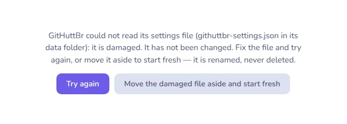

# Seguridad y secretos

Gitcito **no tiene backend**. Las únicas llamadas de red van a tu hosting de Git
y, si lo activas, a tu proveedor de IA.

## Enmascarado de secretos

Los valores de `.env*`, `*.pem`, `*.key`, `id_rsa`, `credentials.*` y
compañía se pintan como `KEY=••••••` en las vistas de diff, archivo y blame,
para que compartir pantalla o hacer una captura no los filtre.
El material de firma de Apple cuenta: `*.mobileprovision`,
`*.provisionprofile`, `*.p12` y las claves `*.p8` de App Store Connect. Un
`*.cer` no — un certificado es público por diseño.

Es **solo visual**: nunca cambia el archivo y nunca cambia lo que preparas. Un
botón con forma de ojo los revela por vista. `.env.example`, `.sample` y
`.template` se tratan como plantillas, no como secretos.

## Guardas antes de que hagas daño

| Guarda | Cuándo |
|---|---|
| **Archivo de secretos** | Al commitear algo que parece una credencial — con un *Ignorar y dejar de rastrear* de un clic |
| **Archivo grande** | Al commitear un blob desmesurado (el umbral está en Ajustes → Seguridad) |
| **Ruido de compilación** | Al commitear `xcuserdata/`, `DerivedData/` o un `.DS_Store` — con el mismo *Ignorar y dejar de rastrear* de un clic |
| **Rama protegida** | Al commitear directamente a `main`/`master`, o al hacerle force push |
| **Secretos con seguimiento** | Al publicar un repositorio que *sigue* un archivo de secretos — se avisa una vez por sesión |

## Imágenes en los comentarios

Los comentarios de pull requests e issues los escriben otras personas, y una imagen
en uno es una petición que tu equipo hace al sitio que eligió el autor. Ese sitio se
entera de tu dirección IP y de cuándo lees el comentario — un píxel de seguimiento no
necesita más que el derecho a comentar.

Por eso la app carga por su cuenta solo las imágenes del propio host: en github.com
sus adjuntos, `*.githubusercontent.com` (que incluye el proxy que GitHub pone delante
de cada imagen externa en su propio renderizado) y sus recursos; en cualquier otro
host, su propia dirección web, por https. Cualquier otra imagen muestra un marcador
con su dominio, y solo se pide cuando haces clic en ella — esa imagen, una vez. La
petición nunca envía un `Referer`.

| Ajuste | Qué hace |
|---|---|
| **Cargar imágenes de otros sitios en los comentarios** (desactivado por defecto) | Las imágenes de cualquier sitio se cargan sin clic, como en la web del host |

Los límites:

- **El host te sigue viendo.** Una imagen del propio host — y en GitHub, cualquier
  imagen a través de su proxy — es una petición al host, que ya sabe que esta cuenta
  está leyendo la pull request.
- **`raw.githubusercontent.com` y `gist.githubusercontent.com` se cargan sin clic.**
  Cualquiera puede poner un archivo ahí, así que la imagen es suya — pero la sirve
  GitHub, y su autor no ve tu dirección IP ni cuándo la lees.
- **Los adjuntos privados de GitHub caducan.** Su dirección firmada dura unos minutos;
  **Actualizar** en la página recupera una que dejó de cargarse.
- **La vista previa de un cuadro de comentario** en esas páginas sigue la misma regla:
  un enlace pegado a una imagen externa no se carga mientras escribes.
- **Solo las páginas de pull request y de issue.** Las imágenes de un archivo
  Markdown del repositorio, de una nota de release o de la wiki son contenido de tu
  propio repositorio y se cargan como antes.
- **Un enlace no es una imagen.** Hacer clic en un enlace de un comentario lo abre en
  tu navegador, como cualquier enlace de la app.

Un comentario tampoco puede atascar ni colgar la ventana: uno de más de 32.000
caracteres, o construido para hacer trabajar al renderizador de Markdown durante
segundos, se muestra como texto plano. Cómo se restringe el resto de un comentario
está en [Pull requests](pull-requests.md#cómo-se-muestran-los-comentarios).

## La AppImage y las rutas que le sobreviven

Una AppImage se ejecuta desde una carpeta bajo `/tmp` (`/tmp/.mount_…`) que solo
existe mientras la app está abierta, cambia de nombre en cada arranque y está en
un directorio en el que puede escribir cualquier usuario local. Hasta la 4.37.1,
la AppImage podía escribir una ruta dentro de esa carpeta en dos sitios que le
sobreviven: el enlace `gitcito` en el `PATH` ([CLI](cli.md)) y el ajuste
`diff.<name>.textconv` de un repositorio ([atributos](attributes.md)). En cuanto
la app se cerraba, otro usuario de la misma máquina podía volver a crear la
carpeta con un programa suyo, que tu siguiente `gitcito` o `git diff` ejecutaría.

Ahora Gitcito rechaza las dos cosas bajo una AppImage, avisa al arrancar de un
enlace `gitcito` obsoleto (con un comando en la paleta para quitarlo) y marca un
conversor obsoleto en el diálogo de atributos con un botón **Eliminar**. Solo ve
el repositorio que tienes abierto; para encontrar conversores obsoletos en otros,
ejecuta `git config --get-regexp 'diff\..*\.textconv'` en cada repositorio (y con
`--global`) y elimina cualquier entrada bajo `/tmp/.mount_`. Una máquina con un
solo usuario no está expuesta, pero esas entradas obsoletas siguen siendo peso
muerto.

## El llavero del sistema

Los tokens y las entradas de la [bóveda](vault.md) se cifran con el llavero
de tu sistema operativo (`safeStorage` de Electron), nunca con una clave metida
en el archivo de ajustes.

**Nada toca el llavero hasta que tú lo dices.** Antes de que pueda aparecer el
diálogo de permisos del propio sistema, Gitcito te explica qué se va a guardar,
qué no puede hacer (una app solo puede releer la entrada que ella misma creó —
tus otras contraseñas quedan fuera de su alcance), y que decir que no está bien:
los tokens viven entonces en memoria solo durante la sesión, la bóveda se
queda cerrada, y puedes activarlo más tarde en **Ajustes → Seguridad → Llavero
del sistema**.

Una instalación recién hecha hace **cero** llamadas al llavero hasta que algo
necesita guardarse de verdad.

Mientras esté desactivado, el campo del token en Integraciones lo indica — *Se guarda solo hasta que cierres Gitcito: el llavero del sistema está desactivado.* — con un botón **Activar** al lado. Activarlo, desde allí o desde aquí, también guarda los tokens que ya escribiste en esta sesión, así que no hay que pegarlos de nuevo.

Un token que **quitas** con el llavero desactivado desaparece al momento — ya no
se envía con nada —, pero solo **durante esta sesión**: el almacén cifrado no se
puede escribir mientras el llavero está desactivado, y el borrado se guarda en
memoria, nunca en un archivo. Vuelve a activar el llavero antes de cerrar y la
copia guardada se borra entonces; cierra antes y el token antiguo vuelve en el
siguiente arranque. Hasta entonces el aviso sigue visible por ese motivo. Para
borrar un token guardado de una vez, vacíalo con el llavero activado.

Un campo en blanco solo borra lo que Gitcito te mostró. Con el llavero
desactivado desde el principio, los tokens guardados nunca se descifran ni se
muestran — los campos están vacíos —, así que el único token que se elimina es
el que escribas ahí y vuelvas a vaciar; el guardado debajo sigue ahí cuando se
activa el llavero.

Si la ventana se recarga o se cuelga mientras la explicación del llavero está en
pantalla, la pregunta cuenta como no respondida — no como un no — y se vuelve a
hacer la próxima vez que haga falta guardar un token. Nada se queda esperando
una pregunta que ya nadie puede contestar: los ajustes se cargan de nuevo con
normalidad.

### Linux sin llavero

En Linux el llavero es un servicio de secretos — GNOME Keyring o KWallet. Cuando
no hay ninguno en ejecución, el sistema sigue «cifrando», pero con una contraseña
fija que es la misma en todas las máquinas: los tokens y las claves quedan
ofuscados, no protegidos. Ajustes → Seguridad lo indica bajo el estado del
llavero — *No hay ningún llavero en ejecución…* — para que la palabra *llavero*
nunca prometa una protección que no existe.

Para que nada nuevo acabe en un almacén que cualquiera podría descifrar, un
token que escribas mientras no hay ningún llavero en ejecución se guarda **solo
hasta que cierres la app**. El campo del token lo indica — *Guardado solo hasta
que cierres Gitcito: no hay ningún llavero en ejecución…* — sin botón de
reintentar, porque reintentar no sirve; solo un llavero lo arregla. Importar un
archivo de ajustes con credenciales dice lo mismo antes de importarlas. Los tokens
guardados antes siguen siendo legibles — nunca pierdes el acceso a ellos — y
borrar o sustituir uno sigue eliminando el valor antiguo del disco. Dos límites:
la clave de la IA general no se mueve a su espacio compartido (cada perfil sigue
leyendo la suya), y la bóveda sigue guardando en el almacenamiento básico,
porque no tiene modo solo de sesión. Instala o desbloquea un llavero y reinicia
Gitcito para volver a guardar tokens nuevos.

Gitcito no se fía de lo que dice el sistema sobre el almacén que le ha tocado. Lo
cuenta como básico cuando el sistema lo nombra así, cuando no puede nombrarlo en
absoluto, y cuando lo que cifra vuelve marcado con la contraseña fija — diga lo que
diga el sistema. Así, un llavero que recurre en silencio a lo básico sigue manteniendo
los tokens nuevos fuera del disco.

A un llavero que deja de responder no se le espera para siempre. En Linux, una vez que
el llavero ha respondido una vez en esta sesión, una pregunta que deja sin responder
10 segundos cuenta como *sin llavero*: un token que guardes se conserva hasta que
cierres, y la Bóveda sigue cerrada. La primera pregunta de una sesión — la que puede
abrir la petición de contraseña del propio llavero — y la que llega justo después de
la explicación de Gitcito tienen dos minutos, para que leer un diálogo nunca se corte.
Durante medio minuto después de un tiempo agotado así, la respuesta sigue siendo *sin
llavero* sin volver a preguntar; luego Gitcito pregunta de nuevo. macOS y Windows
responden localmente y nunca se les pone un tiempo límite.

El límite cubre esa única pregunta — *¿hay un llavero?* Un llavero que la responde y
luego se cuelga al cifrar o descifrar se sigue esperando: guardar los ajustes, y la
Bóveda, siguen ocupados hasta que responde o Gitcito se reinicia.

### Cuando no se pueden leer los tokens guardados

Si cierras el aviso del llavero del sistema, el llavero está bloqueado o el
almacén de tokens lo escribió otra copia de Gitcito (una versión de desarrollo,
una firmada de nuevo), Gitcito **no puede leer tus tokens guardados — y los deja
intactos**. Ajustes → Seguridad dice *Gitcito no pudo leer tus tokens
guardados*, y un token que escribas mientras tanto se guarda solo durante la
sesión (el campo también lo indica). Nunca se escribe encima del almacén que no
pudo leer: eso sustituiría cada token guardado por el que acabas de escribir.

| Botón | Qué hace |
|--------|--------------|
| **Reintentar** | Vuelve a leer el almacén — puede que ahora el sistema pida el llavero. En cuanto se puede leer, los tokens escritos mientras tanto se unen a él. |
| **Crear un almacén de tokens nuevo** | Pregunta antes. Gitcito deja de esperar al almacén antiguo y empieza uno nuevo solo con los tokens de esta sesión. El archivo antiguo se queda al lado como copia de seguridad durante 30 días, y después se borra. Es para un almacén perdido para siempre, no para un aviso que cerraste. |

## Importar ajustes

**Ajustes → Importar / Exportar** lleva ajustes, perfiles y temas de una máquina
a otra. La exportación por defecto **no lleva tokens ni claves de API**, e
importar un archivo así nunca toca los que tienes guardados — un token en blanco
en el archivo significa «no está en este archivo», no «borra el mío».

### Elegir qué exportar

Una copia de seguridad y un archivo para un compañero no son el mismo archivo.
Una copia de seguridad lo quiere todo; un archivo para otro equipo no debería
llevar carpetas que allí no existen; un archivo para el equipo de trabajo no
debería llevar ni tus cuentas ni tus rutas. Por eso **Exportar ajustes** abre un
diálogo con las mismas cuatro partes que ofrece la importación (la tabla de más
abajo), cada una con su tamaño en este equipo, y escribe solo las que marcas.
Una parte que dejas fuera no está en el archivo en absoluto — importarlo más
tarde deja esa parte de la otra máquina exactamente como está.

Tres atajos sobre las partes marcan las combinaciones habituales. Cambiar una
casilla a mano ilumina el atajo que coincide, o ninguno:

| Atajo | Partes | Para |
|----------|-------|-----|
| **Copia completa** | Las cuatro | Restaurar este equipo, o una copia suya — el mismo archivo que escribía Exportar antes de tener partes |
| **Otro equipo** | Perfiles y cuentas, Preferencias de la app | Tu identidad y tus gustos en una máquina nueva, sin las carpetas ni los programas de esta |
| **Para el equipo de trabajo** | Preferencias de la app | Un tema, unos atajos y una configuración del grafo compartidos — nada personal, ninguna ruta |

Debajo de las partes, una nota dice si el archivo nombra carpetas o programas de
este equipo: ámbar con **Repositorios** o **Programas** marcados (la importación
en otra máquina traduce esas rutas o deja fuera las que no encuentra), verde sin
ellos. **Perfiles y cuentas** sin **Programas** también deja fuera la ruta de las
CLI de IA, que se guardan con los perfiles pero nombran binarios de esta máquina.

**Credenciales solo con Perfiles, y solo si lo pides.** Los tokens y las claves
de API pertenecen a los perfiles, así que **Incluir claves de API, tokens y
secretos de la bóveda** solo está disponible con **Perfiles y cuentas** marcado;
desmarca la parte y la casilla se vacía con ella. Con las credenciales marcadas,
el diálogo recomienda **Proteger con contraseña** (más abajo), y exportarlas sin
cifrar pregunta una vez más.

Un recuadro al final lista lo que contendrá el archivo antes de que pulses
**Exportar…**: cuántos perfiles (con o sin credenciales), imágenes de perfil,
preferencias, rutas de repositorios y de programas, si entran las notas y wikis
de los repositorios y la bóveda, qué partes quedan fuera y si el archivo va
cifrado. Qué viaja con cada parte:

| Extra | Va con | Condición |
|-------|-----------|-----------|
| Imágenes de perfil | Perfiles y cuentas | Imágenes elegidas como imagen |
| Secretos de la bóveda | Perfiles y cuentas | Solo con la casilla de credenciales |
| Notas y wikis de los repositorios | Repositorios y espacios de trabajo | Siempre con la parte |

Límites: las partes son la unidad entera — no se pueden elegir perfiles,
repositorios ni preferencias sueltos. **Programas** sin **Perfiles** lleva el
terminal, el editor y las apps predeterminadas, pero no las rutas de las CLI de
IA (viven dentro de los perfiles). El manifiesto cuenta entradas; no muestra las
rutas en sí. Y un archivo sin una parte no puede devolverla: restaurar un archivo
**Para el equipo de trabajo** restaura solo las preferencias.

### Elegir qué importar

Un archivo de ajustes guarda dos tipos de cosas: lo que te sigue *a ti*
(perfiles, tema, atajos) y lo que solo tiene sentido en la máquina que lo
escribió (las carpetas donde viven tus repositorios, la ruta de tu terminal).
Aplicarlo todo en un equipo nuevo llena la barra lateral de pestañas que no
apuntan a nada. Por eso, después de elegir el archivo (y escribir su contraseña,
si tiene), un diálogo pregunta qué partes traer. No se aplica nada hasta que
pulsas **Importar**; **Cancelar** lo deja todo como estaba.

| Parte | Qué lleva |
|------|-----------------|
| **Perfiles y cuentas** | Perfiles, identidad de Git, enlaces de integraciones, los ajustes generales de IA y las imágenes de perfil — y las credenciales y la [bóveda](vault.md), cuando el archivo las tiene |
| **Preferencias de la app** | Tema, idioma, atajos, disposición, los colores del grafo y de los iconos |
| **Repositorios y espacios de trabajo** | Pestañas, espacios de trabajo, favoritos, apodos, imágenes de pestaña, qué perfil usa cada repositorio, carpetas escaneadas, y las notas y wikis de cada repositorio |
| **Programas de este equipo** | Terminal, editor externo, apps predeterminadas y la ruta de las CLI de IA |

Cada parte muestra cuántas entradas tiene el archivo para ella. Una parte que
dejas desmarcada se queda exactamente como está en esta máquina.

**Los perfiles se combinan con los tuyos.** Un archivo de otro equipo rara vez
tiene todos los perfiles que tiene este — una cuenta añadida en el portátil con
Linux, un perfil de cliente que solo existe en el Mac. Por eso **Perfiles y
cuentas** añade los perfiles del archivo a los tuyos en vez de sustituir la
lista. Antes de importar, la parte lista cada perfil y lo que le va a pasar:

| Etiqueta | Significado |
|-----|---------|
| **Actualiza** | El perfil está en los dos: la identidad, la IA y la imagen del archivo sustituyen a las tuyas, y sus servidores se añaden a los tuyos |
| **Nuevo** | Solo lo tiene el archivo: se añade después de los tuyos |
| **Se mantiene** | Solo lo tiene este equipo: se queda exactamente como está |

Dos perfiles son «el mismo» cuando comparten un id — el primer perfil de cada
instalación lo comparte. Cuando ningún id coincide, cuenta el nombre (sin
distinguir mayúsculas ni espacios alrededor), y el perfil conserva **el id de
este equipo**: los repositorios vinculados a él, el perfil activo, sus
credenciales guardadas y su imagen siguen enlazados. El perfil activo no cambia, y tampoco la **IA
general**: el motor y el modelo con los que responde este equipo siguen siendo
suyos.

**Reemplazar todos** sigue ahí, para una copia de seguridad que quieres
recuperar tal como estaba: solo quedan los perfiles del archivo, y los que solo
tiene este equipo aparecen tachados como **Eliminado**. Al pulsar **Importar**
se pregunta una vez más, nombrándolos — se van con sus credenciales guardadas y
su imagen, y eso no se puede deshacer. Con **Reemplazar todos**, el perfil activo
del archivo pasa a ser el activo, y la IA general del archivo sustituye a la de
este equipo.

Límites: la coincidencia es solo por id o por nombre exacto — un perfil
renombrado en un lado cuenta como nuevo, y acabas con los dos. Un perfil
coincidente toma los campos del archivo, con tres excepciones para que no se
pierda nada que solo tenga este equipo: sus servidores de GitHub Enterprise,
GitLab y Bitbucket se **añaden** a los tuyos (en un servidor que tienen los dos
gana la entrada del archivo); un token que el archivo trae en blanco conserva el
tuyo — pero solo para la misma instancia, así que un token nunca se envía a otro
Forgejo, a otro emisor de GitLab ni a otra organización de Azure; y los inicios
de sesión tomados del gestor de credenciales de esta máquina siguen siendo de
esta máquina.

**Las opciones por defecto son una suposición a partir de tu disco.** Antes de
mostrar el diálogo, Gitcito comprueba si las carpetas de repositorios del
archivo existen aquí. Si no existe ninguna, el archivo viene de otro equipo:
**Repositorios** y **Programas** empiezan desmarcados, cada uno con el motivo —
las rutas de los programas aparecen listadas, para que veas que son de otro
sitio. Si existen, es el mismo equipo (una copia de seguridad restaurada, por
ejemplo), todo empieza marcado y una nota verde lo dice. Un archivo sin ningún
repositorio se juzga por las rutas de sus programas: **Programas** empieza
marcado solo cuando todas existen aquí.

Cuando la propia comprobación falla, no se supone nada: **Repositorios** y
**Programas** empiezan desmarcados sin veredicto, un botón **Comprobar de
nuevo** vuelve a preguntar al disco, y **Repositorios** no se puede importar
hasta que una comprobación salga bien. Las demás partes sí.

**Traducir rutas.** Marca **Repositorios** en un archivo cuyas carpetas faltan y
se abre un recuadro **Traducir rutas**. A la izquierda, la carpeta que los
repositorios del archivo tienen en común (`/home/you/code`); a la derecha, dónde
está esa carpeta en este equipo, rellenada a partir de tu carpeta personal
(`/Users/you/code`). Las dos se pueden editar — la suposición puede fallar, y
cuando Gitcito no encuentra ninguna carpeta común deja las dos vacías para que
las escribas. Una barra cuenta, mientras escribes, cuántos repositorios tienen
ya una carpeta aquí, con algunos de ellos listados — en verde los encontrados,
en rojo los que siguen faltando. El cambio se lleva consigo el apodo, la imagen
de pestaña y el perfil del repositorio, y sus notas, wikis y entradas de la
bóveda, para que no haya que configurar nada otra vez a mano.

El pie lo resume — *Importar 3 de 4 partes · 31 carpetas* (las raíces de
escaneo y la última carpeta de clonado también cuentan, por eso dice carpetas y
no repositorios) — e **Importar** sigue desactivado hasta que haya al menos una
parte marcada.

**Importar también sigue desactivado cuando una traducción no encuentra nada.**
Con **Repositorios** marcado y ni una sola carpeta encontrada bajo el nuevo
prefijo, importar dejaría tus repositorios vacíos; corrige las rutas o desmarca
la parte.

Límites de la traducción:

- Es **un prefijo cambiado por otro**. Los repositorios que en el archivo están
  bajo otra carpeta, o que aquí se organizan de otra forma, no se encuentran; no
  hay correspondencia por repositorio.
- Con una traducción en vigor, **solo se importan los repositorios que entonces
  tienen carpeta**. El resto se deja fuera — no se añade como pestañas rotas — y
  el diálogo te dice cuántos.
- Los programas nunca se traducen: `/usr/bin/code` no tiene un equivalente
  fiable en otro sistema. Deja esa parte desmarcada y elígelos en Ajustes.
- Vaciar cualquiera de los dos prefijos importa las rutas tal como están en el
  archivo.

**Mientras importa**, el diálogo no se puede cerrar. Si falla un paso posterior
— las notas de los repositorios, la bóveda, las imágenes de perfil — el
diálogo sigue abierto, nombra el paso, y **Continuar importación** retoma desde
ahí sin volver a escribir los pasos anteriores.

### Credenciales en el archivo

Un archivo exportado con la casilla marcada lleva credenciales. Combinar
perfiles siempre las **añade**: las del archivo se guardan bajo el perfil
coincidente, sustituyendo las de la misma cuenta, y todas las demás credenciales
guardadas se quedan — borrarlas contradiría conservar tus perfiles. Con los
perfiles en **Reemplazar todos**, un archivo así muestra además la elección,
justo debajo de **Perfiles y cuentas**:

| Opción | Tus credenciales guardadas |
|--------|------------------------|
| **Añadir a las mías** | Se añaden las del archivo, sustituyendo las de la misma cuenta; todas las demás se conservan |
| **Reemplazar todo** | Pasan a ser exactamente las del archivo — se borra cada token y clave de API guardados que el archivo no tenga |

La elección se aplica junto con los perfiles: con **Perfiles y cuentas**
desmarcado, no se importa ni se elimina ninguna credencial. Un archivo
exportado sin la casilla no tiene ninguna que ofrecer, marques lo que marques.
**Reemplazar todo** pregunta una vez más al pulsar **Importar**, avisando de que
se borrará cada token y clave de API guardados que el archivo no tenga;
**Cancelar** ahí deja el diálogo como estaba.

**Reemplazar todo necesita el llavero.** Con el llavero desactivado o no
disponible, los tokens antiguos seguirían en el almacén cifrado y volverían en
el siguiente arranque, así que Gitcito se niega: lo dice, y no se importa nada.
Lo mismo ocurre mientras no se pueden leer los tokens guardados (ver más arriba): volverían en
cuanto se pudieran leer. **Añadir a las mías** sigue funcionando, y conserva los
tokens del archivo durante la sesión.

**El límite:** las credenciales pertenecen a un perfil. Un perfil que la
importación elimina se lleva sus tokens guardados, elijas lo que elijas.

### Proteger una exportación con contraseña

Una exportación con las credenciales marcadas vale tanto como los propios tokens
para quien encuentre el archivo — una carpeta sincronizada, un USB olvidado, un
adjunto. **Proteger con contraseña**, en el diálogo de exportación, cifra el
archivo con el mismo cifrado que [Compartir seguro](secure-share.md) (una clave
derivada con scrypt y AES-256-GCM), así que nada de su contenido — ni siquiera si
lleva credenciales — se puede leer sin la contraseña.

Es opcional, con o sin la casilla de credenciales, y la contraseña no tiene
longitud mínima. La escribes dos veces y marcas que entiendes que no se puede
recuperar; importar el archivo la pide — en un diálogo en Ajustes, dentro del
paso de bienvenida en el primer arranque — y una incorrecta la vuelve a pedir.

| | Sin contraseña | Con contraseña |
|---|---|---|
| **Quién puede leerlo** | Cualquiera que tenga el archivo | Solo quien tenga la contraseña |
| **Un byte cambiado** | Se lee tal cual | Se rechaza, igual que una contraseña incorrecta |
| **Se abre en** | Cualquier versión | Las versiones que conocen el formato cifrado |

**No hay recuperación.** La contraseña no se guarda en ningún sitio — ni en el
archivo ni en esta máquina — y no hay servidor al que preguntar. Olvídala y el
archivo se pierde; exporta de nuevo desde una máquina que aún tenga los ajustes.

Límites: una versión antigua no puede abrir una exportación cifrada, y tampoco lo
sabe — dice que los ajustes se importaron y no cambia nada. Importa un archivo
protegido con una versión que pida su contraseña. Una contraseña corta sigue
siendo débil frente a quien tenga el archivo y tiempo para adivinar; la clave
scrypt hace cada intento lento, no imposible. La contraseña protege el archivo, no
la app en marcha: las credenciales se descifran en memoria mientras se reúnen
para la exportación, como siempre.

## El archivo de ajustes

El archivo de ajustes y el almacén cifrado de tokens se escriben enteros: en un
archivo nuevo al lado, solo legible por su dueño, que luego se intercambia, así
que un cuelgue o dos guardados a la vez nunca dejan medio archivo. Si el archivo
de ajustes es un enlace simbólico a otro sitio (un repositorio de dotfiles), la
escritura va al destino del enlace y el enlace se queda. Gitcito nunca sustituye
el enlace. Uno que apunta a un archivo que todavía no existe se escribe a través
de él, creando ese archivo — siempre que su carpeta exista. Si la carpeta
tampoco está, el guardado falla, con un único mensaje que lo dice: el enlace y
aquello a lo que apunta se quedan intactos, y los cambios hechos mientras tanto
duran solo hasta que se cierra Gitcito. Restaura la carpeta, o apunta el enlace a
un sitio que exista, y el siguiente guardado funciona.

Los tokens en texto plano que una versión antigua dejó en el archivo de ajustes
nunca se pierden en un guardado: se quedan en el archivo hasta que Gitcito los
carga en el almacén cifrado (abrir Ajustes lo hace), salvo que borres uno tú.

Solo dos cosas lo escriben: un guardado de tus ajustes, y Gitcito al cargarlos
(al arrancar, o al abrir Ajustes) — que es cuando un token antiguo en texto plano
pasa al almacén cifrado, o se limpia la dirección de un servidor que llevaba una
contraseña. Una consulta que nadie pidió — un fetch que resuelve su token, una
llamada de IA que busca su clave, una imagen de perfil — solo lee, así que nunca
puede caer encima de un guardado. Además, un guardado se rechaza hasta que los
ajustes se han cargado al menos una vez: antes de eso, la app solo tiene los
valores por defecto.

**El coste en una instalación antigua** que todavía tiene tokens en texto plano
en su archivo de ajustes: hasta que se abre Ajustes una vez (o la app se
reinicia y los carga), cada consulta que necesita un token descifra el almacén
de nuevo, y las imágenes de perfil que necesitan un token guardado esperan. Una
consulta no mueve nada, así que un token que borres mientras tanto sigue
borrado.

Uno que existe pero no se puede interpretar (una edición a mano que salió mal,
un disco dañado) **nunca** se sustituye por los valores por defecto: Gitcito dice
que el archivo está dañado y no sigue arrancando — ningún atajo ni comando de
menú puede guardar encima desde esa pantalla.

Puedes corregir `gitcito-settings.json` en su carpeta de datos y pulsar
**Reintentar**, o pulsar **Apartar el archivo dañado y empezar de cero**: el
archivo se renombra a `gitcito-settings.json.corrupt-<date>` (nunca se borra,
así que aún puedes recuperar algo de él), se guarda una copia del almacén
cifrado de tokens a su lado, y Gitcito arranca como la primera vez, con una nota
que dice adónde fue el archivo. Con un archivo de ajustes enlazado, lo que se
renombra es el destino del enlace, así que la copia dañada se queda en tus
dotfiles, junto al archivo de ajustes nuevo que el primer guardado escribe a
través del enlace. La copia se hace primero: si no se puede escribir, no se
mueve nada, y la pantalla lo dice y muestra la carpeta de datos que hay que
revisar, porque empezar de cero sin la copia dejaría que el primer token que
guardes borrara los tokens de los perfiles antiguos. Arregla lo que impide
escribir en la carpeta (permisos, un disco lleno) y pulsa **Reintentar**.

Si el archivo se estropea con Gitcito en marcha (editado a mano por debajo), los
guardados se detienen y Gitcito lo dice una vez: los ajustes no se pueden guardar
hasta reiniciar, y los cambios hechos mientras tanto se pierden.

Un archivo que está ahí pero no se puede *leer* durante un momento — otro
programa, como un antivirus, lo tiene abierto — se reintenta durante unos dos
segundos. Si sigue fallando, o la carga falla por cualquier otro motivo, Gitcito
dice que no pudo arrancar, que el archivo no se ha modificado, y ofrece
**Reintentar**; no dice que el archivo esté dañado.

### Límites conocidos

Requieren condiciones poco habituales, y se listan para que nadie se lleve una
sorpresa:

- **Una instalación muy antigua con tokens todavía en el archivo de ajustes.**
  Si el llavero se desactiva después de desbloquear los tokens guardados, o se
  rechaza mientras una clave de IA sigue guardada en el antiguo formato de texto
  plano, esa copia en texto plano puede perderse en el siguiente guardado y el
  token desaparece tras un reinicio. Abre Ajustes una vez con el llavero activado
  después de actualizar desde una versión así, y los tokens pasan al almacén
  cifrado para siempre.
- **Un guardado y una recarga fallida que se cruzan en la misma ventana.** Un
  token escrito en un guardado que adelanta a una recarga que luego falla no se
  puede borrar desde esa ventana hasta que Ajustes vuelve a cargar; reabre
  Ajustes y bórralo.
- **Un archivo de ajustes enlazado cuya carpeta falta.** El almacén de tokens se
  escribe antes de que falle el archivo de ajustes, así que los dos quedan
  desincronizados hasta que vuelve la carpeta. Restáurala (monta el disco, clona
  los dotfiles) y guarda de nuevo.

## El token de un perfil mientras Git se ejecuta

Cuando un [perfil](profiles.md) inicia sesión con su token en un clone, fetch,
pull o push, el token no va a ninguno de los sitios donde otro programa podría
leerlo: ni a `.git/config`, ni a la línea de comandos (cualquier usuario local
puede leer la lista de procesos), ni al **entorno** del comando git — que heredan
cada hook, filtro y proceso de LFS que git lanza, junto con cada paquete npm que
ejecuta un script de husky o lefthook.

En su lugar, para cada operación Gitcito abre un punto de conexión privado propio
— un socket en una carpeta en la que solo puede entrar tu usuario (una tubería
con nombre aleatorio en Windows) — y registra un asistente de credenciales para
ese único servidor. Cuando git pide un inicio de sesión, el asistente se conecta,
demuestra que pertenece a esta operación con un código aleatorio creado solo
para ella, dice por qué host y repositorio pregunta git, y recibe el inicio de
sesión. El punto de conexión responde a cada petición de la operación — git puede
preguntar más de una vez, para LFS, tras una redirección, por cada proceso que
lanza — y se cierra y se borra cuando git termina. Un hook que vuelca su entorno
encuentra el código, no el token.

Lo que sigue sin poder hacer:

- **Un hook todavía puede preguntar mientras la operación se ejecuta.** Ese
  código está en el entorno de git, porque el asistente es un programa que git
  lanza y git da a cada programa que lanza el mismo entorno. Un hook escrito para
  hablar el protocolo del asistente puede usar el código para pedir el inicio de
  sesión hasta que git termina — así es exactamente como el hook `pre-push` de
  git-lfs consigue uno. Es una abertura mucho menor que un token metido en una
  variable — nada lo lee por accidente, un volcado o un informe de fallo solo
  muestra un código que no sirve de nada cuando git termina —, pero es una
  abertura.
- **Solo responde por el servidor para el que se abrió.** El punto de conexión
  rechaza cualquier otro host, una petición `http` sin cifrar, una ruta fuera de
  la base del servidor y un servidor anidado bajo ella (un Data Center en
  `/bitbucket` junto a un GitLab en la raíz) — incluso con el código correcto. Un
  push a varias URL recibe un punto de conexión por servidor, cada uno con solo
  el inicio de sesión de ese servidor. Bajo un servidor con otro anidado dentro,
  también se rechaza una ruta que el proxy del servidor anidado podría
  enrutarse a sí mismo: cualquier `;` en ella (Tomcat descarta los `;params`), un
  segmento que termina en punto, y el nombre de la base anidada con otras
  mayúsculas o como prefijo (`/Bitbucket/`, `/bitbucketx/`) — así que un grupo
  del servidor exterior cuyo nombre empieza por la ruta del servidor anidado
  tampoco recibe su token.
- **Una exclusión no sobrevive a una redirección en el lado del propio
  servidor.** La comprobación se hace sobre la ruta por la que pregunta git. Si
  el servidor exterior redirige él mismo una petición a la ruta del servidor
  anidado, o un proxy la reescribe allí después de que git haya enviado su inicio
  de sesión, ningún cliente puede verlo.
- **Un inicio de sesión heredado mediante `git -c` se aparta.** Un asistente de
  credenciales (o un `include` que podría añadir uno) transmitido en
  `GIT_CONFIG_PARAMETERS` — la app lanzada desde un alias de git, o por otro git —
  se quita durante la operación, así que nunca se le ofrece el token del perfil
  para guardarlo, ni se le pregunta en nombre de nadie. Cualquier otro ajuste
  `-c` heredado se conserva.
- **La dirección de un servidor se debe escribir como la lee git.** Gitcito
  nombra el servidor según las reglas estándar de URL, git según las suyas: un
  nombre internacionalizado (`bücher.example`), una abreviatura numérica
  (`127.1`, `0x7f.0.0.1`), una dirección IPv6 comprimida o mapeada, o un carácter
  codificado en el host son un servidor distinto para cada uno. Con un perfil de
  por medio, una dirección así se rechaza con un mensaje en vez de dejarla al
  inicio de sesión de la propia máquina. Las mayúsculas y un puerto por defecto
  explícito (`:443`) no son problema.
- **Git anterior a 2.26** solo hacía coincidir una entrada de credenciales con la
  dirección exacta, no con todo lo que hay bajo la base de un servidor. Al
  preguntar en nombre de nadie, la app desactiva entonces los asistentes para
  todo el host durante ese único comando; iniciar sesión con un token necesita
  git 2.31 de todos modos.
- **No ejecutes hooks en los que no confías**, aunque haya un perfil con la
  sesión iniciada. Un repositorio que acabas de clonar puede traer hooks mediante
  herramientas como husky, que los instalan en `npm install`; git ejecuta lo que
  haya en `.git/hooks`, desde Gitcito o desde un terminal por igual, y un hook
  puede hacer cosas mucho peores que leer un token.
- **Reduce el alcance del token.** Un token que solo puede escribir en los
  repositorios en los que trabajas vale mucho menos para quien se haga con él.
- **Los remotos SSH no se ven afectados** — no hay token de por medio; responde
  el [agente SSH](ssh-keys.md).

## Compartir sin riesgo

[Compartir seguro](secure-share.md) exporta ajustes, entradas de la bóveda
o espacios de trabajo enteros como un **paquete cifrado** — los secretos solo se
incluyen si marcas la casilla.

## Reportar un problema

**Reportar problema** en un error abre un issue de GitHub ya rellenado — y
abrirlo ya envía el texto a GitHub, antes de que decidas publicarlo. Por eso el
mensaje se limpia antes: se sustituyen una credencial escrita en una URL, los
tokens, tu carpeta personal (y con ella tu nombre de usuario), los servidores
privados y las rutas de repositorios, el nombre del perfil al que está vinculado
un repositorio, los correos y las direcciones IP. Los hosts públicos como
`github.com` se quedan, igual que los nombres de archivo y el propio mensaje de
git.

**El límite:** un nombre de servidor suelto en una frase se reconoce por su
forma — con puntos, en minúsculas. Un host de una sola palabra (`gitserver`) solo
se detecta en los mensajes que escribe el propio Gitcito, y un servidor bajo un
dominio de nivel superior que se escribe como una extensión de archivo (`.sh`,
`.md`) se mantiene como nombre de archivo. Lee el issue antes de publicarlo de
todos modos: la limpieza reconoce formas conocidas, no todo lo privado.

## Lo que se queda en el disco

El archivo de ajustes, el registro de operaciones, la caché de avatares y el
almacén cifrado de tokens solo los puede leer tu cuenta (en macOS y Linux). A la
dirección de un servidor guardada con un `user:password@` o un `?token=` — desde
una importación o una versión antigua — se le quita esa parte al leerla,
importarla o guardarla. La caché de avatares de commits no guarda direcciones de
correo, solo hashes con una sal propia de cada instalación.

Cada uno de estos archivos se escribe entero: en un archivo nuevo al lado, que
luego se intercambia, así que un cuelgue o dos guardados a la vez nunca dejan
medio archivo — que Gitcito tendría que tratar como ilegible. Una copia de
seguridad del almacén de tokens solo se borra antes de tiempo cuando cada token
que contiene está también en el almacén actual; cualquier otra copia se conserva
30 días.

## Paquetes de Linux: el sandbox y AppArmor

El sandbox de Chromium necesita espacios de nombres de usuario sin privilegios.
Ubuntu 24.04 y posteriores los deniegan a cualquier programa sin un perfil de
AppArmor que los permita, y los dos paquetes de Linux lo resuelven de forma
distinta:

| Paquete | Qué ocurre |
|---------|--------------|
| `.deb` | Instala `/etc/apparmor.d/gitcito`, un perfil para `/opt/GitHuttBr/gitcito` que permite los espacios de nombres de usuario. La app se ejecuta en sandbox. |
| AppImage | No tiene perfil. Su lanzador prueba `unshare -Ur true`, y si falla arranca la app con `--no-sandbox` — en Ubuntu 24.04+, eso es en cada arranque. Gitcito escribe un aviso en su salida de consola cuando ocurre. |

Para ejecutar la AppImage en sandbox, instala el `.deb` en su lugar, o dale a la
AppImage su propio perfil de AppArmor que permita `userns` (o, para toda la
máquina, `sysctl kernel.apparmor_restrict_unprivileged_userns=0`, que desactiva
la restricción para todo).

**El límite del perfil del `.deb`.** Es `flags=(unconfined)` con `userns`
permitido, y se asocia a la ruta del ejecutable. El mismo ejecutable también
funciona como Node a secas cuando se arranca con `ELECTRON_RUN_AS_NODE=1` — así
funcionan el comando `gitcito`, el conversor de diff incluido y el asistente de
credenciales de Gitcito, por lo que ese interruptor no se puede desactivar sin
romperlos. En conjunto, eso significa que cualquier programa local puede usar el
ejecutable de Gitcito como un intérprete de Node con permiso para crear espacios
de nombres de usuario — el mismo tipo de hueco que los rodeos conocidos de la
restricción de Ubuntu a través de otros programas con perfil. No le da a nadie
más que los derechos de su propia cuenta; debilita una capa de endurecimiento
del kernel que Ubuntu añade encima. AppArmor no puede distinguir los dos modos de
un mismo ejecutable, así que no es posible un perfil más estrecho mientras la CLI
lo comparta; un binario auxiliar separado para la CLI está en la hoja de ruta.
Los administradores que prefieran no tener esto pueden añadir una regla de
denegación en `/etc/apparmor.d/local/gitcito`, a costa del sandbox.

**Ver también:** [Bóveda](vault.md) · [Compartir seguro](secure-share.md)
