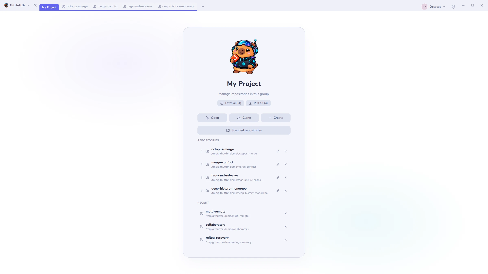

# Espacios de trabajo, pestañas y grupos

Tres niveles, del más suelto al más apretado.

## Pestañas

Un repositorio, una pestaña. Usa <kbd>⌘T</kbd> / <kbd>Ctrl+T</kbd> para abrir
el selector de pestaña nueva y <kbd>⌘W</kbd> / <kbd>Ctrl+W</kbd> para cerrar la
activa. También puedes arrastrar para reordenar, cerrar con el botón central, o
pulsar <kbd>⌘⇧T</kbd> para reabrir la última que cerraste. Haz clic derecho en
una pestaña de repositorio (o en una ficha dentro de un [grupo](#grupos)) para
el [menú contextual del repositorio](repo-menu.md) — alias, worktrees, GitHub,
terminal, mostrar, editor y, al final, **Cerrar este repositorio** y **Cerrar las
demás** (una ficha dentro de un grupo ofrece quitar en su lugar). Cierra la última
pestaña y <kbd>⌘W</kbd> cierra la ventana. Un punto en la pestaña significa
trabajo sin commitear; otro distinto significa conflictos.

Si aparece un aviso al cerrar, <kbd>Escape</kbd> siempre cancela.
<kbd>Enter</kbd> confirma solo cuando la pestaña está limpia — cuando hay
cambios sin commitear o conflictos, el aviso te obliga deliberadamente a ir al
botón, para que una tecla suelta después de <kbd>⌘W</kbd> no cierre trabajo que
todavía tenías en la mano.

### Tamaño de pestañas

Por defecto (**Ajustes → Diseño y terminal → Tamaño de pestañas → Ajustar**) las pestañas se
comportan como las de un navegador: cuando la franja se queda sin espacio, encogen
por igual hasta un ancho mínimo, y solo se desplazan cuando se alcanza incluso ese
mínimo. **Fijo** recupera el comportamiento clásico — cada pestaña conserva el ancho
de su contenido y la franja se desplaza en cuanto no caben todas.

### Ir a un repositorio

Con diez o más repositorios abiertos, encontrar uno en la franja obliga a
desplazarse, <kbd>⌘1</kbd>–<kbd>⌘9</kbd> se detienen en la novena pestaña, y la
[paleta de comandos](search.md) mezcla los repositorios abiertos con todas las
acciones. Pulsa <kbd>⌘J</kbd> / <kbd>Ctrl+J</kbd> (o **Ver → Ir al
repositorio…**) y escribe unas letras de su nombre, carpeta o rama, y luego
<kbd>Enter</kbd>.

La lista tiene solo los repositorios abiertos, incluidos los de grupos, en el orden
en que los miraste por última vez. El que acabas de dejar va primero, así que
<kbd>⌘J</kbd> <kbd>Enter</kbd> te devuelve a él. Cada fila lleva lo que muestra su
pestaña: la rama, el punto de trabajo sin commitear o de conflicto, el grupo en que
está y su tecla <kbd>⌘1</kbd>–<kbd>⌘9</kbd> cuando la tiene. El repositorio en
pantalla aparece atenuado al final. Nada se oscurece detrás del selector; un clic
fuera o <kbd>Esc</kbd> lo cierra.

Cuando nada abierto coincide, la última fila, **Buscar en todos los
repositorios**, lleva tu búsqueda a la página [Repositorios](repositories.md). El
atajo se puede reasignar en **Ajustes → Atajos**.

*Límites:* el orden se recuerda solo en esta sesión, así que tras reiniciar empieza
por el orden de las pestañas. Un repositorio abierto en dos pestañas aparece una
vez, en su primera pestaña. Los repositorios de otros [workspaces](#espacios-de-trabajo) no
aparecen — cambia antes de workspace, o usa la página Repositorios.

## Grupos

Agrupa repositorios relacionados en una **pestaña de grupo** con nombre y
color. Dentro de un grupo tienes una segunda fila con una ficha por
repositorio, y el grupo entero puede hacer **Fetch de todos** o **Pull de
todos** de una vez.

Para empezar uno, haz clic derecho en una pestaña de repositorio → *Nuevo grupo…*:
la pestaña se convierte en un grupo con ese repositorio, en el mismo sitio. Una vez
que existe un grupo, el mismo menú dice *Mover a un grupo →*, con los grupos
abiertos. Arrastrar una pestaña de repositorio sobre una ficha de grupo hace lo
mismo.

*Nuevo grupo…* pide un nombre y un color a la vez. El color empieza en uno que
ningún grupo abierto lleva todavía, elegido al azar, para que los grupos no empiecen
todos iguales.

Para cambiar el color de un grupo, haz clic derecho en él: los diez colores están
en el menú como una fila de puntos, con un anillo alrededor del actual, y un clic
lo aplica. *Color personalizado…* bajo la fila abre un selector para cualquier otro
color. Las carpetas y las secciones de la página Repositorios usan la misma fila.

Para deshacer un grupo, haz clic derecho en él → **Desagrupar**. Cada repositorio
se convierte en una pestaña normal donde estaba el grupo, conservando las páginas
que tenía abiertas. **Cerrar grupo** cierra en cambio el grupo y todos sus
repositorios. Las carpetas no sobreviven a un Desagrupar: solo existen dentro de un
grupo.

Los grupos admiten **carpetas, anidadas hasta donde quieras**: clic derecho en
el grupo → *Nueva carpeta…*, y luego arrastra repositorios sobre la ficha de la
carpeta. Cada carpeta coge un color, se pliega en una ficha con su cuenta,
agrega los puntos de estado de todo lo que contiene, y puede hacer fetch o pull
de todo su subárbol.

> Las carpetas solo organizan. Borrar una sube sus repositorios al nivel
> superior — nunca cierra un repositorio.

Para añadir un repositorio que el grupo aún no tiene, haz clic en el **+** junto al nombre del grupo. Muestra la página del propio grupo — abrir una carpeta, clonar, crear o elegir un repositorio reciente — aunque uno de sus repositorios esté abierto; al hacer clic en un chip vuelves a él.

## Páginas que pertenecen a un repositorio

Algunas páginas no son algo aparte: la [wiki](repo-wiki.md) de un repositorio,
sus [métricas](insights.md), las [dev tools](devtools.md) que anunció una
sesión de lanzamiento. No ocupan una pestaña — aparecen como pequeñas etiquetas en
el propio repositorio: un icono y una palabra que dice qué página es (*CI*, *PRs*,
*Wiki*, *#482* para una pull request, la etiqueta de una release). El nombre
completo está en el tooltip, y una etiqueta o un título largos se recortan con
puntos suspensivos.

- **Clic en un icono** para ver esa página. **Clic otra vez — o clic en el
  nombre del repositorio** — para volver al repositorio. Mientras hay una
  página abierta, el nombre coge cursor de mano y una pastilla al pasar por
  encima: es el camino de vuelta.
- **Hover sobre un icono** y se abre una ✕ a su lado, como la de una pestaña;
  cierra solo esa página.
- Mientras un repositorio tiene páginas abiertas, **su propia ✕ queda oculta**:
  junto a los iconos de las páginas parecía cerrar una página. Haz clic con el
  botón central en la pestaña, o usa su menú contextual, para cerrar el propio
  repositorio.
- Dentro de un **grupo**, los iconos van en el chip del repositorio al que
  pertenecen, y solo mientras ese repositorio es el seleccionado. Elegir otro
  repo del grupo muestra *ese* repositorio, no la herramienta del vecino.
- Reabrir la misma página enciende el icono que ya tiene, en vez de añadir otro.

Un repositorio que no está abierto en ningún sitio no tiene icono que llevar,
así que una página suya se abre en pestaña propia — abrir algo siempre abre algo.

## Espacios de trabajo

Un espacio de trabajo es **una tira de pestañas entera, guardada**. Cambiar de
espacio intercambia todas las pestañas a la vez: `Trabajo` y `Personal` dejan de
pisarse.

El nombre del espacio está arriba a la izquierda, junto a la marca de GitHuttBr.
Haz clic para cambiar, crear, renombrar, reordenar o borrar. Al lado está el
indicador que abre el [Centro de control](mission-control.md) del espacio en el
que estás.

**Ver también:** [Centro de control](mission-control.md) · [La línea de comandos](cli.md)
