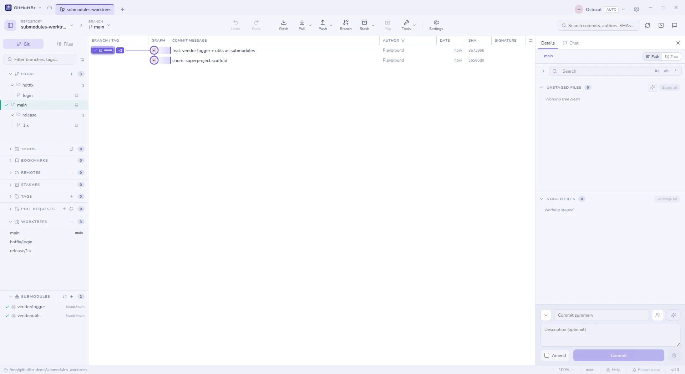

# Worktrees y submódulos

## Worktrees

Un worktree es una segunda copia de trabajo del mismo repositorio, en su propia
carpeta — así puedes mirar `main` mientras `feature/x` se queda exactamente como
la dejaste, sin hacer stash.

- Crea y elimina worktrees desde la barra lateral. **Doble clic** en uno lo abre
  como pestaña propia; el clic derecho ofrece *Abrir worktree*, *Mostrar en
  carpeta* y la eliminación.
- Clic derecho en cualquier rama local → **Abrir en un worktree** para levantar
  uno en una carpeta hermana y abrirlo como pestaña.
- Una rama solo puede vivir en un worktree a la vez, así que hacer checkout de
  una rama que ya tiene otro worktree no puede funcionar: git se niega con
  *already used by worktree at …*. GitHuttBr te lleva allí en su lugar: el menú de
  la rama dice *Ir a `x` en su worktree*, y el doble clic en la fila abre la
  pestaña de ese worktree en vez de fallar.

### Cuidar de los worktrees

Un worktree creado el mes pasado se olvida fácilmente, y las preguntas llegan al limpiar: ¿hay trabajo en él? ¿Sigue existiendo esa carpeta? Cada fila las responde antes de que tengas que preguntar.

| En la fila | Significa |
|---|---|
| **●3** | Tres archivos con cambios sin confirmar en ese worktree |
| **↑2 ↓1** | Su rama va dos commits por delante y uno por detrás de su upstream |
| 🔒 | Bloqueado: pasa el ratón por encima para ver el motivo indicado al bloquearlo |
| **ausente**, nombre tachado | La carpeta ya no existe; git solo conserva su registro |

Los números se leen al abrir la sección, cuando cambia el commit de ese worktree y cuando la ventana recupera el foco; no en cada actualización, porque cada uno es un `git status` dentro de otra carpeta.

Clic derecho en una fila para:

| Acción | Qué hace |
|---|---|
| **Bloquear worktree** | Impide que git (y cualquier otro cliente) lo pode, mueva o elimine. Indica un motivo —*en el disco externo*— y aparece en el candado. Para worktrees en soportes que no siempre están conectados. |
| **Desbloquear worktree** | Lo contrario. Deshacer vuelve a bloquearlo con el mismo motivo. |
| **Mover worktree…** | Mueve la carpeta y actualiza los vínculos de git en ambos sentidos. No se ofrece si está bloqueado o abierto en una pestaña: las pestañas y su diseño se recuerdan por ruta, así que la pestaña quedaría apuntando a nada. Ciérrala antes. Deshacer lo devuelve a su sitio. |
| **Eliminar worktree** | Primero pregunta a git qué se perdería. Uno limpio recibe la confirmación normal, y deshacer lo recrea en la misma rama y la misma carpeta. Uno con cambios sin confirmar recibe otra confirmación, *Descartar y eliminar*, que indica cuántos archivos, y no tiene deshacer. |
| **Reconectar carpeta movida…** | Solo en una fila *ausente*: indica adónde fue la carpeta (la moviste con el explorador de archivos) y git la vuelve a vincular con `git worktree repair`. |
| **Olvidar worktrees ausentes** | También es el botón de goma en la cabecera de la sección, visible cuando alguna fila está ausente. Ejecuta `git worktree prune`. |

Lo que **no** hacen:

- **Eliminar un worktree borra también sus archivos ignorados**: `.env`, `node_modules`, resultados de compilación. Git no los cuenta como cambios, así que incluso la confirmación "limpia" lo advierte, y deshacer no los recupera.
- **Olvidar solo borra el registro de git.** No hay archivos que borrar —la carpeta ya no está— y se omiten los worktrees bloqueados, porque uno bloqueado en un disco desconectado es idéntico a uno borrado.
- Un bloqueo es un acuerdo entre clientes de git, no una protección de archivos: no impide que nada fuera de git borre la carpeta.
- El worktree principal —el propio repositorio— no se puede bloquear, mover ni eliminar.
- Eliminar un worktree nunca borra su rama. Bórrala desde la lista de ramas si ya terminaste.

### Agrupar worktrees en la cabecera

Las pestañas de worktree se abren con etiquetas `raíz · rama`, que se ensanchan
enseguida.

**Un proyecto que está en un grupo acoge sus worktrees.** Cuando el repositorio
— o uno de sus worktrees — ya está en un grupo, un worktree nuevo se abre dentro
de ese grupo, a su lado, sin nada que marcar: el diálogo de añadir worktree solo
dice qué grupo, y **Abrir en un worktree** en el menú de una rama hace lo mismo
sin preguntar. Un worktree abierto después desde **Recientes** o desde una
carpeta también entra. Arrastra la ficha fuera del grupo si la quieres aparte.

Para un repositorio en una pestaña propia, marca **Ofrecer agrupar los worktrees
que comparten el mismo repositorio raíz** en el diálogo de añadir worktree
(desactivado por defecto, recordado como la opción de codegraph): si la raíz
está abierta en una pestaña suelta aparece un campo **Nombre del grupo**
(rellenado con el nombre de la carpeta de la raíz) y ambos van a un grupo nuevo;
sin ningún miembro de la familia abierto, solo avisa de que el worktree se abre
en su propia pestaña. Dentro del grupo, las fichas se reducen a la hoja (`main`,
`feature/x`) porque el grupo ya dice a qué repositorio pertenecen — un
interruptor en Ajustes → Diseño y terminal conserva el nombre completo
`raíz · rama` si lo prefieres. La oferta solo junta worktrees que comparten la
misma raíz — nunca mezcla repositorios sin relación.

**Distinguir una pestaña de worktree.** Un worktree vinculado es un segundo
checkout de un repositorio, y su pestaña se vería exactamente igual que la del
propio repositorio. Por eso una pestaña de worktree muestra una **bifurcación**
verde en lugar del icono de carpeta — en una pestaña con imagen, una pequeña
bifurcación en la esquina de la imagen — y su tooltip dice *Worktree de …* con la
carpeta donde vive. Haz clic derecho para **Abrir …, el repositorio principal**,
que enfoca la pestaña que ya tiene el checkout principal, o lo abre — dentro del
grupo del worktree cuando el worktree está en uno. Funciona se haya abierto como
se haya abierto el worktree: desde su familia, desde **Abrir repositorio** o
desde la lista escaneada, y los worktrees de un submódulo apuntan al submódulo.
Límites: la marca habla de dónde vive el checkout, no de su rama; los worktrees
de un repositorio bare no se marcan, porque no hay checkout principal que abrir;
y un repositorio principal abierto a través de una carpeta enlazada con symlink
no se reconoce como ya abierto, así que el menú lo abre una segunda vez con su
ruta real.

## Submódulos

Añade, actualiza (init y checkout), sincroniza URLs y elimina submódulos, con el
estado en vivo de cada uno:

| Estado | Significa |
|---|---|
| **Sincronizado** | Está en el commit que registra el repositorio padre |
| **Modificado** | Está en otro sitio, o tiene cambios sin guardar |
| **Sin inicializar** | Está registrado, pero nunca se ha hecho checkout |

**Ver también:** [LFS y sparse-checkout](lfs-sparse.md) · [Fetch, pull y push](syncing.md)
