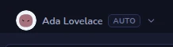
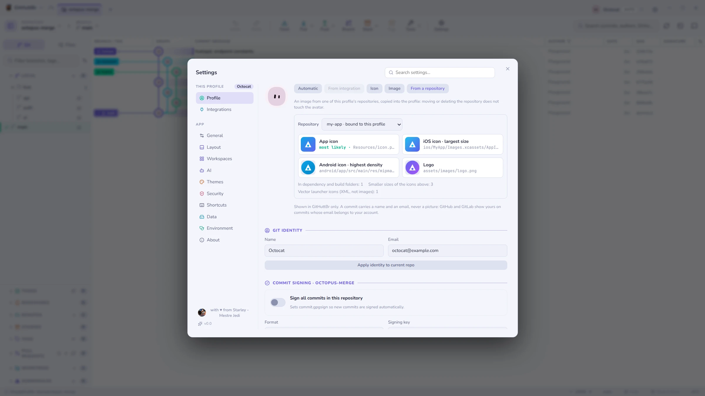

# Avatars d’auteur

Une liste de commits est un mur de noms, et les noms se lisent lentement. Une
image à côté de chacun transforme « qui a écrit ça » en une question à laquelle on
répond d’un coup d’œil. GitHuttBr en met une sur chaque auteur qu’il affiche : dans
la colonne auteur du graphe, dans les détails du commit à côté de l’auteur et de
chaque co-auteur, dans le sélecteur de co-auteurs pendant la rédaction, dans le
sélecteur de profils, et à côté de chaque profil dans les Paramètres.

## D’où vient l’image

Deux sources, essayées dans cet ordre :

| Source | Quand elle est utilisée |
|---|---|
| **Gravatar** | L’e-mail du commit a un compte Gravatar. Récupéré en HTTPS, à partir d’un hachage SHA-256 de l’e-mail en minuscules. |
| **Avatar généré** | Tout le reste — pas de Gravatar, pas de réseau, ou recherche désactivée. Dessiné localement depuis l’e-mail, jamais téléchargé. |

L’avatar généré est une petite créature, pas un carré coloré : le même e-mail
produit toujours la même forme et les mêmes couleurs, si bien qu’un auteur reste
reconnaissable d’un dépôt à l’autre et d’un redémarrage à l’autre. Deux e-mails
différents ne collisionnent pratiquement jamais. Il est dessiné par
[blobatar](https://github.com/Alain00/blobatar) (MIT) et n’a besoin d’aucun
réseau : un dépôt rempli d’auteurs sans Gravatar obtient quand même un jeu complet
de visages distinguables, hors ligne, au premier rendu.

Comme la graine est l’**e-mail du commit**, un auteur qui commite sous deux
adresses obtient deux avatars. C’est volontaire — c’est le même signal que donne
la colonne auteur du graphe, et c’est généralement ainsi qu’on repère un compte
machine ou un `user.email` mal configuré. Corrigez-le avec les
[attributs d’auteur](attributes.md) si les deux adresses sont vraiment la même
personne.

## Le visage de la barre de titre

L’avatar à côté du nom de votre profil est le seul avatar de GitHuttBr qui représente
**vous, dans ce dépôt, maintenant** — c’est donc le seul qui réagit à l’état du
dépôt. Il fait une tête quand il se passe quelque chose, et reste neutre le reste
du temps.

Ce à quoi il réagit, le pire d’abord : des fichiers restés en conflit ; une
fusion, un rebasage, un cherry-pick ou un revert que git n’a jamais su comment
terminer ; un HEAD détaché — alarmé s’il y a du travail non validé dessous, juste
hésitant sinon ; des commits qui s’accumulent sans push, ou sans pull depuis le
distant ; des modifications qui s’accumulent sans validation ; un tiroir de
remisages que personne n’ouvre ; et un dépôt où rien n’est arrivé depuis un mois.

Le pire l’emporte : un dépôt avec des conflits *et* quarante commits non poussés
porte les conflits. Survolez l’avatar et l’infobulle indique exactement ce qui a
causé le visage — une image qui change sans raison énoncée est une énigme, pas un
signal. C’est l’infobulle qu’on lit ; le visage ne fait que vous faire regarder.

Les seuils sont volontairement élevés. Un visage qui s’inquiète au premier commit
non poussé est inquiet en permanence, et un signal permanent est un signal qu’on
apprend à ne plus lire. Une branche sans upstream reste neutre plutôt que
contente : « synchronisée » n’est pas une affirmation possible pour une branche que
personne n’a poussée.

**C’est de la décoration, pas de l’instrumentation.** La barre d’état porte les
vrais décomptes, et c’est elle qu’il faut croire. Le visage dit seulement *il se
passe quelque chose*, d’un coup d’œil.

### Mouvement

L’avatar de la barre de titre respire et clignote tout seul. Désactivez-le dans
**Paramètres → Thèmes → Graphe → Animer l’avatar du profil** — l’expression continue
de suivre le dépôt, elle cesse simplement de bouger. Le mouvement est aussi ignoré
automatiquement si votre système demande un mouvement réduit.

Seul cet avatar est animé. Un avatar animé doit être dessiné en SVG vivant plutôt
qu’en image mise en cache, ce qui va pour un seul et devient du gâchis pour les
plusieurs centaines qu’un graphe dessine au défilement.

## L’image de votre profil

L’avatar de la barre de titre et de la liste des profils est le vôtre : vous pouvez donc le choisir.
**Paramètres → Profil → Avatar** propose cinq sources :

| Source | Ce qui s’affiche |
|---|---|
| **Automatique** | Par défaut : votre Gravatar pour l’e-mail git du profil, ou le visage généré — celui qui réagit au dépôt. |
| **De l’intégration** | La photo du compte GitHub ou GitLab connecté à ce profil dans Intégrations. Désactivé tant qu’il n’y en a pas. |
| **Icône** | L’un des 24 symboles, sur la couleur de votre choix. |
| **Image** | Un fichier que vous choisissez — PNG ou JPEG. Réduit à 256 px et conservé sur cet ordinateur, dans le dossier de données de GitHuttBr, pas dans le fichier de paramètres. |
| **Depuis un dépôt** | Une icône ou un logo trouvé dans l’un des dépôts du profil — celui de l’app ou de l’entreprise —, copié dans le profil comme une image. |

L’image suit **Paramètres → Données → Exporter les paramètres** et revient à l’import ; supprimer le
profil la supprime.

### Une icône depuis un dépôt

Un profil professionnel a souvent une image toute prête : l’icône de l’app ou de
l’entreprise, rangée dans son dépôt. **Depuis un dépôt** liste les plus probables
parmi les dépôts **liés au profil** (ou, s’il n’y en a aucun, celui qui est
ouvert) :

- d’abord l’icône de l’app elle-même (`icon.png`, `Resources/icon.png`) ;
- un `AppIcon.appiconset` iOS dans sa **plus grande** taille, une icône de
  lanceur Android (`mipmap-*/ic_launcher.png`) dans sa densité **la plus haute** ;
- puis les logos et les autres images dont le nom évoque une icône.

Sous la liste, ce qui a été écarté est compté et expliqué : les images des
dossiers de dépendances et de build (`node_modules`, `Pods`, `build`…), les
tailles plus petites des icônes déjà listées, et les icônes de lanceur en XML
vectoriel. En choisir une la copie dans le profil, réduite à 256 px — déplacer,
renommer ou supprimer le dépôt ne touche pas l’avatar.

Tant qu’un profil est sur **Automatique**, la page propose une fois l’icône la
plus probable : *Utiliser l’icône de my-app ?* — **Utiliser**, **En choisir une
autre** ou **Pas maintenant**, qui cesse de demander pour ce profil. Rien ne
change tant que vous n’avez pas choisi.

Ce qu’elle ne sait pas faire : elle ne propose que des images que le dépôt
contient sous forme de fichiers (PNG, JPEG, WebP, SVG et autres), pas des icônes
générées au build ; et elle ne suit pas le dépôt — une nouvelle icône s’y choisit
à nouveau à la main.

**Un commit ne porte jamais d’image.** Il contient un nom et un e-mail, rien de plus.
GitHub et GitLab affichent la photo de votre compte sur un commit dont l’e-mail
appartient à votre compte. Si vous préférez ne pas publier votre vraie adresse,
l’identité git du profil propose **Utiliser mon e-mail noreply GitHub** une fois le
compte connecté — une adresse que le service garde privée et qui relie quand même
vos commits à vous.

Cela ne concerne que vos profils. Les autres auteurs gardent l’image de leur e-mail
de commit, comme décrit plus haut. Une image choisie, comme une photo Gravatar, n’a
pas d’expression : le visage qui réagit au dépôt est l’automatique.

## Désactiver la recherche

**Paramètres → Thèmes → Graphe → Afficher les avatars.**

Désactivé signifie :

- aucune requête vers `gravatar.com`, jamais — ni différée, ni mise en cache puis
  retentée ;
- les avatars apparaissent toujours, tous générés localement.

C’est donc un interrupteur de confidentialité, pas un « masquer les images ». Aucun
réglage ne supprime complètement les avatars.

## Les limites

- **Une recherche Gravatar apprend à gravatar.com que cet e-mail a été consulté.**
  Le hachage n’est pas un secret : quiconque a un e-mail candidat peut le hacher et
  comparer. Si la liste des auteurs d’un dépôt est quelque chose que vous préférez
  ne pas confier à un tiers, désactivez la recherche avant de l’ouvrir.
- **Gravatar seulement.** Les avatars que vous avez téléversés sur GitHub, GitLab
  ou Bitbucket ne sont pas lus — il faudrait un appel authentifié à l’API de
  l’hébergeur par auteur, beaucoup de réseau pour une décoration.
- **Aucun remplacement.** Vous ne pouvez pas épingler une image choisie à un
  auteur, ni changer le style généré. L’avatar est une fonction de l’e-mail et de
  rien d’autre.
- **Une photo Gravatar n’a pas d’expression.** Si l’e-mail de votre profil en a
  une, la barre de titre affiche la photo et aucun visage — une photographie ne
  peut pas vous faire la grimace. Désactivez la recherche si vous préférez le blob
  expressif.
- **Le visage ne suit que le dépôt actif.** Dans un onglet qui n’est pas un dépôt,
  il n’y a rien à quoi réagir : il reste neutre.
- **Une lecture à la fois.** Le visage montre la pire chose trouvée : un dépôt
  peut donc être en désordre de plusieurs façons et n’afficher qu’une expression.
  Ce n’est pas une liste d’état — c’est le travail de la barre d’état et de
  l’infobulle.
- **Petit reste petit.** Dans la colonne auteur du graphe, l’avatar fait 16px, ce
  qui porte la couleur et la silhouette mais pas le détail. Les détails du commit
  dessinent l’auteur à 38px, et c’est là qu’on voit vraiment le visage.

**Voir aussi :** [Thèmes et apparence](themes.md) · [Le graphe de commits](graph.md) ·
[Attributs d’auteur](attributes.md) · [Profils](profiles.md)
