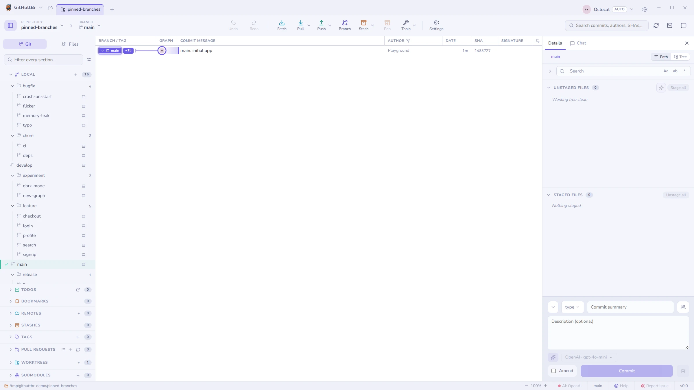
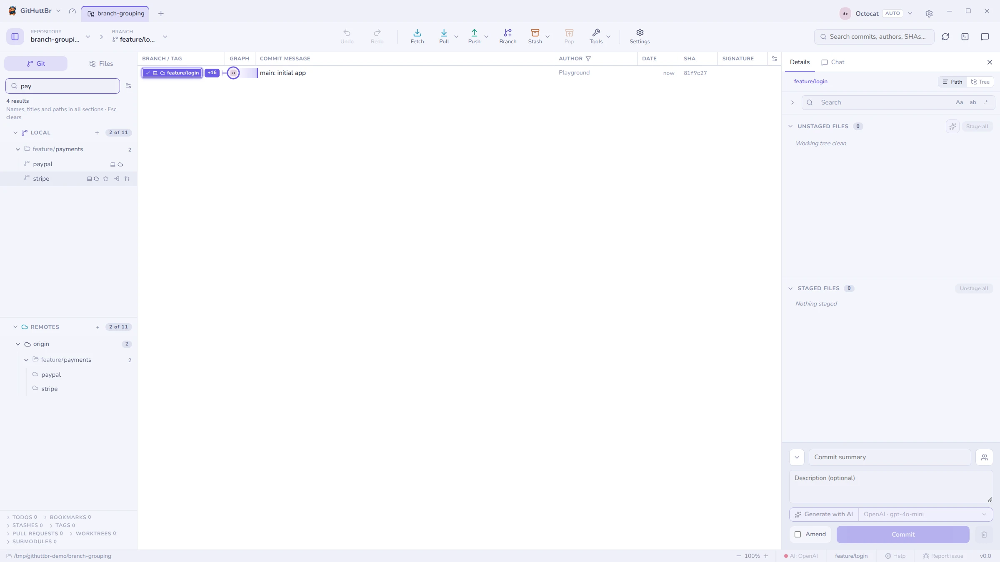
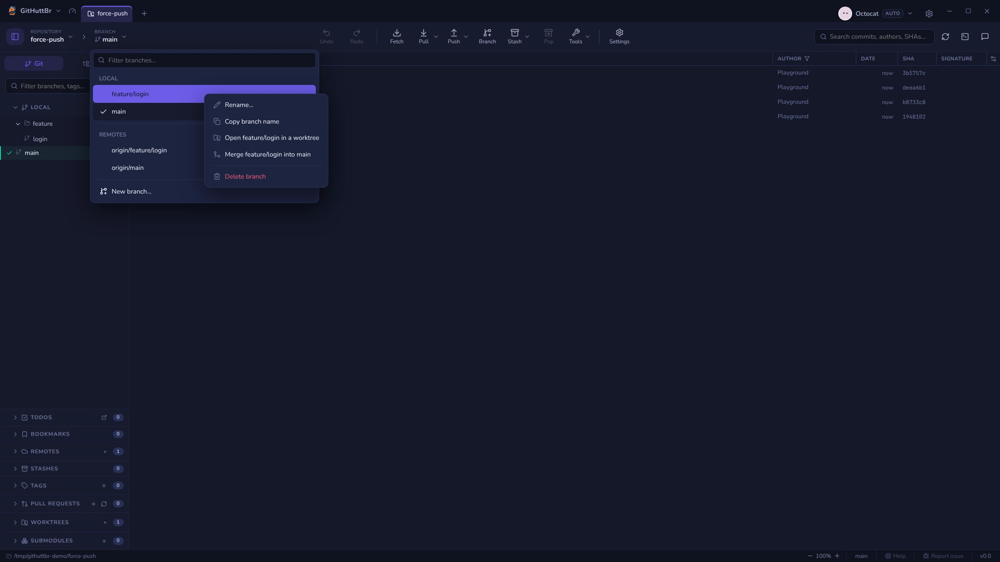
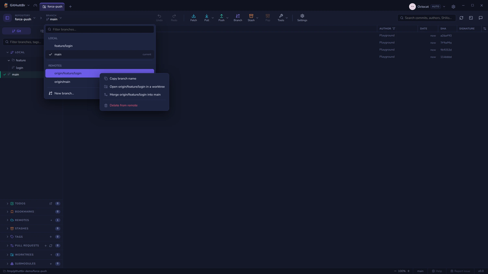
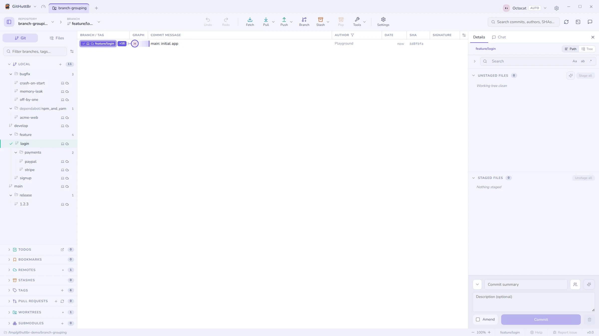
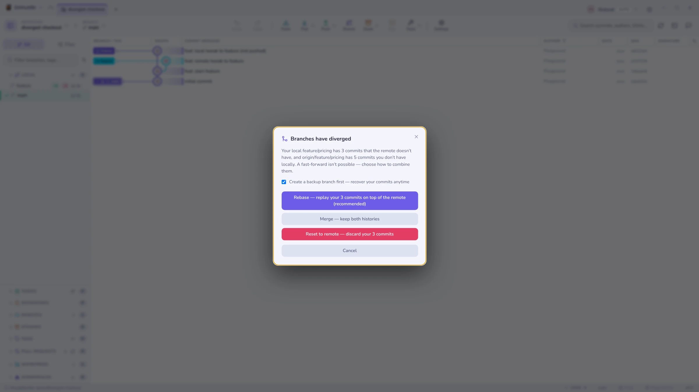
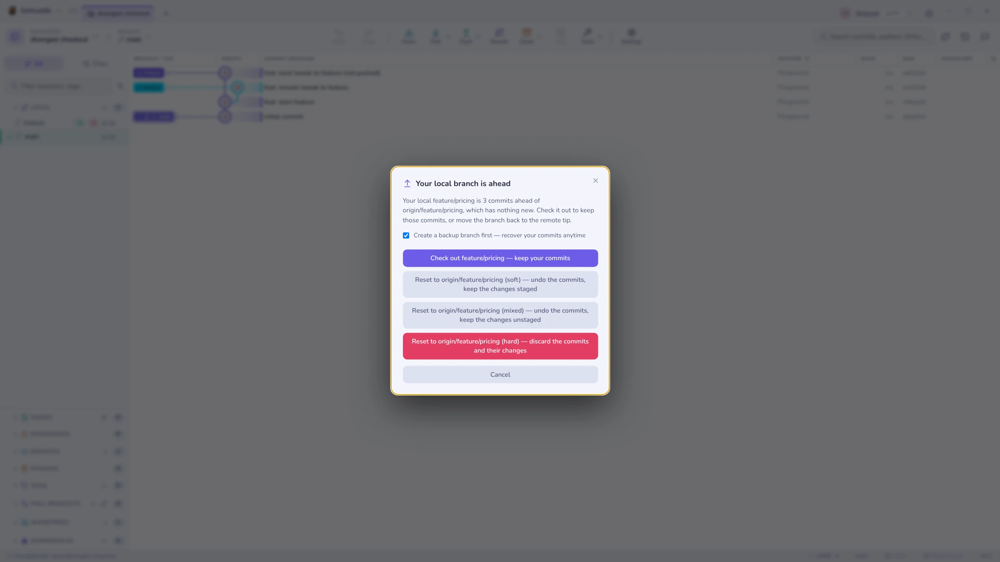

# Branches, distants et barre latérale

Une seule barre latérale, réordonnable et cherchable, contient les **branches,
les distants, les étiquettes, les remisages, les arbres de travail et les
sous-modules**. Chaque section peut être masquée ou déplacée (Paramètres → Disposition et terminal), et le champ de filtre s'applique à toutes.
Les sections et dossiers laissés ouverts ou repliés sont mémorisés par dépôt,
même après un redémarrage.

Pour réordonner, faites glisser une section par son en-tête — ou, sans souris, placez le focus sur l'en-tête et appuyez sur <kbd>Alt</kbd>+<kbd>↑</kbd>/<kbd>↓</kbd>. Les mêmes entrées *Monter la section* et *Descendre la section* se trouvent dans le menu contextuel de l'en-tête (<kbd>Shift</kbd>+<kbd>F10</kbd> l'ouvre au clavier). L'ordre est lui aussi mémorisé par dépôt.

La barre latérale est une pile de panneaux, pas une longue liste. Une section
ouverte prend la hauteur laissée par les repliées, qui restent en dessous comme
des en-têtes ; ouvrez-en plusieurs et elles se partagent cette hauteur à parts
égales, chacune avec son propre défilement. Une section avec des centaines
d'étiquettes défile dans son panneau et les autres en-têtes restent où ils sont,
rien à cliquer ne sort de l'écran. Ouvrez plus qu'il n'y a de place et tous les
panneaux rétrécissent ensemble jusqu'à l'en-tête — la barre elle-même ne défile
jamais.

Seul **Local** démarre ouvert dans un dépôt que vous n'avez pas encore rangé ;
chaque autre section démarre comme un en-tête. Une section contenant plus de 300
références démarre repliée malgré tout. Dans un dépôt comptant des milliers de
branches distantes jamais supprimées, elles seraient sinon toutes à l'écran sans
que vous les ayez demandées ; dépliez-la une fois et ce choix est mémorisé comme
les autres.

## Un filtre pour toutes les sections

La zone en haut de la barre latérale filtre **toutes les sections à la fois** : branches locales et distantes, étiquettes, remises, worktrees, sous-modules, pull requests, issues, jalons, releases, signets et tâches. Elle compare noms, titres et chemins sans tenir compte de la casse ; une pull request correspond aussi par son `#numéro`, sa branche source et son auteur. La ligne sous la zone compte les résultats de toutes les sections.

Tant qu’un filtre est actif :

- chaque en-tête affiche **trouvés sur total** — `2 sur 10` ;
- une section sans résultat quitte la liste et se replie sur une seule ligne en bas, pour que les résultats ne soient pas entrecoupés d’en-têtes vides ;
- les sections et dossiers qui contiennent des résultats s’ouvrent d’eux-mêmes, sauf au-delà de 300 — ceux-là s’ouvrent à la main. Ce que vous ouvrez ou fermez ne dure que jusqu’à l’effacement du filtre ; votre disposition enregistrée reste intacte.

<kbd>Esc</kbd> dans la zone l’efface.

**Limites :** c’est une simple recherche de sous-chaîne — pas de jokers, pas de recherche approximative, pas d’expressions régulières. Elle cherche dans ce que la barre latérale a déjà chargé : les pull requests et issues au-delà de la liste renvoyée par l’hébergeur n’y figurent pas (la page des [pull requests](pull-requests.md) a son propre filtre). Les branches distantes correspondent sur le nom complet `remote/branche`, donc taper le nom d’un dépôt distant trouve toutes ses branches.

## Branches

Créer, extraire, renommer et supprimer — en local comme en distant. Les lignes de
branche affichent :

- **↑en avance / ↓en retard** par rapport à leur amont,
- des **badges de présence par distant** (quels distants possèdent cette
  branche),
- un **point de risque** après un passage du [radar de
  conflits](conflict-radar.md),
- un **marqueur ⟳** quand le distant a [réécrit l'histoire](range-diff.md).

Survolez une ligne de branche locale, ou atteignez-la avec Tab, pour deux actions rapides : **Checkout** et **Créer une pull request**. Ce sont les mêmes actions que le menu contextuel, qui garde tout le reste ; la branche courante n’affiche que la seconde.

Les branches dont le nom contient un `/` se replient automatiquement en dossiers
pliables.
Un préfixe avec un seul enfant reste un dossier — `release/1.2.3` est `release`
contenant `1.2.3` — donc ajouter `release/1.2.4` plus tard ne redessine pas
l’arbre. Une suite de dossiers à un enfant se comprime en un en-tête
(`dependabot/npm_and_yarn`). Les en-têtes de dossier portent une marque de
dossier ; la réf, une marque de branche, de distant ou d’étiquette. **Paramètres → Disposition et terminal → Grouper les réfs par préfixe** désactive les dossiers, pour une liste à plat.

Un clic droit sur l'en-tête d'un dossier agit sur tout le groupe : *Supprimer
toutes les branches sous `feature` (4 branches)* supprime tout son contenu
après une seule confirmation qui liste exactement les branches concernées — la
branche courante est exclue. Le même menu existe sur les dossiers de branches
distantes, en supprimant côté distant.

Les lignes se sélectionnent en groupe comme des fichiers : un clic avec
Le menu déroulant des branches dans la barre d'outils liste les branches
locales et distantes. Un clic droit sur une branche de ce menu permet de
renommer une branche locale, copier son nom, l'extraire dans un nouveau
worktree, la fusionner dans la branche active ou la supprimer. Les branches
distantes n'offrent pas le renommage et sont supprimées de leur dépôt
distant après confirmation. GitHuttBr masque la fusion quand la référence
sélectionnée est déjà contenue dans la branche active, et désactive la
création de worktree quand cette branche est déjà extraite.

<kbd>⌘/Ctrl</kbd> bascule une ligne, un clic avec <kbd>Maj</kbd> sélectionne
une plage, et <kbd>Maj</kbd>+<kbd>↑</kbd>/<kbd>↓</kbd> étend la sélection
depuis la dernière ligne cliquée. Un clic droit sur la sélection ouvre le menu
groupé — *Supprimer 4 branches* — qui confirme avec la liste complète. Les
mêmes gestes fonctionnent sur les branches distantes, les étiquettes et les
remisages.

## Une branche à partir d’un work item Azure Boards

Dans un dépôt dont le remote est sur Azure DevOps, la palette de commandes propose
**Create branch from Azure work item…**. Tapez le numéro du work item (ou
`AB#1234`) : son type, son titre et son état s’affichent ; **Créer la branche**
ouvre la boîte de dialogue habituelle avec le nom prérempli — `bugfix/1234-titre`
pour un bug, `feature/1234-titre` pour le reste — et `AB#1234 titre` comme tâche,
si vous préférez que l’IA propose un nom.

Les mentions de work items deviennent des liens dans les messages de commit et
les textes de pull request : `AB#1234` partout où l’organisation Azure est
connue, et sur un dépôt Azure un simple `#1234` aussi, car Azure numérote des
work items, pas des issues. Sur un dépôt GitHub lié à Azure Boards,
l’organisation n’est pas connue ; une entrée `links.tickets` dans le
[`.githuttbr.json`](repo-config.md) du dépôt y remédie — motif `AB#(\d+)`, URL
`https://dev.azure.com/<org>/_workitems/edit/$1`.

## Renommer une branche

Une branche nommée `fix` il y a trois jours est une branche que personne ne
situe aujourd'hui. Renommez-la depuis l'endroit où vous avez repéré le problème :

| Où | Comment |
|----|---------|
| Barre latérale | Clic droit sur la branche → *Renommer…* |
| Menu déroulant des branches | Clic droit sur la branche → *Renommer…* |
| Graphe des commits | Clic droit sur le badge de branche d'un commit → *Renommer…* |
| Palette de commandes | <kbd>⌘/Ctrl</kbd>+<kbd>K</kbd> → *Renommer la branche* (agit sur la branche courante) |

Un renommage local, c'est `git branch -m` : instantané et **annulable avec ⌘Z** —
l'entrée d'annulation lui rend son ancien nom. Renommer la branche sur laquelle
vous êtes vous y laisse.

Si la branche suit une branche distante, le menu propose aussi *Renommer
(distant compris)…* : renommage local, publication du nouveau nom, suppression
de l'ancien en amont. Ceci **n'est pas annulable** — l'ancienne branche distante
n'existe plus, et quiconque l'avait extraite doit se repositionner. Sur un badge
du graphe, l'option n'apparaît que si la branche suit exactement un dépôt
distant ; s'il y en a plusieurs, passez par la barre latérale pour lever
l'ambiguïté.

**Limites :** GitHuttBr ne réécrit rien de ce qui référençait l'ancien nom — les
pull requests ouvertes pointent toujours vers la branche d'origine, et les
règles de CI qui filtrent sur un motif de branche cessent de correspondre.
Renommer une branche extraite dans un autre [worktree](worktrees.md) échoue, et
git le dit.

## Tirer et pousser une branche sur laquelle vous n'êtes pas

Faites un clic droit sur n'importe quelle branche locale : les entrées **Tirer**
et **Pousser** agissent sur *cette* branche, pas sur celle extraite — plus
besoin d'un détour par un checkout pour mettre trois branches à jour. Voir
[récupérer, tirer et pousser](syncing.md).

## Branches épinglées

Marquez d'une étoile les branches sur lesquelles vous revenez sans cesse —
survolez la ligne et cliquez ★, ou clic droit → *Épingler la branche*. Elles
remontent dans un groupe **Épinglées** en haut de la section Locales, mémorisé
par dépôt, tout en restant à leur place habituelle en dessous.

## Extraire une branche distante

Double-cliquez une branche distante pour créer la branche locale qui la suit. Si
une branche locale de ce nom existe déjà et a **divergé**, GitHuttBr demande
comment réconcilier — rebase, fusion ou réinitialisation — et propose de
sauvegarder la branche d'abord.

### Quand votre branche locale est en retard

Elle est avancée (fast-forward) jusqu'à la pointe du distant pendant le
checkout. Un arbre de travail modifié est mis de côté dans un stash nommé puis
restauré, afin que vos modifications locales n'interrompent pas la mise à jour.

### Quand votre branche locale est en avance

Si la branche locale est en avance et que le distant n'a rien de neuf, basculer
répondrait à une demande de la branche *distante* par votre propre travail non
poussé — rien n'est donc extrait tant que vous n'avez pas dit quel côté vous
vouliez :

| Choix | Ce qui se passe |
|-------|-----------------|
| Basculer sur la locale | Passe sur la branche locale, commits intacts. Ce que tous les autres clients font silencieusement. |
| Réinitialiser (soft) | Ramène la branche sur la pointe du distant ; les modifications des commits restent **indexées**, prêtes à être recommittées. |
| Réinitialiser (mixed) | Même déplacement, modifications laissées **non indexées** dans l'arbre de travail. |
| Réinitialiser (hard) | Supprime les commits *et* leurs modifications. |

Laissez *Créer d'abord une branche de sauvegarde* coché et la pointe locale est
enregistrée sous `backup/<branche>-<horodatage>` avant tout déplacement : même un
reset hard n'est alors qu'à un checkout d'être annulé. Le reset entre aussi dans
la pile d'annulation (⌘Z), mais seulement jusqu'à la fermeture du dépôt — la
branche de sauvegarde, elle, reste.

**Limites :** le dialogue compare uniquement la branche à la référence de suivi
qui vient d'être récupérée ; un distant qui a refusé le fetch (hors ligne,
identifiants invalides) est donc comparé à sa dernière pointe connue. Il ne dit
rien de la *qualité* de vos commits — seulement qu'ils existent ici et pas
là-bas.

## Distants

La section Distants de la barre latérale est l'endroit où on ajoute, modifie,
récupère et retire des distants. Fetch, pull ou push sur un dépôt qui n'en a
aucun ouvre ce même dialogue **Ajouter un distant** — coller une URL ou créer
le dépôt sur l'hôte — au lieu de ne rien faire. Voir [récupérer, tirer et
pousser](syncing.md).

**Voir aussi :** [Fusion et rebase](merging.md) · [Arbres de travail](worktrees.md)
