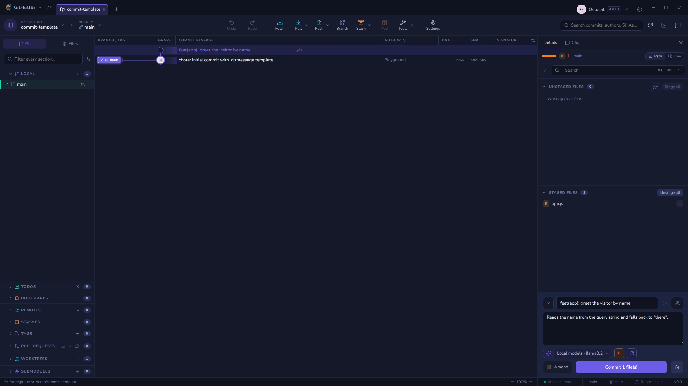

# Faire des commits

## Styles de message

Choisissez-en un dans **Paramètres → IA → Messages de commit**, ou directement
depuis le compositeur ; le compositeur s'y adapte. Le style appartient à l'IA
qu'utilise le profil — la générale, ou celle du profil.

| Style | Ce que ça donne |
|---|---|
| **Conventional** | `feat(api)!: add rate limiting` — avec une liste déroulante de types |
| **Gitmoji** | `✨ add rate limiting` — avec un sélecteur d'emoji |
| **Gitmoji + Conventionnel** | `✨ feat(api): add rate limiting` — sélecteur d'emoji *et* liste de types |
| **Ticket** | `ABC-123: add rate limiting` — amorcé depuis le nom de la branche |
| **Simple** · **Auto** | Ce que vous tapez ; Auto laisse l'IA décider de la forme |
| **Homme des cavernes** · **Haïku** | Exactement ce que le nom laisse entendre |

### Gitmoji

[Gitmoji](https://gitmoji.dev) place un emoji devant le sujet pour qu'un
historique se lise d'un coup d'œil : 🐛 corrections, ✨ fonctionnalités, 🔥
suppressions. Avec l'un ou l'autre style gitmoji, le bouton d'emoji se trouve
juste à côté du champ de sujet. Il ouvre **les 75 gitmoji officiels**,
consultables par emoji, par `:code:` (ce que tapent les utilisateurs de
gitmoji-cli) ou par signification dans votre langue.

**Gitmoji + Conventionnel** garde le type et l'emoji synchronisés. Choisissez un
type et son emoji suit ; changez de type et il change aussi — sauf si vous avez
choisi l'emoji vous-même (🚑️ sur un `fix`, par exemple), qui n'est jamais écrasé.

| Type | Emoji | Type | Emoji |
|---|---|---|---|
| `feat` | ✨ | `test` | ✅ |
| `fix` | 🐛 | `build` | 📦️ |
| `docs` | 📝 | `ci` | 👷 |
| `style` | 🎨 | `chore` | 🔧 |
| `refactor` | ♻️ | `revert` | ⏪️ |
| `perf` | ⚡️ | | |

L'IA écrit sous la même forme. Si un modèle oublie l'emoji ou répond avec un
`:shortcode:`, le sujet est corrigé avant d'arriver dans le champ.

Les commits écrits par d'autres outils sous la forme `:sparkles: add login` sont
**affichés** comme `✨ add login` dans le graphe, les détails du commit et les
vues d'historique.

Limites :

- Le sélecteur écrit toujours l'emoji **unicode**, jamais un `:shortcode:`.
- Les shortcodes ne sont convertis qu'à l'affichage. Le commit n'est pas
  réécrit, et la recherche dans l'historique porte sur le texte tel qu'il a été
  commité.
- Seuls les gitmoji comptent : un sujet qui commence par un autre emoji reste tel quel.
- Un dépôt dont le hook `commit-msg` lance commitlint avec le preset
  Conventional standard refuse un emoji en tête. C'est la règle du hook, pas de
  GitHuttBr : configurez commitlint pour gitmoji ou utilisez du Conventional pur.

## Écrire le message avec l’IA

Quand l’IA est active, **Générer avec l’IA** se trouve sous la description. Il
lit le diff indexé (staged) et écrit le résumé et la description dans le style
ci-dessus. Le bouton nomme qui répondra — *compte · modèle*, la paire choisie
pour les messages de commit dans **Réglages → IA → Modèle par tâche** — pour
qu’un modèle local lent ou un modèle coûteux ne soit jamais une surprise.

- **▾** à côté du nom liste vos comptes enregistrés, chacun avec quelques-uns
  de ses modèles. Le choix vaut **pour cette génération seulement** ; les
  Réglages ne changent pas.
- Pendant l’exécution, la zone affiche *Génération avec compte · modèle… 12 s*
  et **Annuler**, qui arrête la requête elle-même, pas seulement l’indicateur.
  Au bout de 30 secondes elle propose aussi **Utiliser** un autre compte prêt,
  qui lance la même génération sur celui-ci. L’invite globale *prend plus de
  temps que prévu* ([IA](ai.md)) apparaît toujours aussi.
- Le nouveau texte **remplace** l’ancien, qui est conservé : un bandeau indique
  *Généré par compte · modèle en 7 s* et propose **Annuler**, qui remet votre
  résumé et votre description, et **Générer à nouveau**. Il disparaît dès que
  vous modifiez le texte ou faites le commit.

[Modifier un commit](commit-edit.md) a le même bouton, à partir du diff de ce
commit.

Limites :

- Seul le diff indexé est envoyé, tronqué s’il est très gros — jamais les
  modifications non indexées ni d’autres fichiers.
- L’annulation garde une étape : le texte d’avant la première génération d’une
  série. Quand le bandeau disparaît, cette copie aussi.
- Annuler ne rend pas les jetons qu’un fournisseur a déjà consommés.
- La liste ▾ montre tous les comptes enregistrés, y compris un compte encore
  sans clé ; le choisir échoue avec l’erreur propre à ce compte.

## Ce que le compositeur fait pour vous

- <kbd>↑</kbd> <kbd>↓</kbd> rappellent vos **messages récents**.
- Un **sélecteur de co-auteurs** ajoute des lignes `Co-authored-by:` à partir des
  contributeurs du dépôt lui-même.
- `commit.template` / `.gitmessage` **préremplissent** le message, lignes de
  commentaire retirées.
- Pendant une fusion, un cherry-pick ou un revert, le message est
  **prérempli** comme git le ferait.
- Les brouillons **persistent** par dépôt : changer d'onglet ne perd jamais un
  message.

## Le linter

Une vérification vivante et non bloquante : longueur du sujet (avec un compteur
de caractères), point final, sujet non impératif ou en minuscule, lignes de corps
trop larges. Des indications, jamais une barrière — il ne vous empêchera pas de
faire votre commit.

## Amender

Amender réécrit le dernier commit avec ce qui est indexé. GitHuttBr vous montre
d'abord le message existant, pour que vous soyez en train d'éditer et non de
retaper.

**Amender le commit…** sur une ligne du graphe fait la même chose pour HEAD :
il charge le message complet, fait passer le compositeur en mode amend et lui
donne le focus. Un HEAD déjà poussé peut toujours être amendé, mais GitHuttBr
prévient que mettre à jour le distant exigera un push forcé.

**Annuler le commit…** est son pendant pour un HEAD non poussé : reset mixed
vers le parent, changements de l'arbre de travail conservés, message restauré
dans le compositeur. Le commit initial a un chemin dédié qui laisse une branche
non née au lieu de détruire les fichiers.

**Voir aussi :** [Indexation](staging.md) · [Absorption](absorb.md) · [Générateur de changelog](changelog.md)
