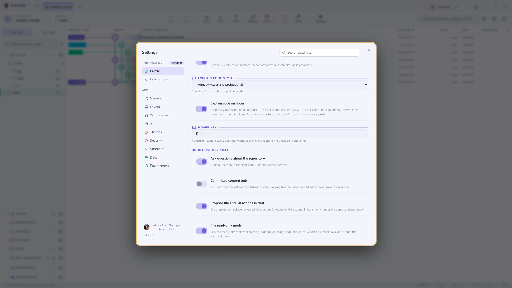
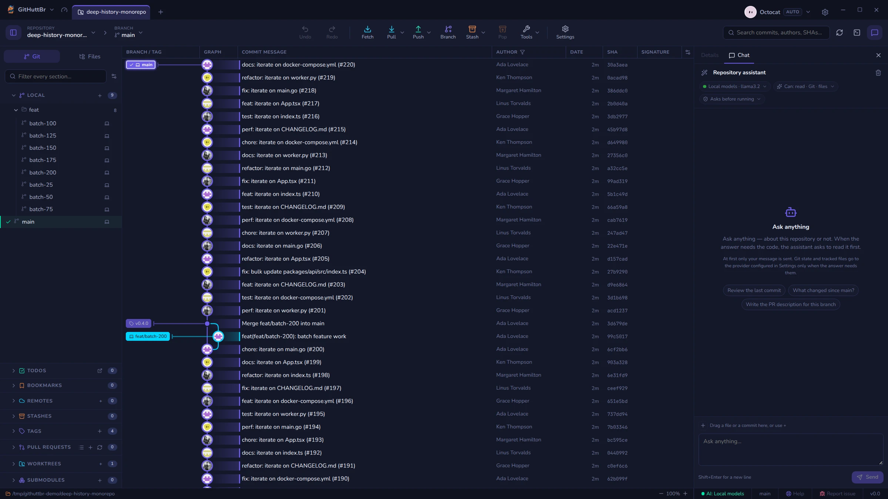

# Discussion du dépôt

Certaines questions sont plus rapides à poser qu’à chercher. *Où se fait
réellement le rafraîchissement du jeton ? Qu’a changé ce commit, en une phrase ?
Pourquoi ce fichier existe-t-il ?* La discussion du dépôt répond sur le dépôt
ouvert et montre les lignes sur lesquelles elle s’est appuyée.

C’est aussi une discussion d’IA ordinaire. Une salutation, une question générale
de programmation ou n’importe quoi d’autre reçoit une réponse directe du modèle,
sans lire le dépôt : elle ne regarde les fichiers que lorsque la question les
concerne.

Elle partage la colonne de droite avec **Détails** : les onglets du haut passent
de l’un à l’autre, sans que le graphe perde sa sélection.

## Ce qu’elle lit

Elle fonctionne comme n’importe quel chat : **c’est votre message qui est
envoyé**, avec à côté rien d’autre que le nom et la branche du dépôt — ni état
Git, ni liste de fichiers, ni contenu de fichier — et la réponse revient en
texte brut. Une salutation ou une question qui ne porte pas sur le dépôt reçoit
sa réponse tout de suite, en un seul appel, et rien du dépôt ne quitte votre
machine.

**Quand le dépôt entre en jeu.** Il est ouvert pour le modèle dans trois cas :

| Vous… | Ce qui se passe |
|------|--------------|
| Nommez un fichier suivi (`config.json`, `src/app.ts`) | Ce fichier est lu avant que le modèle réponde |
| Le dites en toutes lettres — « ce dépôt », « mes modifications », « non commité », « branche actuelle » | L’état Git et la liste des fichiers suivis sont envoyés |
| Posez une question dont le modèle estime qu’elle en a besoin | Il répond par une seule ligne `@repo`, et l’application lui ouvre le dépôt |

À partir de là, le modèle demande ce dont il a encore besoin au lieu de
deviner : des chemins exacts de la liste, des recherches littérales ou des
hachages de commits de l’historique récent. L’application les lit et repose la
question avec ce qu’ils ont donné. Cela arrive quatre fois au plus — chaque tour
est un appel de modèle supplémentaire que vous attendez — et au dernier elle
doit répondre avec ce qu’elle a. Ces réponses citent les extraits qu’elles ont
utilisés, et un fichier ou une ligne inventés sont une erreur de validation, pas
une réponse plausible.

Pendant l’attente, la ligne sous votre message dit ce qui se passe :
**Réflexion…** pendant que le modèle travaille, **Lecture des fichiers (N)…** ou
**Recherche dans le dépôt…** uniquement pendant que l’application lit vraiment
ce qu’il a demandé.

| Inclus | Exclu |
|---|---|
| Les fichiers suivis, tels qu’ils sont dans votre copie de travail | Les fichiers non suivis |
| Les diffs indexés et non indexés des fichiers suivis | Tout ce qui correspond à une règle d’exclusion, même suivi |
| Branche, avance/retard et liste des chemins modifiés | [Fichiers ressemblant à des secrets](security.md), binaires, chemins générés |

Lire la copie de travail permet de parler de modifications non validées. Cela
signifie aussi qu’elles quittent votre machine : le fournisseur configuré dans
[Fonctions d’IA](ai.md) les reçoit.

Une nuance : avec les [propositions d’actions](#exécuter-des-actions-depuis-la-discussion)
activées, les **noms** des fichiers non suivis sont inclus dans l’état du
dépôt — « indexe le nouveau fichier » en a besoin — mais leur contenu n’est
toujours jamais lu.

## Épingler du contexte

Le modèle décide de ce qu’il lit. Épingler, c’est passer outre : ce qui est
épinglé est lu **en premier** et prend la plus grande part du budget de contexte.

Quatre façons d’épingler, toutes vers la même rangée de pastilles au-dessus du
champ de saisie :

| Faites ceci | Vous obtenez |
|---|---|
| Cliquez une pastille suggérée | Le fichier ouvert dans la visionneuse, ou le commit sélectionné dans le graphe |
| Glissez une ligne de l’onglet **Fichiers** | Ce fichier |
| Glissez une ligne du **graphe des commits** | Ce commit — son message et son diff par blocs |
| **+** → *Choisir un fichier…*, ou glissez depuis le Finder/l’Explorateur | N’importe quel fichier du disque, y compris hors du dépôt |

Les pastilles restent épinglées pour les questions suivantes ; le `×` en retire
une, et effacer la conversation les retire toutes. Huit au maximum.

Un commit épinglé apporte son message et jusqu’à douze blocs de diff. Les blocs
touchant un chemin exclu sont retirés de ce diff, pas le commit entier.

## Paramètres

**Paramètres → IA → Discussion du dépôt** — sur l’IA générale, ou sur celle d’un
profil quand il en a une (la barre **Modification de** choisit laquelle, voir
[Une IA pour tous les profils](ai.md#une-ia-pour-tous-les-profils)) :

| Réglage | Effet |
|---|---|
| **Poser des questions sur le dépôt** | Désactivé, l’onglet, le bouton et la cible du raccourci disparaissent. Le reste de l’IA continue |
| **Contenu validé uniquement** | Répond depuis le dernier commit plutôt que la copie de travail : les modifications non validées ne quittent jamais la machine |
| **Proposer des actions sur les fichiers et Git** | Désactivé, la discussion redevient purement en lecture seule : plus de cartes d’actions ni de menu d’approbation |
| **Mode fichiers en lecture seule** | Activé, il bloque la création, la modification, le remplacement et la suppression de fichiers tout en gardant les actions Git disponibles. Activé par défaut |
| **Comment s’exécutent les actions proposées** | Le mode d’approbation — voir [Modes d’approbation](#modes-dapprobation). Les actions destructrices confirment quoi qu’il arrive |
| **Autoriser le chat à proposer des actions distantes** | Désactivé par défaut. Activé, il ajoute fetch, pull, push, l'ouverture d'une pull request et la soumission d'une pile |

Avec l’IA entièrement désactivée, la discussion disparaît avec elle : plus de
panneau proposant une réponse que rien ne peut produire.

Le fournisseur et le modèle qui répondent à la discussion se choisissent sur la
page **IA**, sous **Modèle par tâche** — voir [Fonctions IA](ai.md#modèle-par-tâche).

Le modèle de la discussion se change aussi depuis l’en-tête du panneau, à côté
du nom du fournisseur : même réglage, sans ouvrir les Paramètres.

Le bouton baguette à côté du titre du panneau ouvre l’**assistant de
configuration IA** — un parcours guidé qui génère des fichiers de configuration
d’assistant (instructions, agents, hooks) pour ce dépôt. Voir
[Fonctions d’IA](ai.md).

## Travailler avec les messages

Les messages sont du texte ordinaire. Sélectionnez n'importe quelle partie et
copiez-la, ou faites un clic droit sur une bulle : **Copier** prend la
sélection, **Copier le message** le message entier — une réponse est copiée
sous sa forme Markdown — et, si le clic a atterri sur un lien, **Copier le
lien** prend son adresse.

Les liens s'ouvrent dans votre navigateur par défaut, jamais dans GitHuttBr —
qu'il s'agisse des liens Markdown des réponses ou des adresses `https://`
écrites dans vos propres messages.

Quand un message mentionne une image — un chemin du dépôt comme
`docs/logo.png`, ou une URL se terminant par une extension d'image — survoler
la mention affiche un petit aperçu. Les chemins du dépôt sont lus depuis votre
arbre de travail ; une mention qui ne correspond pas à une image lisible
n'affiche simplement rien.

## Exécuter des actions depuis la discussion

Demandez un changement plutôt qu’un fait — *indexe les fichiers markdown,
valide ceci comme un correctif, mets la sortie du build dans les exclusions* —
et la réponse arrive avec une **carte d’actions**. Une conversation vide
propose quelques demandes d’exemple sous forme de pastilles sous
l’introduction ; en cliquer une remplit le champ de saisie, pour que vous
puissiez la modifier avant l’envoi. La carte liste les étapes concrètes que
l’assistant veut effectuer, une ligne par action, avec les boutons **Exécuter**
et **Ignorer**. Rien de ce que contient la carte n’a encore eu lieu ; le modèle
ne peut que proposer, et chaque proposition est vérifiée contre la copie de
travail avant même que vous la voyiez — une action nommant un fichier qui
n’existe pas est rejetée, pas affichée.

Le chat du dépôt peut proposer des modifications exactes, la création ou le
remplacement de fichiers entiers et leur suppression, puis des actions Git :
motifs d'ignorance, indexer, désindexer, commiter, remiser, abandonner, branche,
changement de branche, étiquette et — parce qu'on lui montre la liste des
branches et les commits récents — merge, rebase, revert et cherry-pick. GitHuttBr
calcule le diff dépliable en local. Les fichiers existants doivent provenir des
preuves lues ; les cibles risquées, secrètes, ignorées, générées, binaires,
périmées, trop grosses ou atteintes par lien symbolique sont refusées. Reset,
réécriture d'historique, suppression de branche et toute opération forcée
restent dans leur interface dédiée.

Un merge ou un rebase peut s'arrêter sur un conflit. Le cas échéant, l'exécution
s'arrête là, la carte marque la ligne en échec et conserve le compte de ce qui
a déjà tourné, et le bandeau de conflit prend le relais exactement comme pour la
même opération lancée depuis la barre d'outils.

Le lot entier est revérifié avant la première écriture et annulé si une étape
échoue. Avant un commit, GitHuttBr vérifie aussi que des changements sont indexés.
La carte marque chaque action terminée, échouée ou ignorée et conserve les
résultats partiels. Un appel séparé, sans actions, résume ensuite le résultat réel.

**Il peut aussi écrire `.githuttbr.json`.** Le chat reçoit la forme du
[fichier de configuration du dépôt](repo-config.md) : *ajoute des liens de
tickets pour JIRA-1234* ou *protège les branches de release* devient une action
de fichier écrite contre le vrai schéma, et non des clés plausibles que le
chargeur refuserait. Cela demande les actions de fichier activées — le même
interrupteur **Mode lecture seule des fichiers**.

**Les lignes qui méritent une image en ont une.** Un résumé d'une ligne suffit
pour « indexe deux fichiers » et pas du tout pour « ouvre quatre pull requests
sur une pile » : les lignes qui décrivent une forme la dessinent — la branche
qu'un push publie et son avance, les deux références d'un merge ou d'un rebase,
les commits qu'un revert ou un cherry-pick rejouerait avec leur sujet, la pull
request telle qu'elle sera, et une pile en échelle avec la base de chaque niveau
et ce que la soumission y ferait : ouvrir, recibler ou laisser tel quel.

### Actions qui quittent la machine

Récupérer, tirer, pousser, ouvrir une pull request et soumettre une pile sont
**désactivés par défaut**, derrière **Autoriser le chat à proposer des actions
distantes**. Publier du travail mérite un choix explicite, et avec le réglage
désactivé le modèle ignore jusqu'à l'existence de ces actions : il ne peut pas
en proposer une et se faire refuser, le défaut qui apprend aux gens à activer
des options sans les lire.

Une fois activé :

| Action | Fait |
|---|---|
| **Récupérer** / **Tirer** | Le fetch et le pull de la barre d'outils ; le mode de pull (merge, avance rapide seule, rebase) fait partie de la proposition |
| **Pousser** | Publie une branche vers un dépôt distant. **Jamais en force** : un push forcé n'existe pas dans le vocabulaire d'une proposition, donc il ne peut pas être proposé |
| **Ouvrir une PR** | Ouvre une pull request, brouillon ou non, contre l'origin du dépôt. La carte en garde le lien ensuite |
| **Soumettre la pile** | La soumission complète de la [pile de PR](stacks.md) : pousser chaque niveau, ouvrir ou recibler une pull request par niveau, écrire la section de navigation, enregistrer la pile GitHub |

Un push proposé passe d'abord les mêmes garde-fous que celui de la barre
d'outils : la confirmation de branche protégée, l'avertissement sur la
publication de [fichiers ressemblant à des identifiants](security.md) et la
liste de contrôle avant-push du dépôt. Ce sont des dialogues : on y répond avant
que le plan démarre, pas depuis l'intérieur.

### Annuler un plan

Un plan est approuvé en bloc, donc il s'annule en bloc. Avant la première action
capable de changer quoi que ce soit, GitHuttBr note où était la branche et prend
un instantané de l'arbre de travail ; la carte terminée propose alors **Annuler
le plan**. Elle ramène la branche à ce commit et restaure l'arbre, ce qui jette
ce que le plan a produit : elle demande donc confirmation et nomme le commit de
retour. Les pull requests ouvertes le restent — un dépôt distant n'est pas
quelque chose qu'un instantané local peut reprendre.

Avec **Exécuter automatiquement toutes les actions**, une modification de
fichier valide s’exécute aussitôt et la carte consigne l’action terminée :

Avec **Toujours demander**, le même type de modification reste en attente
jusqu’à ce que vous choisissiez **Exécuter** ou **Ignorer** :

### Modes d’approbation

Le menu au bouclier sous le champ de saisie (aussi dans **Paramètres → IA →
Discussion du dépôt**) décide de la façon dont une carte s’exécute — pour tous
les profils sur la même IA :

| Mode | Exécute |
|---|---|
| **Toujours demander** | Rien tant que vous n’avez pas pressé **Exécuter** sur la carte |
| **Exécuter automatiquement les actions sûres** | Les propositions faites uniquement d’opérations réversibles — indexer, désindexer, exclure, branche, étiquette — s’exécutent à l’arrivée ; le reste attend le bouton |
| **Exécuter automatiquement toutes les actions** | Chaque proposition s’exécute à l’arrivée, sauf les destructrices |

Une proposition qui **abandonnerait des modifications non validées demande
toujours d’abord**, dans tous les modes, et la confirmation nomme les fichiers
qui seraient perdus. La carte rapporte ce qui s’est réellement passé — combien
d’actions ont été exécutées, ou l’erreur qui les a arrêtées — et l’assistant est
informé du résultat : une question de suivi sait si son plan a été exécuté ou
ignoré.

### Corriger les erreurs avec l’assistant

Quand une opération git échoue et que la discussion IA est disponible, la
notification d’erreur gagne un bouton étincelle : il ouvre la discussion avec
l’échec collé dans le champ de saisie — « pourquoi cela a-t-il échoué et que
faire » tient en un clic. Le brouillon est modifiable ; rien n’est envoyé avant
que vous pressiez Envoyer.

## Ce qu’elle refuse

- **Les fichiers qui ressemblent à des secrets ne sont jamais lus**, épinglés ou
  non : la pastille revient marquée comme ignorée, avec la raison. Épingler ne
  contourne pas le [masquage des secrets](security.md).
- **Les binaires et les fichiers de plus de 512 Ko** venus de l’extérieur du
  dépôt sont ignorés de la même façon. À l’intérieur, les règles habituelles
  s’appliquent.
- **Elle n’écrit jamais d’elle-même.** Le modèle n’a aucun outil, seulement du
  texte : un changement arrive comme carte de proposition, ne s’exécute que
  selon [vos règles d’approbation](#modes-dapprobation), et une étape
  destructrice confirme toujours. Avec **Proposer des actions git dans la
  discussion** désactivé, elle ne propose même pas.
- **Les conversations ne vivent qu’en mémoire.** Chaque dépôt garde son fil ;
  quitter GitHuttBr les efface.
- **Les petits modèles locaux sont plus faibles sur les questions de dépôt.**
  Mesuré avec un modèle 3B : les questions générales reçoivent d’aussi bonnes
  réponses que dans son propre terminal, mais il peut ne pas demander le dépôt
  quand il le faudrait, et une longue réponse bâtie à partir de fichiers peut
  revenir tronquée. Nommer le fichier, ou dire « ce dépôt », fait que
  l’application l’ouvre quoi qu’il arrive. Un modèle de 7B ou plus fait
  nettement mieux.

## L’ouvrir

| Touches | Effet |
|---|---|
| Le bouton bulle dans la barre d’outils | Affiche ou masque l’onglet Discussion |
| <kbd>⌘⌥B</kbd> / <kbd>Ctrl+Alt+B</kbd> | Affiche ou masque tout le panneau droit |
| <kbd>Entrée</kbd> | Envoie le message |
| <kbd>Maj+Entrée</kbd> | Insère un saut de ligne |

Voir [Clavier et raccourcis](keyboard.md) pour le reste, y compris comment
réassigner les bascules de panneau.

**Voir aussi :** [Fonctions d’IA](ai.md) · [Sécurité et secrets](security.md) ·
[Wiki du dépôt](repo-wiki.md)
