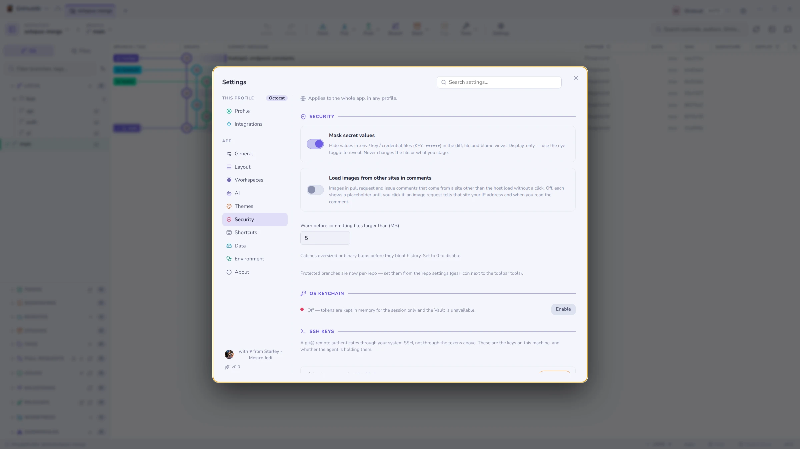

# Sécurité et secrets

Gitcito n'a **aucun backend**. Les seuls appels réseau vont vers votre hébergeur
Git et, si vous l'activez, vers votre fournisseur d'IA.

## Masquage des secrets

Les valeurs contenues dans `.env*`, `*.pem`, `*.key`, `id_rsa`, `credentials.*`
et consorts s'affichent en `KEY=••••••` dans les vues diff, fichier et blame :
un partage d'écran ou une capture ne peut donc pas les faire fuiter.
Le matériel de signature Apple en fait partie : `*.mobileprovision`,
`*.provisionprofile`, `*.p12` et les clés `*.p8` d'App Store Connect. Pas un
`*.cer` — un certificat est public par nature.

C'est **uniquement de l'affichage** : cela ne modifie jamais le fichier et ne
modifie jamais ce que vous indexez. Une bascule en forme d'œil les révèle vue par
vue. `.env.example`, `.sample` et `.template` sont traités comme des modèles, pas
comme des secrets.

## Des garde-fous avant les dégâts

| Garde-fou | Quand |
|---|---|
| **Fichier secret** | Vous validez quelque chose qui ressemble à un identifiant — avec un *Ignorer et ne plus suivre* en un clic |
| **Gros fichier** | Vous validez un blob surdimensionné (seuil dans Paramètres → Sécurité) |
| **Bruit de compilation** | Committer `xcuserdata/`, `DerivedData/` ou un `.DS_Store` — avec le même *Ignorer et cesser de suivre* en un clic |
| **Branche protégée** | Vous validez directement sur `main`/`master`, ou vous en poussez une en force |
| **Secrets suivis** | Vous poussez un dépôt qui *suit* un fichier secret — averti une fois par session |

## Le trousseau du système

Les jetons et les entrées du [coffre](vault.md) sont chiffrés avec le trousseau
de votre système (le `safeStorage` d'Electron), jamais avec une clé rangée dans
le fichier de réglages.

**Rien ne touche au trousseau tant que vous ne l'avez pas dit.** Avant même que
la boîte de dialogue d'autorisation du système ne puisse apparaître, Gitcito
explique ce qui va être stocké, ce qu'il ne peut pas faire (une application ne
relit jamais que l'entrée qu'elle a créée — vos autres mots de passe sont
inatteignables), et que dire non ne pose aucun problème : les jetons vivent alors
en mémoire pour la durée de la session seulement, le coffre reste fermé, et vous
pouvez activer tout cela plus tard dans **Paramètres → Sécurité → Trousseau du
système**.

Une installation neuve fait **zéro** appel au trousseau tant que rien n'a
réellement besoin d'être stocké.

Tant qu’il est désactivé, le champ du jeton dans Intégrations le signale — *Conservé seulement jusqu’à la fermeture de Gitcito : le trousseau du système est désactivé.* — avec un bouton **Activer** à côté. L’activer, depuis là ou d’ici, enregistre aussi les jetons déjà saisis pendant la session : inutile de les recoller.

### Linux sans trousseau

Sous Linux, le trousseau est un service de secrets — GNOME Keyring ou KWallet.
Quand aucun ne tourne, le système « chiffre » quand même, mais avec un mot de
passe fixe, identique sur toutes les machines : les jetons et les clés sont
brouillés, pas protégés. Paramètres → Sécurité le signale sous l'état du
trousseau — *Aucun trousseau n'est actif…* — pour que le mot *trousseau* ne
désigne jamais une protection qui n'existe pas.

Pour que rien de nouveau n'atterrisse dans un stockage que n'importe qui pourrait
débrouiller, un jeton saisi alors qu'aucun trousseau ne tourne n'est conservé
**que jusqu'à ce que vous quittiez l'application**. Le champ du jeton le dit —
*Conservé seulement jusqu'à la fermeture de Gitcito : aucun trousseau n'est
actif…* — sans bouton pour réessayer, car réessayer n'y changerait rien ; seul
un trousseau le peut. Les jetons enregistrés auparavant restent lisibles — vous
n'en perdez jamais l'accès — et effacer ou remplacer l'un d'eux supprime
toujours l'ancienne valeur du disque. Deux limites : la clé de l'IA générale
n'est pas déplacée vers son emplacement partagé (chaque profil continue de lire
la sienne), et le coffre enregistre toujours dans le stockage basique, car il
n'a pas de mode limité à la session. Installez ou déverrouillez un trousseau et
redémarrez Gitcito pour enregistrer à nouveau de nouveaux jetons.

## Importer des paramètres

**Paramètres → Import / Export** transfère paramètres, profils et thèmes d'une
machine à l'autre. L'export par défaut ne contient **aucun jeton ni aucune clé
d'API**, et importer un tel fichier ne touche jamais à ceux que vous avez
enregistrés — un jeton vide dans le fichier signifie « absent de ce fichier »,
pas « supprimer le mien ».

### Choisir ce qu'on importe

Un fichier de paramètres contient deux sortes de choses : ce qui *vous* suit
(profils, thème, raccourcis) et ce qui n'a de sens que sur la machine qui l'a
écrit (les dossiers où vivent vos dépôts, le chemin de votre terminal). Tout
appliquer sur un nouvel ordinateur remplit la barre latérale d'onglets qui ne
pointent nulle part. Donc, après avoir choisi le fichier (et saisi son mot de
passe, s'il en a un), une boîte de dialogue demande quelles parties importer.
Rien n'est appliqué avant que vous appuyiez sur **Importer** ; **Annuler**
laisse tout tel quel.

| Partie | Ce qu'elle contient |
|------|-----------------|
| **Profils et comptes** | Profils, identité Git, liens d'intégration, les réglages généraux d'IA et les images de profil — ainsi que les identifiants et le [coffre](vault.md), quand le fichier les contient |
| **Préférences de l'app** | Thème, langue, raccourcis, disposition, les couleurs du graphe et des icônes |
| **Dépôts et espaces de travail** | Onglets, espaces de travail, favoris, surnoms, images d'onglet, le profil utilisé par chaque dépôt, dossiers analysés, ainsi que les notes et wikis de chaque dépôt |
| **Programmes de cet ordinateur** | Terminal, éditeur externe, applications par défaut et le chemin des CLI d'IA |

Chaque partie indique combien d'entrées le fichier contient pour elle. Une
partie laissée décochée reste exactement telle qu'elle est sur cette machine.

**Les profils fusionnent avec les vôtres.** Un fichier venu d'un autre
ordinateur a rarement tous les profils de celui-ci — un compte ajouté sur le
portable Linux, un profil client qui n'existe que sur le Mac. **Profils et
comptes** ajoute donc les profils du fichier aux vôtres au lieu de remplacer la
liste. Avant l'import, la partie liste chaque profil et ce qui lui arrivera :

| Étiquette | Signification |
|-----|---------|
| **Mis à jour** | Le profil existe des deux côtés : l'identité, l'IA et l'image du fichier remplacent les vôtres, et ses serveurs s'ajoutent aux vôtres |
| **Nouveau** | Seul le fichier l'a : ajouté après les vôtres |
| **Conservé** | Seul cet ordinateur l'a : laissé exactement tel quel |

Deux profils sont « le même » quand ils partagent un id — c'est le cas du
premier profil de chaque installation. Quand aucun id ne correspond, c'est le
nom qui compte (sans tenir compte de la casse ni des espaces autour), et le
profil garde **l'id de cet ordinateur** : les dépôts qui lui sont liés, le
profil actif, ses identifiants enregistrés et son image restent rattachés. Le
profil actif ne change pas.

**Tout remplacer** est toujours là, pour une sauvegarde que vous voulez
retrouver exactement telle qu'elle était : seuls les profils du fichier
restent, et ceux que seul cet ordinateur possède sont listés barrés comme
**Supprimé**. Appuyer sur **Importer** demande alors une nouvelle fois, en les
nommant — ils partent avec leurs identifiants enregistrés et leur image, et
c'est irréversible. Avec **Tout remplacer**, le profil actif du fichier devient
le profil actif.

Limites : la correspondance se fait uniquement par id ou par nom exact — un
profil renommé d'un côté compte comme nouveau, et vous vous retrouvez avec les
deux. Un profil apparié prend les champs du fichier, avec trois exceptions pour
que rien de ce que seul cet ordinateur possède ne soit perdu : ses serveurs
GitHub Enterprise, GitLab et Bitbucket sont **ajoutés** aux vôtres (l'entrée du
fichier l'emporte sur un serveur présent des deux côtés) ; un jeton que le
fichier porte vide garde le vôtre — mais seulement pour la même instance, de
sorte qu'un jeton n'est jamais envoyé à un autre Forgejo, à un autre émetteur
GitLab ou à une autre organisation Azure ; et les identifiants empruntés au
gestionnaire d'identifiants de cette machine restent ceux de cette machine.

**Les choix par défaut sont une supposition tirée de votre disque.** Avant
d'afficher la boîte de dialogue, Gitcito vérifie si les dossiers de dépôts du
fichier existent ici. Si aucun n'existe, le fichier vient d'un autre
ordinateur : **Dépôts** et **Programmes** démarrent décochés, chacun avec la
raison — les chemins des programmes sont listés, pour que vous voyiez qu'ils
appartiennent à une autre machine. S'ils existent, c'est le même ordinateur (une
sauvegarde restaurée, par exemple), tout démarre coché et une note verte le dit.
Un fichier sans aucun dépôt est jugé sur les chemins de ses programmes :
**Programmes** démarre coché seulement quand chacun d'eux existe ici.

Quand la vérification elle-même échoue, rien n'est deviné : **Dépôts** et
**Programmes** démarrent décochés sans verdict, un bouton **Vérifier à
nouveau** interroge encore le disque, et **Dépôts** ne peut pas être importé
tant qu'une vérification n'a pas réussi. Les autres parties, si.

**Traduire les chemins.** Cochez **Dépôts** sur un fichier dont les dossiers
manquent et un encadré **Traduire les chemins** s'ouvre. À gauche, le dossier
que les dépôts du fichier ont en commun (`/home/you/code`) ; à droite, où se
trouve ce dossier sur cet ordinateur, prérempli à partir de votre dossier
personnel (`/Users/you/code`). Les deux sont modifiables — la supposition peut
être fausse, et quand Gitcito ne trouve aucun dossier commun il les laisse vides
pour que vous les saisissiez. Une barre compte, au fil de la saisie, combien de
dépôts ont désormais un dossier ici, avec quelques-uns listés — en vert ceux
trouvés, en rouge ceux qui manquent encore. L'échange emporte avec lui le
surnom, l'image d'onglet et le profil du dépôt, ainsi que ses notes, ses wikis
et ses entrées du coffre, pour qu'il n'y ait rien à reconfigurer à la main.

Le pied de la boîte résume — *Importer 3 parties sur 4 · 31 dossiers* (les
racines d'analyse et le dernier dossier de clonage comptent aussi, d'où
« dossiers » et non « dépôts ») — et **Importer** reste désactivé tant
qu'aucune partie n'est cochée.

**Importer reste aussi désactivé quand une traduction ne trouve rien.** Avec
**Dépôts** coché et pas un seul dossier trouvé sous le nouveau préfixe,
l'import laisserait vos dépôts vides ; corrigez les chemins ou décochez la
partie.

Limites de la traduction :

- C'est **un préfixe échangé contre un autre**. Les dépôts placés sous un autre
  dossier dans le fichier, ou organisés autrement ici, ne sont pas trouvés ; il
  n'y a pas de correspondance dépôt par dépôt.
- Avec une traduction active, **seuls les dépôts qui ont alors un dossier sont
  importés**. Les autres sont laissés de côté — pas ajoutés comme onglets cassés
  — et la boîte de dialogue vous dit combien.
- Les programmes ne sont jamais traduits : `/usr/bin/code` n'a pas
  d'équivalent fiable sur un autre système. Laissez cette partie décochée et
  choisissez-les dans les Paramètres.
- Vider l'un ou l'autre préfixe importe les chemins tels que le fichier les
  contient.

**Pendant l'import**, la boîte de dialogue ne peut pas être fermée. Si une
étape ultérieure échoue — les notes des dépôts, le coffre, les images de profil
— la boîte reste ouverte, nomme l'étape, et **Poursuivre l'import** reprend à
cet endroit sans réécrire les étapes précédentes.

### Identifiants dans le fichier

Un fichier exporté avec l'option cochée contient des identifiants. Fusionner
les profils les **ajoute** toujours : ceux du fichier sont rangés sous le
profil correspondant, en remplaçant ceux du même compte, et tous les autres
identifiants enregistrés restent — les effacer contredirait le fait de garder
vos profils. Avec les profils sur **Tout remplacer**, un tel fichier affiche
aussi le choix, juste sous **Profils et comptes** :

| Choix | Vos identifiants enregistrés |
|--------|------------------------|
| **Ajouter aux miens** | Ceux du fichier sont ajoutés, en remplaçant ceux du même compte ; tous les autres sont conservés |
| **Tout remplacer** | Deviennent exactement ceux du fichier — chaque jeton et clé d'API enregistré que le fichier n'a pas est supprimé |

Le choix s'applique avec les profils : avec **Profils et comptes** décoché,
aucun identifiant n'est importé ni supprimé. Un fichier exporté sans l'option
n'en a aucun à proposer, quoi que vous cochiez. **Tout remplacer** demande une
nouvelle fois quand vous appuyez sur **Importer**, en précisant que chaque jeton
et clé d'API enregistré que le fichier n'a pas sera supprimé ; **Annuler** à ce
moment-là laisse la boîte de dialogue telle quelle.

**Tout remplacer exige le trousseau.** Avec le trousseau désactivé ou
indisponible, les anciens jetons resteraient dans le stockage chiffré et
reviendraient au prochain lancement ; Gitcito refuse donc : il le dit, et rien
n'est importé. Même chose tant que les jetons enregistrés ne peuvent pas être
lus : ils reviendraient dès qu'ils pourraient l'être. **Ajouter aux miens**
fonctionne toujours, en gardant les jetons du fichier pour la session.

**La limite :** les identifiants appartiennent à un profil. Un profil que
l'import supprime emporte ses jetons enregistrés, quel que soit votre choix.

## Partager sans risque

Le [partage sécurisé](secure-share.md) exporte les réglages, les entrées du
coffre ou des espaces de travail entiers sous forme de **bundle chiffré** — les
secrets ne sont inclus que si vous cochez la case.

**Voir aussi :** [Coffre](vault.md) · [Partage sécurisé](secure-share.md)
