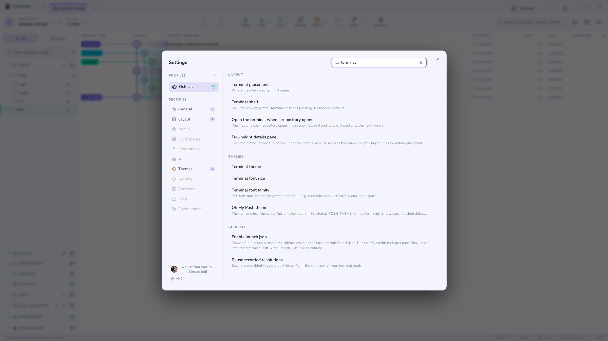

# Thèmes et apparence

Thèmes intégrés — Gitcito, Nord, Dracula, Solarized, GitHub, Monokai,
Midnight, Contrast et Daltonic — chacun avec une variante claire et une variante
sombre.

- **Clair, sombre, ou suivre le système**, changé à chaud.
- Des **thèmes personnalisés**, et des thèmes **générés par l'IA** à partir d'une
  consigne.
- Une **taille de police de code** ajustable.
- Un **style de graphe** distinct : palette de couloirs, style des angles,
  densité des lignes et épaisseur des traits, avec un aperçu en direct sous forme
  de mini-graphe.

## Trouver un réglage

Les Paramètres s'étendent sur de nombreuses pages, et l'option que vous cherchez est rarement
là où vous l'attendez : vous savez qu'elle existe, pas sur quelle page. Le champ
de recherche dans l'en-tête des Paramètres, à côté du bouton de fermeture,
cherche dans toutes les pages à la fois.

À mesure que vous tapez, la partie droite liste les réglages correspondants,
regroupés par page — chacun avec son nom, sa description d'une ligne et la page
où il se trouve. La barre latérale estompe les pages sans résultat et affiche un
compteur sur celles qui en ont.

- La recherche porte sur le nom du réglage, sa description et le nom de la
  page. Majuscules et accents sont ignorés, et chaque mot tapé doit apparaître :
  « police terminal » ne garde que les réglages de police du terminal.
- Elle cherche dans la langue de l'interface et en anglais en même temps : avec
  l'application en français, taper « token » ou « font » trouve toujours le
  réglage.
- Cliquez sur un résultat, ou appuyez sur **Entrée** pour le premier, pour
  ouvrir sa page (et le bon onglet dans Thèmes — Thème ou Graphe), défiler
  jusqu'au réglage et le mettre en évidence un instant.
- **Échap** efface la recherche ; un second **Échap** ferme les Paramètres.

Elle cherche dans les noms et les descriptions, pas dans les valeurs que vous
avez choisies. Les listes de serveurs par hébergeur d'Intégrations (GitHub
Enterprise Server, GitLab autogéré, Bitbucket Data Center) ouvrent la page
Intégrations ; c'est à vous de choisir l'onglet de l'hébergeur. Les raccourcis
clavier ne sont pas indexés un par un — la recherche trouve la page Raccourcis,
dont l'éditeur les liste.

## Disposition

Barre latérale à gauche ou à droite, panneaux redimensionnables partout, une
barre latérale repliable pour quand le graphe mérite toute la fenêtre, et un
placement du terminal par dépôt.

**Voir aussi :** [Le graphe des commits](graph.md) · [Profils](profiles.md)
