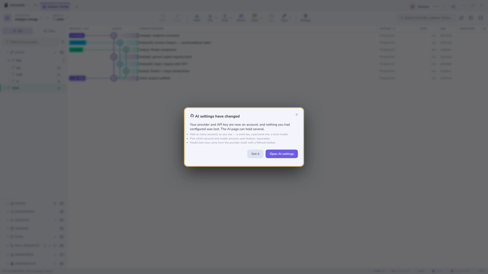

# תכונות AI

כל תכונת AI היא **אופציונלית** וכבויה עד שתגדירו ספק. שום דבר לא נשלח לשום מקום
עד שתבקשו משהו מסוים.

## בינה מלאכותית אחת לכל הפרופילים

הבינה המלאכותית מוגדרת פעם אחת, ב**הגדרות ← AI**, וכל [פרופיל](profiles.md)
משתמש בה: לפרופיל שתיצרו אחר כך כבר יש בינה מלאכותית, בלי להוסיף שוב חשבון. הדף
מפרט כל פרופיל והאם הוא עוקב אחרי **הבינה המלאכותית הכללית** הזו.

פרופיל יכול במקום זאת להשתמש ב**בינה מלאכותית משלו** — פרופיל עבודה שחייב לעבור
דרך החשבון של החברה, מטעמי עלות או מדיניות נתונים, או שכותב את ה-commits שלו
אחרת. בדף **פרופיל** של אותו פרופיל, תחת *הבינה המלאכותית של הפרופיל הזה*,
החליפו את **כללית** ל**משלו**: היא מתחילה כהעתק של כל הבינה המלאכותית הכללית —
חשבונות, מפתחות והעדפות — ומכאן והלאה כל זה שייך רק לו. חזרה ל**כללית** מסירה
אותה, אחרי אישור, ומשאירה את הבינה המלאכותית הכללית כפי שהייתה.

פרופיל משתמש בבינה מלאכותית אחת **בשלמותה**: הכללית או זו שלו, אף פעם לא תערובת.
החשבונות והמודלים, *וגם* האופן שבו הבינה כותבת ומה מותר לצ׳אט לעשות, מגיעים
מאותו מקום, כך ששינוי סגנון ה-commit בבינה המלאכותית הכללית משנה אותו לכל פרופיל
שעוקב אחריה.

כל בינה מלאכותית מוגדרת בדף האחד הזה. הסרגל **עריכה של** בראש הדף בוחר של מי: של
הבינה המלאכותית הכללית, או הבינה של פרופיל מסוים (*הבינה המלאכותית של עבודה*).
**הגדרת הבינה שלו** בדף הפרופיל, או **עריכת הבינה שלו** ברשימת הפרופילים, פותחים
את הדף ישר עליה. דף הפרופיל עצמו רק מראה באיזו בינה מלאכותית הפרופיל משתמש ומה
עונה — העורך אף פעם לא נמצא בו, וגם לא אף אפשרות AI משלו.

מתחת לחשבונות, אותו דף מחזיק את האופן שבו הבינה הזו **כותבת** ומה מותר לה לעשות,
בחלקים:

| חלק | מכיל |
|---|---|
| **הודעות קומיט** | סגנון הקומיט — Conventional,‏ Gitmoji וכרטיס ככרטיסיות עם שורת דוגמה, והשאר תחת „סגנונות נוספים” — „יצירת תיאור לקומיט”, שורת השותף לכתיבה, **כללים נוספים לקומיטים** ותצוגה מקדימה |
| **הסבר וריחוף** | סגנון ההסברים, *הסבר על קוד במעבר עכבר* ומקש השינוי שלו |
| **התנגשויות וענפים** | סגנון פתרון התנגשויות, סגנון שמות ענפים, כל אחד עם דוגמה לתוצאה |
| **צ׳אט המאגר** | האם הצ׳אט פעיל, מה הוא קורא, אילו פעולות מותר לו להציע — ראו [צ׳אט המאגר](repo-chat.md#הגדרות) |

שורה מעל הסעיפים אומרת של מי ה-AI שאתם עורכים ועל מי הוא חל: *בינה מלאכותית
כללית · חלה על עבודה ואישי*, או ה-AI העצמאי של פרופיל אחד.

**כללים נוספים לקומיטים** — „הוראות מותאמות אישית” עד גרסה 4.60 — מתווספים רק ליצירת הודעות קומיט: הצ׳אט, ההסברים, הסקירות ושמות הענפים לא קוראים אותם. התצוגה המקדימה היא דוגמה קבועה, לא קריאה למודל: היא מראה את צורת הסגנון שנבחר, לא את מה שהבינה המלאכותית תכתוב לשינוי שלכם.

מתג הסגנון במלחין ובוררי המודל והאישור של הצ׳אט כותבים לאותה בינה מלאכותית
שהפרופיל קורא: הכללית, או זו של הפרופיל.

שדרוג מגרסה שבה לכל פרופיל הייתה בינה מלאכותית משלו לא מאבד דבר: הבינה של
הפרופיל שבשימוש הופכת לבינה המלאכותית הכללית, וכל פרופיל אחר שהבינה שלו הייתה
שונה שומר אותה כבינה משלו.

**שדרוג מגרסה 4.59 או קודמת**, שבה העדפות הכתיבה נשמרו בכל פרופיל: פעם אחת,
ההעדפות של הפרופיל שבשימוש (או, אם יש לו בינה משלו, של הפרופיל הראשון על הבינה
הכללית) עוברות לבינה המלאכותית הכללית. פרופילים עם בינה משלהם שומרים את שלהם.
**המגבלה:** אם שני פרופילים על הבינה הכללית כתבו באופן שונה — פרופיל עבודה
ב-`ticket` ופרופיל אישי ב-`conventional` — שניהם כותבים עכשיו כמו זה שהועבר. כדי
לשמור על ההבדל, תנו לאחד מהם בינה משלו והגדירו שם את הסגנון שלו מחדש.

## ספקים

**חשבון** הוא דרך אחת להגיע למודל: ספק, היכן פונים אליו, וכיצד הוא מאמת. אפשר
להגדיר כמה חשבונות והם חיים זה לצד זה — מפתח עבודה, מפתח אישי, מודל מקומי, ו־CLI
שכבר התחברת אליו.

ההגדרות המוכנות מכסות את **OpenAI, Anthropic, Google Gemini, OpenRouter, Groq,
Mistral** ו־**Ollama** (מקומי לחלוטין), וכן כל נקודת קצה תואמת OpenAI.

**מפתח לעולם לא יוצא מהמחשב הזה לא מוצפן.** חשבון עם מפתח פונה לנקודת הקצה שלו
דרך `https://`, או דרך `http://` רגיל רק במחשב הזה (`localhost`,‏ `127.x`,‏
`::1`). קריאה שהייתה שולחת את המפתח דרך `http://` למארח אחר נדחית לפני שמשהו
יוצא, ואומרת זאת. נקודת קצה בלי מפתח — Ollama במחשב אחר ברשת שלכם — ממשיכה לעבוד
דרך `http://`.

‏Anthropic משתמשת ב־API משלה `/v1/messages` במקום בקריאה בצורת OpenAI, ולכן מודלי
Claude באמת עובדים במקום רק להיראות כך. אל Gemini פונים דרך נקודת הקצה של Google
התואמת ל־OpenAI.

### הוספה ועריכה של ספק

ספק שנשמר חצי מלא היה מלכודת שקטה: מפתח ריק יכול היה להגיע לשימוש, ושום
דבר לא ענה. לכן שום דבר בכרטיס הזה לא נשמר בזמן ההקלדה.

**הוספת ספק** פותח כרטיס המסומן **טיוטה · לא נשמרה**, עם מסגרת מקווקוות.
מלאו ספק, מפתח, נקודת קצה ומודל, ובחרו **בדיקה ושמירה**. GitHuttBr
קודם מבקש את רשימת המודלים של הספק עם המפתח הזה — אותה בקשה של
**הבאת מודלים** — ושומר רק כשהוא עונה. תראו **מחובר · N מודלים**, והספק
מצטרף לרשימה כ־**מוכן**.

כשהבדיקה נכשלת, הכרטיס מציג **לא ניתן להתחבר** עם הסיבה של הספק
(מפתח שנדחה, `401`; שרת שלא רץ) ו־**שום דבר לא נשמר.** תקנו את השדה ובדקו
שוב, בחרו **לשמור בכל זאת** כדי להשאיר אותו כמו שהוא — אז הוא מופיע
כ־**לא מגיב** — או **ביטול**, שלא משאיר זכר.

עריכת ספק שמור עובדת באותה דרך. פס מודיע **שינויים שלא נשמרו — שום דבר לא משתנה עד שתשמור**, וכל שדה
ששיניתם מסומן **· שונה**. **לבטל שינויים** מחזיר את
הערכים השמורים; **בדיקה ושמירה** בודק ושומר. בחירת ספק אחר, הוספת ספק
או פתיחת **שימוש במינוי שלי** כשיש שינויים ממתינים שואלת **לשמור את השינויים ב„…”?** —
**שמירה**, **לבטל שינויים** או **להמשיך לערוך**. סגירת
ההגדרות משאירה את הטיוטה בזיכרון, כך שהיא שם כשתחזרו; היא אף פעם לא נכתבת
לדיסק.

המפתחות נשמרים בדיוק כמו קודם, במחזיק המפתחות, ורק בשעת השמירה. שגיאה של ספק
מוצגת כשהמפתח וכל מה שנראה כמו אסימון מוסתרים.

| סוג ספק | מה **בדיקה ושמירה** בודק |
| --- | --- |
| מפתח API או שרת מקומי (Ollama, נקודת קצה מותאמת) | מבקש את רשימת המודלים; הצלחה פירושה שנקודת הקצה ענתה עם המפתח הזה |
| מנוי (Codex, Claude Code) | שולח את הנחיית הבדיקה הקצרה שמתוארת בהמשך, מהמכסה של התוכנית שלכם |
| CLI מקומי | מחפש את הפקודה ב־`PATH`; נתיב שהוקלד נשמר בלי בדיקה |

### תגי מצב

לכל ספק ברשימה יש תג אחד, שנגזר ממה שהדף כבר יודע — הבדיקה האחרונה, או רשימת
המודלים שהוא הביא בכל מקרה. שום דבר לא נבדק ברקע.

| תג | משמעות |
| --- | --- |
| **מוכן** | הבדיקה או רשימת המודלים האחרונה הצליחה |
| **לא מגיב** | הניסיון האחרון נכשל; הסיבה בשורה שמתחת, עם **לבדוק שוב** |
| **אין מפתח** | הספק צריך מפתח API ואין לו |
| **לא נבדק** | שום דבר עוד לא שאל אותו — מנוי עד שייבדק, או רשימה שלא הובאה |

**המגבלה:** תג עדכני רק כמו הבדיקה האחרונה שלו. ספק שהפסיק לענות לפני שעה נשאר
**מוכן** עד שמשהו ישאל אותו שוב — בחרו **בדיקת חיבור**
בכרטיס שלו כדי לוודא. **CLI מקומי** עם נתיב שהוקלד נשאר
**לא נבדק**, כי להוכיח שהוא עובד היה עולה הנחיה.

### הספק שבשימוש

ספק אחד עונה לכל משימה שאין לה ספק משלה תחת **מודל לכל משימה**. השורה שלו
מסומנת **בשימוש** — תווית מלאה ושוליים בצבע ההדגשה — ונשארת במקומה ברשימה.
ל-AI הכללי ולפרופיל עם AI משלו יש לכל אחד ספק משלו בשימוש; הרשימה משנה את זה
שאתה עורך עכשיו.

לכל ספק שמור אחר יש כפתור **השתמש** בקצה השורה, ליד התג שלו. לחיצה אחת מכניסה
אותו לשימוש ושומרת מיד: איזה ספק עונה זו בחירה ולא עריכה, ולכן היא לא מחכה
ל**בדיקה ושמירה**. הכרטיס של אותו ספק לא נפתח, וכרטיס עם שינויים שלא נשמרו
שומר עליהם.

**המגבלה:** **השתמש** לא בודק כלום. אפשר להכניס לשימוש ספק שמסומן **אין מפתח**
או **לא מגיב** — בכוונה, לפני שמתקנים את המפתח — והתג שלו ממשיך לומר זאת;
משימת ה-AI הבאה תיכשל מהסיבה של אותו ספק. לטיוטה אין **השתמש**: היא לא ספק
עד שנשמרת.

### ה-AI בשימוש, משורת המצב

פרופיל עם AI משלו מתעלם מהספק שה-AI הכללי משתמש בו: העברת ה-AI הכללי לספק אחר לא משנה דבר בפרופיל הזה, ומחוץ להגדרות שום דבר לא אמר זאת. שורת המצב בתחתית המאגר אומרת זאת עכשיו. הכפתור **AI:** _ספק_ מציג את הספק שעונה עבור הפרופיל הפעיל, עם נקודה למצבו — ירוקה **מוכן**, אדומה **לא מגיב**, ענברית **אין מפתח**, אפורה **לא נבדק**.

לחיצה עליו פותחת חלונית קטנה:

| חלק | מה הוא מציג |
| --- | --- |
| כותרת | הפרופיל הפעיל, והאם הוא **עוקב אחרי ה-AI הכללי** או **יש לו AI משלו** |
| שורה לכל ספק | כל ספק שמור של אותו AI, עם המודל והמצב; ספק שלא מגיב מציג את הסיבה בשורה שנייה |
| **בשימוש** / **השתמש** | הספק שעונה עכשיו, ומעבר בלחיצה אחת בכל אחד מהאחרים |
| **הגדרת AI** | פותח את **הגדרות ← AI** |
| **שימוש ועלות** | פותח את הלשונית *אנליטיקה* בהגדרות המאגר |

**השתמש** כותב למקום שממנו הפרופיל קורא את ה-AI שלו. בפרופיל שעוקב אחרי ה-AI הכללי הוא משנה את ה-AI הכללי — ולכן כל פרופיל שעוקב אחריו; בפרופיל עם AI משלו הוא משנה רק אותו. משימות עם ספק משלהן שומרות עליו. **Esc** סוגר את החלונית, והכפתור מוסתר כל עוד ה-AI כבוי.

**המגבלות:** הנקודה נגזרת מרשימת המודלים שהאפליקציה הביאה בכל מקרה (נשמרת עד יום) ואינה בודקת דבר, כך שספק שהפסיק לענות עדיין עשוי להציג **מוכן** — בדיקת החיבור בהגדרות היא הדרך לוודא. עד שההגדרות נפתחות, החלון לא מחזיק את המפתחות עצמם, ולכן ספק בלי מפתח עשוי להציג שם **לא נבדק** או **לא מגיב** במקום **אין מפתח**. כמו **השתמש** בהגדרות, המעבר לא בודק את הספק שהוא מעביר לשימוש.

### שימוש במנוי במקום במפתח API

ב־**הגדרות ← AI** בחרו **שימוש במינוי שלי**. ב־[הפעלה הראשונה](first-run.md),
כרטיס **המנוי שלי** בשלב ה-AI מוצא את Claude Code או Codex ובודק אותו בצעד אחד,
וחוזר להגדרה הזו עצמה כשאף אחד מהם לא נמצא. בחרו את התוכנית שבה אתם משתמשים, ואז
פתחו **תיעוד** להוראות ההתקנה של הספק. אחרי ההתקנה בחרו **התחברות אל ChatGPT
(Codex)** או **התחברות אל Claude (Claude Code)**. ה-CLI של הספק פותח את דף
הכניסה שלו בדפדפן ושומר סשן משלו. סשן מינוי קיים משמש שוב. **ביטול** עוצר חיבור
ממתין. כניסה שנמשכת יותר משלוש דקות נעצרת ואפשר לנסות שוב.

| תוכנית | CLI נדרש | כניסה מהמסוף |
| --- | --- | --- |
| ChatGPT עם גישה ל-Codex | Codex CLI | `codex login` ובחירה ב-ChatGPT |
| Claude עם גישה ל-Claude Code | Claude Code | `claude auth login` ובחירה בחשבון המינוי |

החיבור גם בודק את הסשן. אם נכנסתם מהמסוף, בחרו **בדיקת החיבור**. GitHuttBr בודק
את שיטת הכניסה של ה-CLI ושולח הנחיית בדיקה קצרה מתיקייה זמנית ריקה. הבקשה נספרת
במכסת הספק. אחרי **מחובר** בחרו **הוספת ספק**. החשבון הראשון של ה-AI הכללי מוגדר
**בשימוש**. בהגדרה קיימת בחרו **השתמש** בשורה שלה או הקצו פיצ'רים בודדים למטה.
כדי לדלג על ההגדרה בהפעלה הראשונה, בחרו **דילוג, בלי AI** וחזרו להגדרות כשתהיו
מוכנים.

אם GitHuttBr לא מוצא את ה-CLI, התקינו אותו או הזינו את הנתיב המלא לקובץ ההפעלה
ובדקו שוב. אם הכניסה פגה או שה-CLI משתמש במפתח API, היכנסו עם חשבון המינוי. אם
הגעתם למגבלת שימוש, חכו עד שמכסת הספק תתאפס.

להגדרה ידנית, בחרו בספק **CLI מקומי** כדי לקבל תשובה מ־CLI של סוכן שכבר מותקן
ומחובר במחשב הזה — ‏`claude`,‏ `gemini`,‏ `codex` או `devin`. ‏GitHuttBr מריץ את
התוכנית עם ההנחיה שלכם וקורא את תשובתה; אין מפתח API להדביק ואין אסימון שנשמר.

‏GitHuttBr מריץ רק פקודה שאתה עצמך הגדרת כחשבון, ותמיד עם רשימת ארגומנטים ולא דרך
מעטפת, כך ששום דבר ב־diff או בשם ענף לא יכול להתפרש כפקודה.

כל קריאה מפעילה את ה-CLI כשתיקיית העבודה שלו היא המאגר, כך ש-CLI של סוכנים כמו
Devin יכולים לפתוח את הקבצים ששאלתם עליהם במקום לענות בעיוורון. פיצ'רים בלי מאגר
(יצירת ערכות נושא) מריצים אותו מהתיקייה של האפליקציה עצמה.

> **זה לא פרטי יותר ממפתח API.** ההנחיות שלך עדיין מגיעות לאותו ספק, תחת החשבון
> שלך, בדיוק כמו עם מפתח. מה שמשתנה הוא החיוב וההתקנה, לא היעד של הטקסט.

אם הפקודה אינה ב־`PATH` שלך, הקלד את הנתיב המלא שלה בחשבון.

### מודל לכל משימה

תחת **מודל לכל משימה**, כל יכולת — הודעות commit, צ'אט, הסבר קוד, סקירת
PR, פתרון התנגשויות, ויקי, ערכות נושא — יכולה להצביע על חשבון ומודל משלה. השאר
שורה על **הספק שבשימוש** כדי לעקוב אחר הספק המסומן **בשימוש**. מודל זול להודעות
commit ומודל חזק לצ'אט היא החלוקה המקובלת.

### הודעת שדרוג

בשדרוג מגרסה שקדמה לחשבונות זה מוצג פעם אחת. הספק והמפתח שהיו לך הופכים לחשבון הראשון; אין מה להגדיר מחדש ביד.

## מודלים

רשימות המודלים מגיעות מהספק עצמו ונשמרות במטמון ליום; **שליפת מודלים** מרעננת
אחת מיד. מתחת לרשימה GitHuttBr אומר מהיכן היא הגיעה — חי, מהמטמון (עם המועד), או
מרשימת הגיבוי המובנית ומדוע.

הרשימה מסוננת למודלים שמסוגלים לענות על בקשת צ'אט, כך שמודלי הטמעה, דיבור ותמונה
נשארים בחוץ. כל שדה מודל מקבל גם טקסט חופשי, כך שמודל בתצוגה מקדימה, פריסה פרטית
או תגית Ollama שהורדה זה עתה תמיד שמישים, גם אם הספק אינו מציג אותם.

ספק שעדיין לא נתת לו מפתח, או שאינו זמין, נסוג לרשימה מובנית קטנה במקום לתפריט
ריק.

אף ספק אינו מפרסם רשימה מדורגת או מסוננת, ולכן העיצוב הוא של GitHuttBr: תצלומי מצב עם תאריך מתקפלים אל המודל שהם תצלום שלו (`gpt-4o` מכסה את `gpt-4o-2024-08-06`), והשאר מסודר מהחדש לישן ולא לפי האלפבית. **הצג את כל המודלים** בתחתית הרשימה מחזיר את כל מה שהספק שלח.

## מה זה יכול לעשות

| תכונה | מה אתם מקבלים |
|---|---|
| **הודעת קומיט** | תקציר (וגוף לבחירתכם) מתוך הדיף שבסטייג׳, בסגנון שבחרתם |
| **הסבר על הקובץ הזה** | הסבר בשפה פשוטה בפאנל צדדי — רגיל, תמציתי, כאילו אני בן חמש… ואפילו פיראט |
| **ריחוף להסבר** | החזיקו <kbd>⇧</kbd> והצביעו על מזהה כדי לקבל הסבר בשורה אחת, ובנוסף את השורות שהוא נשען עליהן |
| **עריכת AI של הבחירה** | בחרו שורות בקובץ, תארו את השינוי, והמודל כותב מחדש רק את השורות האלה בטיוטת העורך |
| **פתרון התנגשויות** | מציע מיזוג לתוך הפלט הניתן לעריכה — לעולם אינו מחיל אוטומטית |
| **סקירת בקשת משיכה** | מסכם דיף ומסמן סיכונים, כשכל אחד מעוגן ב־`path:line` אמיתי |
| **תיאור בקשת משיכה** · **שמות ענפים** | מנוסחים מהקומיטים ומהדיף של הענף |
| **ערכות נושא** · **פלטות לגרף** | נוצרות מתוך הנחיה |
| **העלאה חכמה לסטייג׳** | הצעות למה ששייך לקומיט הזה |
| **[צ׳אט המאגר](repo-chat.md)** | שאלות מעוגנות ושינויי קבצים שנסקרו, ואחריהם פעולות Git מאומתות |
| **אשף תצורת ה‑AI** | מייצר קובצי תצורה לעוזר (הנחיות, סוכנים, הוקים) עבור המאגר — כפתור השרביט בכותרת פאנל הצ׳אט |

### עריכה של השורות שבחרתם בלבד

בתצוגת הקובץ, גררו על השורות שאתם רוצים לשנות ולחצו **עריכת AI…** (או לחצו לחיצה
ימנית על שורה ובחרו בה מהתפריט). פס בתחתית מציג את הטווח שנבחר ומקבל את ההוראה
שלכם — „שנה את שם המשתנה הזה”, „הוסף בדיקות null”, „תרגם את המחרוזות האלה”.
המודל רואה את השורות שנבחרו ועוד מעט הקשר סביבן, ומחזיר רק את התחליף לטווח הזה,
שנוחת ב**טיוטת העורך** ולא בדיסק. סוקרים אותו שם ושומרים או מבטלים דרך זרימת
העריכה הרגילה, כך ששום דבר לא נכתב עד שתחליטו. זה עובד עם כל backend מוגדר, לא
רק עם CLI של סוכנים, כי התשובה היא טקסט ולא קריאה לכלי. המגבלות: הוא כותב מחדש
טווח רציף אחד בכל פעם, לא יכול ליצור או למחוק קבצים שלמים, ובחירה שחוצה כמה
hunks של diff נדחית — בחרו בתצוגת הקובץ במקום.

## מעוגן, לא מנחש

הסקירה רואה את הדיף כ**קטעים מתויגים** ורשאית לצטט רק את התוויות האלה; GitHuttBr
אחר כך מפענח כל תווית לקובץ ולשורה אמיתיים. מודל שממציא מיקום **נדחה ונשאל
שוב**, ולכן הממצאים תמיד מצביעים על קוד שקיים.

ריחוף להסבר קורא רק חלון ממוספר סביב הטוקן — ובתוך דיף, רק את הקטעים הנראים על
המסך — ולכן כשהגדרה חיה במקום אחר הוא אומר זאת במקום להמציא אותה. התשובות נשמרות
במטמון לכל גרסת קובץ.

[צ׳אט המאגר](repo-chat.md) עובד באותו אופן: מותר לו לצטט רק את הקטעים שקיבל,
והבקשה הדו-שלבית בוחרת אותם מרשימת הקבצים המנוטרים של Git עצמו ולא מכל דבר
שהמודל כותב. כשהוא מציע שינוי, GitHuttBr מאמת פעולות קבצים מדויקות, מחשב את
ה-diffs שלהן מקומית, ואז מריץ את פעולות ה-Git הבאות לפי מדיניות האישור שהוגדרה.

**קובצי סודות מוסתרים לעולם לא נשלחים.** וגם לא קבצים שכללי הסתרת הסודות חלים
עליהם — כולל קובץ שהצמדתם לצ'אט ידנית, שנדחה עם סיבה במקום להיקרא.

## כשמודל איטי, או מפסיק לענות

מודל מקומי על מחשב נייד עשוי לקחת דקה להודעת קומיט, ומודל ש"חושב" לפני שהוא עונה
לוקח עוד יותר — אבל שרת שנסגר באמצע בקשה לא אמור להשאיר אתכם לבהות בסמן מסתובב.

| מה קורה | מה אתם רואים |
|---|---|
| אין תשובה אחרי 30 שניות | *"{חשבון} מגיב לאט מהצפוי."*, עם **להמשיך לחכות**, **להשתמש ב-{חשבון אחר}** ו**ביטול**. להמשיך לחכות שואל שוב כעבור דקה אם הבקשה עדיין רצה |
| שרת מקומי (Ollama, LM Studio, llama.cpp…) נסגר בזמן שהוא עובד | תוך שניות ספורות: *"{חשבון} לא מגיב. האם הוא עדיין פועל?"*, עם כפתור לכל חשבון אחר שמוכן לשימוש, ו**ביטול** |
| השרת כבר היה סגור כששאלתם | אותו דבר, מיד |

**להשתמש ב-{חשבון אחר}** מבטל את הבקשה ושולח את אותה בקשה לחשבון ההוא, עם מודל
ברירת המחדל שלו — הודעת הקומיט, הסקירה או תשובת הצ׳אט מגיעות כאילו שאלתם שם.
ההגדרות שלכם לא משתנות: הבקשה הבאה הולכת שוב לחשבון שבחרתם עבור אותה משימה.

זה חל על כל תכונות הבינה המלאכותית — הודעות קומיט, צ׳אט, סקירה, הסבר, התנגשויות,
ערכות נושא, הוויקי — כי כולן עוברות דרך אותה קריאה.

## מגבלות

- **רק שרתים מקומיים נבדקים אם נסגרו.** ספק ענן שנופל נכשל עם השגיאה שלו; קריאת
  ענן שפשוט איטית מקבלת את ההודעה *לאט מהצפוי* כמו כל קריאה אחרת. שרת מקומי
  עסוק, ולא סגור, נחשב חי: רק חיבור שנדחה או שנותק מסיים את הקריאה מוקדם.

- רשימות הגיבוי המובנות מתיישנות בין גרסאות. לשם כך קיימת השליפה החיה; הגיבוי
  מכסה רק את המקרה שבו שליפה אינה אפשרית.
- סינון רשימת הספק למודלי צ'אט נעשה לפי שם, ולכן מודל צ'אט בעל שם חריג עלול
  ליפול. במקרה כזה הקלד אותו בעצמך.
- חשבון CLI אינו יכול לדווח על צריכת אסימונים אלא אם ה־CLI עושה זאת, ולכן נתוני
  השימוש והעלות בהגדרות יספרו קריאות כאלה בחסר.
- תשובות דרך CLI איטיות מקריאת API ישירה: התוכנית פותחת מפגש שלם בכל בקשה.
- המפתחות נשמרים לכל חשבון במחזיק המפתחות של המערכת. מחיקת חשבון מוחקת את המפתח
  שלו — הוא שואל קודם, ואין ביטול.
- חזרה לגרסה מלפני הבינה המלאכותית הכללית מאבדת את המפתחות של הבינה הכללית: הגרסה
  ההיא לא יודעת היכן הם שמורים ומשליכה אותם כשהיא שומרת. החשבונות נשארים; הקלידו
  את המפתחות שוב. בינה מלאכותית משלו של פרופיל אינה מושפעת.

**ראו גם:** [צ׳אט המאגר](repo-chat.md) · [ויקי המאגר](repo-wiki.md) · [אבטחה וסודות](security.md)
