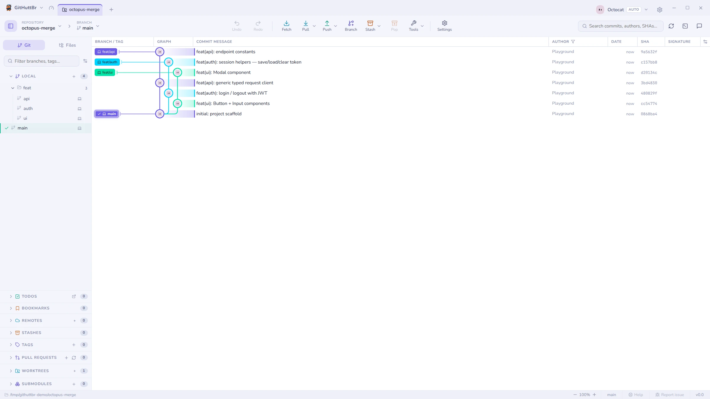
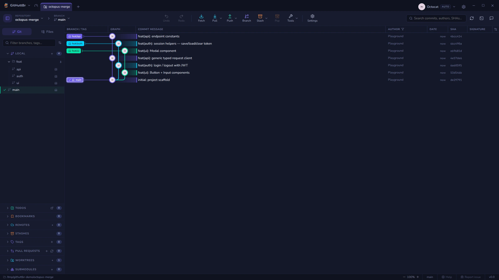
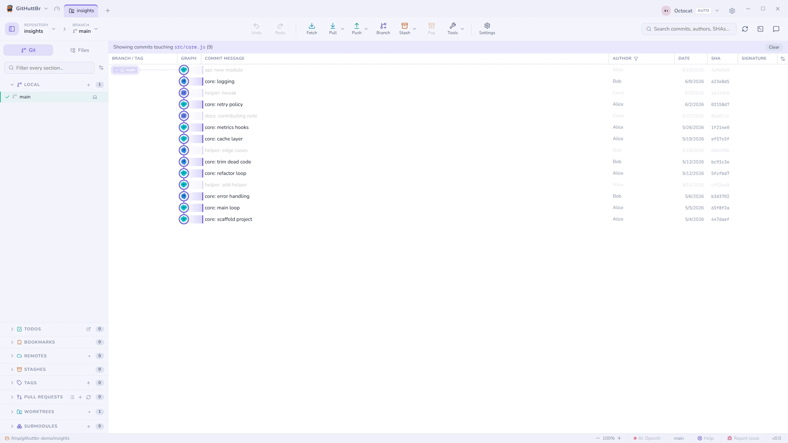
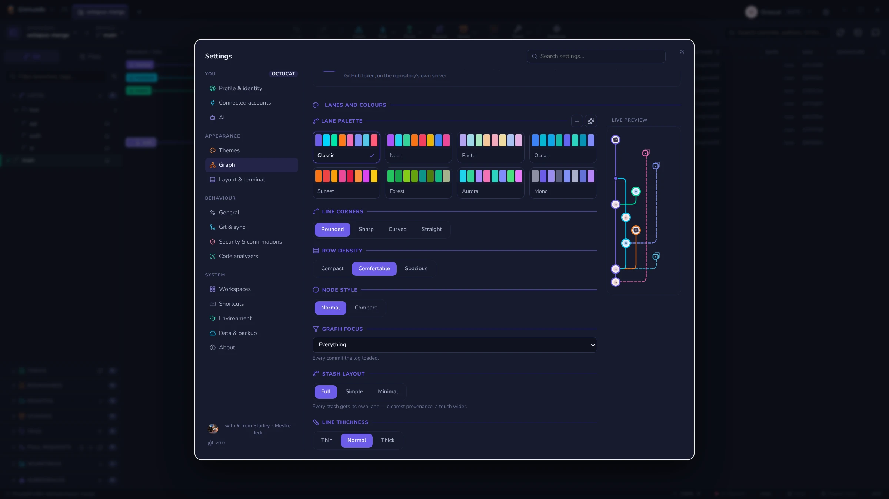
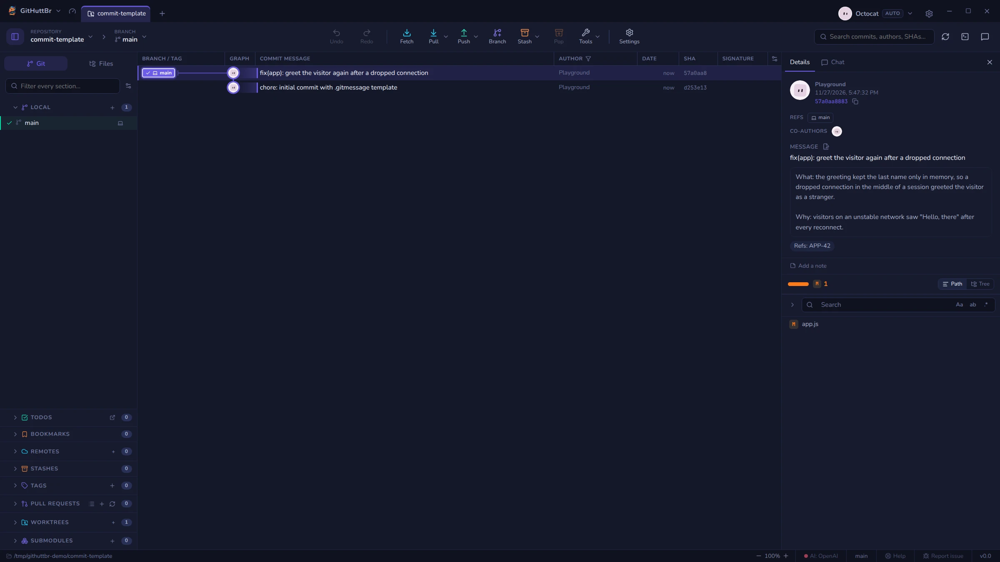
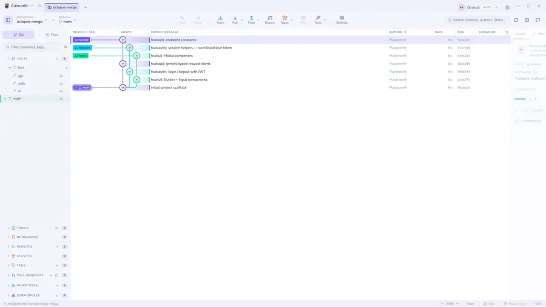

# גרף הקומיטים

ענפים, מיזוגים ומיזוגי תמנון משורטטים כמו שצריך, בבהיר או בכהה. הרינדור מתבצע
בחלון, ולכן מאגר עם מאה אלף קומיטים נגלל כמו מאגר עם מאה.

| | |
|---|---|
|  |  |

## תנועה בגרף

- <kbd>↑</kbd> <kbd>↓</kbd> (או <kbd>j</kbd> <kbd>k</kbd>) מהלכים על הבחירה.
- לחיצה עם <kbd>⌘</kbd>/<kbd>Ctrl</kbd> מכניסה ומוציאה קומיט מ**בחירה מרובה**;
  לחיצה עם <kbd>⇧</kbd> לוקחת טווח. כשכמה נבחרו, לחיצה ימנית מאפשרת לעשות להם
  צ׳רי־פיק אל הענף הנוכחי, למעוך רצף רציף, לייצא טלאי מאוחד אחד, או להעתיק את
  ה־SHA שלהם.
- קומיטים שהגיעו ב**הבאה או במשיכה האחרונה** שלכם מסומנים כחדשים. אלה שעוד לא
  נכנסו לענף הפעיל נשארים שקופים־למחצה עד שמשיכה מביאה אותם.
- לחיצה ימנית על קומיט נותנת **תיקון**, **ביטול**, **איפוס לקומיט…**
  ו**הצגה ב-GitHub**, לצד צ׳קאאוט, צ׳רי־פיק, ריוורט, ענף, תגית והעתקה. פעולות
  לא בטוחות נשארות גלויות ומושבתות.

## לגרום לו להראות מה שאתם רוצים

- **מיקוד הגרף** קובע כמה היסטוריה מצוירת — הגדרות ← **גרף**, או
  תפריט גלגל השיניים בכותרת הגרף. *הכול* מצייר הכול; *היסטוריה ליניארית* (הורה
  ראשון) משאירה רק את הגזע; *הסתר ענפים שמוזגו* משאיר את הגזע ואת הענפים שטרם
  מוזגו; *מצב סולו* משאיר את הענף שלך, הענפים המסומנים בכוכב וענף ברירת המחדל.

  הוא מסנן רק את מה שהיומן כבר טען. *הסתר ענפים שמוזגו* סומך על התשובה של git
  עצמו ל"כבר כלול בענף הנוכחי", ולכן מעבר לענף אחר משנה מה נעלם — והוא שומר כל
  קומיט שעדיין מצביעה עליו תגית או רפרנס שאינו מזהה, כלומר בדיוק מה שענף שנמחק
  משאיר אחריו. *היסטוריה ליניארית* ו*מצב סולו* גסים יותר: תגית או מחסן שיושבים על
  קומיט שהם מסתירים נעלמים איתו.

- **סינון לפי נתיב**: לחיצה ימנית על קובץ או תיקייה ← *סינון הגרף לפי הנתיב
  הזה*, ורק הקומיטים שנגעו בו נשארים דלוקים.

- **עמודות**: הצגה, הסתרה, שינוי גודל וסידור מחדש של עמודות הענף, ההודעה, המחבר,
  התאריך, ה־SHA, החתימה והפריסה.
- **סגנון**: הגדרות ← **גרף** — פלטת המסלולים (8 מובנות, מותאמת
  אישית, או שנוצרה בעזרת AI), סגנון הפינות, צפיפות השורות ועובי הקווים, עם תצוגה
  מקדימה חיה של מיני־גרף.

- **מה שורה מציגה**: הגדרות ← גרף ← **תוכן השורה** — **תאריכים יחסיים**, **הצגת תמונות פרופיל** ו**שימוש בתמונות פרופיל מ־GitHub** (מה כל אחת מבקשת מהרשת, ראו [תמונות פרופיל](avatars.md)). **טעינה אוטומטית בגלילה** נמצא ליד כמויות ההיסטוריה. **קיבוץ refs לפי קידומת** מקבץ את רשימות הסרגל הצדדי, לא את הגרף, ולכן הוא בהגדרות ← פריסה ומסוף.

כל הגדרות הגרף נמצאות בדף הזה; עד 4.60 הן היו מפוצלות בין כללי ללשונית גרף בערכות נושא.

## איפה יושבים המחסנים

מחסן מצויר כשורה משלו, תלוי מהקומיט שממנו נלקח על דרבן מקווקו כדי שלא יזיז את
הגזע. הוא מונח בשורה **ממש מעל קומיט האב הזה**, לא בחריץ שחותמת הזמן שלו הייתה
מזכה אותו.

הסימן שלו הוא קופסת ארכיון במסגרת מנוקדת — אותו סמל ארכיון שמשמשים רשימת
המחסנים, לוח הפקודות וכותרת הפרטים, כדי שהגרף יקרא למחסן כמו שאר האפליקציה.
המסגרת המנוקדת היא מה שמפריד אותו מקומיט: יושב שורה מעל האב, הצורה צריכה לשאת
«זה לא חלק מהענף».

מחסן כמעט תמיד חדש יותר מהקומיט שעליו הוא יושב, לכן סדר לפי תאריך היה מציף
אותו בין קומיטים לא קשורים ומותח את החבל על פני חצי הגרף. האב הוא השורה היחידה
שמחסן באמת קשור אליה, ולכן הוא נשאר לידה.

הגבול: מחסן שקומיט האב שלו אינו בחלון הטעון — גזום, או מעבר לסוף היומן — אין
לו עוגן, והוא חוזר לסדר תאריכים עד שהאב נטען. *היסטוריה ליניארית* ו*מצב סולו*
משליכים מחסן שהם משליכים את אביו, כפי שצוין למעלה.

## פרטי הקומיט

בחירת קומיט מציגה את הקבצים שהשתנו בו (בעץ או שטוח), את המחבר, ה־SHA, השותפים
לכתיבה, ואת החתימה שלו. הכותרת מעל רשימת הקבצים מפצלת את הספירה לפי סוג, באותם צבעים כמו הגליפים בשורות. העבירו את הסמן בשביל הסך הפשוט. הפניות `#123` ו־`@mentions` הופכות אוטומטית לקישורים אל
המארח שלכם.

רשימת הקבצים נבחרת בבחירה מרובה במחוות הרגילות (לחיצה עם
<kbd>⌘</kbd>/<kbd>Ctrl</kbd>, לחיצה עם <kbd>⇧</kbd>,
<kbd>⇧</kbd>+<kbd>↑</kbd>/<kbd>↓</kbd>). לחיצה ימנית על הבחירה ← *שחזור {n}
קבצים לעץ העבודה* מביאה את הקבצים בדיוק כפי שהיו בקומיט הזה: אחרי אישור אחד
עותקי העבודה נדרסים, בלי לגעת ב-HEAD או באינדקס.

**התיאור** של הקומיט — כל מה שמתחת לכותרת — מוצג מיד מתחתיה, ושורות ששוברו ביד מתחברות כדי להתאים לחלונית (פריטי רשימה ושורות מוזחות נשארים כפי שנכתבו). תיאור ארוך מציג את השורות הראשונות ו**הצגת הכול**. הטריילרים ש־git שומר בסוף הופכים לתגיות: *מחבר שותף: שם* לכל `Co-authored-by`, ואחרים כמו `Refs:` כפי שנכתבו. קומיט בלי תיאור מציג רק את הכותרת.

המחבר, ההודעה וחיפוש הקבצים נשארים במקומם בזמן גלילת הקבצים; תיאור ארוך מאוד נגלל בנפרד מעליהם.

**ראו גם:** [blame והיסטוריית קובץ](blame.md) · [חיפוש](search.md) · [מכונת הזמן](time-machine.md)
