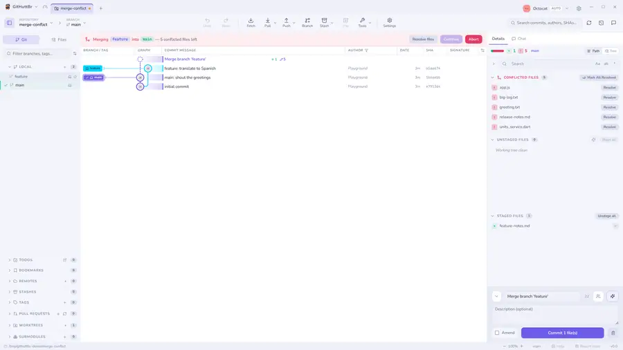
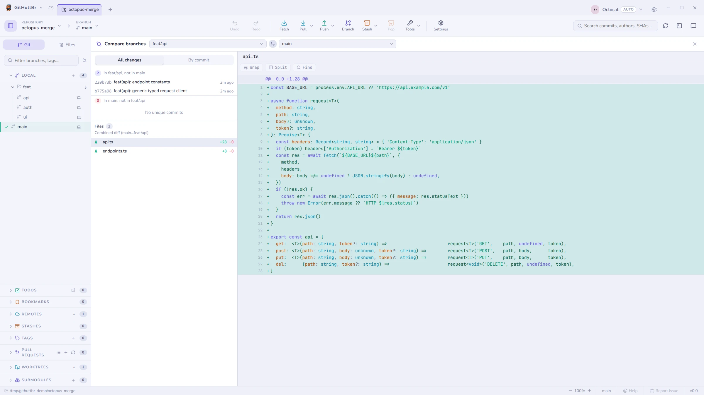
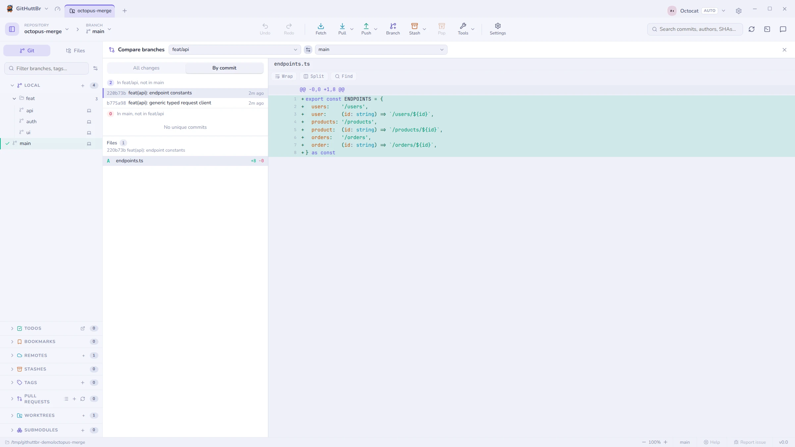
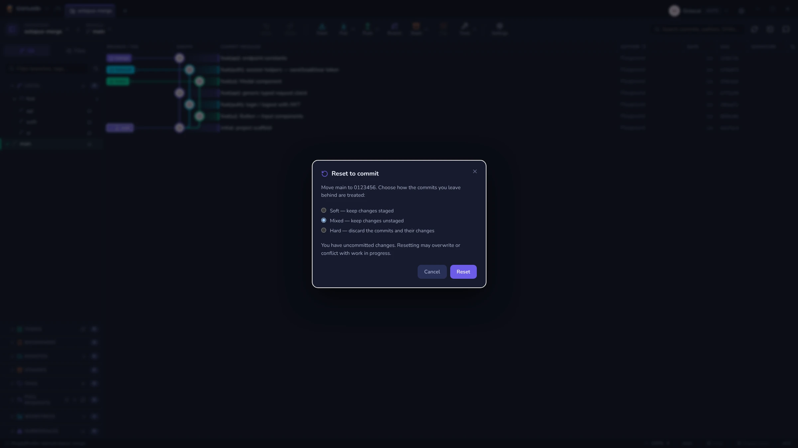

# מיזוג וריבייס

## מתוך סרגל הצד

לחיצה ימנית על ענף נותנת **מיזוג אל הנוכחי** או **ריבייס על גבי** — או
**מיזוג עם אפשרויות…** כשהמיזוג הפשוט הוא זה שכל הזמן משתבש; ראו
[אפשרויות מיזוג](merge-options.md).

## גרירת ref אחד על גבי אחר

התנועה המהירה ביותר באפליקציה: הרימו ענף והפילו אותו על אחר. Gitcito פותח תפריט
קטן של מה שההפלה הזו יכולה לומר, ולא עושה דבר עד שתבחרו.

זה עובד ב**שני** המקומות שבהם refs מוצגים — שורות הענפים, הרימוטים והתגיות
בסרגל הצד, וגם **תגי ה־refs הצבעוניים בגרף** עצמו. גררו ביניהם בכל צירוף; יעד
ההפלה מודגש בזמן שאתם מרחפים מעליו.

| הפלה | פירושה |
|------|-------|
| **הרצה קדימה של {target} עד {source}** | מקדם את היעד עד המקור בלי checkout — מופיע רק כשהיעד הוא ענף מקומי שמפגר אחרי המקור ואינו הענף הנוכחי כאן או ב[עץ עבודה](worktrees.md) אחר |
| **מיזוג {source} → {target}** | עושה צ׳קאאוט ליעד וממזג את המקור לתוכו |
| **ריבייס {source} על {target}** | מריץ מחדש את הקומיטים של המקור מעל היעד |
| **rebase אינטראקטיבי של {source} על {target}…** | פותח את מתכנן ה-[rebase האינטראקטיבי](rebase.md) — כשהמקור הוא הענף הנוכחי |
| **דחיפת {source} אל {target}** | דוחף את המקור אל הענף המרוחק של היעד (`origin/main`) — אף פעם לא בכפייה, ולכן ה-remote דוחה כל מה שאינו הרצה קדימה; שואל קודם, ומריץ אותן בדיקות סודות כמו בכל דחיפה |
| **איפוס {source} אל {target}…** | פותח את חלון האיפוס — soft‏, mixed או hard, עם מה שכל אחד שומר — כשהמקור הוא הענף הנוכחי |
| **יצירת בקשת משיכה {source} ← {target}…** | פותח את טופס [בקשת המשיכה](hosting.md) עם שני הענפים — כשה-remote נמצא אצל ספק נתמך |
| **דחיפת {source} ופתיחת בקשת משיכה אל {target}…** | מחליף את *יצירת בקשת משיכה* כשהמקור עדיין לא ב-remote: דוחף אותו ואז פותח את הטופס |
| **השוואה** | פותח את [ההשוואה](#השוואה-בין-כל-שני-refs) — לא משנה דבר |

**התפריט מציע רק את מה ש־git יכול לעשות.** מיזוג יוצר קומיט על היעד, ולכן היעד
חייב להיות ענף מקומי — אי אפשר למזג לתוך תגית או לתוך ref שעוקב אחרי רימוט.
ריבייס כותב מחדש את המקור, ולכן המקור חייב להיות ענף מקומי. הפילו תגית על ענף
מרוחק וכל מה שיוצע לכם הוא *השוואה*, כי זה באמת כל מה שיש.

ריבייס מבקש אישור קודם: הוא נותן לכל קומיט שמורץ מחדש hash חדש, ומשמעות הדבר
דחיפה כפויה אם הענף כבר פורסם. גם דחיפה שואלת: כל מי שמושך את היעד מקבל את
הקומיטים שלו, ואת הדחיפה אי אפשר לבטל מתוך Gitcito. מיזוג לא שואל — הוא רק
מוסיף. מיזוג וריבייס חוזרים אחורה ב**ביטול** אחד.

## גרירת commit אל ענף

גררו שורת commit מהגרף אל התג של **ענף מקומי**:

| שוחרר על | מציע |
|----------|------|
| הענף הנוכחי | **Cherry-pick** של ה-commit לכאן; **Reset** של הענף אליו (חלון האיפוס, שמסביר מה כל מצב שומר) |
| ענף מקומי אחר | **מעבר אליו ו-cherry-pick**; **העברת הענף** אל ה-commit (`git branch -f`) |

העברת ענף מבקשת אישור קודם: commits שרק אותו ענף הגיע אליהם לא יהיו אחר כך על אף ענף.
ביטול מחזיר את הענף למקומו. ענפי מעקב מרוחקים ותגיות אינם מקבלים commit, כי git לא מזיז
אותם כך, וענף שכבר מצביע על ה-commit לא מציע דבר. אותה גרירה אל צ'אט ה-AI עדיין מוסיפה את
ה-commit כהקשר.

## מיזוג

קידום מהיר כשאפשר, או כפיית קומיט מיזוג כשרוצים שהטופולוגיה תתועד. אם זה מתנגש,
תנחתו ב[פותר](conflicts.md).

## השוואה בין כל שני refs

ראו מה ענף יביא, או מה חסר בו, לפני שממזגים אותו. בחרו ref להשוואה ובסיס — ענף,
תגית או SHA גולמי, עם כפתור החלפה — וההשוואה תיפתח בחלונית המרכזית במקום הגרף,
עם הקומיטים שקיימים רק בכל צד.

| מצב | מציג |
|------|-------|
| **כל השינויים** | כל מה שה-ref המושווה הוסיף מאז שנפרד מהבסיס, כ-diff משולב אחד. |
| **לפי קומיט** | קומיט אחד בכל פעם. לחצו על קומיט באחת הרשימות כדי לראות רק את השינויים שלו — גם מתוך *כל השינויים*. |

הקבצים שהשתנו מופיעים משמאל עם השורות שנוספו ונמחקו, ורק הקובץ שבחרתם מצויר, כך
שהשוואה ענקית נגללת כמו קטנה. **יצירת PR…** מעבירה את הקומיטים ל-pull request
חדש; <kbd>Esc</kbd> או כפתור הסגירה חוזרים לגרף.

מגבלות: קומיט מיזוג מוצג מול ההורה הראשון שלו, וקובץ בינארי מופיע ברשימה בלי
diff טקסטואלי. אם פותר הקונפליקטים או עורך הקומיטים פתוח, סגרו אותו קודם — אחרת
ההשוואה תיפתח מאחוריו.

זמין מסרגל הצד (השוואה לענף הנוכחי), בגרירת ענף אל ענף אחר, מתפריט הכלים, ממכ״מי
הקונפליקטים והעמיתים, או דרך <kbd>⌘K</kbd>.

## צ׳רי־פיק, ריוורט, איפוס

צ׳רי־פיק וריוורט חיים בתפריט ההקשר של הגרף, כמו שהיה תמיד. **איפוס** הוא
כניסה אחת — **איפוס לקומיט…** — במקום שלושה פריטי soft/mixed/hard גולמיים
שסתרו זה את זה.

תיקון, ביטול ואיפוס יושבים בראש תפריט הקומיט הבודד ונשארים **גלויים גם כשהם
אינם בטוחים**: הם מושבתים, עם תיאור צף שמסביר למה. ביטול מיועד רק ל-HEAD שטרם
נדחף; תיקון מותר גם על HEAD שפורסם, אבל מזהיר שתידרש דחיפה כפויה. איפוס מגיע
רק לאבות קדמונים מקומיים ועוד הקומיט המפורסם הראשון — לא להיסטוריה ישנה
שרירותית.

תיבת האיפוס הופכת את המצב למפורש:

| מצב | תוצאה |
|------|--------|
| **Soft** | להשאיר את השינויים באינדקס |
| **Mixed** | להשאיר את השינויים מחוץ לאינדקס |
| **Hard** | לזרוק את הקומיטים ואת השינויים שלהם |

‏Hard לעולם אינו נבחר מראש. עץ עבודה מלוכלך מקבל אזהרה נוספת, כי איפוס עלול
לדרוס עבודה בעיצומה או להתנגש בה. **הצגה ב-GitHub** שוכנת לצד פעולות ההעתקה
ונפתחת רק לקומיטים שפורסמו ברימוט של github.com.

בחרו קודם כמה קומיטים וצ׳רי־פיק יחיל את כל הבחירה, לפי הסדר.

## לפני שאתם ממזגים משהו

[מכ״ם ההתנגשויות](conflict-radar.md) סורק כל ענף מול בסיס ואומר לכם מי מהם ייכנס
לקרב, בלי לעשות צ׳קאאוט לכלום.

**ראו גם:** [ריבייס אינטראקטיבי](rebase.md) · [ערימות ענפים](stacks.md) · [מכ״ם התנגשויות](conflict-radar.md)
