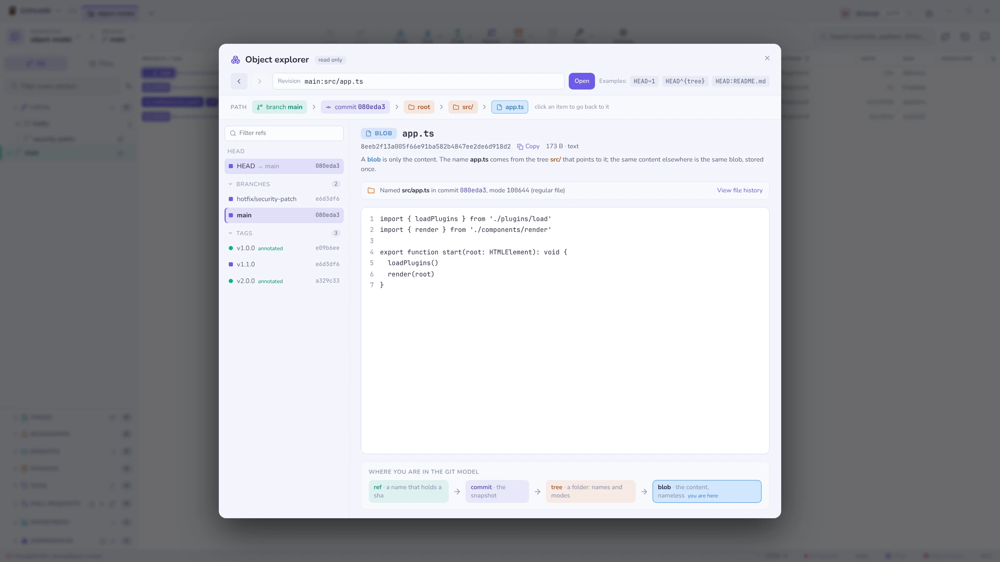

# סייר האובייקטים

ל־git יש מוניטין של מסובך. כמעט כולו נובע מכך שלא רואים את המודל: **ארבעה סוגי
אובייקט, ומצביעים**. ברגע שאתם יכולים ללחוץ על קומיט, לנחות על העץ שלו, ולגלות
שהקובץ שלכם *הוא* בלוב עם שם שעץ נתן לו, הפורצלן מפסיק להיות קסם.

`⌘K` ← **סייר האובייקטים**. שום דבר בעמוד הזה לא יכול לשנות בייט — כל קריאה
מאחוריו היא קריאה בלבד.

## ארבעת האובייקטים

| אובייקט | מה זה | מה הוא יודע |
|--------|----|-------|
| **blob** | ה*תוכן* של קובץ | כלום. לא את שמו, לא את נתיבו, לא את ההיסטוריה שלו |
| **tree** | רשימת תיקייה | שמות, מצבים, וה־sha של כל בלוב או עץ בן |
| **commit** | תמונת מצב אחת | העץ שלו, ההורים שלו, המחבר, המקמט, ההודעה |
| **tag** | תגית מבוארת | האובייקט שהיא מצביעה עליו, המתייג, הודעה |

ההפתעה לרוב האנשים היא בשורה הראשונה. **לבלוב אין שם.** שני קבצים עם תוכן זהה
בכל מקום בהיסטוריה שלכם הם אותו בלוב, שמור פעם אחת. השם חי בעץ שמצביע עליו — ולכן
git עוקב אחרי תוכן ולא אחרי קבצים, ולכן שינויי שם מזוהים ולא מתועדים.

**ref** — `refs/heads/main`, `refs/tags/v1.0`, `HEAD` — הוא סתם קובץ שמכיל sha.
זה כל מה ש״הסתעפות היא זולה״ אומר.

## הליכה

העמודה השמאלית מציגה כל הפניה, מקובצת כפי ש־git מקבץ: HEAD (עם `→ main` כשהוא על
ענף), ענפים, תגים ומרוחקים, ולכל קבוצה מונה. מרוחקים מתחילים מקופלים. סימון מרובע
הוא הפניה לקומיט, ועיגול ירוק הוא תג **מוער**. המסנן מצמצם את כל הקבוצות בבת אחת.
לחיצה על הפניה מביאה אל האובייקט שהיא נותנת לו שם; השורה הזו נשארת מודגשת כל עוד
אתה הולך ממנה.

משם, הכול דלת:

- **קומיט** מראה על מה הוא **מצביע** — עץ השורש שלו עם מספר הפריטים, וכל אב עם
  הכותרת שלו — ואחר כך מחבר ומבצע הקומיט (*זהה למחבר* כשהם תואמים) וההודעה.
- **עץ** הוא טבלה של שם, מצב, אובייקט וגודל, תיקיות קודם. כל מצב כתוב במילים:
  *קובץ*, *בר הרצה*, *תיקייה*, *קישור סימבולי*, *תת-מודול*. תיקייה אומרת כמה פריטים
  יש בה; קישור סימבולי, לאן הוא מצביע.
- **blob** מציג את הטקסט עם מספרי שורות (רק ההתחלה, כשהוא גדול), או אומר בבירור
  שהוא בינארי. כשמגיעים אליו דרך עץ, פס אומר איך הוא נקרא שם — *נקרא src/app.ts
  בקומיט 07c6f3d, מצב 100644 (קובץ רגיל)* — עם קישור להיסטוריית הקובץ.
- **תג מוער** מצביע על האובייקט שהוא נותן לו שם ורושם את יוצרו.

### הנתיב

הפס שמתחת לתיבת הרוויזיה הוא ה**נתיב** שעברת:
`ענף main → קומיט 07c6f3d → שורש → src/ → app.ts`. העץ של קומיט הוא ה**שורש**;
קובץ או תיקייה מקבלים את שם השורה שלחצת עליה. לחיצה על כל פריט מחזירה אליו. הקלדת
רוויזיה, בחירת הפניה או אחת הדוגמאות ליד **פתח** מתחילות נתיב חדש.

**אחורה** ו**קדימה** עוברים על כל מה שפתחת, כמו בדפדפן: אחרי חזרה, "קדימה" מחזיר,
עד שפותחים משם משהו חדש. תיבת הרוויזיה הולכת אחרי ההליכה, כך ש־`main:src/app.ts`
תמיד שם להעתקה.

### צבעים

כל סוג שומר על צבע אחד בכל מקום שבו הוא מופיע — תג, פריט בנתיב, כרטיס, שורה: קומיט
בצבע ההדגשה של ערכת הנושא, עץ בצהוב שלה, blob בכחול, תג והפניה בירוק. מתחת לכותרת
האובייקט, משפט אחד אומר מה הסוג הזה *הוא*.

### איפה אתה במודל

הפס בתחתית החלונית הוא השרשרת של git — **ref → commit → tree → blob**, ובתג מוער
**tag** בין ref ל־commit — והסוג שעל המסך מודגש כ*אתה כאן*.

## הקלדת רוויזיה

התיבה מקבלת כל מה ש־`git rev-parse` מקבל, וכאן זה מפסיק להיות דפדפן ומתחיל להיות
דרך ללמוד:

| הקלידו את זה | כדי לקבל |
|-----------|--------|
| `HEAD` | את הקומיט הנוכחי |
| `HEAD~3` | שלושה קומיטים אחורה |
| `HEAD^{tree}` | את העץ של אותו קומיט, קלוף |
| `HEAD:src/app.ts` | את הבלוב של הנתיב הזה, ישירות |
| `v1.0^{}` | את מה שתגית מבוארת מצביעה עליו, במקום את אובייקט התגית |
| `a1b2c3d` | כל אובייקט, לפי sha — קיצורים עובדים |

ספרות המצב ברשימת עץ שוות הכרה: `100644` קובץ, `100755` קובץ הרצה, `040000`
תת־עץ, `120000` קישור סימבולי, `160000` gitlink של תת־מודול — והאחרון הוא כל מה
שתת־מודול שומר.

## מגבלות ששווה להכיר

- **לקריאה בלבד, בכוונה.** אין כאן במה לכתוב. יצירת אובייקטים ביד היא תרגיל של
  `git hash-object`, ומקומה בטרמינל.
- **בלובים גדולים נחתכים** אחרי 200 הקילו־בייט הראשונים — מספיק כדי לראות מה זה,
  לא מספיק כדי לתקוע את החלון.
- **הגדלים הם גודל התוכן של האובייקט** כפי ש־`git cat-file -s` מדווח אותו, ולא מה
  שהוא עולה בדיסק אחרי אריזה. לשם כך ראו [תחזוקה](maintenance.md).
- **אובייקטים בלתי נגישים הם עדיין אובייקטים.** הדביקו sha מדוח משתלשלים של
  `git fsck` והוא ייפתח, וזו לעתים קרובות הדרך המהירה ביותר לראות מה הכיל קומיט
  אבוד לפני שמחליטים אם לשחזר אותו.
- **שורת תת-מודול לא נפתחת.** ה־gitlink שלה נותן שם לקומיט של מאגר אחר, שאין
  במאגר הזה.
- **למונים וליעדי קישורים יש תקרה.** עץ עם יותר מ־300 תתי-תיקיות מציג אותן בלי
  מונה, ורק 50 הקישורים הסימבוליים הראשונים מציגים את היעד.
- **הנתיב נגמר עם החלון.** סגור אותו, והבא יתחיל שוב מהענף של HEAD.

ראו גם: [הגרף](graph.md) · [תחזוקת המאגר](maintenance.md) ·
[שחזור](recovery.md)
