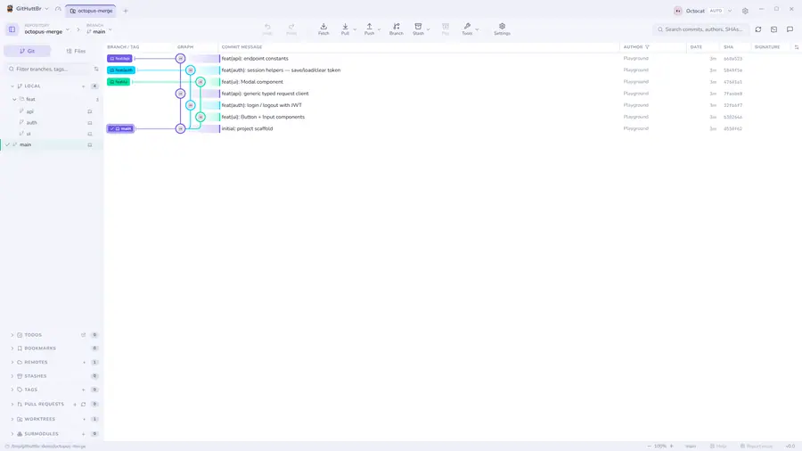

# ערכות נושא ומראה

ערכות נושא מובנות — Gitcito, Nord, Dracula, Solarized, GitHub, Monokai,
Midnight, Contrast ו־Daltonic — לכל אחת וריאנט בהיר וכהה.

- **בהיר, כהה, או לפי מערכת ההפעלה**, מוחלף בזמן אמת.
- **ערכות נושא מותאמות אישית**, ו**מחוללות ב־AI** מתוך הנחיה.
- **גודל גופן קוד** ניתן להתאמה.
- **סגנון גרף** נפרד: פלטת המסלולים, סגנון הפינות, צפיפות השורות ועובי הקווים,
  עם תצוגה מקדימה חיה של מיני־גרף.

## איתור הגדרה

ההגדרות מפוזרות על פני עמודים רבים, והאפשרות שאתם מחפשים נמצאת לעיתים רחוקות היכן
שציפיתם: אתם יודעים שהיא קיימת, לא באיזה עמוד. שדה החיפוש בכותרת ההגדרות, ליד
כפתור הסגירה, מחפש בכל העמודים בבת אחת.

בזמן ההקלדה, אזור התוכן מציג את ההגדרות התואמות מקובצות לפי עמוד — לכל אחת שמה,
התיאור שלה בשורה אחת והעמוד שבו היא נמצאת. סרגל הצד מעמעם את העמודים ללא התאמה
ומציג מונה על אלה שיש בהם.

- החיפוש משווה את שם ההגדרה, התיאור שלה ושם העמוד. רישיות וסימני ניקוד אינם
  משנים, וכל מילה שמקלידים חייבת להופיע, כך ש"גופן טרמינל" מצמצם להגדרות הגופן
  של הטרמינל.
- החיפוש נעשה בשפת הממשק ובאנגלית בו־זמנית: גם כשהאפליקציה בעברית, הקלדת
  "token" או "font" מוצאת את ההגדרה.
- לחצו על תוצאה, או הקישו **Enter** לראשונה, כדי לפתוח את העמוד שלה (ובערכות
  נושא גם את הלשונית הנכונה — ערכת נושא או גרף), לגלול אל ההגדרה ולהדגיש אותה
  לרגע.
- **Esc** מנקה את החיפוש; **Esc** נוסף סוגר את ההגדרות.

החיפוש עובר על שמות ותיאורים, לא על הערכים שהגדרתם. רשימות השרתים לכל מארח
באינטגרציות (GitHub Enterprise Server, GitLab בניהול עצמי, Bitbucket Data Center)
פותחות את עמוד האינטגרציות; את הלשונית של המארח בוחרים בעצמכם. קיצורי מקלדת
בודדים אינם מאונדקסים — החיפוש מוצא את עמוד הקיצורים, שהעורך בו מפרט אותם.

## פריסה

סרגל צד משמאל או מימין, פאנלים הניתנים לשינוי גודל בכל מקום, סרגל צד מתכווץ למקרה
שהגרף ראוי לכל החלון, ומיקום טרמינל לכל מאגר בנפרד.

**ראו גם:** [גרף הקומיטים](graph.md) · [פרופילים](profiles.md)
