# Hosting & pull requests

## Creating

Create a pull (or merge) request without leaving the app: branch dropdowns,
title and body prefilled from the branch's commits, a draft toggle, and the
people and labels it should land with.

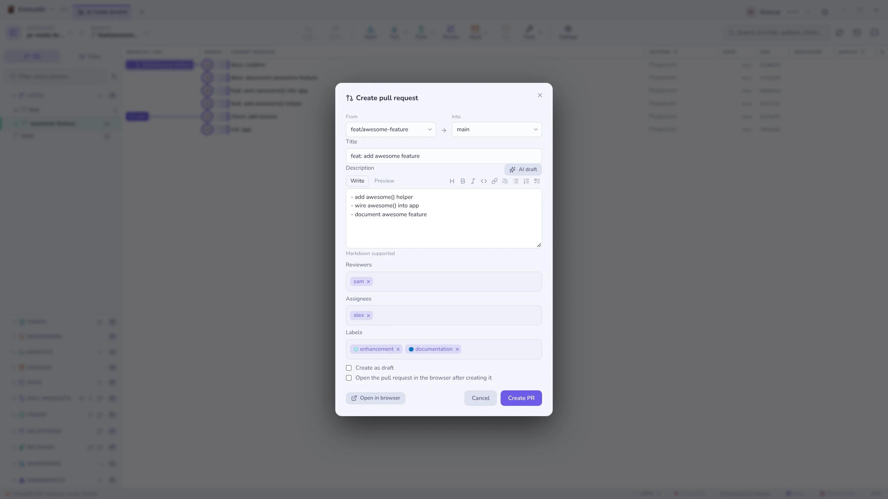

### What the prefill counts

The title, the body and **Draft with AI** describe what the host will show as
the pull request's changes — so they are measured the way the host measures
them: against the **remote's** copy of the target branch (`origin/main`), not
your local `main`. That matters after `git pull origin main` on a feature
branch: the merge brings upstream work in while your local `main` stays where
it was, and a comparison with the local branch would list every upstream
commit as if it were yours.

- When the dialog opens, it fetches that one branch from the remote — quietly,
  with no password prompt and a short timeout — so the comparison is current.
- Only your own commits are listed. Merge commits are left out, and so is
  anything the remote's target already contains.
- The diff the AI reads is the branch's changes since it forked from the
  remote target (`git diff origin/main...feature`).
- The remote is the one the dialog creates the PR on; with no match, the
  source branch's upstream remote, else `origin`.

*Limits:* offline, or when the remote refuses the fetch, the comparison uses
the last fetched `origin/main` and a small note under the branch pickers says
so — if upstream moved since, the list can include commits the host would not.
When the remote has no such branch at all, the local branch stands in, with a
note as well. The fetch updates `origin/<target>` and nothing else; your local
branches are never moved. The pull request itself is unaffected either way —
the host computes its own commits.

### After you press Create

The new pull request is listed in the app: the sidebar's **PULL REQUESTS**
section refreshes straight away, and a message — *Created PR #12. Follow it
under PULL REQUESTS in the sidebar.* — carries a **View in app** link that
opens it on its own page, the same one a click in the list opens (see
[Reviewing](#reviewing--github-and-gitlab) for what each host shows there).

The browser stays shut unless you ask for it. Tick **Open the pull request in
the browser after creating it** and the host's page for the new request opens
as well, as it did before this option existed. The choice is remembered on
this computer for the next pull request; it starts off.

**Open in browser**, at the bottom left, is something else: it skips creating
anything here and opens the host's own *compare* page with the two branches
filled in.

*Limits:* the section lists `origin`'s pull requests. When the dialog was
opened for another remote, **View in app** still opens the new request, but the
section does not list it. The message with the link fades after a few
seconds; the request itself is then one click away in the section (origin) or
on the host.

### Reviewers, assignees and labels

A pull request opened without reviewers waits until someone notices it; one
opened without labels skips the triage the team relies on. So the dialog asks
for them up front, as pickers: type part of a login, a name or a label, open
the list with ↓ (or Enter), pick with ↑/↓ and Enter (or the mouse), and each
choice becomes a chip that × — or Backspace in an empty field — removes. Enter
never adds a row you cannot see: with the list closed it only opens it, and
while an input method (Japanese, Chinese, Korean) is composing, the keys are
its own. Tab moves on and closes the list. Labels show their colour, people
their picture where the host gives one.

Text left in a field when you press **Create** is not thrown away. If it names
a listed row exactly (a login or a label, ignoring case) that row is added; if
the field takes typed entries (a new label, or a login where the list could not
be read) the text is added as it is. A field that only takes listed rows has
nothing it could add, so unmatched text there is dropped rather than blocking
the create. A login may be typed with its `@` — `@ana` is sent as `ana`.

All three are optional. Leave them empty and the request is exactly the one
the app always sent. The choices are read when the dialog opens — a small
*Loading…* line shows meanwhile — and kept for a few minutes, so reopening the
dialog does not ask the host again. That memory is per account: switch
profile, or change a token, and the lists are read afresh. If that happens with
the dialog open, the picks made so far are cleared too — people and labels
chosen from one account's lists are never sent under another.

Reading the choices never touches your saved credentials. If the token cannot
read a list — an Azure DevOps PAT with only the Code scope, say, which cannot
read teams — that field says so and the rest of the dialog works as before;
the saved git login the pull request and your pushes use is left alone.

The same holds after the create. Only the create itself may replace a saved git
login the host turned down (and only once); the calls that follow it — Azure
DevOps labels, GitHub's reviewers, assignees and labels — use the login the
create succeeded with and never remove a saved credential. A label Azure DevOps
refuses because your account may not create tag definitions costs the labels,
nothing more.

A remote on a Bitbucket Data Center whose path the app cannot read as a
repository (`<server>/scm/PROJECT/repo.git`) is refused with a message saying
so. It never falls back to bitbucket.org, so the Data Center's token is never
sent there.

Each host takes a different set, and the dialog shows only the fields the
repository's host supports:

| Host | Reviewers | Assignees | Labels | Choices come from |
|---|---|---|---|---|
| **GitHub**, GitHub Enterprise Server | ✓ | ✓ | ✓ | The repository's assignable users; its labels, or a new one typed |
| **GitLab**, gitlab.com and self-managed | ✓ | ✓ | ✓ | The project's members, inherited ones included; its labels, or a new one typed |
| **Azure DevOps** | ✓ | — | ✓ | The project's teams and their members; labels are typed freely |
| **Bitbucket** (bitbucket.org) | ✓ | — | — | The workspace's members, else the repository's default reviewers |
| **Bitbucket Data Center** | ✓ | — | — | The users who can read the repository |
| **Forgejo** | — | — | — | No fields are shown |

How each one is set:

- **GitHub** opens the pull request first and then requests the reviewers,
  adds the assignees and applies the labels — three calls after the create.
- **GitLab**, **Azure DevOps** reviewers and both **Bitbucket**s send them
  with the create itself. Azure labels follow, one call each.
- If **Azure DevOps** or either **Bitbucket** refuses the create over its
  reviewers — someone without access, the author, an account since removed —
  the app creates the pull request once more without them and tells you the
  reviewers were not set. It only retries after a validation answer (400 or
  409, or Data Center's 404 for a user name it does not know) that means
  nothing was created, so a pull request is never opened
  twice; a sign-in failure, a server error or a lost connection is reported as
  it was, and a refusal the host pins on another field (bitbucket.org) or
  another cause (Data Center's duplicate pull request) is not retried.

*Limits:*

- **You are not offered as your own reviewer** on GitHub or Bitbucket: both
  refuse the author. GitLab and Azure DevOps allow it, so there you are listed.
- **The lists stop at a thousand** people or labels, read 100 at a time. Azure
  DevOps reads the members of the project's first ten teams (up to 500 each);
  every team is still offered as a reviewer itself. A Bitbucket Data Center
  list stops at the same thousand. On bitbucket.org, when the token may not
  list the workspace's members and only the repository's default reviewers
  are offered instead, the list is marked the same way. A list cut short by
  any of these — or by a team whose members could not be read — says *This list may
  be incomplete* under the field, so a missing name is not mistaken for someone
  without access.
- **New labels can be typed** on GitHub, GitLab and Azure DevOps: a name that
  is not in the list is offered as *Add “…”*, and the host creates the label.
  Azure DevOps has no label list to read at all, so there the field is typed
  only. It has no assignees.
- **Bitbucket has no assignees or labels** on pull requests, cloud or Data
  Center.
- **A list the token may not read** — a GitLab token without the right scope,
  a Bitbucket token that cannot list workspace members and a repository with no
  default reviewers — gets a note saying so, and the pull request can still be
  created. Where a person is named by login (GitHub, Bitbucket Data Center) the
  field stays usable: type the login and press Enter. Where the host wants an
  internal id (GitLab, bitbucket.org, Azure DevOps reviewers) nobody could
  type, the field is disabled. Labels can always be typed.
- **A pick the host refuses after the fact** does not undo the pull request:
  it is created, listed (and opened in the browser, if you ticked that) as
  usual, and a second message names
  what could not be set (*reviewers*, say), so you can add it on the host. This
  covers GitHub refusing a review request, GitHub quietly skipping an
  assignee it will not take (the assignees it answers with are checked against
  your picks), GitLab silently dropping a reviewer
  without access, a reviewer Azure DevOps or Bitbucket rejects outright (see
  the retry above), and a host that leaves a picked reviewer off. Reviewers the
  host adds on its own — Bitbucket's default reviewers, say — do not count
  towards your picks: each pick is looked for by name or id.

Works on **GitHub, GitLab, Bitbucket and Azure DevOps**. Open PRs/MRs for all
four are listed in the sidebar.

Start one from [the branch comparison](merging.md#compare-any-two-refs), the
graph, the `+` in the PR panel, or from an issue (which fills in `Closes #N`).

Branch-compare offers **Create PR** only when the profile the repository uses
has something to sign in with on that host — a token, or a linked sign-in. Right
after start-up, while saved tokens are still locked in the keychain, it offers
the button anyway rather than ask the keychain just to draw it: clicking unlocks
the store, and the dialog says plainly if no account turns out to be there.

## Stacks in the list

Pull requests that sit on each other collapse into one row with a stack icon,
the branch the chain lands on, and how many are in it. Expand it to see the
chain in reading order — leaf first, down to the base — with a small arrow under
each one naming what it merges into, so the direction is on screen rather than
inferred from four base branches.

Two things put a group there: GitHub's own stack number, when the pull requests
belong to a [native stack](stacks.md), and otherwise the refs themselves — a
pull request whose base is another's head sits on it. The second rule is why
this also works on GitLab, Bitbucket and Azure DevOps, and for chains opened
before any of that existed.

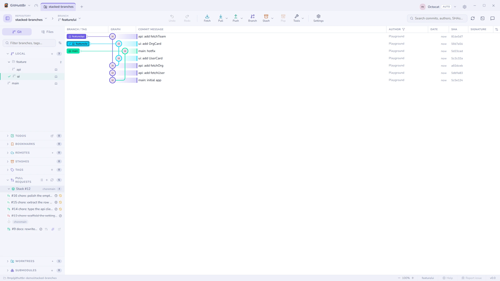

Each row carries the state of its head's **checks** — hover for the counts —
and, on GitHub, the levels that are already closed or merged, which a list of
open pull requests would otherwise hide. A level above a **closed** one is
marked blocked: its own checks may be green, but the branch it targets is never
going to land. The row's actions appear on hover, so the title keeps the width.

Reading the checks costs one request per pull request, and only when the list is
refreshed.

## Your pull requests on the parent of a fork

In a fork, the pull requests that matter are usually the ones you opened on the
repository you forked from, and those live there, not on your fork. So when a
repository has an `upstream` remote that points at a different GitHub repository
than `origin`, the list also asks `upstream` for its open pull requests and keeps
**only the ones whose branch comes from your fork**. They appear under a caption
naming the parent, **On owner/repo**, below your fork's own. A click opens the
same detail view, with its checks and review, on the parent.

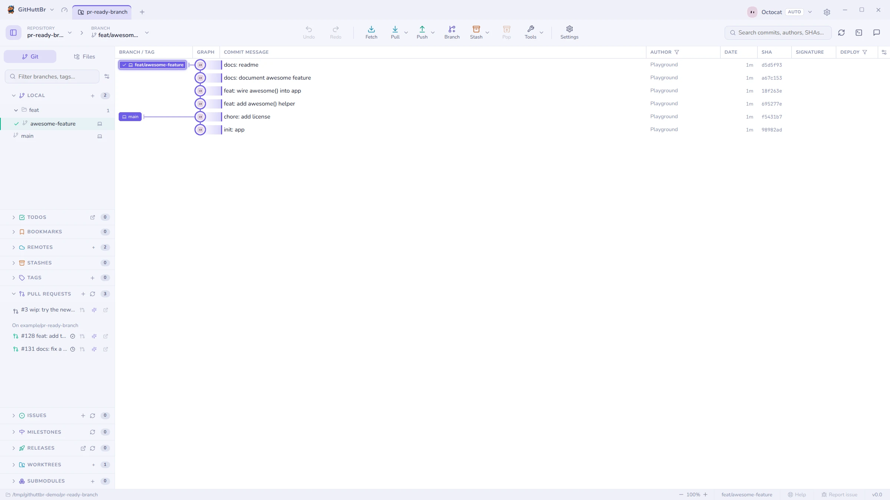

*Limits:* GitHub only, and only a remote named `upstream`. The parent's other
pull requests are left out on purpose: that is the parent's queue, not your
work. Stacks and branch lookups still act on `origin`'s list alone. Listing the
parent costs one more request per refresh.

## Reviewing — GitHub and GitLab

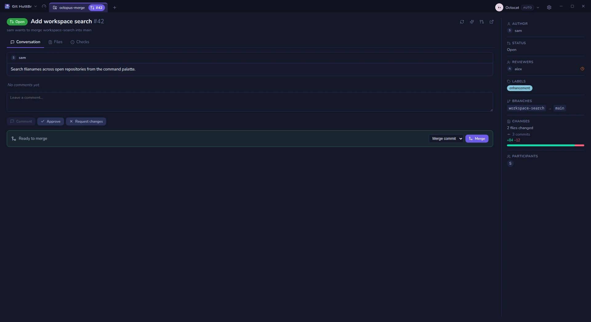

Clicking a pull request opens it as a **page of its own**. It rides on its
repository like the wiki does: an icon with the PR number on the repository's
tab, or on its chip inside a group. Click the icon again, or the repository's
name, to go back. **Open in a new tab** in the PR's right-click menu gives it a
top-level tab instead. If the repository is not open anywhere, the PR opens in a
tab of its own.

The work happens in the main column, and the sidebar says what the PR *is*, so
you do not have to scroll through it. With AI on, the ✨ button in the header
reviews the PR's diff as the host reports it, so it works even for a branch you
have never fetched (a fork, someone else's).

The main column has three sections:

| Section | What it holds |
|---|---|
| **Conversation** | The description, comments and inline review threads (`file:line`, with replies). Only the conversation scrolls: the comment box with comment / approve / request changes, and the merge box (merge, squash or rebase), stay fixed at the bottom, so a long pull request never pushes them out of reach |
| **Files** | Every changed file, and the selected one's diff beside the list, with syntax highlighting and word-level changes (secret-looking files masked when that setting is on). A ✓ "viewed" checklist remembers your progress. A file the host sends no diff for (a binary, or one too large) links to it on the host |
| **Checks** | CI check-runs (GitHub) or pipeline jobs (GitLab), with pass/fail/pending and links to the logs. Every run of the repository — not only this pull request's — is on the [CI runs](ci-runs.md) page |

The sidebar shows:

| Row | Shows |
|---|---|
| **Author** | Who opened it, and when |
| **Status** | Open, draft, merged (by whom, when) or closed; conflicts with the target |
| **Reviewers** | Each reviewer's latest decision (approved, changes requested, commented) and who is still awaiting review, teams included |
| **Assignees, labels, milestone** | As set on the host, labels in their own colours |
| **Branches** | Source → target, and the fork it comes from |
| **Changes** | Files changed, commits, lines added and removed, with a bar |
| **Checks** | Passed / failing / running, a click away from the Checks section |
| **Participants** | Everyone who took part |
| **Activity** | When it was opened and last updated |

GitLab does not report line totals for a merge request; they are summed from
the file list once it loads. A row the host does not report is left out.

If someone force-pushes mid-review, [what changed since](range-diff.md) shows
you exactly what moved.

GitLab differences, stated plainly: GitLab has no single "submit review" call,
so **approve** uses its approval endpoint and **request changes** removes your
approval and posts your comment. **Rebase-merge** is not offered — GitLab
decides merge-commit vs fast-forward from the project's settings, so the merge
menu shows merge and squash only. Inline threads show the file and line but not
the surrounding diff hunk, which GitLab's API does not return. Review and merge
work on gitlab.com and on a [self-managed GitLab](#self-managed-gitlab). Bitbucket
still opens in the browser for review.

Azure DevOps differences: approving casts your vote (*Approved*); **request
changes** votes *Waiting for author*. Completing the PR takes merge, squash or
rebase. Azure lists a PR's changed files but sends no diff, so the app fetches
both versions of each file and diffs them itself — for the first 200 files; a
binary file, or a change too large to diff here, links to the host. People show
as initials, because Azure's profile pictures need a signed-in browser.

The sidebar also lists the **work items linked to the PR** — number, title,
type and state — each opening in the browser. Reading them takes a token that
can read work items (*Work Items: Read*); without it the row is simply left out.

**Checks** include the branch's **build validation** — the pipeline its policy
requires, which Azure records as a policy result rather than as a status — next
to any status a pipeline or an external CI posts. A check that is one of this
organization's Azure Pipelines builds shows its log under the row: the tasks
that failed, each under its name, or each job's whole log when nothing failed,
starting at the end. The token goes only to builds in the PR's own
organization. The panel reads at most three logs, sharing a 512 KB tail budget.
Reading logs takes *Build: Read*; without it the row offers the
browser instead. A token missing a scope is simply refused — the app never
takes that for a revoked sign-in and never drops the credential git uses.

## Self-managed GitLab

> **Beta.** self-managed GitLab support is new in 4.38 and has been tested against simulated
> servers, not yet against a real self-managed GitLab. If anything here does not work on
> yours — sign-in, cloning, pull requests, the reviewer lists — please
> [open an issue](https://github.com/StarleyDev/githuttbr/issues) with the server
> version and what you saw. Leave tokens and private addresses out of it.

A company GitLab lives at its own address, and many people work with more than
one: gitlab.com for open source and the company server for work, or two
company servers after a merger. A profile holds all of them at once —
gitlab.com plus a list of self-managed servers, each with its own token — so
nobody has to switch profiles to move between them.

gitlab.com is the token at the top of **Settings → Integrations → GitLab**.
Below it, under **Self-managed GitLab**, type a server's address — for example
`gitlab.example.corp`, or `https://example.net/gitlab` for one served under a
path — press **Add server**, then paste a token for it. The row says which
account the token signs in as.

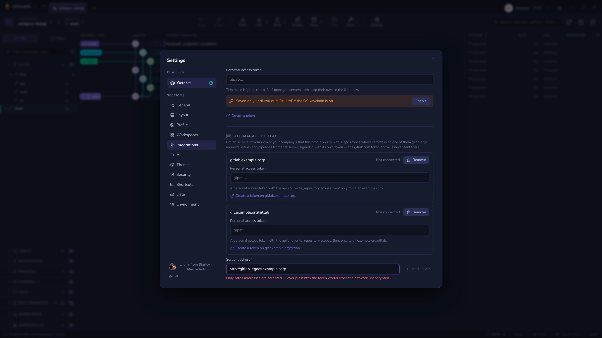

From then on, a remote on one of those servers is GitLab: merge requests list,
open, review and merge, and push, fetch and clone sign in with that server's
token. The clone browser and *create repository* get a **Server** picker with
gitlab.com and every server of the profile.

**Each token goes only to its own GitLab.** Which token a remote gets is decided
by where the remote is: gitlab.com remotes get the gitlab.com token, a remote on
a server in the list gets that server's token, and any other host gets nothing —
the app never guesses that an unknown host "is probably GitLab". A gitlab.com
token never reaches a company server, one server's token never reaches another,
and neither ever reaches gitlab.com. When two servers share a host, the one
with the longer path wins for https remotes (`example.net/gitlab` before
`example.net`). Tokens are stored with your OS keychain like every other token,
filed under their server's address, and left out of a settings export unless
you tick the option to include secrets.

**Create a token on …** opens that server's token page with `api` and
`write_repository` pre-selected. A read-only token connects fine and then fails
on the first push.

**Upgrading from one GitLab per profile.** Before this list existed, a profile
had a single *GitLab address* and its token belonged to that address. Such a
profile — on disk, in an old settings export, or in the encrypted token store —
is converted the first time it is read: the address becomes the first server in
the list and keeps its token (and, if the profile was signed in through a login
on this computer, that link). The gitlab.com field is then empty, ready for a
gitlab.com token of its own. Nothing is sent anywhere it was not sent before: a
token is only ever moved to the instance that issued it, and one whose issuer
cannot be told is dropped rather than guessed — re-enter it if a server shows
*Not connected* after the upgrade.

Limits:

- **https only.** A plain `http://` address is refused, because the token would
  cross the network in clear text. So is an address with a user name or
  password in it (the token has its own field), or with `?` or `#`.
- **Servers sign in with a token.** *Link to the profile* finds a gitlab.com login;
  for a server, paste a personal access token. git's own credential helper still
  answers for push and fetch where the profile has nothing, as it always did.
- Over ssh the host is matched, not the path, so two servers on one host under
  different paths cannot be told apart for an ssh remote.
- Remote avatars are drawn only for gitlab.com and github.com. A self-managed
  remote gets the plain icon, so its group names are never sent to a public
  host.

## GitHub Enterprise Server

> **Beta.** GitHub Enterprise Server support is new in 4.38 and has been tested against simulated
> servers, not yet against a real GitHub Enterprise Server. If anything here does not work on
> yours — sign-in, cloning, pull requests, the reviewer lists — please
> [open an issue](https://github.com/StarleyDev/githuttbr/issues) with the server
> version and what you saw. Leave tokens and private addresses out of it.

A company GitHub that runs on its own servers — GitHub Enterprise Server, at an
address like `github.acme.corp` — speaks the same API as github.com, just at a
different place: REST under `https://<host>/api/v3`, GraphQL at
`https://<host>/api/graphql`. Without telling the app about it, a remote on such
a host is "some git server": push and fetch work, but no pull requests, issues
or checks.

Add the server in **Settings → Integrations → GitHub → GitHub Enterprise
Server**: type its address, press **Add server**, then paste a token for it.
The row says which account the token signs in as. A profile can hold several
servers, each with its own token, next to its github.com token.

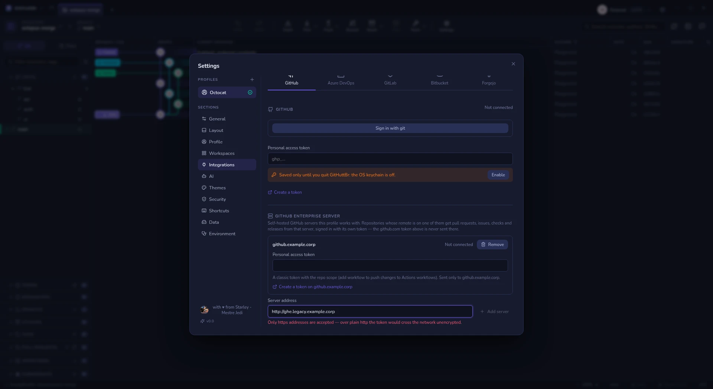

From then on, a remote whose host is that server is GitHub:

| Works on the server | Notes |
|---|---|
| Open pull requests, the pull request page, checks, review, comment, merge | Same as on github.com |
| Create a pull request, with reviewers, labels and assignees | |
| Issues, milestones, releases, create a branch for an issue | |
| Linked pull requests and Projects fields on an issue | GraphQL; see the limits |
| CI status in the graph and the pull request list | |
| Commit, tag and compare links | Open on the server, not on github.com |
| Push, fetch and clone over https | Signed in with that server's token |
| The clone browser and *create repository* | Against the server you pick |

**Each token goes only to its own server.** The github.com token is never sent
to an Enterprise Server, one server's token is never sent to another, and a
server that is not in the list gets nothing at all — the app never guesses
that an unknown host "is probably GitHub". Nor does a host count as github.com
just for ending in it: the github.com token goes to `github.com`,
`api.github.com`, `gist.github.com` and `ssh.github.com` (ssh over port 443)
only — the same holds for `gitlab.com` (plus `altssh.gitlab.com`) and
`bitbucket.org` (plus `api.bitbucket.org` and `altssh.bitbucket.org`); any other
subdomain is an unknown host. The server's port is part of its identity over
https, so `ghe.example.corp:8443` and `ghe.example.corp` are two servers. Tokens are stored with your OS keychain like every other token, and
left out of a settings export unless you tick the option to include secrets.

**Create a token on …** opens the server's token page with the `repo` scope
pre-selected, which covers pull requests, issues, checks and pushing. Add
`workflow` if you push changes to `.github/workflows`, and `read:org` if the
server's policy hides organization membership without it. Fine-grained tokens
work too, if your server offers them; give them read and write access to
*Contents*, *Pull requests* and *Issues*.

Limits:

- **https only.** A `http://` address is refused, because the token would cross
  the network in clear text. Internal and private addresses are fine — that is
  where most Enterprise Servers live.
- **Only the address.** A path, a query, or a user name and password in the
  address are refused. github.com itself is set up above the list, not in it.
- **Older servers lack newer features.** Each server version ships the API of
  its day. What a server does not have is left out quietly instead of failing
  the page: native stacks, the linked pull requests of an issue (they show
  "couldn't load"), and Projects fields stay empty on a server that predates
  them.
- **Not on a server:** the notifications inbox and uploading an SSH key stay
  github.com's, and *Link to the profile* (the GitHub CLI or git's helper) links
  github.com accounts only — a server always takes a token.
- GitHub Enterprise Cloud with data residency (`<name>.ghe.com`) is not
  covered: its API lives at a different address, so the list refuses it.
  Enterprise Cloud on github.com itself is just github.com.

## Bitbucket Data Center

> **Beta.** Bitbucket Data Center support is new in 4.38 and has been tested against simulated
> servers, not yet against a real Bitbucket Data Center. If anything here does not work on
> yours — sign-in, cloning, pull requests, the reviewer lists — please
> [open an issue](https://github.com/StarleyDev/githuttbr/issues) with the server
> version and what you saw. Leave tokens and private addresses out of it.

Bitbucket Data Center — and Bitbucket Server, its predecessor, which shares
its API — is the Bitbucket a company runs itself, at an address like
`bitbucket.acme.corp`, often under a path such as `/bitbucket`. It is not
bitbucket.org with another name: it has its own REST API
(`https://<host>[/<path>]/rest/api/…`), projects instead of workspaces, and its
own tokens. Without telling the app about it, a remote on such a server is
"some git server": push and fetch work if git can sign in by itself, but there
are no pull requests and no build status.

Add the server in **Settings → Integrations → Bitbucket → Bitbucket Data
Center**: type the address you open Bitbucket at — with its path, if it has
one — press **Add server**, then paste an HTTP access token for it. The row
says which user the token signs in as. A profile can hold several servers, each
with its own token, next to its bitbucket.org credential.

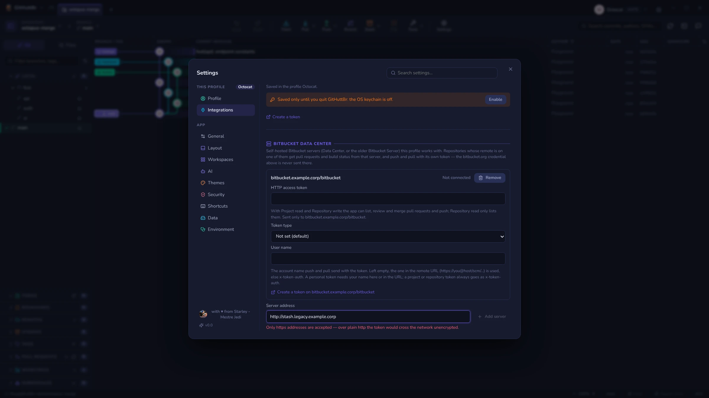

From then on, a remote on that server is Bitbucket Data Center — the https
clone URL (`https://<host>[/<path>]/scm/<project>/<repo>.git`), the ssh one
(`ssh://git@<host>:7999/<project>/<repo>.git`), and personal repositories
(`~user`) alike:

| Works on the server | Notes |
|---|---|
| Open pull requests in the sidebar, with build status and a 👁 on the ones waiting for you | Every page of the list, not just the first |
| The pull request page: conversation, line comments, changed files and their diffs, checks | |
| Comment, reply in a line thread, approve, request changes | The verdict is set first and a review's text posted after it, so a failed verdict leaves no stray comment |
| Merge | The page shows a merge-check veto (*Requires 2 approvals*, …) in the server's own words, apart from real conflicts, and keeps **Merge** off until it clears; the checks are asked again before merging and nothing is merged on a veto |
| Create a pull request | Title, description, draft; source and target in the same repository |
| Build status in the graph | One request finds the commits that have builds, then only those are read. In the pull request list, the 50 newest heads with builds are read in full; older rows show none |
| Push, fetch and clone over https | Signed in with that server's token — **Clone → URL** too, for an address under a server in the list, signed in as the profile picked in the clone dialog — the one the new repository is then bound to |
| The *create pull request* page in the browser | Opens on the server, under its path |

**Each token goes only to its own server.** The bitbucket.org credential is
never sent to a Data Center, one server's token is never sent to another, and a
host that is not in the list gets nothing. Over https the port *and* the path
are part of a server's identity: `bitbucket.acme.corp/bitbucket` and
`bitbucket.acme.corp` are two servers. Over ssh, which has no path and its own
port, the host name is what is compared. Tokens are stored with your OS keychain
like every other token, and left out of a settings export unless you tick the
option to include secrets.

**A Data Center sharing a host name with another server.** When a self-managed
GitLab, a Forgejo or a GitHub Enterprise Server lives on the same host name —
`git.acme.corp` for GitLab, `git.acme.corp:7990` or `git.acme.corp/bitbucket` for
the Data Center — an https remote belongs to the server whose whole address
(port and path included) it sits under, the longest path winning. An ssh remote
says less. Written `ssh://git@git.acme.corp:7999/…`, it is the Data Center. A
remote that reaches port 22 — the short form `git@git.acme.corp:team/app.git`,
which cannot name a port at all, and `ssh://git@git.acme.corp/…` or
`ssh://git@git.acme.corp:22/…` — reaches the ssh daemon on port 22, not the Data
Center's 7999, and counts as the *other* provider on that host name, as long as
there is exactly one other. An `ssh://` remote on any other port, on a host name
two providers share, is left unrecognised — no pull requests, and no token
offered for it — rather than guessed, and the Pull requests section says so
instead of showing an empty list. Use the https remote in that setup.

The limit: a port-22 remote is read by what git itself would do with it. If your
`~/.ssh/config` sends that host name to port 7999, the app does not read that
file, and treats the remote as the other provider's. Write the remote as
`ssh://git@host:7999/…`, or use https.

**Two providers on one address.** If two providers in Settings name the very
same server address — the same GitLab added again as a Forgejo, say — an https
remote there cannot be told apart either, and gets no token. The Pull requests
section says the server is configured under two providers; remove the one that
is wrong.

**Paths that could mean two things.** A remote whose path holds an encoded
slash, backslash or dot (`%2F`, `%5C`, `%2E`), any other encoded plain letter
or digit, a literal backslash, or a `.` or `..` segment matches no server, and
no token is offered for it. A reverse proxy in front of the server may decode
such a path and route it somewhere else than it appears to go —
`https://git.acme.corp/bitbucket%2F..%2Fteam/app.git` reads as the Data Center
but can land on the GitLab at the root. Ordinary escapes such as `%20` are fine.

**The token.** Create an HTTP access token in Bitbucket (your avatar → *Manage
account* → *HTTP access tokens*; **Create a token on …** opens that page).
Give it **Project read** and **Repository write**: that covers listing,
reviewing and merging pull requests, and pushing. **Repository read** is
enough to see pull requests and pull, but not to approve, merge or push. A
project or repository token works too, with the same permissions.

**Token type and user name.** Git sends a user name with the token, and which
one depends on whose token it is — Atlassian's [HTTP access tokens](https://confluence.atlassian.com/bitbucketserver/http-access-tokens-939515499.html)
page sets the rule. The app never guesses the type: it is what you pick, and it
stays until you change it.

| Token type | User name git sends |
|------------|---------------------|
| **Not set** (the default) | The **User name** field; left empty, the one in the remote URL (Bitbucket's own clone URLs read `https://<you>@<host>/scm/…`); with neither, `x-token-auth` |
| **Personal token** | The **User name** field, else the one in the remote URL — never `x-token-auth`. With neither, no credential is sent: git reports the failed sign-in, and the remote's sign-in check says the token needs a user name |
| **Project or repository token** | Always `x-token-auth`, which Bitbucket requires for these tokens — even when the remote URL names whoever copied it. The **User name** field is disabled |

*Not set* covers both kinds as long as the remote URL is a plain one for a
project token, or names you for a personal one. Pick a type when it does not:
a project token cloned from a URL that names a person needs **Project or
repository token**. For a personal token, once the row says *Connected as …*,
a **Use …** button fills in the name the server reported (it is not offered for
a project token, whose account is the server's bot user). Approving and requesting changes find your account's *slug* on the
server (an email-style name `jdoe@corp.com` has the slug `jdoe_corp.com`), so
those work for such names too. When the server does not let the token search
users, a plain name is tried as a slug, and kept only if the server answers for
it — Atlassian does not document how a slug is derived from a name, so it is not
assumed. With no slug found at all, **Approve** still works through the older
approve resource, which needs none; **Request changes** then says your user was
not found, and has to be done on the server.

**Merging.** The PR page asks the server whether the pull request can merge
before enabling **Merge**. A merge check that refuses (say, *Requires 2
approvals*) is shown in the server's own words; a refusal the server gives no
reason for is shown as such, and **Merge** stays disabled either way.

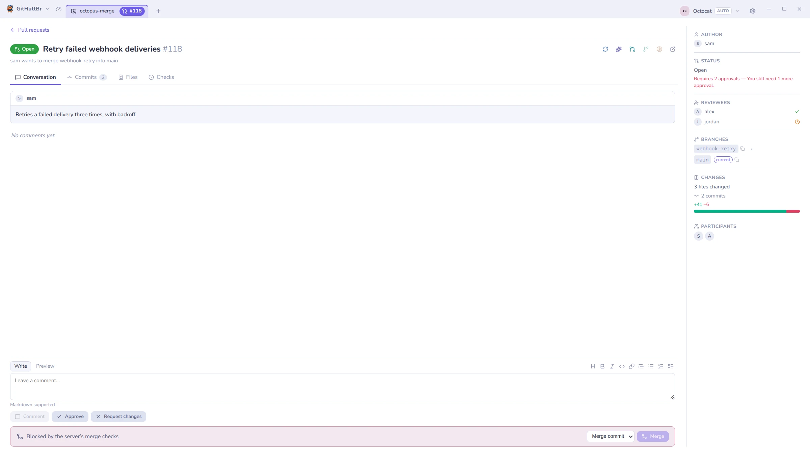

Builds the
server reports as *cancelled* or *unknown* are counted under those names in the
pull request list, not as skipped.

Limits:

- **https only, and only the address.** A `http://` address is refused, because
  the token would cross the network in clear text; so is a user name and
  password in the address, or a path that is not the server's own (a pasted
  project, repository or REST address). Internal and private addresses are
  fine.
- **Written against the documentation, not a live server.** The calls follow
  Atlassian's Bitbucket Data Center REST reference (the 10.x documentation
  and its `latest` API). Older Bitbucket Server releases and servers with
  plugins that change these resources may behave differently. Something the
  server does not offer is left out quietly — no build status, no merge
  check — instead of failing the page.
- **ssh on another host name.** The app recognises an ssh remote by the
  server's own host name. A company that serves ssh from a different name (say
  `git.acme.corp` next to `bitbucket.acme.corp`) gets push and fetch, but no
  pull requests for those remotes; clone over https, or set the remote to the
  https URL, to have both.
- **A certificate from a company CA** (or a self-signed one) is a known gap.
  Git checks it with its own settings (`http.sslCAInfo`), so push and fetch
  work once git trusts it; the app's own API calls trust only the certificates
  that ship with it, so pull requests and build status may fail to load
  against such a server. The app never offers to skip the check.
- **Not covered:** default reviewers are not added when a pull request is
  created here (add them on the server, or open it in the browser); you cannot
  withdraw an approval from the app; the clone browser and *create repository*
  stay bitbucket.org's; Jira links, tasks and comment threads' "resolved" state
  are not shown; the commit menu's *View on GitHub* entries are GitHub-only.
- **Bitbucket Cloud is unchanged.** bitbucket.org keeps its own token above the
  list, and works as before.

## Forgejo

Set the instance address before entering its token. Changing the address clears the previous sign-in.

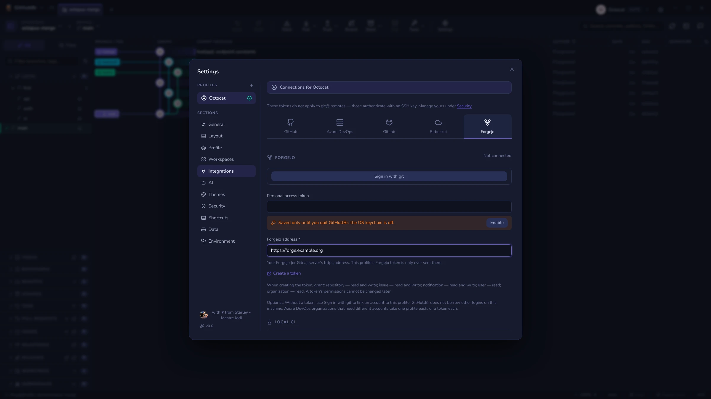

Forgejo, and Gitea, which shares its API, always runs at an address its owner
chose: your own server, or a public one such as codeberg.org. Give a profile
that address in **Settings → Integrations → Forgejo**, together with an access
token. **Create token** opens the token page on that server. Give the token
read and write permission on *repository*, *issue* and *notification*, and
read permission on *user* and *organization*. A token's permissions cannot be
changed later: one made without *issue* or *notification* lists no issues or
notifications, and a new token is the fix.

From then on, remotes on that server are Forgejo:

| Works | How |
|-------|-----|
| Push and fetch | Signed in with the profile's token |
| Open pull requests | Listed in the sidebar, and open in the [pull request page](#reviewing--github-and-gitlab): conversation, each file's diff, checks (commit statuses, including Forgejo Actions), comment, approve, request changes, and merge / squash / rebase |
| Create a pull request | From the app; a draft is marked with the `WIP:` prefix Forgejo uses |
| Clone browser, create repository | Against that server, under your account or an organization |

A check that is a **Forgejo Actions** job shows its log under the row, colours
included, starting at the end where a failure is. Forgejo has no API for job
logs, so the app asks for the same page its web log viewer downloads, sending
the token only when the link is a job on this very server; a status from an
external CI is never sent it. A server that serves logs only to a signed-in
browser answers with its sign-in page, and the row says so and offers the
browser instead. Very long logs show their last few thousand lines.

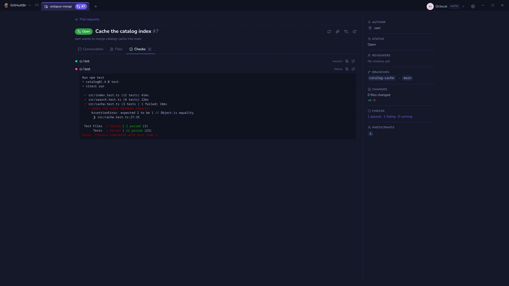

Just like GitLab tokens, **a Forgejo token only goes to the server that issued
it**. A profile without a Forgejo address has no Forgejo credential at all.
There is no default server to fall back to.

Limits:

- Line-comment threads are shown but cannot be replied to from the app:
  Forgejo has no API for a reply inside an existing thread. Reply on the server.
- https only, one Forgejo server per profile.
- Lists stop after twenty requests: 1,000 pull requests or repositories at the
  server's default page size.

## Issues, milestones, releases — GitHub and Forgejo

Browse issues and open a full issue tab: body, comments, labels, assignees,
milestone, Projects v2 fields, close/reopen, and **create a branch for this
issue** (with AI naming). Milestones show progress and their issues. Releases
are browsable with a changelog page.

**Linked pull requests** answers "is someone already fixing this?": the PRs
that will close the issue, or closed it — a `Closes #N`-style keyword or a
manual link in GitHub's *Development* box — open first, then merged, then
closed. A PR that merely *mentions* the issue is deliberately left out, and so is
anything past the first 50. One in this repository opens in a PR tab; one from
another repository opens in the browser. A token that cannot read the
repository's pull requests (a fine-grained token without *Pull requests: read*)
gets a quiet "couldn't load" instead of a wrong "none".

On a [Forgejo](#forgejo) server the same lists and pages work, with the
profile's Forgejo token. Two things are GitHub's alone: Projects v2 fields stay
empty, and the linked pull requests section is not shown. Releases list the
most recent ones, not the whole history.

## Waiting for your review

In the sidebar's pull request list, a 👁 marks the PRs where **you** are a
reviewer who has not answered yet — on GitHub, GitLab and Forgejo alike. Who
"you" are is asked of the host with the profile's credential and remembered for
ten minutes. A token that cannot read its own user (no `read:user` on Forgejo,
for example) marks nothing.

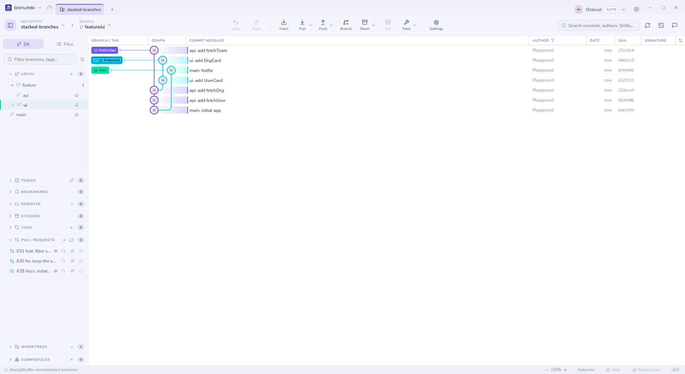

With **Settings → Desktop notifications** on, a GitLab or Forgejo pull request
that *starts* waiting for you raises one; clicking it opens the PR page. The
first look at a repository only takes note of what is already waiting, so
opening the app does not replay a backlog. GitHub's review requests are left to
its notifications inbox, below, which already announces them.

## Notifications — GitHub and Forgejo

Your whole inbox — review requests, mentions, CI activity — across every
repository, with unread/all filters and mark-as-read. The toolbar bell carries
an unread badge, and optional desktop notifications fire when a review is
requested or CI finishes.

If the active profile has a Forgejo server, its notifications join the same
list, newest first, and are marked read on that server. Forgejo does not say
*why* you were notified, so those rows carry no reason, and they never raise a
desktop notification — that is decided by the reason.

## Tokens

Per-profile tokens for multiple accounts or orgs, stored with your OS keychain.
Gitcito can also borrow whatever your **git credential helper** already holds,
so an org you have already authenticated for often needs no setup at all. See
[Security & secrets](security.md).

Each profile **links its own account**. In Settings → Integrations, **Link to the
profile** looks for a login already on the machine — git's credential helper,
then the **GitHub CLI**'s active account, then the helper's own sign-in window
— and ties that account to the profile. Nothing is shared implicitly: a new
profile starts disconnected, and an account another profile already linked is
refused. To link a second GitHub account, add it to gh (`gh auth login`), make
it active (`gh auth switch`) and sign in from the other profile — or paste that
account's token. Git never asks for a username and password on a terminal.

The page says whether the connection is the profile's token, its link to git's
helper or its link to the GitHub CLI, and **Disconnect** undoes it for this
profile only: a token is cleared (it stays valid on the host until you revoke
it there), a link is dropped (the login stays in gh or the helper).

The host's API — pull requests, issues, CI — and git's own fetch, pull and
push over https both use the profile's token or linked account: the profile
the repository is [bound to](profiles.md#per-repository-binding), else the
active one. A repository's hosting actions always run as its bound profile,
whichever profile is active. The credential
reaches git for that one command, scoped to the remote's host, and is never
written to `.git/config`. A profile with neither leaves git to its own
credential helper. Azure DevOps, GitLab and Bitbucket link through git's
credential helper — Git Credential Manager keeps several accounts per host — or
take a token per profile. A link names one account per provider, so
organizations that need different accounts take one profile each.

**See also:** [Stacked branches](stacks.md) · [AI features](ai.md)
