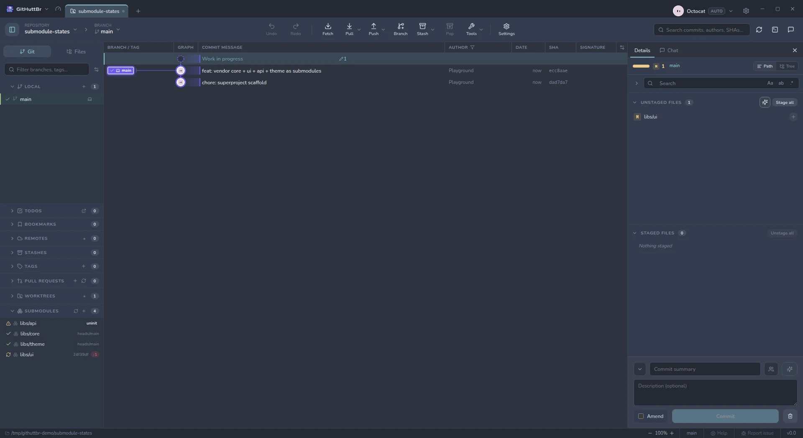

# Worktree e sottomoduli

## Worktree

Un worktree è un secondo checkout dello stesso repository, in una cartella tutta
sua — così puoi guardare `main` mentre `feature/x` resta esattamente come
l'avevi lasciata, senza fare stash.

- Crea e rimuovi worktree dalla barra laterale. Un **doppio clic** ne apre uno
  come scheda a sé; il clic destro offre *Apri worktree*, *Mostra nella cartella*
  e la rimozione.
- Clic destro su un branch locale qualsiasi → **Apri in un worktree** per
  crearne uno al volo in una cartella affiancata e aprirlo come scheda.
- Un branch vive in un solo worktree alla volta, quindi fare checkout di un
  branch che un altro worktree già tiene non può funzionare: git rifiuta con
  *already used by worktree at …*. GitHuttBr ti ci porta invece: il menu del branch
  dice *Vai a `x` nel suo worktree*, e il doppio clic sulla riga apre la scheda
  di quel worktree anziché fallire.

### Prendersi cura dei worktree

Un worktree creato il mese scorso si dimentica in fretta, e le domande arrivano quando si fa pulizia: c’è lavoro dentro? La cartella esiste ancora? Ogni riga risponde prima che tu debba chiederlo.

| Sulla riga | Significa |
|---|---|
| **●3** | Tre file con modifiche non committate in quel worktree |
| **↑2 ↓1** | Il suo branch è due commit avanti e uno indietro rispetto all’upstream |
| 🔒 | Bloccato — passaci sopra per vedere il motivo indicato al blocco |
| **mancante**, nome barrato | La cartella non c’è più; git ne ha solo la registrazione |

I conteggi vengono letti all’apertura della sezione, quando il commit di quel worktree cambia e quando la finestra torna in primo piano — non a ogni aggiornamento, perché ognuno è un `git status` dentro un’altra cartella.

Clic destro su una riga per:

| Azione | Cosa fa |
|---|---|
| **Blocca worktree** | Impedisce a git (e a qualsiasi altro client) di eliminarlo, spostarlo o rimuoverlo. Indica un motivo — *sul disco esterno* — e comparirà sul lucchetto. Per i worktree su supporti non sempre collegati. |
| **Sblocca worktree** | L’opposto. Annulla lo blocca di nuovo con lo stesso motivo. |
| **Sposta worktree…** | Sposta la cartella e aggiorna i collegamenti di git in entrambe le direzioni. Non disponibile se è bloccato o aperto in una scheda: schede e layout sono ricordati per percorso, e la scheda punterebbe al nulla. Chiudila prima. Annulla lo riporta indietro. |
| **Rimuovi worktree** | Chiede prima a git cosa andrebbe perso. Un worktree pulito riceve la conferma normale, e annulla lo ricrea sullo stesso branch nella stessa cartella. Uno con modifiche non committate riceve un’altra conferma, *Scarta e rimuovi*, che indica quanti file, senza annullamento. |
| **Ricollega la cartella spostata…** | Solo su una riga *mancante*: indica dove è finita la cartella (spostata col file manager) e git la ricollega con `git worktree repair`. |
| **Dimentica i worktree mancanti** | È anche il pulsante gomma nell’intestazione della sezione, visibile quando una riga è mancante. Esegue `git worktree prune`. |

Cosa **non** fanno:

- **Rimuovere un worktree elimina anche i suoi file ignorati** — `.env`, `node_modules`, output di build. Git non li conta come modifiche, perciò anche la conferma "pulita" lo avvisa, e annullare non li riporta.
- **Dimenticare elimina solo la registrazione in git.** Non ci sono file da eliminare — la cartella non c’è più — e i worktree bloccati vengono saltati, perché uno bloccato su un disco scollegato è identico a uno eliminato.
- Un blocco è un accordo tra client git, non una protezione dei file: non impedisce a nulla fuori da git di eliminare la cartella.
- Il worktree principale — il repository stesso — non si può bloccare, spostare né rimuovere.
- Rimuovere un worktree non elimina mai il suo branch. Eliminalo dall’elenco dei branch se hai finito.

### Raggruppare i worktree nell’intestazione

Le schede dei worktree si aprono con etichette `radice · branch`, che diventano
presto larghe.

**Un progetto tenuto in un gruppo accoglie i suoi worktree.** Quando il
repository — o uno dei suoi worktree — sta già in un gruppo, un nuovo worktree si
apre dentro quel gruppo, accanto a lui, senza nulla da spuntare: la finestra di
aggiunta del worktree dice solo quale gruppo, e **Apri in un worktree** dal menu
di un branch fa lo stesso senza chiedere. Anche un worktree aperto più tardi da
**Recenti** o da una cartella ci entra. Trascina la pillola fuori dal gruppo se la
vuoi a parte.

Per un repository in una scheda tutta sua, spunta **Proponi di raggruppare i
worktree che condividono lo stesso repository radice** nella finestra di aggiunta
(disattivato per impostazione predefinita, ricordato come l’opzione codegraph):
se la radice è aperta in una scheda autonoma compare un campo **Nome del gruppo**
(precompilato con il nome della cartella della radice) ed entrambi finiscono in
un nuovo gruppo; senza nessun membro della famiglia aperto, avvisa solo che il
worktree si apre in una scheda propria. Dentro il gruppo, le pillole si riducono
alla foglia (`main`, `feature/x`) perché il gruppo dice già a quale repository
appartengono — un interruttore in Impostazioni → Layout e terminale mantiene il
nome completo `radice · branch` se preferisci. La proposta unisce solo worktree
che condividono la stessa radice — non fonde mai repository estranei.

**Riconoscere una scheda di worktree.** Un worktree collegato è un secondo
checkout di un repository, e la sua scheda sembrerebbe altrimenti identica a
quella del repository. Per questo una scheda di worktree mostra una
**biforcazione** verde al posto dell’icona della cartella — su una scheda con
immagine, una piccola biforcazione nell’angolo dell’immagine — e il suo tooltip
dice *Worktree di …* con la cartella in cui vive. Con il clic destro c’è **Apri
…, il repository principale**, che porta in primo piano la scheda che ha già il
checkout principale, o lo apre — dentro il gruppo del worktree quando il worktree
sta in uno. Funziona comunque sia stato aperto il worktree: dalla sua famiglia,
da **Apri un repository** o dall’elenco scansionato, e i worktree di un
sottomodulo puntano al sottomodulo. Limiti: il segno dice dove vive il checkout,
non quale sia il suo branch; i worktree di un repository bare non sono segnati,
perché non c’è un checkout principale da aprire; e un repository principale
aperto da una cartella collegata con symlink non viene riconosciuto come già
aperto, quindi il menu lo apre una seconda volta con il suo percorso reale.

## Sottomoduli

Aggiungi, aggiorna (init e checkout), sincronizza gli URL e rimuovi i
sottomoduli, con lo stato dal vivo per ciascuno:

| Stato | Significa |
|---|---|
| **Allineato** | In checkout al commit che il genitore registra |
| **Modificato** | In checkout da qualche altra parte, oppure sporco |
| **Non inizializzato** | Registrato, ma mai messo in checkout |

**Vedi anche:** [LFS e sparse-checkout](lfs-sparse.md) · [Fetch, pull e push](syncing.md)
