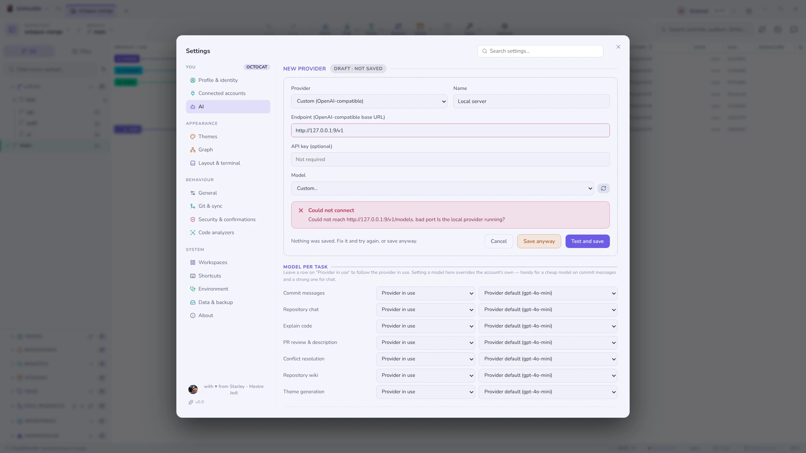

# AI 機能

AI 機能はすべて **任意** で、プロバイダーを設定するまで無効です。あなたが具体的に
何かを頼むまで、どこにも何も送られません。

## 全プロファイル共通の AI

AI は **設定 → AI** で一度だけ設定し、すべての[プロファイル](profiles.md)が
それを使います。あとから作ったプロファイルにもすでに AI があり、アカウントを
追加し直す必要はありません。このページには各プロファイルと、それがこの
**共通の AI** に従っているかどうかが並びます。

代わりに、プロファイルが **独自の AI** を使うこともできます —
コストやデータのポリシーのために会社のアカウントを通す必要がある、
あるいはコミットを別の書き方で書く仕事用プロファイルなどです。そのプロファイルの
**プロファイル** ページで、*このプロファイルの AI* の下の
**共通** を **独自** に切り替えます。共通の AI 全体（アカウント、
キー、設定）のコピーとして始まり、
それ以降はそのすべてがそのプロファイルだけのものです。**共通** に戻すと、
確認のあとでそれは削除され、共通の AI は元のまま残ります。

プロファイルは 1 つの AI を **丸ごと** 使います：共通の AI
か独自の AI かで、混ざることはありません。アカウントとモデル *も*、AI
の書き方やチャットに許されることも同じところから来るので、共通の AI
でコミットのスタイルを変えると、それに従うすべてのプロファイルで変わります。

すべての AI はこの 1 つのページで設定します。上部の **編集中**
のバーで、どれを編集するかを選びます：共通の AI か、プロファイルの独自の
AI（*仕事 の独自の AI*）か。プロファイルページの **独自の AI
を設定**、またはプロファイル一覧の **独自の AI を編集** で、
そのページがその AI で開きます。プロファイルページ自体は、プロファイルがどの
AI を使い何が応答するかを示すだけで、エディターも AI
のオプションも置きません。

アカウントの下には、同じページにその AI がどう **書くか**
と何をしてよいかが、セクションごとにあります：

| セクション | 内容 |
|---|---|
| **コミットメッセージ** | コミットのスタイル — Conventional・Gitmoji・チケットは例の 1 行付きのカードで、それ以外は「その他のスタイル」の中 — 「コミットの説明文を生成」、共同作成者の行、**コミット用の追加ルール**、プレビュー |
| **説明とホバー** | 説明のスタイル、*ホバーでコードを解説* とその修飾キー |
| **コンフリクトとブランチ** | コンフリクト解決のスタイル、ブランチ名のスタイル。それぞれ結果の例付き |
| **リポジトリチャット** | チャットのオン／オフ、何を読むか、提案してよい操作 — [リポジトリチャット](repo-chat.md#設定)を参照 |

セクションの上の 1 行が、どの AI を編集していて誰に適用されるかを示します: *共通の AI · 対象: 仕事、個人*、またはあるプロファイル専用の AI。

**コミット用の追加ルール**（4.60 までの「カスタム指示」）は、コミットメッセージの生成にだけ加わります。チャット、説明、レビュー、ブランチ名はこれを読みません。プレビューは固定の例で、モデルは呼び出しません。選んだスタイルの形を示すだけで、あなたの変更に対して AI が書く内容ではありません。

入力欄のスタイル切り替えと、チャットのモデルと承認の選択は、
プロファイルが読むのと同じ AI に書き込まれます：共通の AI か、
そのプロファイルの独自の AI です。

プロファイルごとに AI を持っていたバージョンからのアップグレードで失うものは
ありません。使用中のプロファイルの AI が共通の AI になり、AI が違っていた
ほかのプロファイルはそれを独自の AI として保ちます。

**4.59
以前からのアップグレード**（書き方の設定が各プロファイルにあった頃）：
一度だけ、使用中のプロファイルの設定（そのプロファイルが独自の AI
を持つ場合は、共通の AI を使う最初のプロファイルの設定）が共通の AI
に移ります。独自の AI
を持つプロファイルは自分の設定を保ちます。**制限：** 共通の AI を使う
2 つのプロファイルが違う書き方をしていた場合（`ticket` の仕事用と
`conventional` の個人用など）、
両方とも移された方と同じ書き方になります。違いを保つには、どちらかに独自の AI
を持たせ、そこでスタイルを設定し直してください。

## プロバイダー

**アカウント**とは、モデルへ到達する一つの経路です。どのプロバイダーで、どこに
接続し、どう認証するか。複数を設定でき、並存します — 仕事用のキー、個人用の
キー、ローカルモデル、すでにログイン済みの CLI。

プリセットは **OpenAI、Anthropic、Google Gemini、OpenRouter、Groq、Mistral**、
**Ollama**（完全にローカル）を網羅し、OpenAI 互換のエンドポイントも使えます。

**キーが暗号化されずにこのマシンの外へ出ることはありません。** キーのあるアカウントはエンドポイントに `https://` で接続し、平文の `http://` を使うのはこのコンピューター上（`localhost`、`127.x`、`::1`）だけです。キーを `http://` で別のホストへ送ることになる呼び出しは、何かが送信される前に拒否され、その旨が表示されます。キーのないエンドポイント — ネットワーク内の別のマシンの Ollama など — は `http://` のまま動作します。

Anthropic は OpenAI 形式の呼び出しではなく独自の `/v1/messages` API を使うため、
Claude モデルは「動いているように見える」のではなく実際に動きます。Gemini は
Google の OpenAI 互換エンドポイント経由で呼び出します。

### プロバイダーの一覧

保存した各プロバイダーは 1 枚のカードです。プロバイダーの頭文字、名前、そしてその下に実際に使っているもの — これで同じプロバイダーの 2 つのアカウントを開かずに見分けられます。

| プロバイダーの種類 | 2 行目 |
| --- | --- |
| サブスクリプションまたはローカル CLI | `CLI claude · sonnet` — コマンド、次にモデル |
| Ollama または独自サーバー | `http://localhost:11434 · qwen3:8b` — アドレス、次にモデル |
| ホスト型 API | `gpt-4o-mini · 41 個のモデル` — モデルと、プロバイダーが一覧にした数 |

モデル数はプロバイダーがモデルを一覧にした後にだけ表示されます。GitHuttBr が代わりに使う同梱リストは推測であって、数ではありません。状態バッジは右側にあります。編集中のカードはアクセント色の縁、応答しないカードは赤い縁になり、名前の下に理由と **再テスト** が表示されます。カードをクリックすると、一覧の下のエディターで開きます。

### プロバイダーの追加と編集

入力途中のまま保存されたプロバイダーは静かな落とし穴でした。空のキーが使用中になり、
何も応答しないことがあったのです。そのため、このカードでは入力中に何も保存されません。

**プロバイダーを追加** を押すと、破線の枠で **下書き · 未保存** と表示されたカードが
開きます。プロバイダー、キー、エンドポイント、モデルを入力して
**テストして保存** を選びます。GitHuttBr はまずそのキーでプロバイダーの
モデル一覧を取得し(**モデル** の横の更新ボタン と同じリクエストです)、応答があったときだけ
保存します。**接続済み · N 個のモデル** と表示され、プロバイダーは
**準備完了** として一覧に加わります。

テストに失敗すると、カードにはプロバイダーが返した理由(キーの拒否 `401`、
起動していないサーバーなど)とともに **接続できませんでした** と
**何も保存されていません。** が表示されます。項目を直して再テストするか、
**このまま保存** でそのまま保存するか(その場合は
**応答なし** と表示されます)、跡を残さない **キャンセル** を
選びます。

保存済みのプロバイダーの編集も同じです。**未保存の変更 — 保存するまで何も変わりません** という帯が
表示され、変更した項目には **· 変更あり** が付きます。
**変更を破棄** は保存済みの値に戻し、**テストして保存** は
テストして保存します。未保存の変更があるまま別のプロバイダーを選ぶ、追加する、
**自分のサブスクリプションを使う** を開くと、**「…」への変更を保存しますか?** と尋ねられます —
**保存**、**変更を破棄**、**編集を続ける**。設定を閉じても
下書きはメモリーに残り、戻ったときにそのままあります。ディスクに書き込まれることは
ありません。

キーはこれまでとまったく同じく、保存時にだけキーチェーンに保存されます。
プロバイダーのエラーは、キーとトークンらしき文字列を伏せて表示します。

| プロバイダーの種類 | **テストして保存** が確認すること |
| --- | --- |
| API キーまたはローカルサーバー(Ollama、カスタムエンドポイント) | モデル一覧を取得します。成功はそのキーでエンドポイントが応答したことを意味します |
| サブスクリプション(Codex、Claude Code) | 後述の短いテストプロンプトを送ります。プランの利用枠を使います |
| ローカル CLI | `PATH` からコマンドを探します。入力したパスは確認せずに保存します |

### ステータスバッジ

一覧の各プロバイダーには、ページがすでに知っていること(直近のテストか、
いずれにせよ取得したモデル一覧)から決まるバッジが 1 つ付きます。バックグラウンドで
問い合わせることはありません。

| バッジ | 意味 |
| --- | --- |
| **準備完了** | 直近のテストまたはモデル一覧の取得が成功した |
| **応答なし** | 直近の試行が失敗した。理由は下の行にあり、**再テスト** も表示されます |
| **キーなし** | API キーが必要なのに設定されていない |
| **未確認** | まだ何も問い合わせていない — テスト前のサブスクリプションや、未取得の一覧 |

**制限:** バッジは最後の確認時点のものです。1 時間前に応答しなくなったプロバイダーも、
再び問い合わせるまで **準備完了** のままです。確かめるにはカードの
**接続をテスト** を選んでください。パスを入力した **ローカル CLI** は、
動作を証明するにはプロンプトが必要なため **未確認** のままです。

### 使用中のプロバイダー

**タスクごとのモデル**で専用のプロバイダーを持たないタスクには、ひとつの
プロバイダーが応答します。そのカードには **使用中** の印が名前のすぐ後に付き、リスト内の位置は変わりません。全体の AI と、独自の
AI を持つプロファイルは、それぞれ別の使用中プロバイダーを持ちます。リストが
変えるのは、いま編集している方です。

保存済みのほかのプロバイダーには、行の右端、バッジの隣に **使用する** ボタンが
あります。1 回のクリックで使用中になり、すぐに保存されます。どのプロバイダーが
応答するかは編集ではなく選択なので、**テストして保存** を待ちません。その
プロバイダーのカードは開かず、未保存の変更があるカードはそのまま残ります。

**制限:** **使用する** は何もテストしません。**キーなし** や **応答なし** の
プロバイダーも使用中にできます — キーを直す前に、意図して — が、バッジは
その状態を表示し続け、次の AI タスクはそのプロバイダーの理由で失敗します。
下書きには **使用する** がありません。保存するまではプロバイダーではないからです。

### ステータスバーから見る使用中の AI

独自の AI を持つプロファイルは、全体の AI で使用中のプロバイダーを無視します。全体の AI で別のプロバイダーを使用中にしても、そのプロファイルには何も変わらず、設定の外ではそれを示すものがありませんでした。リポジトリ下部のステータスバーが、いまはそれを示します。**AI:** _プロバイダー_ ボタンは、使用中のプロファイルに応答するプロバイダーを、状態を表す点とともに示します — 緑は**準備完了**、赤は**応答なし**、琥珀は**キーなし**、灰色は**未確認**です。

クリックすると小さなパネルが開きます。

| 部分 | 表示内容 |
| --- | --- |
| 見出し | 使用中のプロファイルと、それが**全体の AI に従う**か**独自の AI を持つ**か |
| プロバイダーごとの行 | その AI に保存された各プロバイダーとモデル・状態。応答のないものは理由を 2 行目に表示 |
| **使用中** / **使用する** | いま応答しているプロバイダーと、他の各プロバイダーへのワンクリック切り替え |
| **AI を設定** | **設定 → AI** を開く |
| **使用量とコスト** | リポジトリ設定の *分析* タブを開く |

**使用する** は、プロファイルが AI を読み取る場所に書き込みます。全体の AI に従うプロファイルでは全体の AI — つまりそれに従うすべてのプロファイル — が変わり、独自の AI を持つプロファイルではその AI だけが変わります。独自のプロバイダーを持つタスクはそれを維持します。**Esc** でパネルを閉じ、AI がオフの間はボタンが表示されません。

**制限:** 点は、アプリがすでに取得したモデル一覧(最大 1 日保持)から求められ、何もテストしません。応答しなくなったプロバイダーがまだ**準備完了**と表示されることがあり、確かめるには設定で接続をテストしてください。設定を開くまでウィンドウはキーそのものを持たないため、キーのないプロバイダーが**キーなし**ではなく**未確認**や**応答なし**と表示されることがあります。設定の**使用する**と同じく、この切り替えは使用中にするプロバイダーをテストしません。

### API キーの代わりにサブスクリプションを使う

**設定 → AI** で **自分のサブスクリプションを使う** を選びます。[初回起動](first-run.md) では、AI ステップの **自分のサブスクリプション** カードが Claude Code または Codex を見つけて一度にテストし、どちらも見つからない場合はこれと同じ設定に切り替わります。使っているプランを選び、**ドキュメント** を開いてプロバイダーのインストール手順を確認します。インストールしたら **ChatGPT (Codex) に接続** または **Claude (Claude Code) に接続** を選びます。プロバイダーの CLI がブラウザーでサインインページを開き、独自のセッションを保存します。既存のサブスクリプションのセッションは再利用されます。**キャンセル** で保留中の接続を止められます。3 分を超えるサインインは停止し、やり直せます。

| プラン | 必要な CLI | ターミナルでのサインイン |
| --- | --- | --- |
| Codex を利用できる ChatGPT | Codex CLI | `codex login` を実行して ChatGPT を選ぶ |
| Claude Code を利用できる Claude | Claude Code | `claude auth login` を実行してサブスクリプションのアカウントを選ぶ |

接続するとセッションもテストされます。ターミナルでサインインした場合は **接続をテスト** を選びます。GitHuttBr は CLI のサインイン方法を確認し、空の一時ディレクトリから短いテストプロンプトを送ります。このリクエストはプロバイダーの利用枠に含まれます。**接続済み** になったら **プロバイダーを追加** を選びます。共通の AI の最初のアカウントが **使用中** になります。既存の設定では、その行の **使用する** を選ぶか、下で機能ごとに割り当てます。初回起動で設定を省くには **スキップ（AI なし）** を選び、準備ができたら設定に戻ってください。

GitHuttBr が CLI を見つけられない場合は、インストールするか実行ファイルのフルパスを入力して再テストします。サインインの期限が切れている、または CLI が API キーを使っている場合は、サブスクリプションのアカウントでサインインします。利用上限に達した場合は、プロバイダーの枠がリセットされるまで待ちます。

手動で設定する場合は **ローカル CLI** プロバイダーを選ぶと、このマシンにインストール済みでサインイン済みのエージェント CLI — `claude`、`gemini`、`codex`、`devin` — が回答します。GitHuttBr はプロンプトを渡してそのプログラムを実行し、応答を読み取ります。貼り付ける API キーはなく、トークンも保存されません。

GitHuttBr が実行するのは、あなたがアカウントとして設定したコマンドだけで、しかも
常にシェルではなく引数の配列として渡します。差分やブランチ名の中身がコマンドとして
解釈されることはありません。

呼び出しのたびに、リポジトリを作業ディレクトリにして CLI を起動します。そのため Devin のようなエージェント CLI は、推測で答えるのではなく、質問したファイルを開けます。リポジトリのない機能（テーマ生成）は、アプリ自身のディレクトリから起動します。

> **これは API キーより秘匿性が高いわけではありません。** プロンプトは、キーを
> 使う場合とまったく同じように、あなた自身のアカウントで同じベンダーへ届きます。
> 変わるのは課金と設定であって、テキストの行き先ではありません。

コマンドが `PATH` にない場合は、アカウントにフルパスを入力してください。

### タスクごとのモデル

**タスクごとのモデル**では、コミットメッセージ、チャット、コードの
説明、PR レビュー、コンフリクト解決、ウィキ、テーマといった各機能が、それぞれ
別のアカウントとモデルを指せます。**使用中のプロバイダー** のままにすれば、
**使用中** の印が付いたプロバイダーに従います。コミットメッセージは安価な
モデル、チャットは高性能なモデル、という分け方が一般的です。

### アップグレードの案内

アカウント導入前のバージョンから更新すると、これが一度だけ表示されます。使っていたプロバイダーとキーが最初のアカウントになり、手作業での再設定は不要です。

## モデル

モデル一覧はプロバイダーから直接取得し、1 日キャッシュされます。**モデル** の横の更新ボタン
で個別に即時更新できます。一覧の下には、それがどこから来たか — ライブか、
キャッシュか（取得日時つき）、組み込みのフォールバックか、そしてその理由 — が
表示されます。

一覧はチャット要求に応答できるモデルに絞り込まれるので、埋め込み・音声・画像の
モデルは除かれます。どのモデル欄も自由入力を受け付けるため、プレビュー版モデル、
専用デプロイ、取得したばかりの Ollama タグは、プロバイダーが列挙していなくても
常に使えます。

まだキーを渡していない、あるいは到達できないプロバイダーは、空のドロップダウンでは
なく小さな組み込み一覧にフォールバックします。

順位づけされた一覧も厳選された一覧も、どのプロバイダーも公開していません。ですから整形は GitHuttBr 側の判断です — 日付つきのスナップショットは、その元になっているモデルにまとめられ（`gpt-4o` が `gpt-4o-2024-08-06` を兼ねます）、残りはアルファベット順ではなく新しい順に並びます。一覧の末尾にある**すべてのモデルを表示**で、プロバイダーが返したものがすべて戻ります。

## できること

| 機能 | 得られるもの |
|---|---|
| **コミットメッセージ** | ステージした差分から、選んだスタイルで要約（と任意の本文）を生成 |
| **このファイルを説明** | サイドパネルでの平易な説明 — ふつう、簡潔、ELI5、さらには海賊風まで |
| **ホバーで説明** | <kbd>⇧</kbd> を押しながら識別子を指すと 1 行の説明と、根拠にした行を表示 |
| **選択範囲を AI で編集** | ファイルの行を選択して変更内容を説明すると、モデルがその行だけを書き直してエディターの下書きに入れます |
| **コンフリクトの解決** | 編集可能な出力欄へのマージ案を提示 — 自動で適用されることはありません |
| **PR レビュー** | 差分を要約してリスクを指摘し、それぞれを実在する `path:line` に紐づけ |
| **PR の説明** · **ブランチ名** | ブランチのコミットと差分から下書き |
| **テーマ** · **グラフの配色** | プロンプトから生成 |
| **スマートステージング** | このコミットに入れるべきものの提案 |
| **[リポジトリチャット](repo-chat.md)** | 根拠のある質問と、レビュー済みのファイル変更、続いて検証済みの Git 操作 |
| **AI 設定ウィザード** | リポジトリ向けのアシスタント設定ファイル（指示、エージェント、フック）を生成 — チャットパネルのヘッダーにある魔法の杖ボタン |

### 選択した行だけを編集する

ファイルビューで変更したい行をドラッグして選択し、**AIで編集…** を押します（行を右クリックしてメニューから選ぶこともできます）。下部のバーに選択範囲が表示され、指示を入力できます — 「この変数の名前を変えて」「null チェックを追加して」「これらの文字列を翻訳して」。モデルは選択した行と周辺の少しの文脈を見て、その範囲の置き換えだけを返します。結果はディスクではなく **エディターの下書き** に入ります。そこで確認し、通常の編集の流れで保存または破棄するので、あなたが決めるまで何も書き込まれません。答えはツール呼び出しではなくテキストなので、エージェント CLI に限らず、設定したすべてのバックエンドで動作します。制限: 一度に書き直せるのは連続した 1 つの範囲だけで、ファイル全体の作成や削除はできません。diff の複数のハンクにまたがる選択は拒否されるので、ファイルビューで選択してください。

## 推測ではなく、根拠に基づいて

レビューは差分を **ラベル付きのハンク** として受け取り、そのラベルしか引用できません。
GitHuttBr は各ラベルを実在するファイルと行に解決します。存在しない場所をでっち上げた
モデルの回答は **却下され、やり直しを求められます**。だから指摘は必ず実在するコードを
指します。

ホバーで説明する機能が読むのは、トークンの周囲の行番号付きの窓だけ — 差分の中なら
画面に見えているハンクだけです。定義がよそにあるときは、それをでっち上げずに「よそに
ある」と言います。回答はファイルのバージョンごとにキャッシュされます。

[リポジトリチャット](repo-chat.md) も同じ仕組みです。渡された抜粋しか引用できず、2 段階のリクエストはその抜粋を、モデルが書いた内容ではなく Git 自身の追跡ファイル一覧から選びます。変更を提案するときは、GitHuttBr が正確なファイル操作を検証し、その diff をローカルで計算してから、設定された承認ポリシーに従って後続の Git 操作を実行します。

**マスクされたシークレットファイルは決して送信されません。** シークレットのマスク規則が対象とするファイルも同様です — 手動でチャットにピン留めしたファイルも含め、読み取られずに理由付きで拒否されます。

## モデルが遅いとき、または応答しなくなったとき

ノート PC 上のローカルモデルはコミットメッセージ 1 つに 1 分かかること
があり、答える前に「考える」モデルはさらに時間がかかります。とはいえ、リクエスト
の途中で閉じられたサーバーのせいで、回り続けるスピナーを眺め続ける必要はありませ
ん。

| 起きること | 表示されるもの |
|---|---|
| 30 秒たっても応答がない | *「{アカウント} の応答に予想より時間がかかっています。」*と、**待ち続ける**、**{別のアカウント} を使う**、**キャンセル**。待ち続けるを選ぶと、まだ実行中なら 1 分後にもう一度尋ねます |
| ローカルサーバー（Ollama、LM Studio、llama.cpp…）が処理中に閉じられた | 数秒以内に *「{アカウント} が応答していません。まだ実行中ですか？」*と、すぐに使える他のアカウントごとのボタン、そして **キャンセル** |
| 尋ねた時点でサーバーがすでに閉じていた | 同じ表示が、すぐに |

**{別のアカウント} を使う** はリクエストをキャンセルし、同じリクエストを
そのアカウントへ、そのアカウントの既定のモデルで送ります。コミットメッセージ、レ
ビュー、チャットの返答は、最初からそちらに尋ねたかのように届きます。設定は変わり
ません。次のリクエストは、そのタスク用に選んだアカウントへ再び送られます。

これはすべての AI 機能に当てはまります — コミットメッセージ、チャット、レ
ビュー、説明、コンフリクト、テーマ、wiki — どれも同じ呼び出しを通るからで
す。

## 制限

- **閉じられたかどうかを監視するのはローカルサーバーだけです。** 落ちたクラウ
  ドプロバイダーはそれ自身のエラーで失敗し、単に遅いだけのクラウド呼び出しは他と同
  じく*時間がかかっています*の確認を受けます。閉じたのではなく処理中で忙しいロー
  カルサーバーは生きているとみなされ、呼び出しを早めに終わらせるのは、拒否された接
  続か切断された接続だけです。

- 組み込みのフォールバック一覧はリリースの間に古くなります。ライブ取得はまさに
  そのためのもので、フォールバックは取得できない場合だけを補います。
- チャット可能なモデルへの絞り込みは名前で行うため、変わった名前のチャットモデルは
  除外されることがあります。その場合は手で入力してください。
- CLI アカウントは、CLI 自体が報告しない限りトークン使用量を伝えられません。設定
  画面の使用量と費用は、その分だけ少なく計上されます。
- CLI の応答は API を直接呼ぶより遅くなります。リクエストごとにセッションを丸ごと
  起動するためです。
- キーはアカウントごとに OS のキーチェーンに保存されます。アカウントを削除するとそのキーも削除されます — 事前に確認があり、元に戻せません。
- 共通の AI より前のバージョンに戻すと、共通の AI のキーが失われます。その
  バージョンはキーの保存場所を知らず、保存時に捨ててしまいます。アカウントは
  残るので、キーを入力し直してください。プロファイルの独自の AI には影響
  しません。

**関連項目:** [リポジトリチャット](repo-chat.md) · [リポジトリ wiki](repo-wiki.md) · [セキュリティと秘密情報](security.md)
