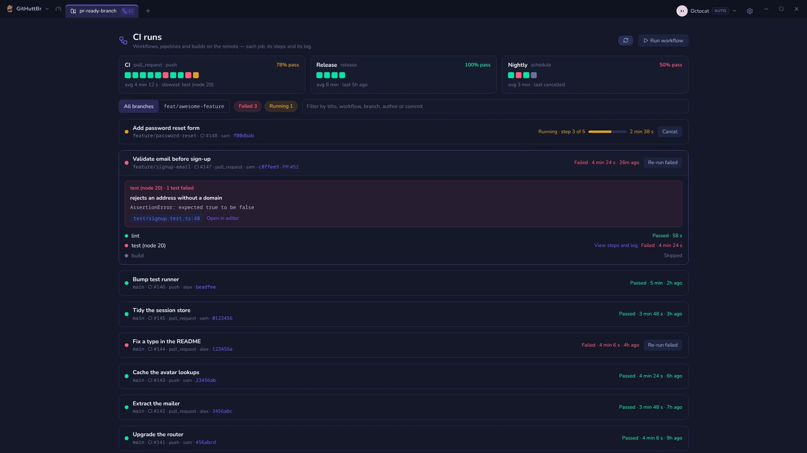

# CI 実行

プッシュしたら、あとは待つだけ — ブラウザに切り替え、リポジトリを探し、Actions を
開き、自分の実行を見つけ、赤くなったジョブを開き、ログの末尾までスクロールする。
**CI 実行** はその往復をコードの隣に持ってきます。1 つのページで、各ワークフローの
最近の調子がわかり、リモートの実行が新しい順に並び、失敗した実行は壊れたテストの
ところで直接開きます — ファイルと行つきで、エディターまでワンクリックです。再実行や
停止のボタンはカードの上にあります。

ホスト自身の API と、GitHuttBr にすでに渡してあるトークンで通信します。あなたの
マシンでは何も実行しません — それには [ローカル CI](local-ci.md) を参照してください。

## 開き方

**ツール → CI 実行…**、またはコマンドパレット（⌘K）の *CI 実行*。Wiki やインサイト
と同じくリポジトリのタブの上に開き、`origin` という名前のリモートを読みます —
`origin` がなければ最初のリモートです。

## ページに表示されるもの

| 部分 | 内容 |
|---|---|
| **ワークフローのカード** | ワークフローごとに 1 枚: 何がトリガーか、終了した直近 10 回の成功率（90 % 以上で緑、70 % 以上で琥珀色、それ未満で赤）、その実行を色付きの四角で — 古いものを左に置くので、最新は「今」の隣に来ます —、平均時間、そして最も遅いジョブか、直近の実行の結果。カードをクリックするとそのワークフローの実行だけを一覧し、もう一度クリックするとすべてに戻ります |
| **すべてのブランチ / 現在のブランチ** | リモートのすべての実行か、チェックアウト中のブランチのものだけか |
| **失敗 / 実行中** | それぞれを押したときに残る実行の数つきのクイックフィルター。ほかのフィルターで残ったものを数えるので、その数がクリックで表示される件数です |
| **フィルター** | 読み込んだ実行を、タイトル、ワークフロー、ブランチ、作成者、コミット、イベントで絞り込みます |
| **実行のカード** | コミットのタイトル（またはワークフロー名）、続いてブランチ、ワークフローと実行番号、何で開始されたか（プッシュ、プルリクエスト、スケジュール、手動…）、誰が開始したか、コミット — コミットをクリックするとコピーします。実行がプルリクエストに属するときは、**PR #n** でそのプルリクエストのページが開きます。右側: 現在の状態、かかった時間、どれくらい前か |
| **実行中の実行** | *実行中 · ステップ 3 / 5*、進捗バー、ここまでの時間。ステップは実行中のジョブのものです。ステップのないホスト（GitLab、Forgejo）では代わりにジョブを数えます |
| **失敗したテスト** | 失敗した実行は、新しいものから自動で開き、ログが名指ししたテストを示します: ジョブ、テスト、エラーの 1 行目、**パス:行** — それか *エディタで開く* をクリックすると、その行に移動します。プルリクエストの [チェックタブ](hosting.md#チェックタブ) と同じ読み取り方です |
| **ジョブ** | その下に、各ジョブの状態と所要時間。ホストにステージがある場合（GitLab、Azure）はステージごとにまとめます。*ステップとログを見る* でジョブのステップとログの末尾を開きます — 失敗したジョブでは常に表示され、それ以外ではジョブにポインターを合わせると現れます |
| **ステップ** | ジョブの各ステップと、その状態と所要時間 — GitHub、Azure、Forgejo は報告します。GitLab にはステップがありません |
| **ログ** | 終了したジョブのログの末尾を、色つきのまま。取得するのは最後の 512 KB だけで — 失敗があるのはそこです —、先頭を省いたときはページがそう表示します |

ページに待機中や実行中のものがある間は、一覧は 15 秒ごとにホストへ問い合わせ直し、
開いている実行と実行中のすべての実行のジョブも一緒に取得します — ステップ数はそこから
来ます。所要時間は毎秒進みます。2 分間の応答で何も新しいことがなければ — たとえば
デプロイの承認を待っている実行 —、1 分に 1 回に間隔を広げ、何かが動いたらすぐに
また速くなります。すべてが終了した一覧は、更新を押すまで何も問い合わせず、ウィンドウ
が隠れている間も何も問い合わせません。

ホストがタイトルなしで送ってくる実行 — GitLab のすべてのパイプライン、スケジュール
された Azure のビルド — は、コミットがグラフにあればそのコミットの件名で名付けます。
ローカルリポジトリから読むのでコストはかかりません。なければ番号で名付けます。

## 再実行・キャンセル・開始

| ボタン | 表示される条件 | 何が起きるか |
|---|---|---|
| **失敗を再実行** | 実行が失敗したかキャンセルされた | 成功しなかったジョブだけをもう一度実行します |
| **再実行**（↻） | GitHub で実行が終了している — カードにポインターを合わせると表示 | すべてのジョブをもう一度実行します |
| **ブラウザで開く** | カードにポインターを合わせたとき | ホストのサイトでその実行を開きます |
| **キャンセル** | 実行が待機中か実行中 | 先に確認します: 進行中のジョブは中断され、その作業は失われます |
| **ワークフローを実行** | ホストが手動での開始に対応している | ワークフローとブランチを選びます。そのブランチがプッシュされたかのように開始し、数秒後に一覧に現れます |

ホストごとにできること:

| ホスト | 一覧とジョブ | ステップ | ログ | すべて再実行 | 失敗を再実行 | キャンセル | 手動で開始 |
|---|---|---|---|---|---|---|---|
| **GitHub**（と Enterprise Server） | ✓ | ✓ | ✓ | ✓ | ✓ | ✓ | ✓ — ワークフローに `workflow_dispatch` トリガーが必要 |
| **GitLab**（とセルフマネージド） | ✓ — パイプライン、ステージごとのジョブ | — | ✓ | — | ✓（*Retry*） | ✓ | ✓ — ブランチ上で `.gitlab-ci.yml` を実行 |
| **Azure DevOps** | ✓ — ビルド、ステージごとのジョブ | ✓（タスク） | ✓ | — | ✓ | ✓ | ✓ — リポジトリの任意のビルド定義 |
| **Forgejo / Gitea** | ✓ Actions の実行 API があるサーバーで | ✓ | ✓ サーバーがトークンに提供する場合 | — | — | — | — |
| **Bitbucket** | — | | | | | | |

## グラフのバッジ

同じ CI が、グラフの各コミットの横に小さなバッジとして表示されます: 緑、赤、または
実行中は時計。ホバーでジョブ、クリックでホストのページです。バッジの出どころ:

| ホスト | 出どころ |
|---|---|
| GitHub | コミットのチェック実行 — Actions に限らず、GitHub に報告するあらゆる CI |
| GitLab | コミットのステータス。パイプラインのすべてのジョブを含みます。手動ジョブ（たとえばデプロイ）があってもバッジが時計のまま止まることはありません |
| Azure DevOps | リポジトリの直近 100 件のビルドを、コミットで照合 |
| Forgejo / Gitea | コミットの統合ステータス — Forgejo Actions と外部のあらゆる CI |
| Bitbucket Data Center | コミットのビルドステータス |

どの応答も記憶します — 「ここには CI がない」も含めて —。コミットへの問い合わせは、
答えが変わったかもしれないときだけです: 実行中は 45 秒ごと、終了後は 10 分ごと、
CI が一度もなかったコミットにはだんだん間隔を空けて。これで、にぎやかなグラフでも
ホストの 1 時間あたりの上限内に収まります。

## 制限

- **カードが知っているのは、ページが一覧した実行だけです。** それは適用中のブランチ
  フィルターでの直近 50 件です — めったに動かないワークフローは四角が 10 個に満たない
  ことがあり、現在のブランチに切り替えるとすべてのカードを計算し直します。最も遅い
  ジョブは、ページが終了した実行のどれかのジョブを読んでから表示されます（自動で開く
  失敗した実行で十分です）。それまでは、カードは直近の実行の結果を表示します。
- **失敗したテストはログのテキストから読み取ります。** Vitest、Jest、pytest を認識
  します。それ以外のランナー、ビルドエラー、途中で切れたログでは、ジョブの一覧だけ
  を表示します。ランナーがチェックアウトの外に書いたパスは開けません。
- **PR #n はホストの返答しだいです。** GitHub がプルリクエストを示すのは同じ
  リポジトリからの実行だけで、フォークからのものは示しません。GitLab はマージ
  リクエストのパイプライン、Azure は PR ビルドで示します。Forgejo の実行にはリンク
  がありません。
- **ログは末尾だけ、しかもジョブが終わってからです。** GitHub と Forgejo は、ジョブ
  が終わってからログを渡します。実行中は、出力ではなくステップの進み具合を表示
  します。GitLab と Azure は実行中のジョブのそこまでのログを返します — 続きを読むには
  開き直してください。
- **トークンには CI へのアクセスが必要です。** GitHub の細粒度トークンは、一覧に
  *Actions: read*、再実行・キャンセル・開始に *Actions: write* が必要で、クラシック
  トークンは `repo` が必要です。GitLab のトークンは一覧に `read_api`、ボタンに `api`
  が必要です。Azure のトークンは *Build: read*（ボタンには *Build: read & execute*）が
  必要で、ないとページもバッジもエラーにはならず空のままになります。
- **Azure のバッジは 100 ビルド前までしかさかのぼりません。** それより古いコミット
  にはバッジがありませんが、CI 実行ページにはそのビルドが引き続き表示されます。
- **Azure の再実行は「失敗したものを再試行」です。** ステージのある YAML パイプライン
  で動作します。クラシックパイプラインでは拒否されることがあり、ページはホストの
  返答を表示します。
- **ワークフローの開始時に入力は聞きません。** 既定値のない必須入力を持つ GitHub の
  ワークフローや GitLab のパイプラインは、ホストが独自のメッセージで拒否します。
- **Forgejo は読み取り専用で、新しいサーバーのみです。** 古い Forgejo や Gitea の
  サーバーには実行を一覧する API がありません。ページはホストが未対応だと表示し、
  グラフのバッジはコミットステータス経由で引き続き動作します。トークンから見えない
  リポジトリは、「未対応」ではなくアクセスエラーとして表示されます。
- **Bitbucket には実行ページがありません。** Data Center では CI は外部システム
  （Jenkins、Bamboo…）で、ステータスを報告するだけです — そのステータスがグラフの
  バッジです。bitbucket.org の Pipelines には対応していません。
- **リモートは 1 つです。** ページは `origin` を読みます。フォークの別のリモートの
  実行は一覧されません。

**関連項目:** [ローカル CI](local-ci.md) · [ホスティングとプルリクエスト](hosting.md)
