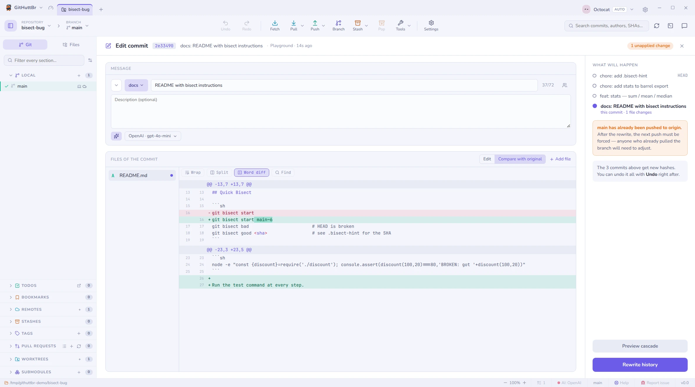

# 任意のコミットを編集

タイポは 3 週間前のコミットの中にあります。いつもの直し方は対話的リベースです。
そのコミットで止め、編集し、続行し、祈る。GitHuttBr の直し方はこうです。コミットを
右クリック、**このコミットを編集**、テキストを変更、完了。コミット詳細パネルの
ペンボタンからも同じエディターが開きます。

## 何をするのか

`HEAD` の祖先である任意のコミットを選びます — 履歴が直線でなくても構いません。エ
ディターはコミットグラフの代わりに中央ペインに開きます — コンフリクト解決やファイ
ルビューアーが開くのと同じ場所です — そしてウィンドウの幅と高さをすべて使います。
**Esc** かヘッダーの **×** で閉じます。別のリポジトリタブに切り替えて戻ってきても
編集内容は残り、未適用の編集がある状態で閉じようとすると先に確認されます。

ヘッダーにはコミットの短いハッシュ、件名、作者、経過時間が表示され、何かを変更す
ると黄色のピルが **未適用の変更** を数えます。メッセージで 1 件、編集したファイル
ごとに 1 件です。

### メッセージカード

メッセージには [コミット作成欄](committing.md) と同じ道具がそろっています。要約の前の **種別 ▾** ボタン、文字数カウンター（*56/72*）付きの要約とその下の説明、矢印の奥にあるスタイル行（scope、チケットキー、コミットスタイル）、gitmoji ピッカー、共同作成者、そのコミット自身の差分からの AI 生成、そしてリンターのヒントです。コミットのメッセージは読み込み時に分割され（1 行目が要約、残りが説明）、書き換えるときに空行 1 つでつなぎ直されます。古い `add retry` を `fix: add retry` にするのは、種別ボタンから 1 つ選ぶだけです。

メッセージが元と変わるとすぐに、カードに **変更あり** の印が付き、元の件名が説明
の下に *変更前: …* として表示されたままになり、**元に戻す** で要約と説明の両方が
元どおりになります。

### ファイルカード

コミットのファイルがステータス文字付きで一覧表示され、変更したファイルには点が付
きます。ファイルを選ぶと、そのコミット時点の内容を編集できます。エディターの上の
切り替えで **編集** と **元と比較** を行き来できます。**元と比較** は、コミットが持
つ内容から編集後のテキストまでのファイルの差分を、アプリの他の場所と同じ差分ビュー
で表示します。

**ファイルを追加** は、コミットが触れていないファイルをコミット自身のスナップショ
ットから開きます。パスの一部を入力して選んでください。編集すると、書き換え後のコ
ミットはそのファイルも変更します。一覧では **+** の印が付きます。

### 何が起こるか

カードの横 — 狭いウィンドウではカードの下 — のパネルには、書き換えが触れる連鎖が
表示されます。編集したコミットより上のすべてのコミットが `HEAD` から下へ並び、一
番下に編集したコミット自身と、そこで何が変わるかが表示されます。

1. **カスケードをプレビュー** は、編集したコミットより上のすべてのコミットを
   *メモリ上で* リプレイします（`merge-tree` チェリーピックの連鎖 — チェックアウ
   トなし、作業ツリーなし、ref なし）。連鎖の各コミットには、**競合なく再適用** さ
   れるか、名前の示されたファイルで **競合** するかが表示されるので、編集がきれい
   に波及するのか後の変更と衝突するのかが、**何かが動く前に** わかります。さらに
   編集すると結果は消え、**もう一度プレビュー** で再実行できます。
2. **履歴を書き換える** は本番です。同じ連鎖をプラミングで構築し、ブランチを
   `reset --keep` で移動します — コミットしていない変更は引き継がれるか、リセット
   が中止されて何も起きなかったことになります。先に
   [ガードスナップショット](recovery.md)が取られ、**元に戻す** で元の連鎖が復元さ
   れます。

コミットがすでにリモートにある場合は、黄色の注記がリモートブランチの名前を示し、
それが何を意味するか — 次のプッシュは強制プッシュになる — を伝えます。もう 1 つの
注記は、いくつのコミットに新しいハッシュが付くかを伝えます。

リプレイされたすべてのコミットの作者情報と日付は保持されます。変わるのはハッシュ
だけです — それが履歴を書き換えるということです。

## 範囲内のマージ

コミットと `HEAD` の間にマージがあっても、もう編集は無効になりません。カスケード
はマージをリプレイするとき、その **記録された結果** — そのマージが実際にコミット
したツリーで、衝突の解決も含まれます — を書き換え後の親に適用し直します。そのた
め、誰かが手作業で行った解決は書き換え後も一字一句そのまま生き残ります。rerere
なし、再マージなし、作業ツリーなし。カスケードの他の部分と同じメモリ上のプラミン
グで、両方の親ポインタも保持されます。編集したコミットを同じく含むサイドブランチ
は書き換えられて付け替えられ、含まないブランチはその同一性にいっさい手を付けられ
ません。サイドパネルの注記には範囲に含まれるマージの数が表示され、連鎖の中ではマ
ージコミットにマージアイコンが付きます。

正直な注意点: リプレイされたマージの出来は、記録された結果の出来を超えません。編
集が、マージ自身が解決した行と衝突する場合、プレビューは他の衝突するステップと
まったく同じように赤になります — 何も推測はされません。

## カスケードが衝突するとき

後のコミットが、いま編集しているのと同じ行に触れていた場合です。プレビューはその
コミットに衝突したファイルを示し、その上のコミットを再適用されないものとして示し
ます。**履歴を書き換える** は無効のままです — 中途半端に適用されることは決してあ
りません。リベースと違い、エディターは途中で止まって衝突を解決させてはくれませ
ん。編集の内容を変えるか、[対話的リベース](rebase.md)で衝突に正面から向き合って
ください。

## 制限

- **コミットは `HEAD` の祖先でなければなりません。** マージされていないサイドブ
  ランチ上のコミットには、現在のブランチへリプレイするための経路がありません。
- バイナリファイルと 2 MB を超えるファイルは表示されますが編集できません。
- すでにリモートにあるコミットも編集できますが、次のプッシュは **強制プッシュ**
  にならざるを得ません — その決断をする前にエディターが警告します。
- コミット内で削除されたファイルは編集できません（編集する内容がありません）。
- **ファイルを追加** で届くのは、コミットのスナップショットにすでに存在するファイ
  ルだけです。まったく新しいファイルの作成、ファイルの削除、シンボリックリンクや
  サブモジュールの変更はできません。

**関連項目:** [対話的リベース](rebase.md) · [復旧と reflog](recovery.md) · [アブソーブ](absorb.md)
