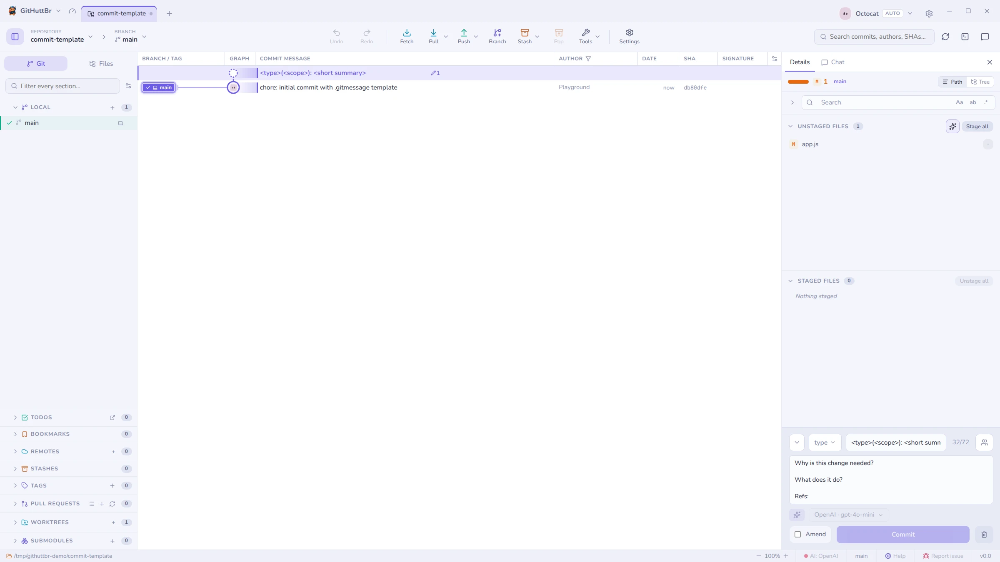

# コミット

## メッセージのスタイル

**設定 → AI → コミットメッセージ** で、または入力欄から直接 1
つ選ぶと、入力欄がそれに合わせて変わります。スタイルはプロファイルが使う
AI（共通の AI か、そのプロファイルの独自の AI）のものです。

| スタイル | 見た目 |
|---|---|
| **Conventional** | `feat(api)!: add rate limiting` — 型を選ぶドロップダウン付き |
| **Gitmoji** | `✨ add rate limiting` — 絵文字ピッカー付き |
| **Gitmoji + Conventional** | `✨ feat(api): add rate limiting`——絵文字ピッカー*と*種類のドロップダウン |
| **チケット** | `ABC-123: add rate limiting` — ブランチ名から自動で埋まる |
| **そのまま** · **自動** | 打ったとおり。自動は形を AI に決めさせる |
| **原始人** · **俳句** | 名前のとおりのもの |

### Gitmoji

[Gitmoji](https://gitmoji.dev) は件名の前に絵文字を付けて、履歴をひと目で読める
ようにします。🐛 は修正、✨ は機能追加、🔥 は削除です。どちらの gitmoji スタイル
でも、絵文字ボタンは件名の入力欄のすぐ横にあります。ボタンを押すと **公式の
gitmoji 75 個すべて** が開き、絵文字、`:コード:`（gitmoji-cli の利用者が入力する
もの）、またはあなたの言語での意味で検索できます。

**Gitmoji + Conventional** は種類と絵文字を連動させます。種類を選ぶと絵文字が
付き、種類を変えると絵文字も変わります。ただし、絵文字を自分で選んだ場合
（たとえば `fix` に 🚑️）は決して上書きされません。

| 種類 | Emoji | 種類 | Emoji |
|---|---|---|---|
| `feat` | ✨ | `test` | ✅ |
| `fix` | 🐛 | `build` | 📦️ |
| `docs` | 📝 | `ci` | 👷 |
| `style` | 🎨 | `chore` | 🔧 |
| `refactor` | ♻️ | `revert` | ⏪️ |
| `perf` | ⚡️ | | |

AI も同じ形で書きます。モデルが絵文字を忘れたり `:shortcode:` で答えたりしても、
件名は入力欄に入る前に修正されます。

他のツールが `:sparkles: add login` として書いたコミットは、グラフ、コミットの
詳細、履歴の画面で `✨ add login` として**表示**されます。

制限:

- ピッカーは常に **unicode** の絵文字を書き込み、`:shortcode:` は使いません。
- shortcode の変換は表示だけです。コミット自体は書き換えられず、履歴の検索は
  コミットされたときのテキストに一致します。
- 対象は gitmoji だけです。ほかの絵文字で始まる件名はそのままです。
- `commit-msg` フックが標準の Conventional プリセットで commitlint を実行する
  リポジトリでは、先頭の絵文字が拒否されます。これは GitHuttBr ではなくフックの
  ルールです。commitlint を gitmoji 向けに設定するか、そこでは素の Conventional を
  使ってください。

## AI でメッセージを書く

AI がオンのとき、説明欄の下に **AI で生成** があります。ステージ済みの diff
を読み、上で選んだスタイルで要約と説明を書きます。ボタンには誰が答えるか —
*アカウント · モデル*、つまり **設定 → AI → タスクごとのモデル** でコミット
メッセージ用に選んだ組み合わせ — が表示されるので、遅いローカルモデルや高価
なモデルに驚かされることはありません。

- 名前の横の **▾** は保存済みのアカウントを、それぞれのモデルをいくつか添えて
  一覧します。選んだものは **その 1 回の生成だけ** に使われ、設定は変わりま
  せん。
- 実行中は *アカウント · モデル で生成中… 12 秒* と **キャンセル** が表示され
  ます。キャンセルはスピナーだけでなくリクエストそのものを止めます。30 秒を
  過ぎると、準備のできた別のアカウントを **使う** ボタンも出て、同じ生成をそ
  ちらで実行します。アプリ全体の *予想より時間がかかっています* の案内
  （[AI](ai.md)）もこれまでどおり表示されます。
- 新しいテキストは元のテキストを **置き換え**、元のテキストは保持されます。
  *アカウント · モデル が 7 秒で生成しました* というバナーに、要約と説明を元
  に戻す **元に戻す** と **もう一度生成** が並びます。テキストを編集するか
  コミットすると消えます。

[コミットの編集](commit-edit.md) にも同じボタンがあり、そのコミット自身の
diff から生成します。

制限:

- 送られるのはステージ済みの diff だけで、非常に大きいときは切り詰められます。
  未ステージの変更や他のファイルは送られません。
- 元に戻すのは 1 段階だけです。連続した生成の最初の前のテキストです。バナー
  が消えると、そのコピーも消えます。
- キャンセルしても、プロバイダーがすでに消費したトークンは戻りません。
- ▾ の一覧には、まだキーのないアカウントも含め、保存済みのすべてのアカウント
  が出ます。それを選ぶと、そのアカウント自身のエラーで失敗します。

## 入力欄がやってくれること

- <kbd>↑</kbd> <kbd>↓</kbd> で**最近のメッセージ**を呼び出せます。
- **共著者ピッカー**が、そのリポジトリ自身の貢献者から `Co-authored-by:`
  トレーラーを追加します。
- `commit.template` / `.gitmessage` がメッセージを**あらかじめ埋め**、コメント行は
  取り除かれます。
- マージ、チェリーピック、リバートの最中は、git と同じようにメッセージが
  **あらかじめ埋まります**。
- 下書きはリポジトリごとに**保持される**ので、タブを切り替えてもメッセージを
  失いません。

## リンター

その場で動く、妨げにならないチェックです。件名の長さ（文字数カウンター付き）、
末尾のピリオド、命令形でない件名や小文字始まりの件名、長すぎる本文の行を見ます。
あくまでヒントであり関門ではありません — コミットを止めることはありません。

## 修正（Amend）

修正は、ステージされているものを使って直前のコミットを書き換えます。GitHuttBr は
既存のメッセージを先に表示するので、打ち直すのではなく編集することになります。

グラフの行にある **コミットを修正…** は、同じことを HEAD に対して行います。
メッセージ全体を読み込み、入力欄を修正モードに切り替えて、フォーカスを移します。
すでにプッシュ済みの HEAD でも修正はできますが、リモートを更新するには強制
プッシュが必要になると GitHuttBr が警告します。

**コミットを取り消す…** は、未プッシュの HEAD 向けの対になる操作です。親への
mixed リセットを行い、作業ツリーの変更は保たれ、メッセージは入力欄に復元されます。
最初のコミットには専用の経路があり、ファイルを壊す代わりに未出生（unborn）の
ブランチを残します。

**関連項目:** [ステージング](staging.md) · [アブソーブ](absorb.md) · [変更履歴ジェネレータ](changelog.md)
