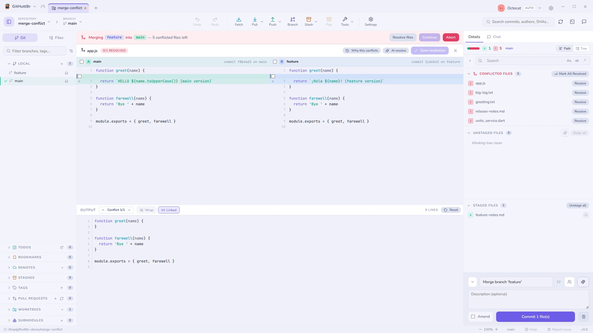

# コンフリクトの解決

マージ、リベース、チェリーピック、リバートが止まると、リゾルバはそのステップ全体を
1 つの画面にまとめます。上部のバーは **何が** 止まったのか、**何と何の間で** 止まった
のかを伝えます。単なる「コンフリクト」ではなく「`feature` を `main` にマージ中」と
表示し、さらに進み具合 — *5 ファイル中 2* 解決済み — と、全ファイルを通して残って
いるコンフリクトの数も示します。

## ファイルの帯

バーの下には、このステップが止まったファイルごとに 1 つずつチップが並びます。

| チップ | 意味 |
|---|---|
| 緑で ✓ 付き | 解決済み — ステージ済みで、決めることは残っていません |
| 枠線付き | いま開いているファイル |
| 赤い数字 | そのファイルにまだ残っているコンフリクトブロックの数 |
| ラベル | マージするテキストのないコンフリクト: *片方で削除*、*両方で名前を変更*、*片方で追加* |

解決済みのチップが先、未解決のチップが後に並び、それぞれ名前順です。帯は左が完了分、
右が残り、と読めます。

**次のファイル →** はまだ未解決の次のファイルへ飛びます。ファイルを解決済みにすると、
自動でそこへ移ります。バーの **続行** はすべてのチップが緑になるまで無効のままです。
**中止** は先に確認し、何を失うかを伝えます。

git はファイルをステージした瞬間にそのファイルのことを忘れます。そのため「解決済み」
とは、このステップの間に GitHuttBr が見たものに、git がマージメッセージに挙げた
ファイルを加えたものです。リゾルバを開く前にターミナルでステージしたファイルも数に
入ります。ただしリベースの途中で再起動すると、そのステップで解決済みだった分は数に
入らないことがあります。

## なぜここが衝突するのか

ファイルヘッダーの **なぜ衝突するのか** は、ブランチが分かれてからこのファイルに
触れたコミットを、側ごとに一覧します。中身は `git log --merge` — git がずっと前から
積んでいるのに、誰も見つけないコマンドです。

マーカーが言うのは *何が* ぶつかっているかです。こちらが言うのは *誰が、なぜ* 変えた
のかで、たいてい解決を決めるのはそちらです。何も出てこなければ、どちらの側もこの
パスそのものへの変更をコミットしていません。衝突は名前の変更か移動から来ています。

ヘッダーには、いまどのコンフリクトにいるのか、そしてそのファイルがどの種類の
コンフリクトなのかも、git 自身のステータスから読んで表示されます: *両方が同じ行を
変更*、*両方で追加*。

## 3 つのペイン

| ペイン | 中身 |
|---|---|
| **自分の側** | いたほうの側。その側でこのファイルに触れた最新のコミット — sha、件名、作者、どれくらい前か — が見出しに付きます |
| **ベース** | 両方の側の出発点となったバージョン。共通の祖先、またはピックやリベースのステップでは、適用中のコミットの親です。各コンフリクトが置き換えた行には網掛けが付きます |
| **取り込む側** | 入ってくる側。見出しは自分の側と同じ形式です |

結果ヘッダーの **ベースを表示** でベースペインの表示・非表示を切り替えられ、選択は
記憶されます。ベースがないとき — 両方の側がファイルを追加したとき — はグレーアウト
します。

どのペインもサイズを変えられます。さらに結果のヘッダーには、表示のトグルが 2 つ
あります。

| 切り替え | 何をするか |
|---|---|
| **折り返し** | 左右のペイン内で長い行を折り返し、横スクロールをなくします。結果のテキスト表示は 1 行 1 段のまま — 側面のマーカーがそれを前提にしています — なので常にスクロールします |
| **スクロールを連動** | ペインと結果を縦・横ともに一緒にスクロールします。行数が互いに違うため、縦位置は割合で合わせます |

折り返しは最初オフ、スクロールを連動は最初オンで、どちらも状態を覚えます。

## 結果

結果は、書き込まれるときのファイルそのものです。各コンフリクトはその位置に、4 つの
答えを載せたカードとして置かれます。

| 答え | ファイルに入るもの |
|---|---|
| **自分を採用** | 自分の行だけ |
| **相手を採用** | 相手の行だけ |
| **両方** | 自分の行、続けて相手の行 |
| **編集** | 両方を、コンフリクトを選択した状態でテキストエディタに開きます。答えが「両方、ただし手直しして」のときのためです |

まだ答えていないカードは両側をプレビューし、各行に *← 自分* か *← 相手* のタグと、
採用したときに入る行番号を付けます。視線を上げずに決められます。行がとても長い
ファイルでは、コードが下で横にスクロールしても答えのボタンは見えたままです。
ファイルヘッダーの **ファイル全体: 自分 | 相手** で、すべてのコンフリクトに一度に
答えられます。

**テキストとして編集** は、結果を自由に入力できるプレーンなエディタに切り替えます。
ヘッダーにはファイルの行数が出ます。一度でも入力すると、カードはそこにある内容を
もう表せないので、**選択をリセット** で全部を元に戻すまでテキストのままになります。

フッターはこのファイルに残っている数を数えます。**_ファイル_ を解決済みにする** は
結果を書き込んでステージします。すべてのコンフリクトに答えるまでは無効です。

## 移動する

ファイルを開くと、ファイルの先頭ではなく**最初のコンフリクト**に着地します。
結果ヘッダーの ⌃ / ⌄ 矢印 — または <kbd>Alt+↑</kbd> / <kbd>Alt+↓</kbd> — で
残りを順に辿り、そのたびにすべてのペインがそこへスクロールします。

## 行単位で選ぶ

左右のペインでは今までどおり **行** 単位、**チャンク** 単位で選べます。ヘッダーの
チェックボックスは **片側まるごと** を採用します。カードにはない答え — たとえば自分の
2 行と相手の 1 行 — のためのものです。行単位で選んだ内容は、その場でカードに反映され
ます。

## マージするものがないファイル

比べる行がないコンフリクトもあります。片方が、もう片方の変更したファイルを
**削除** した場合や、両方がそれぞれ別の名前に **名前を変更** した場合です。片方が空の
3 ペインでは何も説明できないので、こうしたケースには代わりにカードが出ます — 誰が
何をしたのかを、それぞれの側のコミット、作者、経過時間とともに示します。

| ケース | 選択肢 |
|---|---|
| 片方で削除 | **ファイルを残す**(もう片方の変更あり)、**ファイルを削除**(先に確認します)、そして **自分の変更を見る** — ベースからの差分で、削除すると何を捨てることになるのかがわかります |
| 両方で名前を変更 | 一方の名前を **残す**、もう一方を残す、または **両方の名前を残す** |

git は、名前を変更された元のファイルと 2 つの新しい名前との結びつきを記録しません。
そのためカードは内容で対応を付けます。判断できないとき — 複数の名前変更が同時にあり、
ファイルの中身も変わっているとき — はそう伝え、新しい名前はそれぞれ独立したチップに
なります。

## 完了する

最後のファイルを解決すると、ワークスペースは **続行** を探させたりしません。カードが
コンフリクトにどう答えたかをまとめ、マージメッセージ(git 自身のもので事前入力)を
編集させ、そこから完了できます。

- まとめは、あなたが選ぶのを見た分を数えます: 自分、相手、両方、手で編集。
  リゾルバの外で解決したファイルは、答えではなくファイルとして数えます。
- **リベース** のステップは再適用するコミット自身のメッセージを使うので、メッセージ欄は
  ありません。
- **この解決 (rerere) を次回のために記憶する** は git の `rerere.enabled` で、設定に
  あるのと同じスイッチです。git は発生するのを見たコンフリクトしか覚えないので、ここで
  オンにすると次のコンフリクトから効きます。
- **もう一度確認** は、ステージ済みの結果のままリゾルバを閉じます。

## 元に戻す

あらゆる解決 — 解決済みにしたファイル、採用した側、残した・削除したファイル、決めた
名前変更 — には元に戻す項目があります。元に戻すと、コンフリクトは git が残したとおりの
状態に戻ります: マーカー、インデックス内の両側とベース、ディスク上のファイル。
**中止** だけは元に戻せません。だから確認するのです。

## AI の補助

AI を有効にしていると、**AI で解決** が結果にマージ案をテキストとして提示します。
自分から何かを適用することは決してありません。読んで、直して、ステージするのは
あなたです。[AI 機能](ai.md) を参照してください。

## Xcode プロジェクトファイル

`project.pbxproj` は iOS リポジトリのどのファイルよりも競合します。しかも、
誰かが意見を違えたからであることはほとんどありません。24 桁の 16 進 ID を
キーにした平坦なオブジェクト辞書ひとつなので、ファイルを 1 つ追加すると 4 つの
エントリが書かれます — `PBXBuildFile`、`PBXFileReference`、所属グループの
`children` の 1 行、ターゲットのビルドフェーズの 1 行。2 人がそれぞれ 1 つずつ
追加すれば、同じ数行に落ちる 8 つのエントリが書かれます。Git は衝突と見ますが、
解決すべきものは何もありません。

競合したファイルが `project.pbxproj` のとき、リゾルバは 3 つの版をテキストでは
なくプロジェクトとして読み、**構造で統合**することを提案します。ID でオブジェクト
を対応づけ、両側のすべての追加を取り込み、`children` と `files` の配列を統合し、
本当に食い違ったところで止まります。ペインの上の帯が、各側が何を追加したか、
そして — もしあれば — あなたに何が残っているかを伝えます。

AI の提案と同じく、結果に入るだけでステージはしません。保存する前に
自分で読みます。

### やらないこと

**両者が動かした設定を推測することは決してありません。** あなたが
`MARKETING_VERSION` を `1.1` に、相手が `2.0` にしたなら、それは判断です。
背後で解決するのではなく、設定名・あなたの値・相手の値として帯に出ます。決着を
つけられなかったオブジェクトは *あなたの* 版をそのまま保ちます。中途半端に適用
された統合がディスクに届くことはありません。

**3 つの版のいずれかが解析できなければ、ファイル全体を断ります。** Xcode が
開けない `project.pbxproj` は手作業の統合より高くつくので、確実に読めないものは
通常のテキスト競合のまま残り、そのことを明示します。

**異なるオブジェクトに同じ ID が振られた場合は検出しません。** Xcode は ID を
無作為に選ぶため稀ですが、起きたときはどちらを取っても誰かのファイルを黙って
落とすことになるため、統合せずに報告します。

### `merge=union` ではなく

これに対して出回っている対処は [`.gitattributes`](attributes.md) の
`*.pbxproj merge=union` です。やめましょう。union は変更が独立した追加だけの
うちは動きますが、2 人が同じビルド設定を編集した瞬間に両方の行を出力し、Xcode が
開けないファイルを作ります — しかも差分を丁寧に読む可能性が最も低いその瞬間に。
構造による統合は、その破綻なしに同じ手軽さを与えます。

## ロックファイル

`Podfile.lock`、`Package.resolved`、`yarn.lock` とその仲間は、誰かのリゾルバが
すでに解いた依存グラフを記録したものです。片方の解の半分をもう片方の解の半分に
縫い合わせても、誰も解いていないグラフができるだけです。インストールできないかも
しれませんし、できたとしても、どちらのブランチもテストしていないものが入ります。

そこで競合したファイルがロックファイルのときは、帯がそれを持つツールの名前を出し、
**こちらを採用** と **相手を採用** をその場で提供し、あとで再生成するコマンドを
示します。ここで片側を選ぶのは妥協ではありません — それが方法のすべてで、
正しさを与えるのは再生成のほうです。

3 つのペインはそのまま使えます。見覚えのあるチェックサム、予期していたバージョン
など、何が変わったのか読みたいことはたまにあるからです。思いとどまってほしいのは
手で編集することのほうです。

## そもそも起こさない

[コンフリクトレーダー](conflict-radar.md) は、マージする前に、どのブランチが衝突する
のかを教えてくれます。

## git に覚えさせる（rerere）

長く生きているブランチをリベースすると、毎回同じコンフリクトに出会います。`rerere`
— *reuse recorded resolution*（記録した解決の再利用）— が git の答えです。コンフリクトを
どう決着させたかを覚えておき、まったく同じものが次に現れたときにその答えを再生します。

**設定 → Git と同期 → コンフリクトの解決を記憶する。** グローバルの git 設定に
`rerere.enabled` を書き込むので、コマンドラインでも同じように振る舞います。

git があなたの代わりに答えたとき、リゾルバは「コンフリクトマーカーがありません」という
空の画面を見せる代わりにその旨を伝え、**この解決を忘れる** を提示します。これは記憶を
捨てると *同時に* コンフリクトを呼び戻すので、違う決着をつけられます。

知っておくとよいことが 2 つあります。

- **再生された解決はステージされません** — *再生された解決を自動でステージする* を
  有効にしない限りは。オフのままにしておいてください。ここで一度止まる意味は、
  記憶された答えがこのマージでは間違っているかもしれない、という点にあります。見ずに
  ステージすることが、それをコミットまで運んでしまう経路です。

  だから再生されたファイルは **コンフリクトしたファイル** に残り続けます。git は中身を
  書いたものの、インデックスは未マージのまま抱えており、それを片付けるのはステージ
  だけだからです。動かすのは、リゾルバの **このままステージ**、または一覧の
  **すべて解決済みにする** です。
- **rerere はすべてのコンフリクトを理解するわけではありません。** 追加／追加や
  削除／変更のコンフリクトには前像が残らないので、毎回そのまま戻ってきます。設定に
  出ている件数が実際に抱えている数で、**すべて忘れる** で空にできます。

**関連項目:** [コンフリクトレーダー](conflict-radar.md) · [マージとリベース](merging.md)
