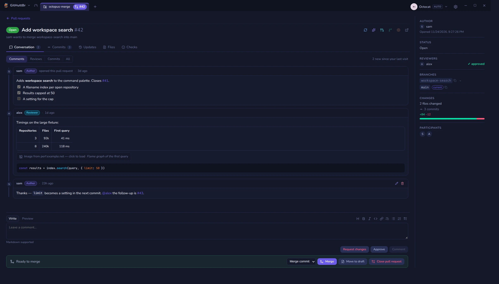

# プルリクエストページ

活発なリポジトリでは、20 件のプルリクエストが同時に開いています。サイドバーにも
並びますが、1 件 1 行では多くを語りません。どれが誰のものか、どれがあなたを待って
いるか、どれが赤くなったか。それを知るには、1 件ずつ開いて読み、戻って、次を開く
しかありませんでした。**プルリクエストページ**はこうした問いに 1 画面で答え、
プルリクエストを開いたあとは **‹ ›** で、戻らずに同じ一覧の次の 1 件へ移れます。

## 開き方

- サイドバーの **プルリクエスト** 見出しにある **一覧アイコン**（*すべてのプルリク
  エストを表示*）。
- コマンドパレット（⌘K）の *プルリクエスト…*、または **ツール → プルリクエスト…**。
- [ミッションコントロール](mission-control.md) のリポジトリの行にある **プルリクエストのチップ**。
  そこから開くと、ページの先頭に **← ミッションコントロールに戻る** が付き、その
  プルリクエストを開いて **← プルリクエスト** で戻ってきても残ります。

Wiki や [CI の実行](ci-runs.md) と同じく、このページはリポジトリのタブの上に開き
ます。

## 状態

検索の左にあるセグメントコントロールに、4 つの状態がそれぞれの件数つきで並びます。

| 状態 | 内容 |
|---|---|
| **オープン** | 開いているすべてのプルリクエスト（ドラフトを含む） |
| **ドラフト** | 開いているもののうち、ドラフトとしてマークされたものだけ |
| **マージ済み** | マージされたプルリクエスト。タブを初めて開いたときに読み込みます |
| **クローズ** | マージされずに閉じられたもの（却下・放棄）。マージ済みと一緒に読み込みます |

オープンとドラフトの横の件数は、サイドバーがすでに持っている一覧から取ります。
マージ済みとクローズは、どちらかを開いたときに、セッションごとに 1 回だけ問い合わ
せます。**更新** でもう一度問い合わせます。

## フィルター

| フィルター | 残すもの |
|---|---|
| **検索** | タイトル・説明・作成者・ブランチ・番号に、入力したすべての単語を含むプルリクエスト。`#482` や `482` でその番号が見つかり、一致箇所はタイトル内でハイライトされます |
| **作成者** | 1 人の作成者。それぞれこのタブでの件数つきで並び、**自分** が先頭です |
| **レビュアー** | レビューを依頼された 1 人、または **自分にレビュー依頼** |
| **マージ先ブランチ** | そのブランチへのプルリクエスト |
| **自分のレビュー待ち** | *レビュアー: 自分にレビュー依頼* のショートカット |
| **自分の** | *作成者: 自分* のショートカット |
| **CI 失敗** | head のチェックが失敗したプルリクエスト |

検索と 3 つのチップは 1 行に並び、各チップには、現在の状態のプルリクエストのうち
それを押すと残る件数が表示されます。**作成者**、**レビュアー**、**マージ先ブラン
チ** は **その他のフィルター ▾** の中にあり、どれかが設定されている間はそのボタン
が強調表示されます。

フィルターが 1 つでも有効な間は、一覧の上の行に、その状態のプルリクエストのうち何
件を表示しているか、どのフィルターが有効かが表示され、**フィルターをクリア** で
すべて外せます。

フィルターはリポジトリごとに、**アプリが動いている間** 保持されます。ページを
離れて戻っても、そのままです。再起動をまたいで保存しないのは意図的です。1 週間後
に「自分の、CI 失敗」のフィルターが黙って戻ってきたら、隠すつもりのないプル
リクエストを隠してしまいます。

### 「自分」とは誰か

「自分」とは、このリポジトリの呼び出しがホストにサインインするアカウントです。
リポジトリが [紐づけられた](profiles.md) プロファイル、なければアクティブな
プロファイルで、ホスト自身に問い合わせて決めます。トークンが自分が誰かを答えられ
ない場合（ユーザースコープがない）やトークンがない場合、**自分**、**自分の**、
**自分のレビュー待ち** は表示されません。

## 一覧

オープンとドラフトは、片づけていく順に 3 つのセクションに分かれます。

| セクション | 内容 |
|---|---|
| **あなたのレビュー待ち** | 誰かがあなたにレビューを依頼したプルリクエスト。見出しは黄色 |
| **あなたのプルリクエスト** | あなたが書いたもの |
| **その他** | それ以外すべて。上の 2 つに何かある間は **表示** の後ろに折りたたまれ、検索やフィルターで展開されます |

ホストがあなたが誰かを答えられないときは振り分けるものがなく、一覧は 1 枚のカード
になります。マージ済みとクローズは履歴なので、カード 1 枚でセクションはありません。

各行は左から右へ読みます。

| 部分 | 表示内容 |
|---|---|
| **点** | 最後にそのページを離れてから、プルリクエストが変わったこと。一度も開いていないものには点がありません — 比べる相手がないからです |
| **#** | 番号。オープン中は緑、ドラフトはグレー |
| **タイトル** | タイトル、その [Conventional Commits](committing.md) の種別を色付きチップで（`feat`、`fix`、`docs`…）、*ドラフト* バッジ。その下に作成者（自分のものでは省略）、ソース → マージ先、そして **コメント N 件** — 前回の訪問以降に他の人が書いたものがあれば **新しいコメント N 件** |
| **サイズ** | `+48 −12 · 4 ファイル` — 追加・削除した行数と、変更したファイル数 |
| **レビュー** | 各レビュアーの現時点の判定 — **✓ bruno が承認**、**✕ ana が変更を要求** — 続いてまだ依頼されている人、黄色の **● あなたを待っています**。ホストがレビュー完了と言い、チェックも失敗していなければ **✓ マージ可能**、誰も依頼されず誰も答えていなければ **レビュアーなし** |
| **チェック** | head のチェック — `✓ 6/6`、`✕ 失敗 1`、`● 実行中 2`。ホバーで件数 |
| **更新** | 最後に変更されてからの経過時間。ホバーで日付 |

### ホストごとに得られるもの

サイズ、コメント、判定は、どのホストの一覧にもあるわけではありません。ページは
それを探すためにプルリクエストを 1 件ずつ開くことはしません。一覧が持っていないもの
は空欄のままで、ゼロにはしません。

| ホスト | サイズ | コメント | レビューの判定 |
|---|---|---|---|
| **GitHub** | ✓ | ✓、どれが新着かも | ✓、*マージ可能* も — 一覧全体で GraphQL リクエストが 1 回増えます |
| **GitLab** | — | ✓（件数のみ） | 依頼されている人。*マージ可能* は GitLab のマージステータスから |
| **Azure DevOps** | — | — | ✓ レビュアーの投票から |
| **Bitbucket Data Center** | — | ✓（件数のみ） | ✓ |
| **Bitbucket Cloud** | — | ✓（件数のみ） | — |
| **Forgejo** | ✓ サーバーが埋めていれば | ✓（件数のみ） | 依頼されている人 |

コメント数は会話のコメントです — 差分の行へのコメントは含みません。トークンがない
と GitHub のリクエストは行わず、これらの列は空のままです。

セクション内では行は最新のアクティビティ順に並び、プルリクエストの中の **‹ ›** は
表示された順にたどります。クリックするとプルリクエスト自身のページ
（[ホスティングとプルリクエスト](hosting.md)）が開きます。そのページのないホスト
では、行をクリックするとブラウザでプルリクエストが開きます。

[フォークのチェックアウト](hosting.md#フォーク元リポジトリにあるあなたのプルリクエスト) では、フォーク元リポジトリにある
あなたのプルリクエストも一覧に入り、*owner/repo 上* と表示されます。

## プルリクエストから一覧をたどる

ページから開いたプルリクエストには、タイトルの上に帯が表示されます。

- **← プルリクエスト** で一覧に戻ります。フィルターは離れたときのままです。
- **‹ k / n ›** で、開いた元の一覧の前後のプルリクエストへ移ります。クリックした
  時点の、絞り込んだ一覧とその並び順のままです。ツールチップには各矢印の行き先の
  プルリクエストが表示されます。
- **Alt+← / Alt+→** でキーボードからも同じ操作ができます。**設定 → ショートカット**
  で割り当てを変更できます。テキスト欄にカーソルがある間（Option+← が単語単位の
  移動になる場所）と、ターミナルにフォーカスがある間は反応しません。

移動はページをその場で置き換えるので、10 件のプルリクエストをたどってもタブに
アイコンが 10 個残ることはありません。一覧から別の行を開いても置き換わります。

**それ以外の場所から** — サイドバーや通知から — 開いたプルリクエストは、ページの
既定の並び（オープン、フィルターなし）でリポジトリのオープンなプルリクエストを
たどります。その一覧にも入っていないもの（たとえばスタックのマージ済みの段）には、
一覧に戻る道だけが表示されます。

## プルリクエストのブランチへ移動する

プルリクエストで作業するには、そのブランチをチェックアウトする必要があります。
そして何千ものブランチがあるリポジトリでは、ブランチ一覧から名前で探すのが時間の
かかる部分です。プルリクエストのページでは、**ブランチ** 欄がそれを代わりに
やってくれます。

- **ブランチ名はリンクです。** クリックするとそのブランチをチェックアウトし、
  リポジトリのグラフのブランチの先端へ移ります。プルリクエストのページはタブに
  開いたままです。
- **サーバーにしかないブランチ** は、まずフェッチします（リモート全体ではなく、
  そのブランチだけ）。そして、それを追跡するローカルブランチとしてチェックアウト
  します。すでにローカルにあるブランチには、そのまま切り替えます。更新はしない
  ので、プルリクエストの最新のコミットが欲しいときはプルしてください。
- **すでにいるブランチ** には、代わりに *現在* と表示されます。何もチェックアウト
  しません。
- 各名前の横の **コピーボタン** で、名前をクリップボードに入れます。
- **元に戻す**（⌘Z）で元いたブランチに戻り、チェックアウトで作られたローカル
  ブランチを削除します。ただし、その後そのブランチにコミットしていれば、
  そのまま残します。

ヘッダーにも同じ 2 つの操作がボタンとしてあります: **ソースブランチへ移動** と
**ターゲットブランチへ移動**。すでにいるブランチでも動作し、その場合はリポジトリ
へ移るだけです。 [アイコンの色](themes.md#アイコンの色) をオンにすると、ヘッダーのボタンはそれぞれ固有の色になります: 更新は青、AI レビューは紫、プレビューはティール、ソースブランチは緑、ターゲットブランチはオレンジ（ブラウザーで開くは灰色のまま）。

クリックするまで何も調べません。プルリクエストを開いても、ブランチを読み込んだり
フェッチしたりはしません。

できないこと:

- **フォークのソースブランチ** は別のリポジトリにあるので、リンクになりません
  （コピーボタンは残ります）。そのすぐ下にある **プルリクエストをローカルで
  試す…** が、ここで動かす方法です。マージ先ブランチはリンクのままです。
- **一致するリモートがない。** ブランチは、URL がプルリクエストのリポジトリである
  リモートで探します。そこを指すリモートが設定されていなければ、リンクは何もせず、
  ツールチップがその理由を伝えます。
- **削除されたブランチ。** マージ済みのプルリクエストは、ブランチも一緒に削除して
  いることがよくあります。その場合フェッチは、そのブランチがもうリモートにないと
  伝え、プルリクエストのページにとどまります。
- **ローカルの変更。** チェックアウトは破壊的ではないので確認はありません。
  コミットしていない変更が上書きされる場合は、git がチェックアウトを拒否します。
  エラーにファイル名が出るので、コミットするかスタッシュしてからもう一度クリック
  してください。
- **このウィンドウ。** チェックアウトはこのリポジトリの作業ツリーで行われます。
  ブランチがすでに別の [ワークツリー](worktrees.md) でチェックアウトされている
  場合は、代わりにそのワークツリーのタブが開きます。

## コミット

サイドバーはプルリクエストのコミットが何件あるかは示しても、どれなのかは示しません
でした。コミットを 1 件ずつレビューする — たいていのプルリクエストはそう読まれる
ことを想定しています — にはブラウザーが必要でした。会話と更新の間にある
**コミット** タブが、それらを一覧にします。

- 上部の **要約行**: コミットの数、作成者の数、プルリクエストの **+/−**、そして
  [Conventional Commits](https://www.conventionalcommits.org/) の種別ごとに件数付きの
  色付きチップ。*feat 2 · fix 1 · test 1* を見れば、1 行も読まないうちにどんな種類の変更
  かがわかります。機能は緑、修正とリバートは赤、テストはアクセントカラー、パフォーマン
  スは黄、その他は灰色です。
- **古い順** に、適用される順序で並び、作成された日ごとにまとめられます。日付順から
  外れてリベースで入ったコミットは、移動されるのではなく、その日の見出しを新たに
  始めます。
- 各行には作成者の画像（ホストが提供する場合）、件名 — Conventional Commits に従って
  いれば、種別は同じ色付きチップで、scope は控えめな色で表示 — 、作成者、経過時間、
  そしてこのクローンにあるコミットならその **+/−** と変更したファイル数があります。
  続いて、ホストがそのコミットの実行を報告していれば **CI** の点（緑は成功、赤は失敗、
  黄は実行中）、短い SHA、**差分を表示**。親が 2 つあるコミットには、ホストがそう伝え
  れば **マージ** バッジが付きます。
- 件名以外にも本文があるコミットは、メッセージの残りを行の下に表示します。
- ホバーすると、**コピー** で完全な SHA をクリップボードに入れ、**ブラウザーで開く**
  でホスト上のコミットを開きます — ホストにそのページがあればプルリクエストの中で
  （GitHub、GitLab、Bitbucket Data Center）、なければリポジトリのコミットページで。

最後にプルリクエストを離れた後に作られたコミットは、**前回の訪問以降の新着** の線の
下に並びます — 会話タブと同じ印で、同じ訪問に基づきます。

**差分を表示** — または行のクリック、あるいは Tab で移動して Enter — で、グラフで
クリックしたときと同じように、アプリでそのコミットを開きます。リポジトリのビューで、
そのコミットが選択され、詳細が開きます。これはこのクローンにコミットが **ある** 場合
に動作します。ない場合、行には *まだリポジトリにありません* と表示され、ボタンが変わ
ります。

- **ブランチを取得** — [ブランチへの移動](#プルリクエストのブランチへ移動する) と同じ
  1 ブランチだけのフェッチで、チェックアウトはしません。一緒に届いたコミットはどれも
  開けるようになります。このコミットが届かなければ（その後フォースプッシュで書き換え
  られた場合）トーストがそう伝えます。
- **プルリクエストのコミットを取得** — **フォーク** からのプルリクエストの場合。その
  ブランチは別のリポジトリにありますが、ほとんどのホストはプルリクエストの head を
  ターゲットリポジトリに専用の ref として映しています — `refs/pull/N/head`（GitHub、
  GitHub Enterprise Server、Forgejo）、`refs/merge-requests/N/head`（GitLab）、
  `refs/pull-requests/N/from`（Bitbucket Data Center）。アプリはその ref だけを、
  タグなしで、アプリ専用の ref `refs/githuttbr/pr/<remote>/N` にフェッチし、コミットは
  ほかと同じように開きます: グラフはその head をラベルのないレーンとして描きます。
  もう一度フェッチすると、ref はその時点の head に移ります。その後のフォースプッシュで
  コミットが外れていれば、トーストがそう伝えます。
- **ブラウザーで開く** — フェッチできない場合のために。

**2 つのコミットを比較** では 2 つの行にチェックを入れると、その間の
[比較](merging.md#compare-any-two-refs)がリポジトリのビューで開きます。古い方がベース
になるので、一方から他方へ何が起きたか — 間にあるコミットとその合算の差分 — がわか
ります。どちらもこのクローンにある必要があり、2 つそろうまではボタンはグレーアウトさ
れます。

一覧はページを開いたときではなく、タブを初めて開いたときに読み込み、**更新** の
たびに読み直します。読み込むまで、タブの件数はホストがプルリクエストについて
返した数です。マージ済みやクローズのプルリクエストも同じようにコミットを一覧に
します。

できないこと:

- **最大 250 件のコミット。** GitHub 自体がプルリクエストについて 250 件までしか
  一覧にしません。アプリはどのホストでも同じ数で止まり、それ以上あるときは
  *ホストにはさらにあります* と表示し、ホスト上のプルリクエストへのリンクを付けます。
  どの 250 件になるかはホストが一覧にする順序次第です — アプリは先に並んだものを
  残し、一覧の上の行がどちらかを示します。

  | ホスト | もっと長いプルリクエストで表示されるもの |
  |---|---|
  | GitHub | **最初の** 250 件（GitHub 自体の上限） |
  | GitLab、Azure DevOps、Bitbucket Data Center、bitbucket.org | **最新の 250 件** |
  | Forgejo | サーバーが先に返す側。その順序は文書化されていません |
- **ホストが映していないフォークの head。** Azure DevOps はマージ結果しか公開せず、
  プルリクエスト自身の head は公開しません。bitbucket.org はどちらも公開しません: そこ
  では行はブラウザーだけを提案します。映していないと分かったほかのホストでは、フェッチが
  そう伝えます。必要なら、**プルリクエストをローカルで試す…** が Azure のマージ結果を
  取り込みます。
- **フェッチした head は残ります。** `refs/githuttbr/pr/…` はブランチではありません:
  チェックアウトもプッシュもできず、prune 付きのフェッチも触れず、git はそのコミットを
  保持します。それを消すものもありません — ページを閉じても、
  [ブランチの整理](branch-cleanup.md) でも。不要なら ref を手で削除してください:
  `git for-each-ref refs/githuttbr/pr` で一覧が出て、`git update-ref -d <ref>` で
  1 つ削除できます。
- **名前に `/` を含むリモート** は、その ref の名前の 1 区切りになれないため、そこでは
  フェッチを拒否します。
- **削除されたブランチ。** マージ済みのプルリクエストはブランチも一緒に削除して
  いることがよくあり、その場合はフェッチがそう伝えます。bitbucket.org は、ソース
  ブランチがなくなるとコミットを一切返しません。
- **スカッシュマージ。** スカッシュマージされたプルリクエストのコミットはマージ先
  ブランチに入っていないので、ブランチが削除された後はホスト上にしかありません。
- **コミットごとの数値はクローンから。** **+/−** とファイル数は git から読み、ホストに
  は問い合わせません。そのため、まだフェッチしていないコミットには表示されず、マージ
  にも表示されません（変更が 2 つの親に対するものだから）。コミットのファイルが欠けて
  いる部分クローンでは、ダウンロードせずに表示しないままにします。
- **CI は最新 40 件のコミットだけ**、黙って。コミットごとに 1 リクエストでは長いプル
  リクエストで積み重なりますし、CI はたいていプッシュされたヘッドで実行されています。
  ホストの資格情報がなければ点は出ず、サインインを求めることもありません。
- **種別チップは件名を読みます。** Conventional Commits を書かないチームにはチップも
  種別ごとの件数も出ません — 推測はしません。
- **作成者** はコミットに記録された名前で表示します。GitLab、Azure DevOps、
  Bitbucket Data Center は、画像からは送れないサインインなしでは画像を返さない
  ので、それらの行はイニシャルを表示します。
- **Azure DevOps の長いメッセージ** は途中で切れることがあります。Azure の一覧が
  コミットのメッセージを切り詰めるため、アプリは届いたものを表示します。
- **bitbucket.org** のプルリクエストはブラウザーで開きます — アプリにはまだその
  ページがありません — ので、アプリが一覧を読めるにもかかわらず、そこではこの
  タブにたどり着きません。

## 更新

月曜日にレビューしたプルリクエストは、木曜日には先に進んでいます。コミットタブは
いまどこにあるかを示しても、その間に何が起きたかは示しません: どのコミットがどの
プッシュで来たか、誰かがフォースプッシュして読んだはずの内容を書き換えていないか、
そしてコードが *自分の見た版と比べて* どうなっているか。コミットとファイルの間に
ある **更新** タブがそれに答えます — Azure DevOps 自身の Updates タブと同じように。

プルリクエストへの各プッシュを **新しい順** に並べます。

- **更新 1 — 作成** はプルリクエストを作成したときのプッシュです。以降のプッシュには
  順に次の番号が付きます。
- それぞれに **いつ**、**誰がプッシュしたか**（ホストが伝える場合）、**追加された
  コミット** — 短い SHA、件名、作成者 — が表示されます。プッシュでブランチから外れた
  コミットをホストが報告する場合は、取り消し線付きで **削除されたコミット** の下に
  並びます。
- フォースプッシュやリベースには **履歴の書き換え** の印が付きます: 読んだコミットが
  消えているかもしれず、並んでいるのは古い作業の新しいコピーかもしれません。Azure
  DevOps では、プルリクエストを別のマージ先ブランチに移したプッシュに **ターゲット
  変更** の印が付きます。

### 1 つの更新で何が変わったか

**この更新の変更を表示** は、そのプッシュだけについてファイルタブを開きます: 前の
更新の head からこの更新の head までの差分 — 更新 1 なら、ホストがその地点を示す
場合（Azure DevOps、GitLab）、作成時のマージ先ブランチから。ファイルツリーと
ビューアーは同じで、バナー — *更新 3 の変更を表示中（更新 2 との比較）* — と、
プルリクエスト全体に戻る **すべての変更を表示** が付きます。

差分は、できる限り **このクローンで** 作ります: 2 つの head の間の `git diff` で、
正確で、ホストに問い合わせません。どちらかの head がなければ、アプリはまず両方を
**コミット ID で** プルリクエストのリモートからフェッチし — ブランチもタグも ref も
書き込みません。フォースプッシュで置き換えられた head はもうどのブランチにもありま
せんが、ほとんどのホストはまだ ID で返します — ここで比較します。そのフェッチが
失敗したときだけ、ホストに問い合わせます。

| ホスト | ホストの比較 |
|---|---|
| Azure DevOps | `$compareTo` を付けたイテレーションの変更 — 2 つのプッシュの間 |
| GitLab | リポジトリの比較。一方の head からもう一方へ直接 |
| Bitbucket Data Center | リポジトリの比較 — 2 つの head の **共通の基点から** |
| GitHub | Compare API（`base...head`）— 2 つの head の **共通の基点から** |
| Forgejo / Gitea | なし: API に 2 つのコミット間の差分がありません |

共通の基点から比べると、書き換えの差分はそのプッシュがしたことではありません: 削除
した内容は表示されず、その後マージ先ブランチに入った変更がプルリクエストの変更の
ように見えることがあります。履歴が書き換えられた更新をそのように比較したときは、
バナーがそう伝えます — *共通の基点から比較しています。このプッシュで削除された内容は
表示されません。* どれもうまくいかないときは、バナーがそう伝え、ブランチ（フォーク
からならプルリクエストの head）をフェッチしてここで比較することを提案します。

行コメントはプルリクエスト全体の差分に属するため、1 つの更新を表示している間は行に
**+** がありません。バナーがそう伝えます。ファイルを確認済みにする操作はいつもどおり
で、プルリクエスト内のファイルに印を付けます。

### 前回の訪問以降の新着

最後にタブを開いてからプッシュされた更新には **新着** バッジが付き、タブ自体にも
件数が出ます: *更新 5 · 新着 2*。タブを開くとそれらは既読になります（どれが新着
だったか分かるよう、タブを見ている間はバッジが残ります）。タブを開いたまま **更新**
でさらに届いたら、**既読にする** で消せます。プルリクエストのページを開いただけでは
何も既読になりません。あるプルリクエストの更新タブを初めて開いたときは、何も新着では
ありません — 比べる前回の訪問がないからです。

更新はその件数のためにページと一緒に読み込み、**更新** でも読み直します — 投稿した
コメントやレビューのたびではありません。

既読の状態はこのコンピューターにだけ、リポジトリとプルリクエストごとに保存され、
ホストには送りません。

### ホストごとの違い

| ホスト | 更新の出どころ | プッシュした人 | 削除されたコミット | 書き換えの検出 |
|---|---|---|---|---|
| Azure DevOps | プルリクエストの **イテレーション** — 各プッシュに対する Azure 自身の記録 | あり | なし（報告されない） | あり: `forcePush` / `rebase` |
| GitLab | マージリクエストの **差分バージョン**。各バージョンのコミットはその head から割り出す | なし（バージョンは誰も示さない） | あり | あり: 以前の head にもう到達できない |
| Bitbucket Data Center | プルリクエストのアクティビティ: **OPENED** と、ソースブランチを動かした各 **RESCOPED** | あり | あり（ホストの合計付き） | あり: コミットを削除した rescope |
| GitHub | タイムラインのコミットとフォースプッシュから **推定** — 下記参照 | フォースプッシュのみ | なし | あり: フォースプッシュのイベント |
| Forgejo / Gitea | タイムラインの **push** 項目。最初のものはプルリクエスト自体と一緒に書かれる | あり | なし | あり: フォースプッシュの項目 |
| bitbucket.org | 利用不可 | — | — | — |

**GitHub は通常のプッシュを記録しません** — フォースプッシュだけです — そのため
更新は **コミットの時刻から推定** します。更新とは、フォースプッシュの間にある、互いの
上に積み重なったコミットの連なりです。前のコミットの上に積まれていないコミットや、
前のコミットから 10 分より後に来たコミットは、次の更新を始めます。プルリクエストの
作成後にコミットされたものは作成時に含まれていたはずがありません。そのため、1 時間
おきに作ったコミットを 1 回でプッシュすると 2 つに **分かれ**、数分おきの 2 回の
プッシュは **1 つ** に見えます。タブはグループ分けが概算だと伝えます。リベースの
新しいコミットは、タイムラインがそのフォースプッシュの直前に並べることがありますが、
そのフォースプッシュの分として数えます。フォースプッシュの前後の head は正確なので、
その **変更を表示** も正確です。

### 制限

- **上限。** 一覧には最新の 100 件の更新が並びます。GitHub のタイムラインは新しい端
  から最大 500 件、Bitbucket Data Center のアクティビティ（こちらも新しい順）は最大
  1,000 件、GitLab のバージョンとコミットはそれぞれ最大 300 件、Forgejo のタイムライン
  は最大 500 件（それより長ければ新しいもの）を読みます。上限で **作成時** が切れると、
  番号はもうホストのものではありません: タブがそう伝え、最新から数え戻します（*最新の
  更新*、*更新（最新の 2 件前）*）。
- **Azure DevOps** は削除されたコミットを報告しません。代わりにフォースプッシュや
  リベースに印が付きます。Azure がコミット一覧を切り詰めたイテレーションは個別に
  読み（最大 500 コミット）、それでも不完全なときは更新がそう伝えます。
- **GitLab** はプッシュした人を示しません。head が書き換えで失われたバージョンは、
  そのコミットを見つけるために個別に読みます — そうしたバージョンのうち新しい 10 件
  について — セッションごとに 1 回: バージョンは変わらないからです。
- **Forgejo と Gitea** はフォースプッシュのコミットを一覧にしません — 2 つの head だけ
  で、**変更を表示** が比べるのはそれです — そしてフォースプッシュの後は作成時に何が
  含まれていたかを示すものがないため、サーバーが作成時のプッシュ自体を記録していない
  限り空のままです。API に 2 つのコミット間の差分がないので、その比較には両方の
  コミットがこのクローンに必要です。タイムライン API のないサーバーは、すべての
  コミットを 1 つの更新に表示します。
- **ID でのフェッチ** には、コミットを ID で返すホストが必要です。GitHub はまだ保持
  しているコミットならどれでも返しますが、ほかのホストや素の git サーバーは、どの
  ブランチも指していないコミットを拒むことがあります — その場合はホストの比較を使い
  ます。フェッチしたコミットは ref なしでこのクローンに置かれ、git がいずれ回収します。
- **Bitbucket Data Center の比較** はサーバーの構造化された差分を読み、unified 形式で
  描きます。非常に大きなファイルは切り詰められて返ることがあります。
- 書き換えられた head は **ホストから** 完全に **消えている** ことがあります（Azure と
  GitLab は保持しますが、ほかは回収することがあります）。その場合はどちら側でも比較
  できず、バナーがそう伝えます。
- **bitbucket.org** のプルリクエストはブラウザーで開き、更新タブはありません。

## ファイルを読む

200 ファイルのプルリクエストを、200 個のフルパスとして読むのは大変ですし、どこまで
見たかを見失わずに終えるのも大変です。一覧と差分の上の行が数を数えます — *9 ファイル
中 4 件を確認済み*、バー付き — そして **前の未確認** / **次の未確認** は、まだチェック
していないいちばん近いファイルへ上または下に移動し、一覧の端まで来たら反対側に回り
込みます。一覧のすべてが確認済みになるとグレーアウトします。**次へ進むときに確認済み
にする** にチェックを入れると、**次の未確認** は先へ進む前に開いているファイルを確認
済みにします — 頭から順に読んでいけば、チェックボックスに触れることはありません。こ
の選択は記憶されます。**表示:** で一覧を **未確認** のファイル、または **コメントあ
り**（レビューの会話が何かあるもの）に絞り込み、**すべて** に戻せます。

**ファイル**
タブの一覧には、コミットパネルと同じ **パス / ツリー** の切り替えがあり、その選択は
アプリ全体で共通です。**ツリー** では、ファイルはフォルダーの下に並び（`src/main/ipc`
のような連なりは 1 行になります）、各フォルダーには合計の **+/−** と、そのうち何件が
確認済みか（*3/5*）が表示されます。フォルダーのチェックボックスで中のファイルを
すべて確認済みにするか、すべて外します。チェックはこのコンピューターにだけ保存され、
ホストには送られません。チェックはファイルの差分の版を覚えているので、プッシュで
確認済みのファイルが変わると、**変更あり** のピル（*確認後に変更されました*）付きで未確認に
戻ります。差分のないファイル（バイナリ、大きすぎるもの）は、状態と行数だけで比較
します。 レビューの会話があるファイルには、名前のすぐ後に吹き出しの件数が表示され、長い一覧でもコメントのあるファイルが目立ちます。古くなった会話も、解決済みの会話も数えます — アプリが読むホストの一覧は、どれが解決済みかを伝えないからです。フォルダーをクリックするか、その上で ←/→ を押すと折りたたみます。↑/↓
（または j/k）で画面上のファイルを順に進み、それぞれの差分を開きます。折りたたんだ
フォルダーはアプリを終了するまでプルリクエストごとに記憶され、その中のファイルを
開くとそこまでの道筋が展開されます。ツリーはホストがファイルを並べる順ではなく、
名前順です。

**画像。** プルリクエストが追加・削除・変更する画像（png、jpg、gif、webp、bmp、ico、avif、
svg）には読むべきテキストの差分がないので、タブは代わりに画像を表示します。コミットの場合と
同じ表示で、新しい画像、古い画像、または変更前と変更後を横に並べたものとスライダーです。
名前が変わった画像は、ベース側の古いパスとヘッド側の新しいパスを比べます。1 回の更新の差分
では、その更新の 2 つのヘッドを比べます。バイトは、コミットがこのクローンにあればここから
取り（無料で速い）、なければリポジトリのプロファイルでホスティングから取ります。制限: 32 MB
を超える画像はプレビューされません。行コメントは画像には付きません（SVG はテキストの差分と
そのコメントを下に残します）。**Git LFS** に保存された画像はホスティングから読みます。
クローンにはポインタしかないからです。GitLab、Azure DevOps、Forgejo はそれを解決しますが、
GitHub の API はポインタしか返さないので、そこではタブがホスティングへ案内します。ホスティ
ングがマージベースを示さない場合（そのときはターゲットブランチの先端で代用します）、注記が
「変更前」にターゲットブランチの後の変更が含まれうることを伝えます。クローンもホスティングも
バイトを出せないときは、タブがそう伝え、プルリクエストのブランチを取得するか、ホスティングで
開くよう提案します。

**パスとエディタ。** 差分の上のバーには、ファイルのパスをコピーするボタンと **⋯** メニュー
があります。一覧でファイルやフォルダを右クリックしても同じメニューが開きます。メニューは
パス、名前が変わったファイルの以前のパス、フォルダのパスをコピーし、ファイルを
[エディタ](editor.md)（または別のアプリ）で開くか、ファイルマネージャーで表示します。後の
2 つはプルリクエストの版ではなく**作業コピー**に対して動きます。作業コピーに存在するファイル
にだけ有効で（PR が削除するファイルや、ブランチにないファイルは理由を表示します）、チェック
アウト中のブランチが PR のブランチでないときは、どのブランチのファイルを開くことになるかを
メニューが伝えます。

**戻ってくる。** プルリクエストを離れてリポジトリや別のタブ、次の PR に移っても、戻れば
離れたときのままです。同じタブ、同じ開いたファイル、同じスクロール位置、そして未送信の
テキスト（コメント、返信、行コメント、編集）がすべて残っています。これはプルリクエストを
閉じるかアプリを終了するまで続きます。保持はメモリ上だけで、直近 50 件のプルリクエストが
対象です（それを超えると最も古い位置が手放され、そこにあったテキストは次に開くプルリクエ
ストのページに引き継がれます）。未送信のテキストがある PR を閉じると、先に確認します。更新で
下書きの場所がなくなったと分かった場合（返信先の議論、編集中のコメント、対象のファイル）、
テキストは失われません。コピーするか破棄するまで、ページの上部で待っています。

### 差分の出どころ

レビューの質は、読む差分の質で決まります。ホスティングの API はその元として適していません。
Azure DevOps は差分をまったく送らずファイルの一覧だけを返すので、ファイルごとに 2 回
ダウンロードして比べる必要があります。GitHub は 3000 ファイルで打ち切り、大きなファイルの
パッチを省きます。GitLab は大きな差分を*大きすぎる*として何も送りません。そのため「ファイル」
タブは、どのホスティングでも**まずこのクローンを読みます**。

1. ホスティングにプルリクエストの 2 つのコミット、つまり始点とヘッドを尋ねます。Azure
   DevOps、GitLab、Forgejo はマージベースを示します。Bitbucket Data Center は行コメントが
   結び付く差分のベースを示します。GitHub はターゲットブランチしか示さないので、ヘッドとの
   マージベースはここで計算します（コミットがなければ GitHub の比較を使います）。画像の
   プレビューも同じ 2 つのコミットを使います。
2. 両方がここにあれば、その間の `git diff` がすべてのファイルを返し、数に上限はありません。
   ホスティング自身のページが比べるのと同じ 2 つのコミットなので、ここでの行番号はそこでの
   行番号であり、行コメントは置いた場所に付きます。
3. ここになければ、プルリクエストのリモートから **id で**取得します。オブジェクトだけで、
   ブランチは作りも動かしもしません。取得はページを開いたときに 1 回（「更新」でもう一度）
   で、その間は一覧の上に*プルリクエストのコミットを取得中…*と表示されます。id でコミットを
   渡さないサーバー（一部の Azure DevOps や素の git サーバー）は、何も言わずに飛ばします。
4. そこで初めてホスティングの API を使います。API が差分を返さないファイルは、空のふりを
   せずに理由を表示します（下記）。

後から読み込んだファイル（*まだ読み込まれていない*ときに開いたもの、または**再試行**の後の
もの）も、ほかと同じように一覧に加わります。同じビューアで表示され、行コメントも付けられます。

Azure DevOps では、API 経由の場合、タブを開いたときに最初の 100 ファイルを、同時に 3 件
ずつ、合計 1 分以内で読みます。残りは開いたときに 1 件ずつ読みます。制限を受けたリクエストは、
サーバーが求める待ち時間のあいだすべての読み込みを止めます。それでも失敗したものは理由と
ともにそう表示します。ファイルがテキストかどうかはバイトで判断し、Azure の *binary* フラグ
は使いません。Azure は UTF-16 のファイルや ASCII 以外のテキストの一部にもこのフラグを付ける
からです。プルリクエストに含まれるより少ないファイルしかホスティングが返さないとき（GitHub は
3000 で打ち切ります）、一覧の上の 1 行がそれを伝えます。

### ファイルに差分が出ないとき

| 表示 | 理由 | できること |
|---|---|---|
| **バイナリ** | バイトがテキストではない（画像、アーカイブ）。UTF-16 や古い 1 バイト文字のテキストはテキストとして認識されます。 | ホスティングで開く。 |
| **大きすぎて表示できません** | 変更行が 20,000 行または差分が 8 MB を超えるか、どちらかの版が 4 MB を超える。クローンで読めた場合、**+/−** は数えられます。 | ホスティングで開く。 |
| **まだ読み込まれていません** | 1 回の読み込みが保持する範囲（差分約 150,000 行）を超えた、または Azure DevOps の API で最初の 100 ファイルか 1 分を超えた。 | 開けば読み込まれます。読み込まれなければ**差分を読み込む**。 |
| **読み込めませんでした** | 読み込みが失敗した。理由が下に表示されます。 | **再試行**。 |
| **ホスティングが省略しました** | ホスティングの API が差分を送らず、このクローンにプルリクエストのコミットがない。 | **プルリクエストを取得してローカルで見る**（id でコミットを、またはフォークからプルリクエストのヘッドを取得）。その後、差分はここで作られます。 |
| **名前またはモードだけが変更されました** | 名前の変更か権限の変更で、内容は同じ。 | 内容にレビューするものはありません。 |
| **エンコーディングが変更されました** | 同じテキストを別の形で保存した（バイトオーダーマークの追加・削除、UTF-16 から UTF-8 への変換）。 | 意図した変更か確認する。気にするツールもあります。 |

一覧では、差分を読めていないファイル（まだ読み込まれていない、読み込めなかった、ホスティング
が省略した）は **+0 −0** ではなく **—** を表示します。**+0 −0** だと「何も変わっていない」と
読めてしまうからです。バイナリのファイルや名前だけの変更は本当の **+0 −0** を表示し、
ホスティングが行数を数えている場合（GitHub は省略したパッチでも数えます）はその数を表示します。

## 行にコメントする

ここではレビューのスレッドに返信はできても、新しく始めることはできなかったので、
本格的なレビューにはやはりブラウザーが必要でした。プルリクエストの **ファイル**
タブでは、差分のどの行にも、その行だけのコメントを付けられます。

- **行にホバー** して、番号の上に出る **+** を押すか、**行そのものをクリック** します
  （テキスト選択を終えるクリックや、単語を選択するダブルクリックは数えません。
  それは読んでいるだけです）。右クリックメニュー — またはキーボードのコンテキスト
  メニューキー — にも *N 行目にコメント* があります。
- **その行の下** に入力欄が開きます。書いたら **コメント** — または ⌘/Ctrl+Enter。
  **キャンセル** で閉じます。**Esc** でも閉じ、何か入力していれば先に確認します。
  どちらの場合もフォーカスはその行に戻ります。
- 成功すると、新しいスレッドが **その行の下** と、ほかの全員が見る会話タブの
  レビュースレッドに表示されます。

コメントがどちら側に付くかは行によって決まります。

| 行 | 固定先 |
|---|---|
| **追加**（緑） | ファイルの新しい版の、新しい行番号 |
| **削除**（赤） | 古い版の、古い行番号 |
| **変更なし** | 新しい版（GitLab には、求められるとおり両方の番号を送ります） |

既存のスレッドもそれぞれの行の下に表示され、ホストがスレッド内での返信をアプリに
許している場合は返信欄も付きます（Forgejo は許していません）。スレッドを行の上に
表示するのは、表示中の差分にまだ属しているとホストが言うときだけです。それ以外は、
推測した行に置くのではなく会話タブに残します。

| ホスト | 最新のプッシュより前に書かれたスレッド |
|---|---|
| GitHub | 行が変わると古いもの扱い: 会話のみ |
| GitLab | 古い head に対して書かれたもの: 会話のみ |
| Azure DevOps | 行が今ある場所まで Azure が追跡 |
| Bitbucket Data Center | 行がなくなると孤立: 会話のみ |
| Forgejo | Forgejo はコメントが古いかどうかを伝えないので、記録された行番号に表示します — プッシュ後はその行に別のコードがあるかもしれません |

表示中のハンクの外にある行へのコメントは、どのホストでも会話タブにだけあります。

入力したまま送っていないコメントは、メインのコメント欄のテキストと同じくプルリクエストに
残ります。**‹ ›**、Alt+矢印、別のタブに移ってもそのまま残り、戻ればその行に再び表示され
ます（上の*戻ってくる*を参照）。別のファイルを見ても保たれます。別の行でコメントを始める
には、先に最初のものを送るか取り消してください。

できないこと:

- **1 行ずつ、すぐ投稿。** 行の範囲指定も、コメントをまとめて後で提出する保留中の
  レビューも、変更の提案もありません。コメントは送った瞬間に、それぞれ独立した
  スレッドとして公開されます（Forgejo では単独コメントの呼び出しがないため、その
  1 件だけを含むレビューとして）。
- **見ている差分に対して。** ファイルタブは、差分をどのコミット（Azure DevOps では
  どのイテレーション）で読み込んだかを覚えていて、コメントはそれに対して送られます。
  その後プルリクエストが進んでいれば — プッシュや新しいマージベース — 今その番号を
  持つ行にコメントを付けることはせず、*この差分を読み込んだ後にプルリクエストが
  変更されました* として拒否します。**更新** で新しい差分が表示されます。GitHub では
  代わりに、読んだコミットに対してコメントを投稿し、その行が変わっていれば GitHub が
  古いものとしてマークします。それでもホストが受け付けない行は、差分の外として
  拒否されます。
- **拒否。** コメントの権限がない場合（読み取り専用のトークン、リポジトリがコメントを
  許していないアカウント）、ホストが拒否し、メッセージがそれが理由だと伝えます。
- **bitbucket.org** のプルリクエストはブラウザーで開きます — アプリにはまだその
  ページがありません — ので、そこでの行コメントは引き続き Web サイトで行います。
- **差分のないファイル**（バイナリ、またはホストが含めないほど大きいもの）には、
  コメントする行がありません。

## 会話

プルリクエストの経緯はあちこちに散らばっています。説明は上に、コメントはある一覧に、
行のスレッドは別の一覧に、判定はサイドバーにだけ、プッシュは専用のタブに。追いつくに
はそれを全部読んで、順序を頭の中で組み立て直す必要がありました。**会話** タブはそれ
を、1 本のレールに沿った **タイムライン** として、起きた順に語ります。

| タイムライン上 | 表示されるもの |
|---|---|
| **説明** | 常に最初に、誰がいつプルリクエストを開いたかとともに |
| **コメント** | 会話。それぞれに作成者の役割 — **作成者** または **レビュアー** — が付きます |
| **プッシュ** | *sam が 2 件のコミットをプッシュ*、続いてコミットごとに 1 行。ハッシュをクリックするとコミットタブが開きます |
| **行のスレッド** | 最初のコメントの位置に、その場で: ファイルと行、対象の差分の行、返信、返信欄。パスと **ファイルで表示 →** は、そのファイルをファイルタブで開きます |
| **レビューの判定** | 緑の **承認**、赤の **変更を依頼** とレビュアーが書いた内容、またはレビュー自身のコメント |

ホストが **未解決** と報告したスレッドには琥珀色のピルが付き、タイムラインの上のバーが
その数を数えます。**未解決のスレッド 1 件** を押すと、まだ返事を待っているそれらだけが
表示されます。**解決済み** のスレッドは 1 行に折りたたまれ — *src/palette.tsx:18 の解決
済みスレッド · コメント 2 件* — クリックで展開します。**コメント · レビュー · コミット ·
すべて** で、タイムラインを 1 種類に絞り込めます。開いたときは **コメント** が選ばれて
いて、**すべて** で全部に戻ります。

サイドバーの **レビュアー** は、各人の判定を言葉で示します — **✓ 承認** または **変更
を依頼** — まだ返答していない人には時計が付きます。

### 前回の訪問以降の新着

プルリクエストのページを離れると（別のページ、別のタブ、閉じる、アプリの終了や再読み込み）、アプリはその時刻を
記録します。次に開いたとき、線が中断した場所を示し — **前回の訪問以降の新着** — バーが
その後に何件来たかを伝えます。印は開いたときではなく離れたときに付けるので、読んでい
る間は動きません。プルリクエストを初めて開いたときは、何も新着として示されません。

自分で書いたものが自分にとって新着になることはありません。自分のコメント、返信、
レビューは数に入らず、線も動かしません。訪問より前に始まり、その後に他の人から返信
が付いたスレッドも新着として数えます — タイムライン上では始まった位置に留まるので、
線より上を探してください。

時刻は *2 日前* のように表示され、ホバーすると完全な日付が出ます。

*制限:*

- **コミットがいつプッシュされたか** は、ホストが教えてくれません。プッシュはコミット
  の一覧から組み立て直します。同じ作成者の連続したコミットで、それぞれが前のものから
  1 時間以内なら 1 回のプッシュとみなし、最後のコミットの日付に置きます。日付を書き換
  えたリベースがあれば位置が動きます。ホスト自身の記録がある場合は、更新タブがそれで
  す。
- **未解決か解決済みか** は GitHub（読み込みごとに GraphQL リクエストが 1 回増えます）
  と GitLab から得ます。Azure DevOps、Bitbucket Data Center、Forgejo のスレッドにはピル
  が付かず、数にも入りません。
- **タイムライン上の判定** には日付が必要です。GitHub、GitLab（承認は、GitLab がそのた
  めに書くノートの日付）、Forgejo は日付を返します。Azure DevOps の投票と Bitbucket
  Data Center の承認には日付がないので、サイドバーにだけ表示されます。
- 本文のない GitHub のレビュー — 行コメントのまとまりをしまう封筒 — には行を設けませ
  ん。そのスレッドはすでに表示されています。
- 前回の訪問は、最近の 300 件のプルリクエストについて、このコンピューターにだけ保存さ
  れます。クラッシュや、アプリが強制終了された場合は、訪問は記録されません。
- **自分のもの** は、ホスト上のあなたのアカウントで判断します。ホストが作成者を表示
  名でしか示さず、照合できる ID を返さない場合、自分の項目も他の人のものと同じように
  数えられます。

## コメントを書く

ページ上のどの入力欄も — 下部のコメント、スレッド内の返信、行へのコメント — 同じ
Markdown エディターです。**書く / プレビュー** タブ、GitHub のショートカットを
備えた書式ツールバー、Enter で続くリスト、そして画面にすでにある人やプルリクエスト
からの **@** / **#** 補完。スレッドの返信だけは例外で、ツールバーのない 1 行の欄
です。Enter で送信、Shift+Enter で改行します。詳細と制限は [コメントを書く](writing-comments.md)
にあります。

## コメントの表示

コメントは Markdown で書かれるため、プレーンテキストで表示すると `**` や `- [ ]`、
コードフェンスだらけになります。説明、会話、レビュースレッド（会話タブとファイルタブ）
は Markdown として描かれます: 見出し、リストとタスクリスト、表、引用、フェンスが示す
言語でハイライトされたコードブロック、リンク、画像。イシューのページも同じように
テキストを描きます。テキスト中の `#123`、`AB#123`、`!123`、`@user` はこれまでどおり
リンクになり、カードがあったものには [カード](#123-や-ab123-が何の話か) も付きます。

描画の出どころ:

| ホスト | 描画するもの |
|---|---|
| GitHub、GitHub Enterprise Server | GitHub 自身（`body_html`）: メンションや参照は Web サイトと同じくリンクになり、画像は GitHub の画像プロキシを通り、非公開の添付ファイルには署名付きのアドレスが付きます |
| GitLab、Forgejo、Azure DevOps、Bitbucket Data Center | アプリが、コメントの Markdown から描きます。相対リンクはリポジトリ内を指し、GitLab では GitLab と同じく `/uploads/…` がプロジェクト内を指します |

コメントはほかの人のコンテンツなので、含められるものは狭く、自分のファイルよりも
狭くなっています: 明示されたタグの一覧、`https:`、`http:`、`mailto:` だけのリンクと
画像、スクリプト・フレーム・フォーム・SVG・インラインスタイルはなし、そしてリンクは
アプリ内では決して開きません（ブラウザーに渡します）。タスクリストのチェックボックスは
表示されますが、クリックはできません: ここでチェックしてもホスト上では何も変わらない
ためです。

**別のサイトの画像はクリックを待ちます。** 画像の読み込みは、その向こうのサイトが、
あなたの IP アドレスとコメントを読んだ時刻とともに観察できるリクエストです — コメント
できる人なら誰でもトラッキングピクセルを置けます。そのため、自動で読み込むのはホスト
自身の画像だけです: github.com ではその添付ファイル、`*.githubusercontent.com`（画像
プロキシを含む）、そのアセット。ほかのホストではそのホスト自身のアドレス。それ以外の
画像には *example.net の画像 — クリックして読み込む* と表示され、クリックするとその
画像だけを読み込みます。**設定 → セキュリティ → コメント内の他サイトの画像を読み込む**
でこれをオフにできます。[セキュリティ](security.md#コメント内の画像) を参照してください。

**プレビューは投稿される内容を示します。** このページとイシューのページでは、各
コメント欄の **プレビュー** タブも同じようにテキストを描きます: 同じプロファイル、
同じ改行、同じ保留された画像 — 外部の画像へのリンクを貼っても、書いている間は読み
込みません。新しいプルリクエストと新しいイシューのダイアログは、アプリの通常の
Markdown プレビューのままです。

**長すぎるものや複雑すぎるものはテキストで表示します。** Markdown はアプリの
ウィンドウで描画され、テキストによっては大きさから想像するよりはるかに描画の負荷が
かかります。**32,000 文字** を超えるコメントや、描画を止めるような形のもの（1 段落に
数千個の対になっていない `_` や `*`、1 行に 32 段を超える `>` やリスト記号）は、
*長いコメントのため、プレーンテキストで表示しています。* または *複雑すぎてここでは
描画できないため、プレーンテキストで表示しています。* の下に、リンク付きの
プレーンテキストとして表示します。それでも描画に失敗したコメントは、自動で同じように
切り替わります: ページのほかの部分は影響を受けません。

できないこと:

- **編集では書いたとおりのテキストを表示します。** **編集** はこれまでどおり
  Markdown を開き、保存した編集は、ページがプルリクエストを読み直すまでアプリが
  描きます（GitHub では、その後は GitHub が描きます）。
- **GitHub の非公開の添付ファイルは期限切れになります。** GitHub は非公開画像の
  アドレスに数分間だけ署名します。ページをしばらく開いた後に読み込めなくなった画像は
  **更新** で戻ります。
- **アプリ自身が描く GitHub 上の相対パスの画像**（ページが読み直す前の、アプリから
  送った返信）は、github.com 上のリポジトリのアドレスの下で探すため、GitHub が置く
  場所とは違うことがあります。
- GitHub のコメント内の **動画** は、プレーヤーではなくファイルへのリンクとして表示
  されます。
- アプリ自身が描く場合（ほかのホスト）、**GitHub 独自の拡張** はありません: 絵文字の
  ショートコード、Mermaid 図、アラートのスタイルはなく、数式はテキストのままです。
- **コードがハイライトされるのは、フェンスが言語を示したときだけです。** 言語を推測
  すると、ページ上のすべてのブロックにすべての文法を走らせることになります。
- コミットタブの **コミットメッセージ** はプレーンテキストのままです: git は Markdown を
  描画せず、ホストも描画しません。

## 自分のコメントを編集・削除する

送信済みのコメントのタイプミスや、もう当てはまらない指摘を直すには、以前はブラウザー
へ行く必要がありました。いまは自分のコメントのヘッダーの末尾に **編集**（鉛筆）と
**削除**（ごみ箱）があります: 会話のコメント、レビュースレッドのコメントと返信で、
会話タブとファイルタブの両方に。イシューのページにも、GitHub と Forgejo のコメント
についてあります。

何が「自分のもの」かはページ自身が決めます。ページは読み込むたびに、このリポジトリの
呼び出しが誰としてサインインするか（アクティブなプロファイルではなく、紐づけられた
プロファイル）をホストに問い合わせます。ほとんどのホストは作成者をログイン名で示し、
大文字と小文字を区別せずに比較します。Azure DevOps は作成者を表示名で示しますが、表示名は 2 人が同じこともあるため、そこでは
名前を比較しません: 作成者 ID がアカウントの ID と一致するか、**または** 作成者の一意な
名前（アカウント名、たいていはメールアドレス）がアカウントのものと大文字小文字を区別
せずに一致すれば、そのコメントはあなたのものです。どちらも 1 人だけのものです。後者は、
接続が報告するものとは異なる作成者 ID の場合をカバーします。どちらも比較できなければ、
どのコメントにも操作は表示されません。アプリがあなたが誰か分からない場合（ユーザースコープのないトークン、または
ホストが応答しなかった）も、どのコメントにも表示されません。**更新** でもう一度
問い合わせます。それでも決めるのはホストです: コメントの変更を許していない
アカウントは拒否され、メッセージがそう伝えます。

- **編集** は、同じ Markdown エディターで、書いたとおりのテキストのままコメントを
  その場で開きます。**保存**（または ⌘/Ctrl+Enter）で送信し、**キャンセル** か
  **Esc** で閉じます。何か変更していれば先に確認します。取り除くのはテキスト前後の
  空行だけで、インデントされたコードや末尾の 2 つのスペースによる改行は打ったとおり
  残ります。新しいテキストはすぐに表示され、ページはプルリクエストを読み直します。
  プルリクエストページでは、保存していない編集は **‹ ›** で次へ進んでもタブを切り替えても
  プルリクエストに残り、プルリクエストを閉じるときは先に確認します。Issue ページは何も保持
  しません。タブを閉じる前に確認するものもありません。
- **削除** は必ず先に確認し、その問いが何が起きるかを伝えます: サーバーがコメントを
  全員から削除し、元に戻せません。戻す手段がないので、元に戻す履歴もありません。

返信のある **スレッドの最初のコメント**（レビュースレッド、またはほかの人が返信した
会話のコメント）の削除はホストごとに異なり、確認ダイアログがどれかを伝えます。
そのうち 2 つはホストが文書化しておらず、その旨も伝えます。

| ホスト | 返信のあるスレッドの最初のコメント |
|---|---|
| GitHub | 返信は残るはずですが、GitHub のドキュメントには書かれていません。スレッドは返信欄を保ちます: 最初のコメントがなくなると、返信は GitHub の GraphQL API を通じてスレッドそのものに送られます。スレッドは、まだ残っている返信から見つけます。それが失敗した場合（古い Enterprise Server、GraphQL が拒否するトークン、このアカウントは返信できないと GitHub が言うスレッド）、スレッドには代わりに **GitHub で返信** が表示されます。GitHub で進行中のレビューがあると、GitHub は返信をその中に入れることがあります: その場合はトーストがそう伝え、そのレビューを向こうで提出するまで返信は誰にも見えません |
| GitLab | そのノートだけが消え、スレッドと返信は残ります |
| Azure DevOps | 削除済みとしてマークされ非表示になり、スレッドと返信は残るはずですが、Azure のドキュメントには書かれていません |
| Bitbucket Data Center | 拒否されます: Data Center は返信のあるコメントを削除しません。先に返信を削除するか、代わりに編集してください |

コメントを **編集済み** と表示するホストもあります。テキストだけの日時を持つのは
Azure DevOps だけです。GitHub、Bitbucket Data Center、Forgejo では、アプリはコメントの
作成日時と最終更新日時を比べるので、表示は近似です（コメントに触れるほかの操作でも
付くことがあります）。GitLab の日時はスレッドを解決したときにも動くため、使いません。

できないこと:

- **Forgejo のレビューコメント**（行へのコメント）は API で編集できず、削除できるのも
  一部のバージョンだけなので、どちらの操作も表示しません: Web サイトで変更して
  ください。会話のコメントはほかと同じように使えます。
- **その間に誰かが変更した。** Bitbucket Data Center はコメントのバージョンを確認
  します: ページの読み込み後に変更されたコメントの編集や削除は拒否され、**更新** で
  現在のものが表示されます。ほかのホストは最後の書き込みを採用します。
- **見つからない**: ホストがコメントを見つけられないと、削除されたか、このアカウント
  からは見えない可能性があるとメッセージが伝え、ページはプルリクエストを読み直し
  ます。なくなったコメントで開いていた編集は破棄されます。
- **bitbucket.org** のプルリクエストはブラウザーで開くので、アプリはその呼び出しが
  できるものの、コメントを編集するページはまだありません。
- プルリクエストの **説明** とレビューの要約はコメントではなく、ここでは編集しません。

## `#123` や `AB#123` が何の話か

*fixes AB#4821* と書かれたコミットや、*#312 を参照* と書かれたコメントが伝えるのは
番号であって、それが何だったかではありません。知るには開くしかありませんでした。
いまは **参照を指す** — または Tab で移動する — と、ホストがそれについて返す内容の
小さなカードが開きます。

- 種類を示すアイコンと、書かれたままの参照
- その **タイトル**
- その **状態**（オープン、クローズ、マージ済み — Azure DevOps ではワークアイテム自身の
  状態、たとえば *Active* や *Resolved*）
- Azure DevOps では **ワークアイテムの種類**（Bug、User Story、Task…）

カードがあるのは、プルリクエストページ（説明、コメント、レビュースレッド、**コミット**
タブのコミットのメッセージ全体）、イシューのページ、コミット詳細パネルの件名です。
Azure DevOps の **コミット** タブでは、コミットの件名にある各ワークアイテム（`AB#123`、
またはそこでは同じ項目を指す `#123`）の横にタイトルも灰色で表示されます。Azure DevOps
では `!123` はそのプルリクエストへのリンクになり、カードはありません。

| 参照 | ホスト | 読み込み元 |
|---|---|---|
| `AB#123`、および Azure リポジトリでの `#123` | Azure DevOps | ワークアイテム。1 リクエストで最大 200 件 |
| `#123` | GitHub、GitHub Enterprise Server | イシューとプルリクエスト。1 回の GraphQL リクエストで最大 50 件。GraphQL が失敗したときは 1 件ごとに 1 回の REST リクエスト |
| `#123` / `!123` | GitLab | イシュー / マージリクエスト。種類ごとに 1 リクエスト |
| `#123` | Forgejo | イシュー（プルリクエストも）。1 件ごとに 1 リクエスト、2 件ずつ同時 |

`#123` は独立した単語のときだけ数えます: `org/repo#123`（別のリポジトリ）、`&#39;`、
`#123abc` のような色、リンクの `#issuecomment-…` には反応しません。

カードが開くまでは何も問い合わせません。開いたときに、指している参照と、ページ上で
その近くにあるまだ分かっていない参照をまとめて 1 回で問い合わせるので、次のカードは
たいていすぐに出ます。回答はアプリが動いている間メモリーに 5 分間保持され、ディスク
には書きません。その後も表示は続き、次のホバーで読み直します。保持はプロファイルごと
です: 呼び出しはリポジトリが [紐づけられた](profiles.md) プロファイルとして行われ、
別のプロファイルでは別の項目が見えることがあります。

かかるコスト:

- **GitHub** は GraphQL API で 1 リクエストに最大 **50** 件を読みます — 指しているものと
  その近くのもの。レート制限以外の理由で GraphQL が失敗した場合（古い Enterprise
  Server、拒否されるトークン）、アプリは 1 リクエストで 1 件のイシューを読む REST API に
  切り替えます: そのときは最初の **10** 件だけを、GitHub がアプリに求めるとおり 1 件ずつ
  順に問い合わせます。残りは分からないままで、後のホバーで問い合わせます。
- **Forgejo** は複数のイシューを 1 リクエストで読めないので、カード 1 枚につき 1 リク
  エストかかります: 1 回のホバーで最大 **10** 件、2 件ずつ同時に問い合わせます。
- GitHub と Forgejo では、*速度を落として* という最初の回答（429、403、GraphQL 独自の
  レート制限エラー、セカンダリ制限、または制限の最後のリクエストを使い切った回答）で
  残りを止めます — そのとき GitHub は REST に切り替えません — そして、それらの参照は
  5 分間問い合わせません。
- **Azure DevOps** は 1 リクエストで最大 200 件のワークアイテムを読み、GitLab は種類
  ごとに 1 リクエストなので、そこではページ全体を一度に問い合わせます。

できないこと:

- **Bitbucket** にはカードがありません: アプリはそこでイシューを読まず、リンクは
  これまでどおりブラウザーを開きます。
- **見つからない、またはアクセスできない。** 削除されたイシュー、このアカウントから
  見えないプロジェクトのワークアイテム、*Work Items (Read)* スコープのない Azure の
  トークンは、どれも同じに見えます: カードがそう伝え、リンクはそのまま使えます。
  制限中のホスト、到達できないホスト、このプロファイルにアカウントのないホストには、
  それぞれのメッセージが出ます。
- **Azure DevOps 以外での `AB#123`** — Azure Boards に接続した GitHub リポジトリ
  など — はリンクにならないので、カードもありません: アプリはそれがどの組織のものか
  分からないためです。
- プルリクエストのマージ日時を返さない **古い GitHub Enterprise Server でのマージ済み
  状態**: クローズとして表示されます。
- **グラフ** のコミット行にはカードは表示されません。

## 制限

- **オープンなプルリクエストはサイドバーの一覧です。** GitHub、GitLab、
  bitbucket.org は最初の 30 件を読みます。それより多いリポジトリではその 30 件だけが
  表示され、オープンの件数は **30+** になります。Azure DevOps、Bitbucket Data
  Center、Forgejo はすべて読みます。
- **マージ済みとクローズには上限があり**、ホストにそれ以上ある場合はタブに **+** が
  付きます（ホストの Web サイトにはすべて載っています）。

  | ホスト | 読み込む範囲 |
  |---|---|
  | GitHub、bitbucket.org、Forgejo | 最近更新された 100 件。マージ済みとクローズを **合わせて** |
  | GitLab | それぞれ最近更新された 100 件 |
  | Bitbucket Data Center | サーバーの *newest* 順でそれぞれ 100 件 — それが作成順か更新順か、API は明かしません |
  | Azure DevOps | **この 1 年** に終了したもののうち、それぞれ 100 件。API が順序を示さないので、100 件を超えるとどれが入るかはサーバー次第です |

  これらのチェックは読み込みません。終わったプルリクエストの CI は何も決めず、
  1 行ごとにリクエストが 1 回かかるからです。そのため **CI 失敗** はこれらのタブ
  では効きません（チップも隠れます）。
- **アカウントがない**: ホストに届くトークンがなければ、マージ済みとクローズは
  空の一覧を出す代わりにその旨を表示します（GitHub は公開リポジトリなら読めます）。
- **チェック**: GitHub と Bitbucket Data Center は一覧に含めて返します。GitLab、
  Azure DevOps、Forgejo には、ページを開いたときに head ごとに 1 回、グラフの CI
  バッジと同じキャッシュを通して問い合わせます。bitbucket.org にはありません。
- **レビュアー**: GitHub、GitLab、Forgejo、Bitbucket Data Center、Azure DevOps は、
  まだ依頼されている人を返します（Azure: まだ投票していない人。チームは除外）。
  bitbucket.org の一覧はそれを返さないので、そこではレビュアーのフィルターは空です。
- **説明の検索** は、ホストの一覧に説明が含まれる場合に効きます。bitbucket.org は
  省くことがあり、その場合はタイトル・ブランチ・番号だけを検索します。
- **bitbucket.org と Azure DevOps の「自分」** は表示名で照合します。これらの一覧は
  作成者を表示名で示すからです。
- **Azure DevOps の更新** は、プルリクエストが作成された（またはクローズされた）
  日時です。一覧に最終アクティビティの時刻がないためです。
- たどる順序はアプリが動いている間だけ記憶されます。再起動後は、一覧から開いた
  プルリクエストも、代わりにオープンなプルリクエストをたどります。
- **ファイルの読み込みで 1 回だけ fetch することがあります。** プルリクエストのコミットが
  このクローンにないとき、ページは開いたときと**更新**のときに、リモートから id で取得します。
  コメント、レビュー、マージの後には取得せず、1 セッションでプルリクエストの版ごとに最大
  1 回です（失敗した試行は「更新」を待ちます）。書き込むのはオブジェクトだけで、ブランチも
  `FETCH_HEAD` も作らないので、ツールバーの「… 前に取得」は変わりません。20 秒たつか、
  転送が 15 秒間 1 KB/s を下回るとあきらめ、パスワードを尋ねることはありません。git の
  プロンプトは無効にし、Git Credential Manager にはサインイン画面を開かないよう指示するので、
  それが必要なリモートは API に切り替わります。ssh のリモートは、あなたの ssh 設定をそのまま
  使いますが、ssh 自身のパスフレーズ画面は開きません。別の git 操作がリポジトリを 5 秒を超えて
  押さえているとき（長い push など）は、その回の fetch を飛ばして API を使います。取得中に
  作業ツリーで行った変更は失われません。終わり次第リポジトリを更新します。オブジェクトが欠けた
  shallow クローンや部分クローンは、ホスティングの API に切り替わります。
- **上限を超えた**ファイルは、数値付きで差分なしで一覧に載ります。クローンから読んだ差分で
  変更 20,000 行または 8 MB、Azure DevOps から読んだ版ごとに 4 MB です。1 回の読み込みが
  保持するのは差分約 150,000 行または 48 MB で、それより後のファイルは**まだ読み込まれて
  いません**となり、開いたときに読み込みます。
- git がバイナリとみなす **UTF-16 のファイル**は、プルリクエストごとに 50 件、版ごとに
  2 MB までテキストとして読み直します。それを超えるとバイナリとして表示されます。
- **名前の変更**は `git diff -M` と同じ方法で検出するので（既定は 50% の類似度）、
  ホスティング自身の対応付けと少し違うことがあります。
- **API 経由の Azure DevOps** は、最初の 100 ファイルを合計 1 分以内に読みます。1 分が過ぎた
  時点で残ったファイルは**まだ読み込まれていません**になります。制限を受けた応答は、サーバーの
  Retry-After まですべての読み込みを止めます。20,000 件を超える変更を含むプルリクエストは
  そこまで一覧に載り、タブがそう伝えます。
