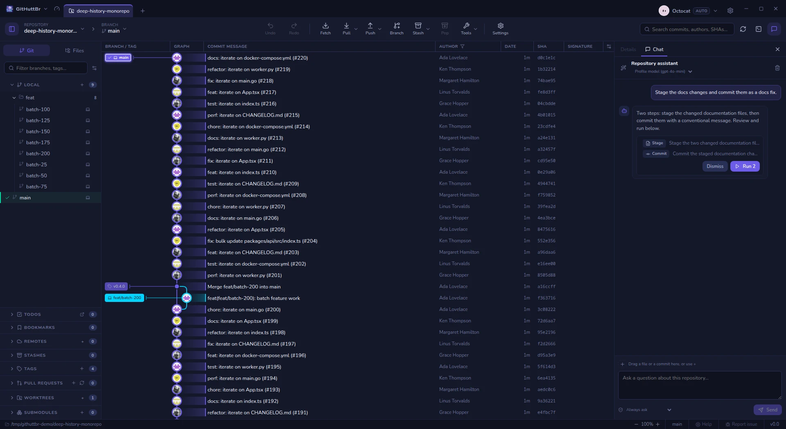
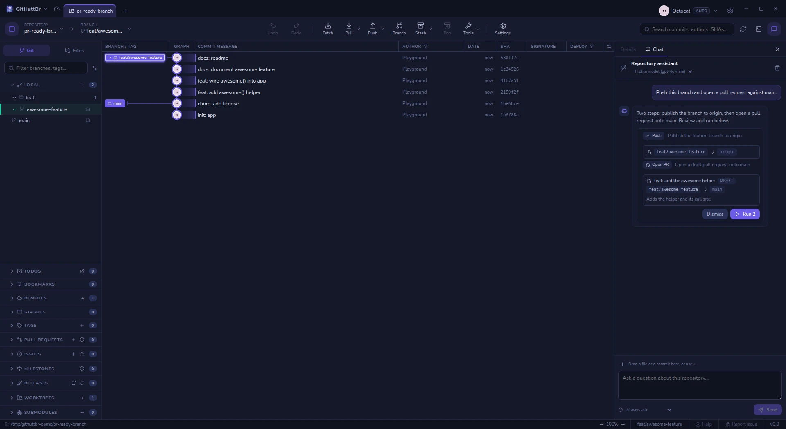

# リポジトリチャット

探すより聞いたほうが早い質問があります。*トークンの更新は実際どこで起きている
のか。このコミットは一言でいうと何を変えたのか。なぜこのファイルがあるのか。*
リポジトリチャットは開いているリポジトリについてそれに答え、根拠にした行を示し
ます。

普通の AI チャットとしても使えます。あいさつ、一般的なプログラミングの質問、
そのほか何でも、リポジトリを読まずにモデルが直接答えます。ファイルを見るのは、
質問がそのファイルに関わるときだけです。

右側の列を**詳細**と共有します。上部のタブで切り替わるため、質問してもグラフの
選択は失われません。

## 何を読むのか

ふつうのチャットと同じように動きます。**送られるのはあなたのメッセージ**で、添えられる
のはリポジトリの名前とブランチだけです。Git の状態も、ファイル一覧も、ファイルの内容も
送られず、返信はプレーンテキストで返ってきます。あいさつやリポジトリに関係ない質問には
1 回の呼び出しでその場で答え、リポジトリの中身は何ひとつマシンの外に出ません。

**リポジトリが開かれるとき。** モデルにリポジトリが開かれるのは次の 3 つの場合です。

| あなたが… | 何が起きるか |
|------|--------------|
| 追跡ファイルの名前を出す（`config.json`、`src/app.ts`） | モデルが答える前にそのファイルが読まれる |
| 言葉でそう言う（「このリポジトリ」「自分の変更」「未コミット」「現在のブランチ」） | Git の状態と追跡ファイル一覧が送られる |
| モデルが必要と判断することを尋ねる | モデルが `@repo` だけの 1 行で返し、アプリがリポジトリを開く |

そこから先、モデルは推測する代わりにほかに必要なものを求めます。一覧にある正確なパス、
リテラル検索、最近の履歴のコミットハッシュです。アプリがそれを読み、見つかったものを
添えて質問をもう一度投げます。これは多くても 4 回まで（各ラウンドは待ち時間の増える
モデル呼び出しです）で、最後のラウンドでは手元の材料で答えなければなりません。
こうした回答は使った抜粋を引用し、存在しないファイルや行は「もっともらしい回答」では
なく検証エラーになります。

待っている間、メッセージの下の行が今何が起きているかを示します。モデルが作業中は
**考え中…** と、アプリが求められたものを実際に読んでいる間だけ **ファイルを読み取り中 (N)…**
または **リポジトリを検索中…** と表示されます。

| 含む | 含まない |
|---|---|
| 追跡ファイル（作業ツリーの内容そのまま） | 追跡されていないファイル |
| 追跡ファイルのステージ済み・未ステージの差分 | 無視ルールに一致するもの（追跡されていても） |
| ブランチ、先行/遅延、変更されたパスの一覧 | [機密に見えるファイル](security.md)、バイナリ、生成物のパス |

作業ツリーを読むため、コミットしていない変更についても質問できます。同時に、
質問した時点でその変更は端末から出ていきます。受け取るのは
[AI 機能](ai.md)で設定したプロバイダーです。

ひとつ補足があります。操作の提案（後述「チャットから操作を実行する」）を有効に
すると、追跡されていないファイルの**名前**はリポジトリ状態に含まれます —
「新しいファイルをステージして」に必要だからです。ただし、その内容が読まれる
ことは変わらずありません。

## 文脈を固定する

何を読むかは通常モデルが決めます。固定はそれを上書きする手段です。固定したものは
**先に**読まれ、コンテキスト予算の大きい方の取り分を受け取ります。

固定の方法は四つ。いずれも入力欄の上にある同じチップの列に入ります。

| 操作 | 得られるもの |
|---|---|
| 候補チップをクリック | ビューアで開いているファイル、またはグラフで選択中のコミット |
| **ファイル**タブの行をドラッグ | そのファイル |
| **コミットグラフ**の行をドラッグ | そのコミット（メッセージと、ハンク単位の差分） |
| **+** →「ファイルを選択…」、または Finder／エクスプローラーからドラッグ | ディスク上の任意のファイル（リポジトリ外も可） |

チップは続く質問でも固定されたままです。`×` で 1 つ外れ、会話を消すとすべて外れ
ます。上限は 8 件です。

固定したコミットはメッセージと最大 12 個の差分ハンクを提供します。除外対象の
パスに触れるハンクはその差分から落ちますが、コミット全体が落ちるわけではありま
せん。

## 設定

**設定 → AI → リポジトリチャット** — 共通の AI で、
またはプロファイルが独自の AI を持つ場合はそちらで設定します（どちらかは
**編集中** のバーで選びます。[全プロファイル共通の
AI](ai.md#全プロファイル共通の-ai) を参照）：

| 設定 | 内容 |
|---|---|
| **リポジトリについて質問する** | オフにするとタブ・ツールバーのボタン・ショートカットの対象が消えます。ほかの AI 機能はそのまま動きます |
| **コミット済みの内容のみ** | 作業ツリーではなく最新のコミットから回答します。未コミットの変更が端末を出ることはありません |
| **チャットでファイルと Git の操作を提案** | オフにするとチャットは純粋な読み取り専用に戻ります。操作カードも承認ドロップダウンもありません |
| **ファイル読み取り専用モード** | オンにするとファイルの作成、編集、置換、削除を禁止し、Git 操作は引き続き利用できます。既定でオンです |
| **提案された操作の実行方法** | 承認モードです — 後述「承認モード」を参照。破壊的な操作はどのモードでも確認します |
| **チャットにリモート操作の提案を許可** | 既定ではオフ。オンにするとフェッチ、プル、プッシュ、プルリクエストの作成、スタックの送信が提案対象に加わります |

チャットにどのプロバイダーとモデルが答えるかは、**AI** ページの **タスクごとのモデル**
で設定します — [AI 機能](ai.md#タスクごとのモデル)を参照してください。質問はレビューより
軽いので、小さいモデルで足りることがよくあります。

AI 全体をオフにすると、チャットもいっしょに消えます。答えられないのに応答を差し
出すパネルは残しません。

チャットのモデルは、パネル上部のプロバイダー名の隣からも切り替えられます。設定と
同じ項目で、設定画面を開く必要はありません。

パネルタイトルの隣にある魔法の杖ボタンは **AI 設定ウィザード**を開きます。この
リポジトリ向けのアシスタント設定ファイル（指示、エージェント、フック）を生成する
ガイド付きのフローです。[AI 機能](ai.md)を参照してください。

## メッセージの操作

メッセージは普通のテキストです。任意の部分を選択してコピーできるほか、吹き出し
を右クリックすると、**コピー**は選択範囲を、**メッセージをコピー**はメッセージ
全体を(回答は Markdown ソースとして)コピーします。クリックがリンク上なら
**リンクをコピー**でそのアドレスをコピーできます。

リンクは常に既定のブラウザで開き、GitHuttBr の中では開きません。回答内の
Markdown リンクも、自分のメッセージに書いた `https://` アドレスも同じです。

メッセージが画像に触れているとき — `docs/logo.png` のようなリポジトリのパスや、
画像拡張子で終わる URL — その言及にカーソルを重ねると小さなプレビューが表示さ
れます。リポジトリのパスは作業ツリーから読み取られ、読める画像に解決できない言
及は何も表示しません。

## チャットから操作を実行する

事実ではなく変更を頼むと — *Markdown ファイルをステージして、これを修正として
コミットして、ビルド成果物を無視リストに入れて* — 返信に**操作カード**が付いて
きます。空の会話では、導入文の下にいくつかの例のリクエストがチップとして表示され、
クリックすると入力欄に入るので、送信前に編集できます。カードには、アシスタントが
実行したい具体的な手順が 1 行 1 操作で並び、**実行**と
**却下**のボタンが付きます。カードの中身はまだ何も起きていません。モデルにできる
のは提案だけで、どの提案も表示される前に作業ツリーと突き合わせて検証されます —
存在しないファイルを名指しする操作は、描画されるのではなく拒否されます。

リポジトリチャットは、正確な編集、ファイルの作成や全置換、削除を提案でき、続けて
Git 操作 — 無視パターン、ステージ、ステージ解除、コミット、スタッシュ、破棄、ブランチ、
チェックアウト、タグ、そしてブランチ一覧と直近のコミットが示されているため merge、
rebase、revert、cherry-pick — を提案できます。展開できる diff は GitHuttBr がローカルで
計算します。既存ファイルは読んだ根拠から来ていなければならず、危険・機密・無視対象・
生成物・バイナリ・古くなった・大きすぎる・シンボリックリンク経由の対象は拒否されます。
reset、履歴の書き換え、ブランチの削除、あらゆる強制操作は専用 UI にのみ残ります。

**会話中のテキストはファイルにできます。**テキストを頼んでから*ファイルを作って*と送ると、前の返信が内容になり、ファイル名を指定しなければアシスタントが名前を選んでカードに表示します。ファイル操作がオンのときは書き込めることがモデルに伝えられるので、アクセスできないと言った以前の返信は繰り返されません。それでも構造化された回答が失敗した場合、返信は今回は変更を準備できなかったこと、依頼をもう一度送れば再試行されることを伝えます。ファイルを書き込んだと主張することはありません。

merge や rebase は競合で止まることがあります。止まった場合、実行はそこで終わり、カード
はその行を失敗として記録し、すでに実行済みの件数を保ちます。競合バナーは、同じ操作を
ツールバーから始めたときとまったく同じように引き継ぎます。

ファイル一式は最初の書き込み前に再検証され、途中で失敗すればロールバックされます。
コミット前にはステージ済み変更があることも確認します。カードは完了・失敗・スキップ
された各操作と部分結果を表示します。その後、操作を許可しない別のモデル呼び出しが
実際の結果だけを要約します。

**`.githuttbr.json` を書くこともできます。** チャットには
[リポジトリ自身の設定ファイル](repo-config.md)の形が渡されるので、*JIRA-1234 の
チケットリンクを追加して* や *release ブランチを保護して* は、ローダーが拒否する
もっともらしいキーではなく、本物のスキーマに沿ったファイル操作になります。
ファイル操作が有効であることが必要です — ファイル読み取り専用モードの同じスイッチです。

**絵が必要な行には絵がつきます。** 一行の要約は「2 つのファイルをステージして」には
十分でも、「スタックに 4 つのプルリクエストを開いて」にはまったく足りません。だから形を
語る行は形を描きます — プッシュが公開するブランチとその先行数、merge や rebase が関わる
2 つの参照、revert や cherry-pick が再生するコミットとその件名、これから作られる
プルリクエストの姿、そしてスタックははしごとして、各レベルのベースと、送信がそれを
作成するのか、付け替えるのか、そのままにするのかを添えて。

### マシンの外へ出る操作

フェッチ、プル、プッシュ、プルリクエストの作成、スタックの送信は **既定でオフ** で、
**チャットにリモート操作の提案を許可** の後ろにあります。作業の公開は意識して選ぶ価値の
ある判断であり、設定がオフのときはモデルにその操作の存在すら伝えません。提案して拒否
される、という「読まずに設定をオンにする」癖を教える失敗が起きないためです。

オンのとき:

| 操作 | 内容 |
|---|---|
| **フェッチ** / **プル** | ツールバーと同じ fetch と pull。プルの方式（マージ、fast-forward のみ、リベース）は提案の一部です |
| **プッシュ** | 1 つのブランチを 1 つのリモートへ公開します。**強制は決してしません** — 強制プッシュは提案の語彙に存在しないため、提案すること自体ができません |
| **PR を作成** | リポジトリ自身の origin に対してプルリクエストを 1 つ、下書きかどうかを含めて作成します。カードはそのリンクを保持します |
| **スタックを送信** | [スタック PR の送信](stacks.md)一式: 各レベルをプッシュし、レベルごとにプルリクエストを作成または付け替え、ナビゲーション節を書き、GitHub のスタックを登録します |

提案されたプッシュは、実行前にツールバーのプッシュと同じガードを通ります —
保護ブランチの確認、[認証情報らしきファイル](security.md)を公開することへの警告、
リポジトリ自身のプッシュ前チェックリストです。これらはダイアログなので、プランの内側
からではなく、プランが始まる前に答えます。

### プランを取り消す

プランはまとめて承認されるので、取り消しもまとめて行います。何かを変えうる最初の操作の
前に、GitHuttBr はブランチの位置を記録し、作業ツリーのスナップショットを取ります。完了した
カードはそこで **プランを取り消す** を提供します。ブランチをそのコミットへ戻し、ツリーを
復元するので、プランが生み出したものは捨てられます。だから先に確認し、戻り先のコミットを
明示します。作成されたプルリクエストは開いたままです — ローカルのスナップショットが
リモートを取り消すことはできません。

**すべての操作を自動実行**では、有効なファイル変更はすぐに実行され、カードに完了した操作が記録されます。

**毎回確認する**では、同じ種類の変更も **実行**か**却下**を選ぶまで保留のままです。

### 承認モード

入力欄の下にある盾のドロップダウン（**設定 → AI →
リポジトリチャット**にもあります）が、カードの実行方法を決めます。これは同じ
AI を使うすべてのプロファイルに適用されます。

| モード | 実行 |
|---|---|
| **毎回確認する** | カードの**実行**を押すまで何も実行しません |
| **安全な操作を自動実行** | 取り消し可能な整理だけでできた提案 — ステージ、アンステージ、無視、ブランチ、タグ — は届き次第実行し、それ以外はボタンを待ちます |
| **すべての操作を自動実行** | すべての提案を届き次第実行します。ただし破壊的なものは除きます |

**未コミットの変更を破棄する**提案は、どのモードでも必ず先に確認し、確認には
失われるファイル名が並びます。カードは実際に起きたこと — 何件の操作が実行された
か、あるいは止めたエラー — を報告し、その結果はアシスタントにも伝わります。だから
続きの質問は、計画が実行されたのか却下されたのかを踏まえて答えられます。

### エラーをアシスタントと直す

git 操作が失敗し、AI チャットが使えるときは、エラートーストにスパークルボタンが
現れます。押すとチャットが開き、失敗の内容が入力欄に貼り付けられるので、「なぜ
失敗したのか、どうすればいいのか」がワンクリックになります。下書きは編集でき、
送信を押すまで何も送られません。

## 断ること

- **機密に見えるファイルは読みません。**固定していても同じで、チップは理由付きで
  「スキップ」として返ります。固定は[機密のマスキング](security.md)の抜け道では
  ありません。
- **バイナリと 512 KB を超えるファイル**は、リポジトリ外から来た場合に同じように
  スキップされます。リポジトリ内では通常のルールが適用されます。
- **質問には提案が付きません。**操作がモデルに示されるのは、メッセージが何かをするよう頼んでいるときだけです — 「ステージしたファイルをコミットして」「faça um stash」「ブランチを作って」。バージョンを尋ねたり、コミットとは何かを尋ねたりしても、実行する計画が返ってくることはありません。直前の依頼を押し通す短い返事 — 「はい」「アクセスを許可した」 — はその依頼として扱われます。質問やお礼はそうなりません。
- **勝手に書き込むことはありません。**モデルは道具を持たず、テキストだけです。
  変更は提案カードとして届き、あなたの承認ルール（前述「承認モード」）の下でだけ
  実行され、破壊的な手順は必ず確認します。**チャットで Git 操作を提案**をオフに
  すれば、提案すらしません。
- **会話はメモリ上だけに存在します。**リポジトリごとにスレッドは独立し、GitHuttBr
  を終了すると破棄されます。
- **小さなローカルモデルはリポジトリについての質問が苦手です。**3B モデルで測った
  ところ、一般的な質問にはそのモデル自身のターミナルと同じくらいよく答えますが、
  リポジトリを求めるべきときに求めないことがあり、ファイルをもとにした長い回答は
  途中で切れて返ってくることがあります。ファイル名を出すか「このリポジトリ」と書けば、
  アプリはそれとは関係なくリポジトリを開きます。7B 以上のモデルなら目に見えて良く
  なります。

## 開き方

| キー | 内容 |
|---|---|
| ツールバーの吹き出しボタン | チャットタブの表示を切り替えます |
| <kbd>⌘⌥B</kbd> / <kbd>Ctrl+Alt+B</kbd> | 右パネル全体を切り替えます |
| <kbd>Enter</kbd> | メッセージを送信します |
| <kbd>Shift+Enter</kbd> | 改行します |

パネル切り替えの再割り当てを含め、残りは[キーボードとショートカット](keyboard.md)
にあります。

**関連：** [AI 機能](ai.md) · [セキュリティと機密](security.md) ·
[リポジトリ Wiki](repo-wiki.md)
