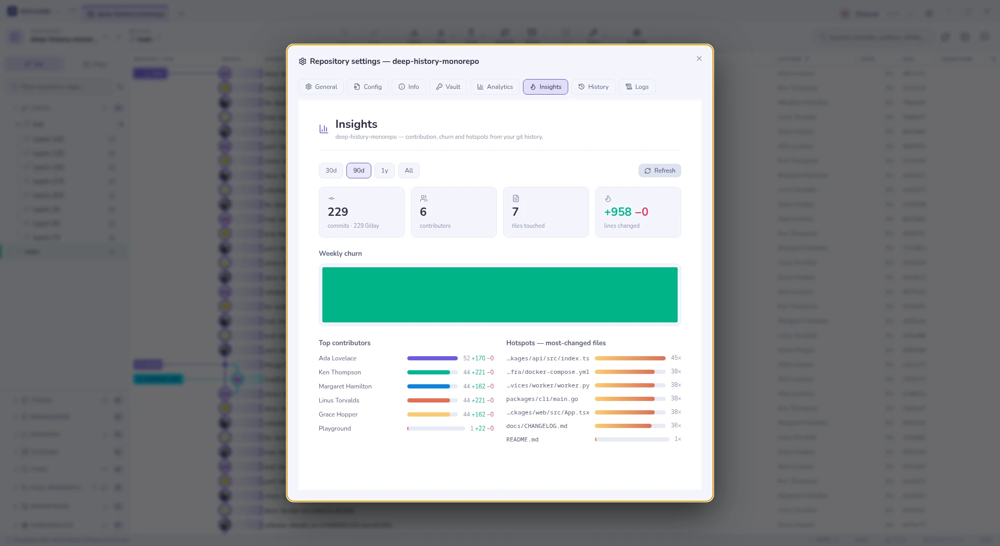

# リポジトリごとの設定

ツールバーのツールの隣にある歯車を押すと、アプリではなく**このリポジトリ**に
属する設定が開きます。

ヘッダーは、これから変更するリポジトリを示します：名前、フォルダー、現在の
ブランチ、メインのリモート（あれば `origin`）とそのホスト、いくつかの件数。
ブランチ数は読み込み済みの一覧から取ります。保管庫の件数は **保管庫** を開いた
後にだけ表示されます。保管庫を読むとシステムのキーチェーンに問い合わせるため
で、設定を開くだけでそれをすべきではないからです。コミット数はありません：
長い履歴を数えるのはそれだけで git 呼び出しが 1 回要り、ヘッダーにその価値は
ありません。

ページはサイドナビに 3 つのグループで並びます：

| グループ | ページ | 内容 |
|---|---|---|
| リポジトリ | **一般** | 表示名、プロファイル、保護ブランチ、タブ画像、一覧から削除 |
| リポジトリ | **プロジェクト設定** | このリポジトリが `.githuttbr.json` で[持ち運ぶルール](repo-config.md)と、それを確認する doctor |
| リポジトリ | **情報** | このリポジトリについての自由なメモとフィールド。ローカルに保存 |
| セキュリティ | **保管庫** | このリポジトリの[保管庫](vault.md)エントリー |
| アクティビティ | **メトリクス** | GitHuttBr で行ったこと。ローカルで集計 |
| アクティビティ | **インサイト** | [履歴ダッシュボード](insights.md) |
| アクティビティ | **操作履歴** | 開いたリポジトリの、時間ごとのコミットとその作成者 |
| アクティビティ | **ログ** | 操作ログ：GitHuttBr がここで実行したすべての git コマンドと結果 |

操作ログは正直な存在です。何かの挙動がおかしいとき、実行されたコマンドと発生した
エラーをそのまま見せてくれるので、バグ報告に形容詞ではなく事実を載せられます。

## 一般

各設定は 1 行です：左に何をするか、右にコントロール。**保存** を押すまで
何も保存されません。

| 行 | 何をするか | 保存先 |
|---|---|---|
| **表示名** | タブや一覧に出る名前。ディスク上のフォルダー名は決して変わりません。空ならフォルダー名 | GitHuttBr の設定（このマシン） |
| **プロファイル** | タブがアクティブなときにこのリポジトリが切り替える ID、トークン、AI。**自動** はアクティブなプロファイルに従います | GitHuttBr の設定（このマシン） |
| **保護ブランチ** | これらのブランチへ直接コミットや force push をする前に警告します | リポジトリの git config |
| **タブ画像** | タブの小さな画像。下記参照 | GitHuttBr の設定（このマシン） |

リポジトリに `.githuttbr.json` があると、「一般」の上部にお知らせが出て
**プロジェクト設定** へ案内します。そのルールはリポジトリと一緒にクローンする
全員に届きます。お知らせの下の行はあなただけのものです。

**一覧から削除…** はリポジトリを[リポジトリ](repositories.md)から外します。
先に確認し、その質問はしないことを伝えます：ディスク上のフォルダーには触れず、
開いているタブも開いたままです。もう一度開けば一覧に戻ります。

## タブ画像

タブを十個開いていると、`api`、`api-gateway`、`api-docs` のように同じ
始まりの名前は見分けにくくなります。タブ上の小さな画像は、文字より早く目に
留まります。

**一般** で画像の欄をクリックすると、リポジトリ自身の画像（PNG、JPEG、GIF、
WebP、SVG、ICO、BMP、AVIF）がサムネイル付きで一覧表示されます。logo や icon
のような名前のファイルが先頭です。入力して絞り込み（`logo dark` で
`assets/logo-dark.png` が見つかります）、矢印キーで移動して Enter で選択
するか、パスを直接入力します。パスは **リポジトリのルートからの相対パス**
として保存されるので、フォルダーがどこにあっても画像はリポジトリについて
いきます。

タブに何を表示するかはアプリ全体の設定で、**設定 → 一般 → リポジトリタブの
表示** にあります。

| オプション | タブの表示 |
|---|---|
| **画像と名前**（既定） | フォルダーアイコンの代わりに画像、続いて名前 |
| **名前のみ** | フォルダーアイコンと名前（画像がないときと同じ） |
| **画像のみ** | 画像だけ。名前はツールチップに移ります |

知っておきたい制限:

- 一覧に出るのは git から見えるファイル（追跡中と未追跡。無視されたものは
  除く）で、一度に最大 40 件です。それ以外は入力して探します。無視された
  画像も、パスを直接入力すれば使えます。
- 1 MB を超える画像や読み込めない画像は淡色で表示され、選べません。20 ピクセル
  のアイコンにそれ以上は不要です。
- 画像の **ない** リポジトリは、どのオプションでも常に名前を表示します。何も
  ないタブでは見分けがつかないからです。
- パスが **壊れている** 場合（ファイルの削除・名前変更、画像でない、大きすぎる）、
  タブは何も言わずに名前表示に戻り、この設定タブのパスの下に警告が出ます。
  ほかには何も警告しません。
- 画像はセッションごとに一度だけ読み込まれます。同じ名前のままファイルを
  差し替えたときは、この設定タブを開き直すと再読み込みされます。
- この設定はこのマシンの GitHuttBr の設定に保存され、リポジトリには入りません。
  チームメンバーには引き継がれません。

**関連項目:** [セキュリティと秘密情報](security.md) · [インサイト](insights.md)
