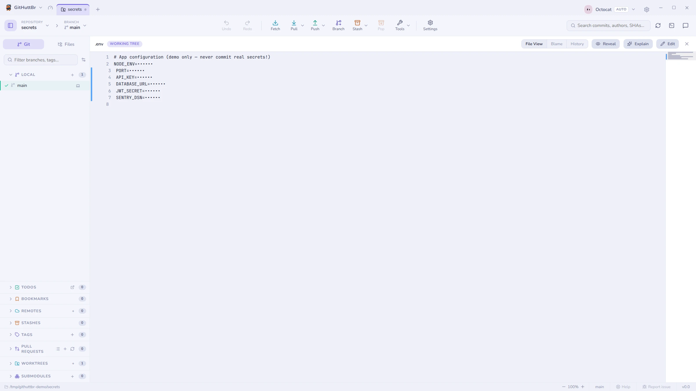

# セキュリティと秘密情報

Gitcito に **バックエンドはありません**。ネットワーク通信の相手は、あなたの Git
ホストと、有効にした場合の AI プロバイダーだけです。

## 秘密情報のマスキング

`.env*`、`*.pem`、`*.key`、`id_rsa`、`credentials.*` などに含まれる値は、差分・
ファイル・blame の各ビューで `KEY=••••••` として表示されます。画面共有やスクリーン
ショットから漏れないようにするためです。
Apple の署名関連ファイルも対象です: `*.mobileprovision`、
`*.provisionprofile`、`*.p12`、そして App Store Connect の `*.p8` キー。
`*.cer` は対象外です——証明書はもともと公開されるものだからです。

これは **表示だけの話** です。ファイルを書き換えることはなく、ステージする内容も
変わりません。目のアイコンでビューごとに一時的に表示できます。`.env.example`、
`.sample`、`.template` はテンプレートとして扱われ、秘密情報とはみなされません。

## 事故が起きる前のガード

| ガード | 発動するとき |
|---|---|
| **秘密情報ファイル** | 資格情報らしきものをコミットしようとしたとき — ワンクリックの *無視して追跡解除* つき |
| **大きなファイル** | 巨大な blob をコミットしようとしたとき（しきい値は 設定 → セキュリティ） |
| **ビルドの残骸** | `xcuserdata/`、`DerivedData/`、`.DS_Store` をコミットするとき — 同じワンクリックの *無視して追跡をやめる* 付き |
| **保護ブランチ** | `main` / `master` に直接コミットするとき、あるいはそこへフォースプッシュするとき |
| **追跡された秘密情報** | 秘密情報ファイルを *追跡している* リポジトリをプッシュするとき — セッションにつき 1 回警告 |

## OS のキーチェーン

トークンと [金庫](vault.md) の項目は、OS のキーチェーン（Electron の
`safeStorage`）で暗号化されます。設定ファイルの中に鍵を置くことはありません。

**あなたが許可するまで、キーチェーンには一切触れません。** システム自身の許可
ダイアログが出るより前に、Gitcito は何を保存しようとしているのか、何ができないのか
（アプリが読み戻せるのは自分が作った項目だけで、ほかのパスワードには手が届きません）、
そして断っても構わないことを説明します。断った場合、トークンはそのセッションの
メモリ上にだけ存在し、金庫は閉じたままで、あとから **設定 → セキュリティ → OS の
キーチェーン** で有効にできます。

入れたばかりの状態では、実際に保存すべきものが出てくるまでキーチェーンの呼び出しは
**ゼロ** です。

オフの間は、連携のトークン欄にその旨が表示されます — *Gitcito を終了するまでしか保持されません: OS のキーチェーンがオフです。* — 横に **有効にする** ボタンがあります。そこからでもここからでも、オンにするとこのセッションで入力済みのトークンも保存されるため、貼り直す必要はありません。

### キーリングのない Linux

Linux のキーチェーンはシークレットサービス — GNOME Keyring または KWallet — です。
どれも動いていないとき、システムはそれでも「暗号化」しますが、どのマシンでも同じ
固定パスワードを使います。トークンやキーはかき混ぜられているだけで、保護されては
いません。設定 → セキュリティ はキーチェーンの状態の下でそれを伝えます —
*キーリング（GNOME Keyring または KWallet）が動作していないため…* — *キーチェーン*
という言葉が、存在しない保護を指すことがないようにするためです。

誰にでも元に戻せる保存場所に新しいものが入らないよう、キーリングが動いていない
あいだに入力したトークンは **アプリを終了するまでしか** 保持されません。トークンの
欄にもそう表示されます — *Gitcito を終了するまでしか保持されません：キーリングが
動作しておらず…* — 再試行ボタンはありません。再試行しても解決せず、解決できるのは
キーリングだけだからです。以前に保存したトークンは読めるままです — 締め出される
ことはありません — し、トークンを消したり置き換えたりすれば、古い値は引き続き
ディスクから削除されます。制限は 2 つ。共通 AI のキーは共有の場所へ移されません
（各プロファイルは自分のキーを読み続けます）。また金庫はセッション限りのモードを
持たないため、引き続き基本ストレージに保存します。新しいトークンを再び保存できる
ようにするには、キーリングをインストールするかロックを解除して、Gitcito を再起動
してください。

## 設定のインポート

**設定 → インポート / エクスポート** で、設定・プロファイル・テーマをマシン間で
移せます。既定のエクスポートには **トークンも API キーも含まれず**、そうした
ファイルをインポートしても保存済みのものには一切触れません — ファイル内の空の
トークンは「このファイルにはない」という意味で、「自分のを消す」ではありません。

### インポートする内容を選ぶ

設定ファイルには 2 種類のものが入っています。*あなた* についてくるもの
（プロファイル、テーマ、ショートカット）と、それを書いたマシンでしか意味をなさない
もの（リポジトリがあるフォルダ、ターミナルのパス）です。新しいコンピューターで
すべてを適用すると、サイドバーがどこも指さないタブで埋まります。そのため、
ファイルを選んだあと（パスワードがあれば入力したあと）、どの項目を取り込むかを
ダイアログが尋ねます。**インポート** を押すまで何も適用されず、**キャンセル** なら
すべて元のままです。

| 項目 | 含まれるもの |
|------|-----------------|
| **プロファイルとアカウント** | プロファイル、Git の ID、連携のリンク、共通の AI 設定とプロファイル画像 — ファイルにあれば認証情報と [金庫](vault.md) も |
| **アプリの設定** | テーマ、言語、ショートカット、レイアウト、グラフとアイコンの色 |
| **リポジトリとワークスペース** | タブ、ワークスペース、お気に入り、ニックネーム、タブの画像、各リポジトリが使うプロファイル、スキャンするフォルダ、リポジトリごとのメモと Wiki |
| **このコンピューターのプログラム** | ターミナル、外部エディタ、既定のアプリ、AI CLI のパス |

各項目には、ファイルに含まれるその項目のエントリ数が表示されます。チェックを
外した項目は、このマシンでそのまま残ります。

**プロファイルはあなたのものと統合されます。** 別のコンピューターから来た
ファイルに、このコンピューターのプロファイルがすべてそろっていることはまれです —
Linux のノートで追加したアカウント、Mac にしかない顧客用プロファイル。そこで
**プロファイルとアカウント** は、一覧を置き換えるのではなく、ファイルのプロファイルを
あなたのものに追加します。インポートする前に、この項目はプロファイルごとに何が
起きるかを一覧にします。

| タグ | 意味 |
|-----|---------|
| **更新** | 両方にあるプロファイル：ファイルの ID 情報、AI、画像があなたのものを置き換え、サーバーはあなたのものに追加されます |
| **新規** | ファイルにだけある：あなたのものの後ろに追加されます |
| **維持** | このコンピューターにだけある：そのまま残ります |

2 つのプロファイルは、id が同じときに「同じもの」とみなされます — どのインストールでも
最初のプロファイルはそうです。一致する id がないときは名前で照合し（大文字・小文字と
前後の空白は無視）、プロファイルは **このコンピューターの id** を保ちます。紐づいた
リポジトリ、アクティブなプロファイル、保存済みの認証情報、画像はそのまま結びついて
います。どのプロファイルがアクティブかは変わりません。

**すべて置き換える** も引き続き使えます。バックアップをそのままの状態で戻したい
ときのためです。残るのはファイルのプロファイルだけで、このコンピューターにだけある
ものは取り消し線付きで **削除** と表示されます。**インポート** を押すと、それらの
名前を挙げてもう一度確認します — 保存済みの認証情報と画像ごと消え、元に戻せません。
**すべて置き換える** では、ファイルでアクティブなプロファイルがアクティブになります。

制限：照合は id か完全に一致する名前だけです — 片方で名前を変えたプロファイルは
新規とみなされ、両方が残ります。照合されたプロファイルはファイルの内容を受け取り
ますが、このコンピューターにしかないものを失わないよう例外が 3 つあります。GitHub
Enterprise、GitLab、Bitbucket のサーバーはあなたのものに **追加** されます（両方に
あるサーバーではファイルの項目が優先）。ファイルで空になっているトークンはあなたの
ものを保ちます — ただし同じインスタンスに限られ、トークンが別の Forgejo、別の
GitLab 発行元、別の Azure 組織に送られることはありません。そして、このマシンの
認証情報ヘルパーから借りているログインは、このマシンのものとして残ります。

**既定のチェックはディスクからの推測です。** ダイアログを表示する前に、Gitcito は
ファイル内のリポジトリのフォルダがここにあるかを確かめます。1 つもなければ、
ファイルは別のコンピューターのものです。**リポジトリ** と **プログラム** は理由を
添えてチェックなしで始まります — プログラムのパスが一覧になるので、よそのものだと
分かります。フォルダがあれば同じコンピューター（復元したバックアップなど）で、
すべてチェックありで始まり、緑のメモがそう伝えます。リポジトリが 1 つもない
ファイルは、代わりにプログラムのパスで判断します。**プログラム** は、そのすべてが
ここにあるときだけチェックありで始まります。

確認そのものに失敗したときは何も推測しません。**リポジトリ** と **プログラム** は
判定なしでチェックなしのまま始まり、**再確認** ボタンでもう一度ディスクに問い
合わせます。確認が成功するまで **リポジトリ** はインポートできません。ほかの項目は
インポートできます。

**パスの変換。** フォルダが見つからないファイルで **リポジトリ** にチェックを
入れると、**パスを変換** の枠が開きます。左はファイル内のリポジトリに共通の
フォルダ（`/home/you/code`）、右はそのフォルダがこのコンピューターのどこにあるかで、
ホームフォルダから推測して入力済みです（`/Users/you/code`）。どちらも編集できます —
推測が外れることもあり、共通のフォルダが見つからないときは Gitcito が両方を空に
して入力を待ちます。入力に合わせて、ここにフォルダがあるリポジトリの数をバーが
数え、いくつかを一覧にします — 見つかったものは緑、まだ見つからないものは赤です。
置き換えには、リポジトリのニックネーム、タブの画像、プロファイル、そしてメモ、Wiki、
金庫の項目もついていくので、手で設定し直すものはありません。

フッターが要約します — *4 項目中 3 項目をインポートします · フォルダー 31 件*
（スキャンのルートと最後のクローン先フォルダも数えるので、リポジトリではなく
フォルダと表示します）。少なくとも 1 つの項目にチェックが入るまで **インポート** は
押せません。

**変換で何も見つからないときも、インポート は押せません。** **リポジトリ** に
チェックが入り、新しいプレフィックスの下にフォルダが 1 つも見つからない状態で
インポートすると、リポジトリが空になってしまいます。パスを直すか、その項目の
チェックを外してください。

変換の制限：

- **1 つのプレフィックスを別のものに置き換える** だけです。ファイルの中で別の
  フォルダの下にあるリポジトリや、ここでは配置が違うリポジトリは見つかりません。
  リポジトリごとの対応付けはありません。
- 変換が有効なときは、**その結果フォルダがあるリポジトリだけがインポートされます**。
  残りは除外され — 壊れたタブとして追加されることはなく — ダイアログがその数を
  伝えます。
- プログラムは変換されません。`/usr/bin/code` に、別のシステムで確実に対応する
  ものはないからです。その項目はチェックを外したままにし、設定で選んでください。
- どちらかのプレフィックスを空にすると、パスはファイルに書かれたままインポート
  されます。

**インポート中** はダイアログを閉じられません。後の手順 — リポジトリのメモ、金庫、
プロファイル画像 — で失敗した場合、ダイアログは開いたまま失敗した手順を示し、
**インポートを続行** でそこから再開します。それ以前の手順を書き直すことはありません。

### ファイル内の認証情報

オプションにチェックを入れてエクスポートしたファイルには、認証情報が含まれます。
プロファイルを統合するときは、認証情報は常に **追加** されます。ファイルのものは
対応するプロファイルの下に保存されて同じアカウントのものを置き換え、ほかの保存済み
認証情報はすべて残ります — 消してしまうと、プロファイルを残すことと矛盾するから
です。プロファイルが **すべて置き換える** のとき、そうしたファイルでは
**プロファイルとアカウント** のすぐ下に選択肢も表示されます。

| 選択肢 | 保存済みの認証情報 |
|--------|------------------------|
| **追加する** | ファイルのものが追加され、同じアカウントのものは置き換わります。ほかはすべて残ります |
| **すべて置き換える** | ファイルのものとまったく同じになります — ファイルにない保存済みのトークンと API キーはすべて削除されます |

この選択はプロファイルと一緒に適用されます。**プロファイルとアカウント** の
チェックを外していれば、認証情報は 1 つもインポートも削除もされません。オプション
なしでエクスポートしたファイルには、何にチェックを入れても提供できる認証情報は
ありません。**すべて置き換える** は **インポート** を押したときにもう一度確認し、
ファイルにない保存済みのトークンと API キーがすべて削除されると伝えます。そこで
**キャンセル** すれば、ダイアログは元のままです。

**すべて置き換える にはキーチェーンが必要です。** キーチェーンがオフか使えない
状態では、古いトークンが暗号化ストアに残り、次回の起動で戻ってきてしまうため、
Gitcito は拒否します。その旨を伝え、何もインポートしません。保存済みのトークンを
読み取れないあいだも同じです。読めるようになった時点で戻ってきてしまうからです。
**追加する** は引き続き使え、ファイルのトークンをセッションのあいだ保持します。

**制限：** 認証情報はプロファイルに属します。インポートで削除されるプロファイルは、
どちらを選んでも、保存済みのトークンを一緒に持っていきます。

## 安全な受け渡し

[セキュア共有](secure-share.md) は、設定・金庫の項目・ワークスペース全体を
**暗号化されたバンドル** として書き出します。秘密情報が含まれるのは、あなたが
チェックを入れたときだけです。

**関連項目:** [金庫](vault.md) · [セキュア共有](secure-share.md)
