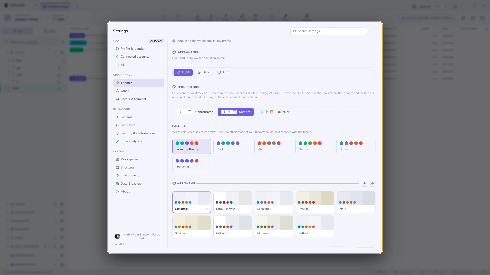

# テーマと外観

組み込みテーマ — Gitcito、Nord、Dracula、Solarized、GitHub、Monokai、
Midnight、Contrast、Daltonic — それぞれにライトとダークの2種類があります。

- **ライト、ダーク、または OS に追従**。切り替えは即座に反映されます。
- **カスタムテーマ**、そしてプロンプトから作る **AI 生成** テーマ。
- 調整可能な **コードの文字サイズ**。
- 独立した **グラフのスタイル**: レーンのパレット、角の形、行の密度、線の太さ。
  ミニグラフのプレビューがその場で追従します。

## 設定を探す

設定は多くのページに分かれていて、目当ての項目が思った場所にあることはまずありません。
あることは知っていても、どのページにあるかまではわからないものです。設定の
ヘッダー、閉じるボタンの隣にある検索欄は、すべてのページをまとめて検索します。

入力するにつれて、右側に一致した設定がページごとにまとまって表示されます。それぞれ
に名前、1 行の説明、その設定があるページが付きます。サイドバーでは一致のない
ページが薄く表示され、一致のあるページには件数が付きます。

- 照合の対象は設定の名前、説明、ページの名前です。大文字と小文字、アクセント記号
  の違いは無視され、入力した語はすべて含まれている必要があります。たとえば
  「ターミナル フォント」と入れると、ターミナルのフォント設定に絞り込めます。
- 検索は表示言語と英語の両方で同時に行われます。アプリを日本語で使っていても、
  「token」や「font」と入力すれば該当する設定が見つかります。
- 結果をクリックするか、**Enter** を押して先頭の結果を選ぶと、そのページが開き
  (テーマではテーマかグラフの正しいタブも)、設定の位置までスクロールして一瞬
  ハイライトします。
- **Esc** で検索をクリアし、もう一度 **Esc** を押すと設定が閉じます。

検索するのは名前と説明で、設定した値ではありません。連携にあるホストごとのサーバー
一覧 (GitHub Enterprise Server、セルフマネージドの GitLab、Bitbucket Data
Center) は連携ページを開くところまでで、ホストのタブは自分で選びます。個々の
キーボードショートカットは索引に含まれません。検索で見つかるのはショートカット
ページで、そのエディターに一覧があります。

## レイアウト

サイドバーは左にも右にも置けます。パネルはどこでもサイズを変えられ、グラフに
ウィンドウ全体を使わせたいときのために折りたためるサイドバーがあり、ターミナルの
配置はリポジトリごとに決められます。

**関連項目:** [コミットグラフ](graph.md) · [プロファイル](profiles.md)
