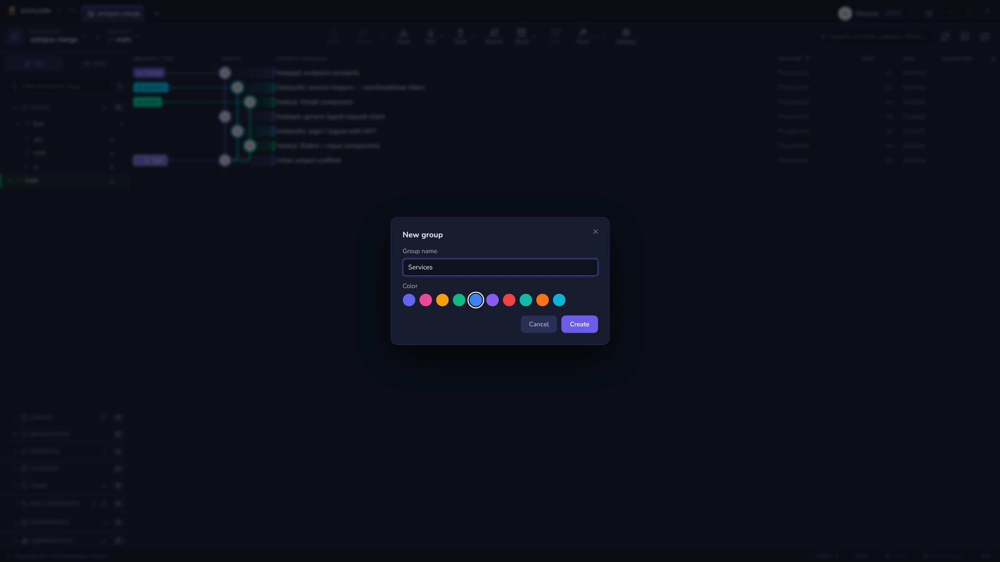
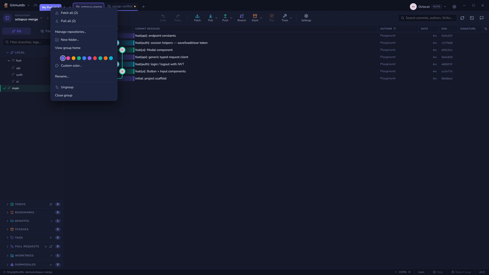

# 작업 공간, 탭, 그룹

느슨한 것부터 촘촘한 것까지 세 단계예요.

## 탭

저장소 하나에 탭 하나. <kbd>⌘T</kbd> / <kbd>Ctrl+T</kbd> 로 새 탭 선택기를 열고,
<kbd>⌘W</kbd> / <kbd>Ctrl+W</kbd> 로 활성 탭을 닫아요. 드래그해서 순서를 바꾸거나,
가운데 클릭으로 닫거나, <kbd>⌘⇧T</kbd> 를 눌러 마지막에 닫은 탭을 다시 열 수도
있어요. 저장소 탭(또는 [그룹](#그룹) 안의 칩)을 우클릭하면
[저장소 컨텍스트 메뉴](repo-menu.md)가 열려요 — 별칭, 워크트리, GitHub, 터미널,
보기, 편집기가 들어 있고, 맨 아래에 **이 저장소 닫기**와 **다른 탭 닫기**가 있어요
(그룹 안의 칩에서는 대신 제거가 나와요). 마지막 탭까지 닫으면 <kbd>⌘W</kbd> 는 대신 창을 닫아요. 탭에 점이 하나
있으면 커밋하지 않은 작업이 있다는 뜻이고, 다른 점은 충돌을 뜻해요.

닫기 경고가 뜨면 <kbd>Escape</kbd> 는 언제나 취소예요. <kbd>Enter</kbd> 는 탭이
깨끗할 때만 확인으로 동작해요. 커밋하지 않은 변경이나 충돌이 있으면 경고는
일부러 버튼까지 손을 뻗게 만들어요. <kbd>⌘W</kbd> 뒤에 잘못 눌린 키 하나가
아직 붙들고 있던 작업을 닫아 버리지 못하도록요.

### 탭 크기

기본값(**설정 → 레이아웃 → 탭 크기 → 맞춤**)에서는 탭이 브라우저 탭처럼 동작해요.
줄에 자리가 모자라면 최소 너비까지 똑같이 줄어들고, 그 하한에도 닿아야 비로소
스크롤돼요. **고정**은 예전 동작으로 돌아가요 — 탭마다 내용 너비를 유지하고, 모두
들어가지 않는 순간 줄이 스크롤돼요.

### 저장소로 이동하기

저장소를 열 개 이상 열어 두면 줄에서 하나를 찾으려면 스크롤해야 하고,
<kbd>⌘1</kbd>–<kbd>⌘9</kbd>는 아홉 번째 탭에서 멈추며, [명령
팔레트](search.md)는 열린 저장소를 모든 동작과 섞어서 보여 줘요. <kbd>⌘J</kbd> /
<kbd>Ctrl+J</kbd>(또는 **보기 → 저장소로 이동…**)를 누르고 이름, 폴더, 브랜치의
글자 몇 개를 입력한 뒤 <kbd>Enter</kbd>를 누르세요.

목록에는 열린 저장소만, 그룹 멤버까지 포함해서, 마지막으로 본 순서대로 나와요.
방금 떠난 저장소가 맨 위라서 <kbd>⌘J</kbd> <kbd>Enter</kbd>로 그리 돌아갈 수
있어요. 각 행에는 그 탭이 보여 주는 것이 담겨요: 브랜치, 커밋하지 않은 작업이나
충돌을 나타내는 점, 속한 그룹, 그리고 있다면 <kbd>⌘1</kbd>–<kbd>⌘9</kbd> 키.
화면에 떠 있는 저장소는 맨 아래에 흐리게 나와요. 전환기 뒤로는 아무것도 어두워지지
않고, 바깥을 클릭하거나 <kbd>Esc</kbd>를 누르면 닫혀요.

열린 것 중 맞는 게 없으면 마지막 행 **모든 저장소에서 찾기**가 검색을
[저장소](repositories.md) 페이지로 넘겨요. 단축키는 **설정 → 단축키**에서 바꿀 수
있어요.

*한계:* 순서는 이번 세션 동안만 기억되므로, 다시 실행하면 탭 순서에서 시작해요. 두
탭에 열린 저장소는 첫 탭 위치에 한 번만 나와요. 다른 [작업 공간](#작업-공간)의 저장소는
나오지 않아요 — 먼저 작업 공간을 바꾸거나 저장소 페이지를 쓰세요.

## 그룹

관련된 저장소들을 이름과 색이 붙은 **그룹 탭** 으로 묶어요. 그룹 안에서는 저장소
하나당 칩 하나가 놓인 두 번째 줄이 생기고, 그룹 자체를 **전체 페치** 하거나
**전체 풀** 할 수 있어요.

그룹을 시작하려면 저장소 탭을 우클릭 → *새 그룹…*: 그 탭이 같은 자리에서 그
저장소를 담은 그룹이 돼요. 그룹이 하나라도 있으면 같은 메뉴가 *그룹에 추가 →*로
바뀌고, 열린 그룹을 나열해요. 저장소 탭을 그룹 칩 위로 끌어다 놓아도 같아요.

*새 그룹…*은 이름과 색을 함께 물어요. 색은 아직 어떤 열린 그룹도 쓰지 않은 색
중에서 무작위로 골라 시작하므로, 그룹이 모두 같은 색으로 시작하지 않아요.

그룹 색을 바꾸려면 그룹을 우클릭하세요: 열 가지 색이 메뉴에 점 한 줄로 놓여 있고,
현재 색에는 테두리가 있으며, 한 번 클릭하면 적용돼요. 줄 아래의 *사용자 지정
색상…*은 다른 어떤 색이든 고를 수 있는 선택기를 열어요. 폴더와 저장소 페이지의
섹션도 같은 줄을 써요.

그룹을 풀려면 그룹을 우클릭 → **그룹 해제**. 각 저장소는 그룹이 있던 자리에서
평범한 탭이 되고, 열어 둔 페이지는 그대로 유지해요. **그룹 닫기**는 대신 그룹과 그
안의 모든 저장소를 닫아요. 폴더는 그룹 해제 뒤에 남지 않아요: 그룹 안에만 존재하기
때문이에요.

그룹은 **원하는 깊이까지 중첩되는 폴더** 를 담을 수 있어요. 그룹을 오른쪽
클릭 → *새 폴더…* 를 고른 다음, 저장소를 폴더 칩 위로 끌어다 놓으면 돼요. 각
폴더는 색을 하나 갖고, 개수가 적힌 칩으로 접히고, 안에 든 모든 것의 상태 점을
모아 보여 주고, 자기 하위 트리 전체를 페치하거나 풀할 수 있어요.

> 폴더는 정리만 해요. 폴더를 삭제하면 그 안의 저장소들이 상위로 올라올 뿐,
> 저장소가 닫히는 일은 없어요.

그룹에 아직 없는 저장소를 추가하려면 그룹 이름 옆의 **+**를 클릭하세요. 저장소 하나가 열려 있어도 그룹 자체의 페이지(폴더 열기, 복제, 만들기, 최근 저장소 선택)를 보여 줍니다. 칩을 클릭하면 그 저장소로 돌아갑니다.

## 저장소에 속한 페이지

어떤 페이지는 그 자체로 독립적인 것이 아닙니다. 저장소의
[위키](repo-wiki.md), [인사이트](insights.md), 실행 세션이 알린
[개발 도구](devtools.md). 이들은 탭을 차지하지 않고, 저장소 자체에 작은 칩으로
나타납니다: 아이콘과 어떤 페이지인지 알려 주는 짧은 단어(*CI*, *PR*, *위키*, 풀
리퀘스트라면 *#482*, 릴리스라면 그 태그). 전체 이름은 툴팁에 있고, 긴 태그나 제목은
말줄임표로 줄어듭니다.

- **아이콘을 클릭**하면 그 페이지가 보입니다. **한 번 더 클릭하거나, 저장소의
  이름을 클릭**하면 저장소로 돌아갑니다. 페이지가 열려 있는 동안 이름에는 손가락
  커서와 호버 시 작은 배경이 붙습니다. 그게 돌아가는 길입니다.
- **아이콘에 마우스를 올리면** 그 페이지만 닫는 ✕가 나옵니다.
- **그룹** 안에서는 아이콘이 자기 저장소의 칩에 붙고, 그 저장소가 선택되어 있는
  동안에만 보입니다. 그룹의 다른 저장소를 고르면 *그* 저장소가 보입니다. 옆
  저장소의 도구가 아니라요.
- 같은 페이지를 다시 열면 이미 있는 아이콘이 켜질 뿐, 두 번째가 생기지 않습니다.

어디에도 열려 있지 않은 저장소는 아이콘을 달 곳이 없으므로, 그 페이지는 대신
자기 탭으로 열립니다 — 여는 동작은 언제나 무언가를 열어야 하니까요.

## 작업 공간

작업 공간은 **저장된 탭 줄 전체** 예요. 전환하면 모든 탭이 한 번에 바뀌어요.
`Work` 와 `Personal` 이 서로를 밟지 않게 되죠.

작업 공간 이름은 왼쪽 위, Gitcito 마크 옆에 있어요. 클릭하면 전환, 생성, 이름
변경, 순서 변경, 삭제를 할 수 있어요. 그 옆의 계기판은 지금 있는 작업 공간의
[미션 컨트롤](mission-control.md)을 열어요.

**함께 보기:** [미션 컨트롤](mission-control.md) · [명령줄](cli.md)
