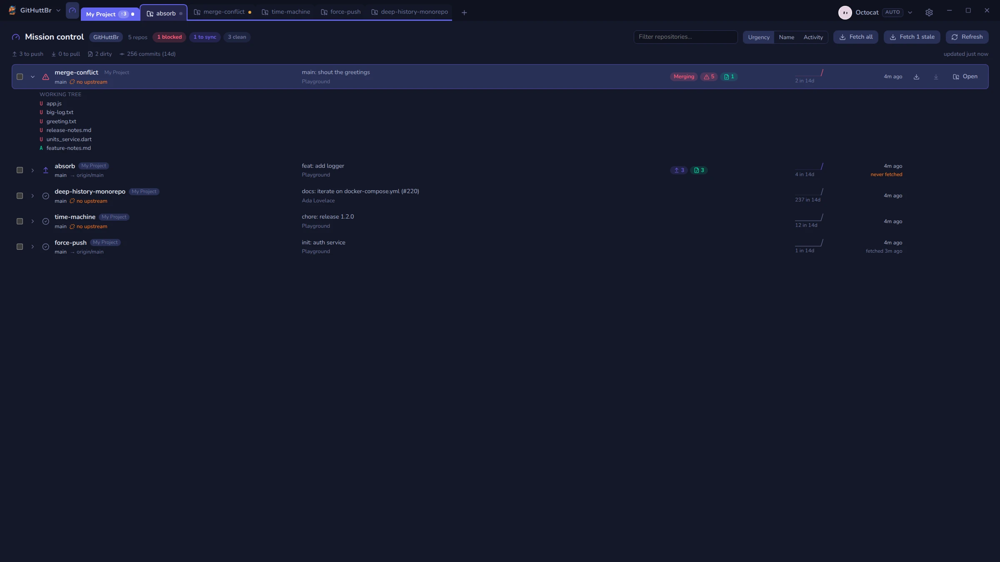

# Mission control

Twenty repositories, and the question is always the same: which one needs me?

Mission control answers it. Every repository of the **active workspace** on one
screen, ordered by what actually needs you:

1. **Blocked** — a rebase or merge left half-finished, conflicts, a repo that
   cannot be read at all.
2. **To sync** — commits to pull, then commits to push.
3. **In progress** — uncommitted work, untracked files.
4. **Clean** — the quiet ones, at the bottom, where they belong.

## What a row tells you

Each row reads left to right, and the columns line up down the list so the
counts compare like a table:

| Column | What it shows |
|---|---|
| **Repository** | Name, its group, the branch and its upstream — or **no upstream** in amber, since such a branch can never be pushed by mistake but also never syncs |
| **Last commit** | Its subject and author: what the repository was last doing, without opening it |
| **Local** | Conflicts · ↓ to pull · ↑ to push · staged · modified · untracked · stashes. Hover any of them for what it counts |
| **Hosting** | The open pull requests, with the ones waiting for **your** review in amber, and HEAD's CI. Click the count to open that repository's **Pull requests** page, or **CI** to open its runs |
| **Release** | The newest tag HEAD reaches, and how many commits came after it — **up to date** when none. The count is coloured by how far behind a release is: grey up to 5 commits, yellow up to 20, red beyond, all of it changeable in **Settings → Git & sync → Release note colours** |
| **Activity** | A 14-day commit sparkline, and how many commits that is |
| **Time** | How long since the last commit, and since the last **fetch** |

Hover the status icon for the reasons the row ranks where it does — "2 to push ·
1 uncommitted".

The fetch age is there because reading this page never fetches: the "to pull"
count is only as fresh as the last fetch. When a tracking branch has not
fetched for a day or more, or never has, the age turns amber — fetch it before
trusting a 0. The dashboard reads the fetch time from git itself, so a
`git fetch` in a terminal counts too.

On a narrow window every column stays, and the table scrolls sideways inside its frame.

**Open** at the end of a row shows that repository itself — its graph — even when its tab was last showing the pull request list the PR count opened.

Expand a row (the chevron, or <kbd>space</kbd>) to see exactly which commits are
waiting to be pushed and which files are dirty.

## Working the list

- The status pills at the top are **filters** — click "3 blocked" to see only
  those. **N open PRs** and **N CI failing** filter the same way, and so does
  **N waiting for your review** in the line below.
- Sort by **urgency**, **name** or **activity**.
- **Tick several repos** to fetch them, or pull just the ones that are behind
  (the button counts them for you).
- **Fetch N stale** shows up when some tracking branches have not fetched for a
  day or more, and fetches only those — the ones whose "to pull" may be wrong.
- It refreshes itself every 30 seconds while it is open — change it in
  **Settings → Git & sync → Mission Control refresh**, 30 seconds at least. Nothing
  runs while the page is closed.

| Key | Action |
|---|---|
| <kbd>↑</kbd> <kbd>↓</kbd> or <kbd>j</kbd> <kbd>k</kbd> | Walk the list |
| <kbd>Enter</kbd> | Open that repository |
| <kbd>f</kbd> / <kbd>p</kbd> | Fetch / pull it |
| <kbd>space</kbd> | Expand it |
| <kbd>/</kbd> | Jump to the filter |

## It is a view, not a tab

The gauge next to the workspace name toggles it; clicking any tab returns you to
your work. It never adds a tab of its own, and it belongs to the workspace you
are in — switch workspace and you get that workspace's dashboard.

The git side is **local**: a handful of git commands per repository, no fetch.
The **Hosting** column is the one part that talks to a host. It asks each
repository's host for its open pull requests and HEAD's CI, as that repository's
profile, and quietly: a host with no token or link for that profile simply shows
nothing, and no sign-in window ever opens. A repository already open in a tab
costs no call, since the sidebar has its pull requests already.

Limits, so the numbers are read right:

- Hosts are asked **at most every 5 minutes** per repository (sooner when HEAD
  moves or a CI run is still going), whatever the refresh interval — a host's
  API allowance is shared with the rest of the app. **Refresh** asks again now.
- A count shows **30+** when the host's first page came back full; the list
  page has them all.
- The release column is the newest tag **reachable from HEAD**, not the newest
  tag in the repository. A tag made on a commit HEAD already has shows within
  two minutes.

Fetching is always something you asked for.

**See also:** [Workspaces & tabs](workspaces.md) · [Workspaces, tabs & groups](workspaces.md)
