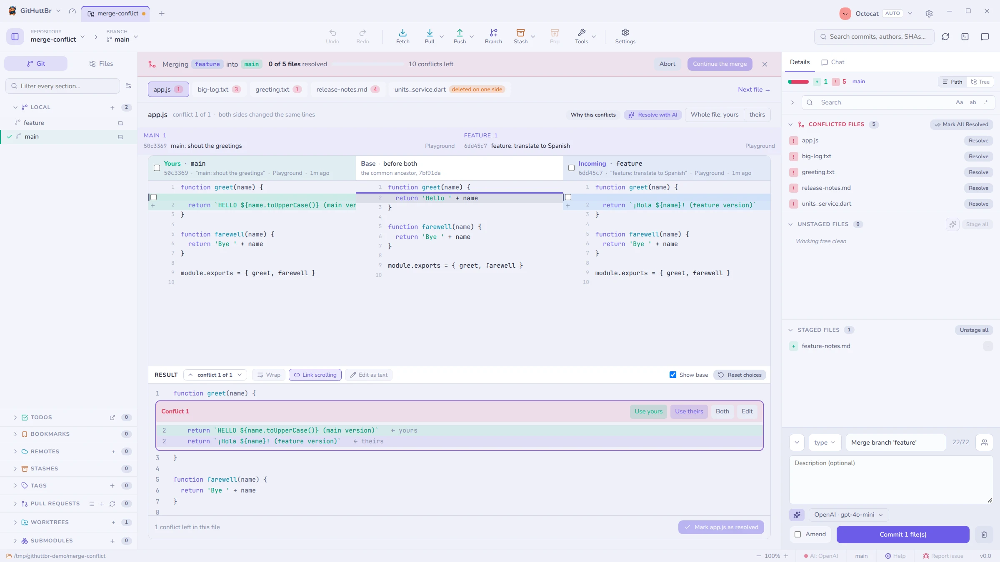

# Conflicten oplossen

Wanneer een merge, rebase, cherry-pick of revert stilvalt, maakt de oplosser van
de hele stap één scherm. De balk bovenaan zegt **wat** er stilviel en **tussen
wat** — "`feature` wordt samengevoegd in `main`", niet alleen "conflict" — en hoe
ver je bent: *2 van 5 bestanden opgelost*, met de conflicten die nog over zijn in
alle bestanden samen.

## De bestandenstrook

Onder de balk staat één chip per bestand waarop deze stap stilviel:

| Chip | Betekent |
|---|---|
| Groen met ✓ | Opgelost — gestaged, niets meer te beslissen |
| Omlijnd | Het bestand waar je nu bent |
| Een rood getal | Hoeveel conflictblokken het bestand nog bevat |
| Een label | Een conflict zonder tekst om samen te voegen: *aan één kant verwijderd*, *aan beide kanten hernoemd*, *aan één kant toegevoegd* |

Opgeloste chips komen eerst en open chips daarna, elke reeks op naam, zodat de
strook links leest als klaar en rechts als wat er nog over is.

**Volgend bestand →** springt naar het volgende bestand dat nog open is, en een
bestand als opgelost markeren brengt je daar vanzelf heen. **Doorgaan** in de
balk blijft uitgeschakeld tot elke chip groen is; **Afbreken** vraagt eerst en
zegt wat je verliest.

git vergeet een bestand zodra het gestaged is, dus "opgelost" is wat GitHuttBr
tijdens deze stap zag, plus de bestanden die git in zijn merge-bericht noemde.
Een bestand dat je in een terminal hebt gestaged voordat je de oplosser opende,
telt nog steeds mee; na een herstart midden in een rebase telt de opgeloste helft
van die ene stap misschien niet mee.

## Waarom dit conflicteert

**Waarom dit conflicteert** in de bestandskop somt per kant de commits op die dit
bestand hebben aangeraakt sinds de branches uiteengingen — `git log --merge`, dat
git al eeuwig meelevert en dat niemand vindt.

Markers zeggen wat er botst. Dit zegt wie het veranderde en waarom, en dat is
meestal wat de oplossing werkelijk bepaalt. Staat er niets, dan heeft geen van
beide kanten een wijziging aan precies dit pad gecommit — de botsing kwam van een
hernoeming of een verplaatsing.

De kop zegt ook bij welk conflict je bent en wat voor conflict het bestand heeft,
gelezen uit git's eigen status: *beide kanten wijzigden dezelfde regels*, *aan
beide kanten toegevoegd*.

## De drie panelen

| Paneel | Is |
|---|---|
| **Jouw kant** | De kant waar je op zat, met bovenaan de nieuwste commit aan die kant die het bestand aanraakte: sha, onderwerp, auteur, hoe lang geleden |
| **Basis** | De versie waar beide kanten van uitgingen — de gemeenschappelijke voorouder, of bij een pick of een rebase-stap de ouder van de commit die wordt toegepast. De regels die elk conflict verving zijn gearceerd |
| **Binnenkomend** | De kant die binnenkomt, met een kop op dezelfde manier als Jouw kant |

**Basis tonen** in de kop van het resultaat verbergt of toont het paneel Basis en
onthoudt je keuze. Het is grijs als er geen basis is — beide kanten voegden het
bestand toe.

Alle panelen zijn in grootte aan te passen, en de kop van het resultaat draagt
twee weergaveschakelaars:

| Schakelaar | Wat het doet |
|---|---|
| **Terugloop** | Laat lange regels teruglopen binnen de zijpanelen in plaats van ze te scrollen. De tekstweergave van het resultaat houdt één rij per regel — zijn zijmarkeringen hangen daarvan af — dus die scrolt altijd |
| **Scrollen koppelen** | Scrolt de panelen en het resultaat samen, verticaal en zijwaarts. Hun regelaantallen verschillen, dus de verticale positie wordt naar verhouding gelijkgehouden |

Terugloop staat aanvankelijk uit, Scrollen koppelen aanvankelijk aan, en beide
onthouden hun stand.

## Het resultaat

Het resultaat is het bestand zoals het geschreven gaat worden. Elk conflict staat
op zijn plek als een kaart met vier antwoorden erop:

| Antwoord | Wat er in het bestand komt |
|---|---|
| **Die van jou** | Jouw regels, en alleen die van jou |
| **Die van hen** | Hun regels, en alleen die van hen |
| **Beide** | Jouw regels, daarna die van hen |
| **Bewerken** | Beide, geopend in de teksteditor met het conflict geselecteerd, voor als het antwoord "beide, maar aangepast" is |

Een kaart zonder antwoord toont beide kanten vooraf, elke regel gemarkeerd met *←
van jou* of *← van hen* en genummerd met de regel waarop hij terechtkomt als je
hem kiest, zodat je kunt beslissen zonder op te kijken. Bij een bestand met heel
lange regels blijven de antwoorden in beeld terwijl de code eronder zijwaarts
scrolt. **Hele bestand: dat van jou | dat van hen** in de bestandskop beantwoordt
elk conflict in één keer.

**Als tekst bewerken** zet het resultaat om naar een gewone editor om vrij te
typen, met het aantal regels van het bestand in de kop. Zodra je hebt getypt,
beschrijven de kaarten niet meer wat er staat, dus blijft de tekst tot **Keuzes
herstellen** alles terugzet.

De voettekst telt wat er in dit bestand nog over is; ***bestand* als opgelost
markeren** schrijft het resultaat weg en staget het, en is uitgeschakeld tot elk
conflict een antwoord heeft.

## Navigeren

Een bestand openen zet je op zijn **eerste conflict**, niet bovenaan het
bestand. De pijlen ⌃ / ⌄ in de kop van het resultaat — of <kbd>Alt+↑</kbd> /
<kbd>Alt+↓</kbd> — stappen door de rest en scrollen elk paneel naar elk
conflict.

## Kiezen per regel

De zijpanelen kiezen nog steeds per **regel** en per **blok**, en het
selectievakje in hun kop neemt de **hele kant** — voor het antwoord dat geen kaart
biedt, zoals twee regels van jou en één van hen. Keuzes per regel verschijnen
meteen in de kaarten.

## Bestanden zonder iets om samen te voegen

Sommige conflicten hebben geen regels om te vergelijken: de ene kant
**verwijderde** een bestand dat de andere wijzigde, of beide kanten
**hernoemden** het naar verschillende namen. Drie panelen waarvan er één leeg is
zouden niets uitleggen, dus deze krijgen in plaats daarvan een kaart — wie wat
deed, met de commit, auteur en ouderdom van elke kant.

| Geval | Keuzes |
|---|---|
| Aan één kant verwijderd | **Bestand houden** (met de wijzigingen die de andere kant maakte), **Bestand verwijderen** (vraagt eerst), en **Bekijk wat jij wijzigde** — de diff ten opzichte van de basis, zodat je weet wat verwijderen weggooit |
| Aan beide kanten hernoemd | De ene naam of de andere **houden**, of **Beide namen houden** |

git legt geen verband vast tussen een hernoemd origineel en zijn twee nieuwe
namen, dus de kaart koppelt ze op inhoud. Lukt dat niet — meerdere hernoemingen
tegelijk, en de bestanden ook gewijzigd — dan zegt hij dat, en verschijnen de
nieuwe namen als eigen chips.

## Afronden

Als het laatste bestand is opgelost, stuurt de werkruimte je niet op zoek naar
**Doorgaan**: een kaart vat samen hoe de conflicten zijn beantwoord, laat je het
merge-bericht bewerken (vooraf ingevuld met dat van git zelf) en rondt van daaruit
af.

- De samenvatting telt wat hij jou zag kiezen: van jou, van hen, beide, met de
  hand bewerkt. Een bestand dat buiten de oplosser is opgelost telt als bestand,
  niet als antwoord.
- Een **rebase**-stap houdt het eigen bericht van de opnieuw toegepaste commit,
  dus daar is geen berichtvak.
- **Deze oplossingen (rerere) onthouden voor de volgende keer** is git's
  `rerere.enabled`, dezelfde schakelaar als in Instellingen. git onthoudt alleen
  conflicten die het heeft zien gebeuren, dus aanzetten hier werkt vanaf het
  volgende.
- **Opnieuw nakijken** sluit de oplosser op het gestagede resultaat.

## Ongedaan maken

Elke oplossing — een bestand als opgelost gemarkeerd, een kant gekozen, een
bestand gehouden of verwijderd, een hernoeming beslecht — heeft een
ongedaanmaakregel. Ongedaan maken zet het conflict precies terug zoals git het
achterliet: de markers, beide kanten en de basis in de index, het bestand op
schijf. **Afbreken** is het enige dat niet ongedaan kan worden, en daarom vraagt
het eerst.

## AI-hulp

Met AI ingeschakeld stelt **Oplossen met AI** een merge voor in het resultaat,
als tekst. Het past nooit iets uit zichzelf toe: jij leest het, bewerkt het en
staget het. Zie [AI-functies](ai.md).

## Xcode-projectbestanden

`project.pbxproj` botst vaker dan welk ander bestand in een iOS-repository ook,
en bijna nooit omdat iemand het oneens was. Het is één platte woordenlijst van
objecten met 24-cijferige hex-ids, dus één bestand toevoegen schrijft vier
regels weg: een `PBXBuildFile`, een `PBXFileReference`, een regel in de
`children` van de bijbehorende groep en een regel in de buildfase van het
target. Twee mensen die elk één bestand toevoegen schrijven acht regels die op
dezelfde handvol regels belanden. Git ziet een botsing; er valt niets op te
lossen.

Is het conflicterende bestand een `project.pbxproj`, dan leest de resolver alle
drie de versies als projecten in plaats van als tekst en biedt aan om **op
structuur samen te voegen**: objecten koppelen op id, elke toevoeging van beide
kanten overnemen, de `children`- en `files`-arrays verenigen, en stoppen bij wat
echt uiteenliep. De balk boven de panelen zegt wat elke kant toevoegde en wat er
— als er iets is — voor jou overblijft.

Net als het AI-voorstel landt het in het resultaat en zet het niets klaar.
Je leest het voor je opslaat.

### Wat het weigert te doen

**Het gokt nooit naar een instelling die jullie allebei verzetten.** Zet jij
`MARKETING_VERSION` op `1.1` en zij op `2.0`, dan is dat een beslissing, en die
staat met naam in de balk — de instelling, jouw waarde, die van hen — in plaats
van achter je rug om opgelost te worden. Een object dat het niet kon beslechten
houdt *jouw* versie precies zoals hij was, zodat een half toegepaste
samenvoeging nooit de schijf haalt.

**Het weigert het hele bestand als één van de drie versies niet parseert.** Een
`project.pbxproj` die Xcode niet kan openen kost meer dan een handmatige
samenvoeging, dus alles wat het niet met zekerheid kan lezen blijft een gewoon
tekstconflict, en het zegt dat ook.

**Het herkent geen twee ids die voor verschillende objecten zijn aangemaakt.**
Zeldzaam, omdat Xcode ze willekeurig kiest — maar als het gebeurt zou elke kant
kiezen stilletjes iemands bestand laten vallen, dus wordt het gemeld in plaats
van samengevoegd.

### Niet `merge=union`

Het middel dat hiervoor rondgaat is `*.pbxproj merge=union` in
[`.gitattributes`](attributes.md). Doe het niet. Union werkt zolang de enige
wijzigingen onafhankelijke toevoegingen zijn, en zodra twee mensen dezelfde
buildinstelling bewerken zet het beide regels neer en levert het een bestand op
dat Xcode weigert te openen — precies op het moment dat je de diff het minst
zorgvuldig leest. Samenvoegen op structuur geeft hetzelfde gemak zonder die
misser.

## Lockfiles

`Podfile.lock`, `Package.resolved`, `yarn.lock` en hun neven leggen een
afhankelijkhedengrafiek vast die iemands resolver al heeft opgelost. De helft
van de ene oplossing aan de helft van de andere genaaid is een grafiek die
niemand oploste: hij installeert misschien niet, en als hij het wel doet,
installeert hij iets dat geen van beide branches heeft getest.

Dus als het conflicterende bestand een lockfile is, noemt de balk het gereedschap
dat erover gaat, biedt daar meteen **De onze houden** en **De hunne houden**, en
geeft je het commando dat hem daarna opnieuw genereert. Een kant kiezen is hier
geen compromis — het is de hele methode, en het opnieuw genereren maakt het juist.

De drie panelen blijven beschikbaar, want af en toe wil je wel degelijk lezen wat
er veranderde: een checksum die je herkent, een versie die je verwachtte. Ze met
de hand bewerken is precies waar dit je vanaf probeert te praten.

## Ze om te beginnen vermijden

De [conflictradar](conflict-radar.md) vertelt je welke branches gaan
conflicteren voordat je er ook maar één merget.

## Git het laten onthouden (rerere)

Rebase een langlevende branch en je komt elke keer hetzelfde conflict tegen.
`rerere` — *reuse recorded resolution* — is het antwoord van git: het onthoudt
hoe jij een conflict beslechtte en speelt dat antwoord opnieuw af als het
identieke conflict weer opduikt.

**Instellingen → Git & synchronisatie → Conflictoplossingen onthouden.** Het schrijft
`rerere.enabled` naar je globale git-config, dus de commandoregel gedraagt zich
net zo.

Wanneer git voor je geantwoord heeft, zegt de oplosser dat in plaats van een leeg
scherm met "geen conflictmarkers" te tonen, en biedt het **Deze oplossing
vergeten** aan — wat de herinnering wist *én* het conflict terugbrengt, zodat je
het anders kunt beslechten.

Twee dingen die je moet weten:

- **Een afgespeelde oplossing wordt niet gestaged** tenzij je *Een afgespeelde
  oplossing automatisch stagen* aanzet. Laat dat uit: de hele zin van de pauze is
  dat een onthouden antwoord fout kan zijn voor déze merge, en stagen zonder
  kijken is hoe het in een commit belandt.

  Daarom **blijft een afgespeeld bestand bij Conflicterende bestanden** staan:
  git schreef de inhoud, maar de index houdt het nog als unmerged, en alleen
  stagen beslecht dat. **Stagen zoals het is** in de oplosser, of **Alles als
  opgelost markeren** in de lijst, is wat het verplaatst.
- **rerere begrijpt niet elk conflict.** Add/add- en delete/modify-conflicten
  krijgen geen preimage, dus die komen altijd rauw terug. Het aantal in de
  instellingen is wat het werkelijk bevat, en **Alles vergeten** leegt het.

**Zie ook:** [Conflictradar](conflict-radar.md) · [Mergen & rebasen](merging.md)
